---
output:
  pdf_document: default
  html_document: default
---
# Wheat stomatal kinetics (heat & drought)
## --- Ed Chaplin (USyd), *Apr--June 2025* ---

### Analysis of anatomical traits

### Load packages


``` r
library(knitr)
#knitr::spin("anat.anout.v1.r")
library(ggplot2)
library(asreml)
library(asremlPlus)
```

### Set up constants and files


``` r
options(width=95)
load("../data/anat.Analyses.v1.RData")
source("anat.anal.v1.stub.r")
```

## Show the results


``` r
for (resp in responses.anat[kvec]) {
  showIndvModelResults(models[[resp]], response=resp)
}
```

```


#### Results for StomatalCount 


  Final model converged 


#### Formulae from asreml object

fixed: StomatalCount ~ ASide/ABlock + Rm_Temperature/(AWatering * ALine +
     HWatering * HLine)
random: NULL
residual: ~ (dsum(~ units | Rm_Temperature))


####  Summary of the fitted variance parameters for StomatalCount 

                           component std.error  z.ratio bound %ch
Rm_Temperature_7,Heat!R     10.44401  1.959970 5.328658     P   0
Rm_Temperature_8,Ambient!R  22.31792  4.114156 5.424665     P   0


####  Pseudo-anova table for fixed terms 


Wald tests for fixed effects.
Response: StomatalCount

                               Df denDF  F.inc  F.con Margin     Pr
(Intercept)                     1 101.6 7756.0 7756.0        0.0000
ASide                           1 101.6    2.2    2.0      B 0.1586
ASide:ABlock                    2 101.7    5.7    6.0      C 0.0035
Rm_Temperature                  1 104.0    0.1    0.1      A 0.7795
Rm_Temperature:AWatering        1  58.9    0.9    0.9      B 0.3359
Rm_Temperature:ALine            9  58.9    0.9    0.9      B 0.5552
Rm_Temperature:AWatering:ALine  9  58.9    0.8    0.8      C 0.5940
Rm_Temperature:HWatering        1  56.8    0.9    1.1      B 0.3067
Rm_Temperature:HLine            9  56.8    7.1    7.1      B 0.0000
Rm_Temperature:HWatering:HLine  9  56.8    1.7    1.7      C 0.1123


####  Sequence of model investigations for StomatalCount 

(If a row has NA for p but not denDF, DF and denDF relate to fixed and variance parameter numbers)

                                                                         terms DF denDF      p
1                                                                Initial model 43   1.0     NA
2  Start with residual heterogeneity in Watering & Rm_Temperature for Residual NA    NA     NA
3                               Try homogeneity in Rm_Temperature for Residual  0  -2.0     NA
4                                     Try homogeneity in Watering for Residual  0  -2.0     NA
5                                                                    Room:Side  1    NA     NA
6                                                           Room:Side:Location  1    NA     NA
7                                                   Room:Side:Location:SubUnit  1    NA     NA
8                                                Fix bound variance components  0   0.0     NA
9                                               Rm_Temperature:HWatering:HLine  9  56.8 0.1123
10                                                        Rm_Temperature:HLine  9  56.8 0.0000
11                                                    Rm_Temperature:HWatering  1  56.8 0.3067
12                                              Rm_Temperature:AWatering:ALine  9  58.9 0.5940
13                                                        Rm_Temperature:ALine  9  58.9 0.5552
14                                                    Rm_Temperature:AWatering  1  58.9 0.3359
          AIC        BIC           action
1  649.460213 784.491998   Starting model
2          NA         NA Changed residual
3    4.283150  -1.224031        Unswapped
4   -3.861354  -9.368534          Swapped
5          NA         NA         Boundary
6          NA         NA         Boundary
7          NA         NA         Boundary
8    0.000000   0.000000          Swapped
9          NA         NA   Nonsignificant
10         NA         NA      Significant
11         NA         NA   Nonsignificant
12         NA         NA   Nonsignificant
13         NA         NA   Nonsignificant
14         NA         NA   Nonsignificant

  Information criteria for spatial models 

NULL

Chosen terms
[1] "Rm_Temperature:HLine"

LSDs
          c   minLSD  meanLSD   maxLSD assignedLSD accuracyLSD falsePos falseNeg
overall 780 4.526069 5.683925 6.616287    5.683925   0.2037072       12       22
```

```
Joining with `by = join_by(Rm_Temperature, Watering, Line.ID)`
Joining with `by = join_by(Watering, Line.ID, Rm_Temperature)`
```


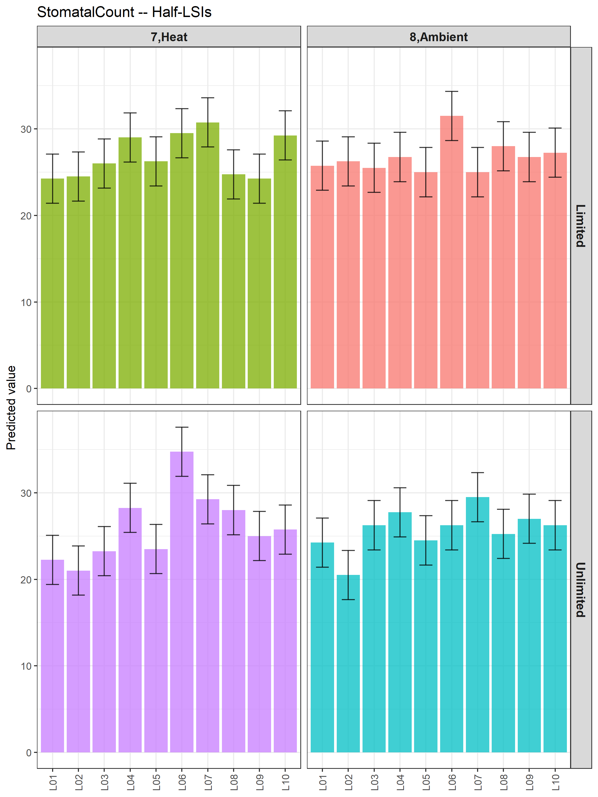

```


#### Results for StomatalDensity 


  Final model converged 


#### Formulae from asreml object

fixed: StomatalDensity ~ ASide/ABlock + Rm_Temperature/(AWatering * ALine +
     HWatering * HLine)
random: NULL
residual: ~ (dsum(~ units | Rm_Temperature))


####  Summary of the fitted variance parameters for StomatalDensity 

                           component std.error  z.ratio bound %ch
Rm_Temperature_7,Heat!R     39.48046  7.409081 5.328658     P   0
Rm_Temperature_8,Ambient!R  84.36620 15.552334 5.424665     P   0


####  Pseudo-anova table for fixed terms 


Wald tests for fixed effects.
Response: StomatalDensity

                               Df denDF  F.inc  F.con Margin     Pr
(Intercept)                     1 101.6 7756.0 7756.0        0.0000
ASide                           1 101.6    2.2    2.0      B 0.1586
ASide:ABlock                    2 101.7    5.7    6.0      C 0.0035
Rm_Temperature                  1 104.0    0.1    0.1      A 0.7795
Rm_Temperature:AWatering        1  58.9    0.9    0.9      B 0.3359
Rm_Temperature:ALine            9  58.9    0.9    0.9      B 0.5552
Rm_Temperature:AWatering:ALine  9  58.9    0.8    0.8      C 0.5940
Rm_Temperature:HWatering        1  56.8    0.9    1.1      B 0.3067
Rm_Temperature:HLine            9  56.8    7.1    7.1      B 0.0000
Rm_Temperature:HWatering:HLine  9  56.8    1.7    1.7      C 0.1123


####  Sequence of model investigations for StomatalDensity 

(If a row has NA for p but not denDF, DF and denDF relate to fixed and variance parameter numbers)

                                                                         terms DF denDF      p
1                                                                Initial model 43   1.0     NA
2  Start with residual heterogeneity in Watering & Rm_Temperature for Residual NA    NA     NA
3                               Try homogeneity in Rm_Temperature for Residual  0  -2.0     NA
4                                     Try homogeneity in Watering for Residual  0  -2.0     NA
5                                                                    Room:Side  1    NA     NA
6                                                           Room:Side:Location  1    NA     NA
7                                                   Room:Side:Location:SubUnit  1    NA     NA
8                                                Fix bound variance components  0   0.0     NA
9                                               Rm_Temperature:HWatering:HLine  9  56.8 0.1123
10                                                        Rm_Temperature:HLine  9  56.8 0.0000
11                                                    Rm_Temperature:HWatering  1  56.8 0.3067
12                                              Rm_Temperature:AWatering:ALine  9  58.9 0.5940
13                                                        Rm_Temperature:ALine  9  58.9 0.5552
14                                                    Rm_Temperature:AWatering  1  58.9 0.3359
          AIC        BIC           action
1  860.894764 995.926549   Starting model
2          NA         NA Changed residual
3    4.283150  -1.224031        Unswapped
4   -3.861354  -9.368534          Swapped
5          NA         NA         Boundary
6          NA         NA         Boundary
7          NA         NA         Boundary
8    0.000000   0.000000          Swapped
9          NA         NA   Nonsignificant
10         NA         NA      Significant
11         NA         NA   Nonsignificant
12         NA         NA   Nonsignificant
13         NA         NA   Nonsignificant
14         NA         NA   Nonsignificant

  Information criteria for spatial models 

NULL

Chosen terms
[1] "Rm_Temperature:HLine"

LSDs
          c   minLSD  meanLSD   maxLSD assignedLSD accuracyLSD falsePos falseNeg
overall 780 8.799917 11.05111 12.86387    11.05111   0.2037072       12       22
```

```
Joining with `by = join_by(Rm_Temperature, Watering, Line.ID)`
Joining with `by = join_by(Watering, Line.ID, Rm_Temperature)`
```


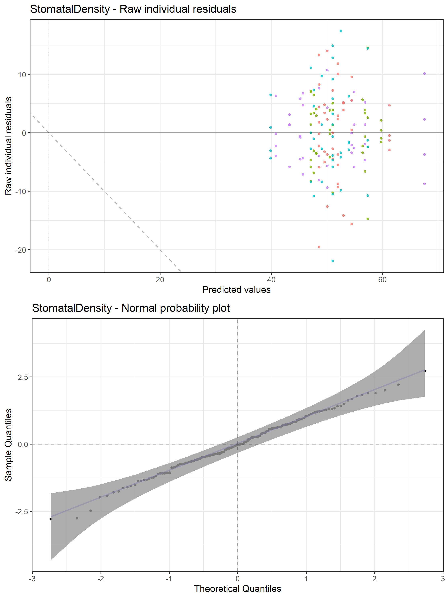


```


#### Results for StomatalArea 


  Final model converged 


#### Formulae from asreml object

fixed: StomatalArea ~ ASide/ABlock + Rm_Temperature/(AWatering * ALine +
     HWatering * HLine)
random: ~ Room:Side + Room:Side:Location:SubUnit +
     Room:Side:Location:SubUnit:Cell
residual: ~ (dsum(~ units | Rm_Temperature))


####  Summary of the fitted variance parameters for StomatalArea 

                                  component std.error    z.ratio bound %ch
Room:Side                          73.50967  2849.146  0.0258006     P   0
Room:Side:Location:SubUnit       4251.30086  3683.569  1.1541254     P   0
Room:Side:Location:SubUnit:Cell 27684.33016  4167.307  6.6432184     P   0
Rm_Temperature_7,Heat!R         80242.34575  2530.630 31.7084472     P   0
Rm_Temperature_8,Ambient!R      63677.22734  2003.859 31.7772984     P   0


####  Pseudo-anova table for fixed terms 


Wald tests for fixed effects.
Response: StomatalArea

                               Df denDF  F.inc  F.con Margin     Pr
(Intercept)                     1   1.0 5643.0 5643.0        0.0085
ASide                           1   1.0    2.7    2.6      B 0.3560
ASide:ABlock                    2   8.0    0.1    0.1      C 0.9477
Rm_Temperature                  1   1.0    0.4    0.4      A 0.6300
Rm_Temperature:AWatering        1   7.9    2.8    2.8      B 0.1332
Rm_Temperature:ALine            9 104.9    3.4    3.4      B 0.0010
Rm_Temperature:AWatering:ALine  9 104.9    1.6    1.6      C 0.1399
Rm_Temperature:HWatering        1   8.1    1.7    1.5      B 0.2523
Rm_Temperature:HLine            9 109.2    3.3    3.3      B 0.0013
Rm_Temperature:HWatering:HLine  9 109.3    0.3    0.3      C 0.9723


####  Sequence of model investigations for StomatalArea 

(If a row has NA for p but not denDF, DF and denDF relate to fixed and variance parameter numbers)

                                                                         terms DF denDF      p
1                                                                Initial model 43   4.0     NA
2  Start with residual heterogeneity in Watering & Rm_Temperature for Residual NA    NA     NA
3                               Try homogeneity in Rm_Temperature for Residual  0  -2.0     NA
4                                     Try homogeneity in Watering for Residual  0  -2.0     NA
5                                                           Room:Side:Location  1    NA     NA
6                                                Fix bound variance components  0   0.0     NA
7                                               Rm_Temperature:HWatering:HLine  9 109.3 0.9723
8                                                         Rm_Temperature:HLine  9 109.2 0.0013
9                                                     Rm_Temperature:HWatering  1   8.1 0.2523
10                                              Rm_Temperature:AWatering:ALine  9 104.9 0.1399
11                                                        Rm_Temperature:ALine  9 104.9 0.0010
12                                                    Rm_Temperature:AWatering  1   7.9 0.1332
            AIC         BIC           action
1  51482.844762 51780.83498   Starting model
2            NA          NA Changed residual
3     23.589533    10.92973        Unswapped
4     -3.121447   -15.78125          Swapped
5            NA          NA         Boundary
6      0.000000     0.00000          Swapped
7            NA          NA   Nonsignificant
8            NA          NA      Significant
9            NA          NA   Nonsignificant
10           NA          NA   Nonsignificant
11           NA          NA      Significant
12           NA          NA   Nonsignificant

  Information criteria for spatial models 

NULL

Chosen terms
[1] "Rm_Temperature:HLine" "Rm_Temperature:ALine"

LSDs
          c   minLSD  meanLSD   maxLSD assignedLSD accuracyLSD falsePos falseNeg
overall 780 239.5736 256.0375 279.8144    256.0375  0.09286501        5        1
```

```
Joining with `by = join_by(Rm_Temperature, Watering, Line.ID)`
Joining with `by = join_by(Watering, Line.ID, Rm_Temperature)`
```


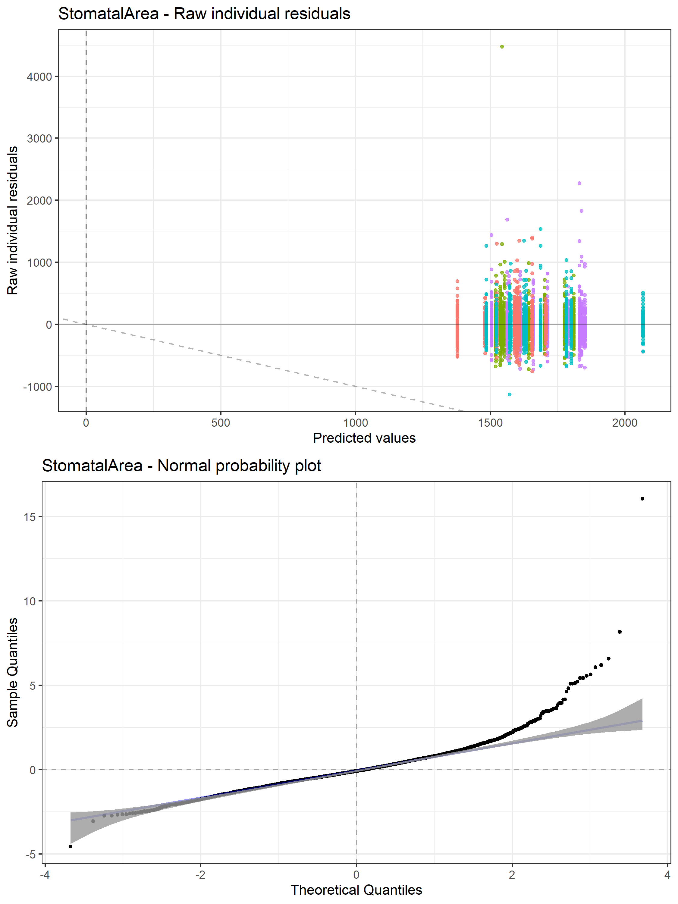

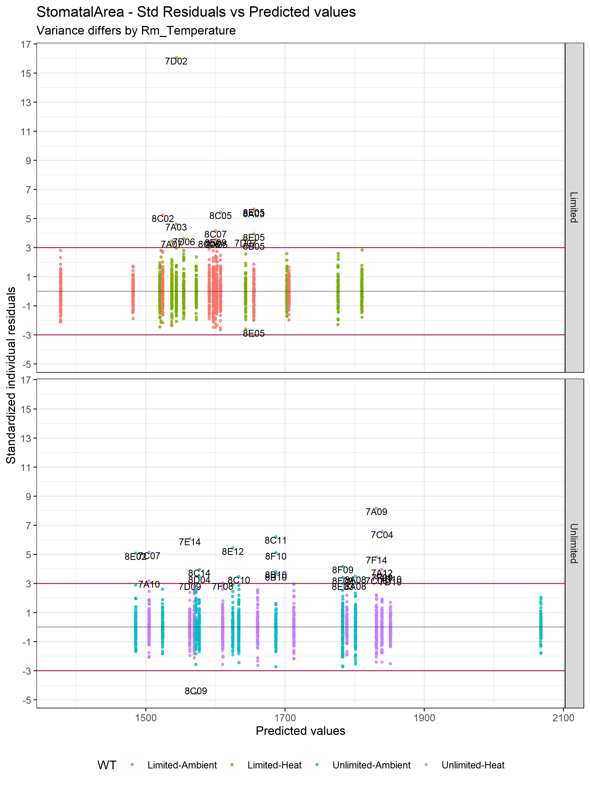

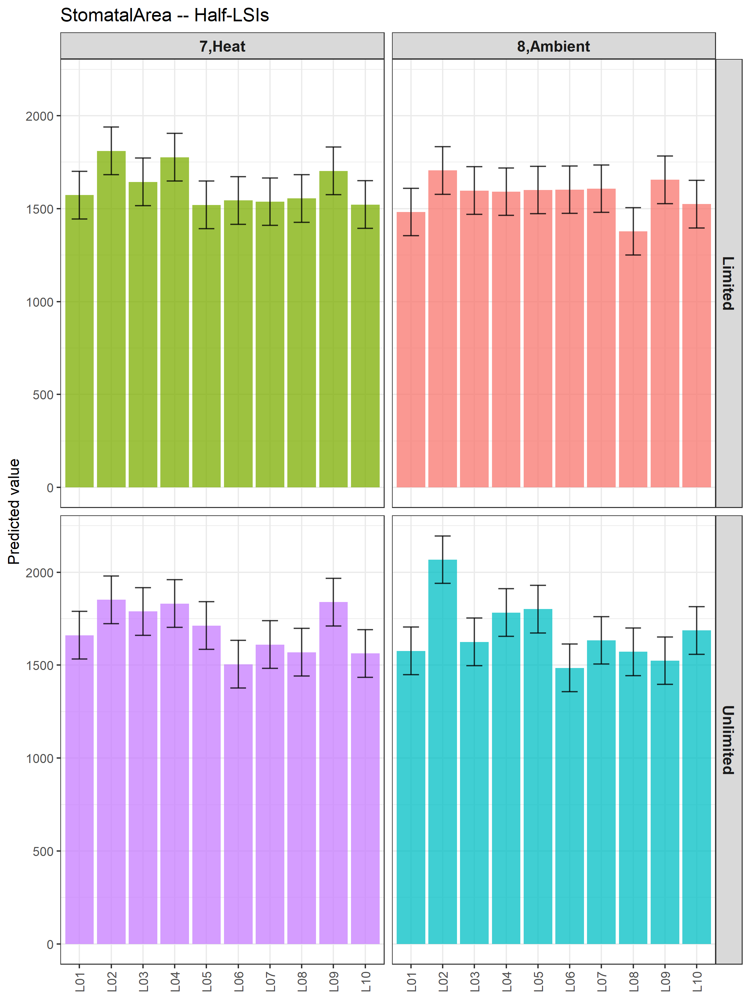

```


#### Results for StomatalWidth 


  Final model converged 


#### Formulae from asreml object

fixed: StomatalWidth ~ ASide/ABlock + Rm_Temperature/(AWatering * ALine +
     HWatering * HLine)
random: ~ Room:Side + Room:Side:Location:SubUnit +
     Room:Side:Location:SubUnit:Cell
residual: ~ dsum(~ units | WateringRm_Temperature)


####  Summary of the fitted variance parameters for StomatalWidth 

                                             component std.error    z.ratio bound %ch
Room:Side                                    0.1484938 0.5902575  0.2515746     P   0
Room:Side:Location:SubUnit                   0.1077919 0.5306323  0.2031386     P   0
Room:Side:Location:SubUnit:Cell              8.4966975 1.2553291  6.7685019     P   0
WateringRm_Temperature_Limited7,Heat!R      17.4083994 0.7763376 22.4237499     P   0
WateringRm_Temperature_Limited8,Ambient!R   15.6030113 0.6869376 22.7138713     P   0
WateringRm_Temperature_Unlimited7,Heat!R    19.0023201 0.8478592 22.4121182     P   0
WateringRm_Temperature_Unlimited8,Ambient!R 17.2784271 0.7774182 22.2253946     P   0


####  Pseudo-anova table for fixed terms 


Wald tests for fixed effects.
Response: StomatalWidth

                               Df denDF   F.inc   F.con Margin     Pr
(Intercept)                     1   1.0 11500.0 11500.0        0.0059
ASide                           1   1.0     2.4     2.2      B 0.3760
ASide:ABlock                    2   8.0     0.1     0.1      C 0.9133
Rm_Temperature                  1   1.0     0.3     0.3      A 0.6759
Rm_Temperature:AWatering        1   7.9     8.4     8.4      B 0.0200
Rm_Temperature:ALine            9 106.1     2.4     2.4      B 0.0160
Rm_Temperature:AWatering:ALine  9 106.1     2.3     2.3      C 0.0207
Rm_Temperature:HWatering        1   8.1     7.5     6.7      B 0.0322
Rm_Temperature:HLine            9 107.6     3.2     3.2      B 0.0019
Rm_Temperature:HWatering:HLine  9 107.7     0.3     0.3      C 0.9776


####  Sequence of model investigations for StomatalWidth 

(If a row has NA for p but not denDF, DF and denDF relate to fixed and variance parameter numbers)

                                                                         terms DF denDF      p
1                                                                Initial model 43   4.0     NA
2  Start with residual heterogeneity in Watering & Rm_Temperature for Residual NA    NA     NA
3                               Try homogeneity in Rm_Temperature for Residual  0  -2.0     NA
4                                     Try homogeneity in Watering for Residual  0  -2.0     NA
5                                                           Room:Side:Location  1    NA     NA
6                                                Fix bound variance components  0   0.0     NA
7                                               Rm_Temperature:HWatering:HLine  9 107.7 0.9776
8                                                         Rm_Temperature:HLine  9 107.6 0.0019
9                                                     Rm_Temperature:HWatering  1   8.1 0.0322
10                                              Rm_Temperature:AWatering:ALine  9 106.1 0.0207
            AIC         BIC           action
1  1.660484e+04 16902.82530   Starting model
2            NA          NA Changed residual
3  1.303480e+00   -11.35632        Unswapped
4  5.531296e-01   -12.10667        Unswapped
5            NA          NA         Boundary
6  0.000000e+00     0.00000          Swapped
7            NA          NA   Nonsignificant
8            NA          NA      Significant
9            NA          NA      Significant
10           NA          NA      Significant

  Information criteria for spatial models 

NULL

Chosen terms
[1] "Rm_Temperature:HLine"           "Rm_Temperature:HWatering"      
[3] "Rm_Temperature:AWatering:ALine"

LSDs
          c   minLSD meanLSD   maxLSD assignedLSD accuracyLSD falsePos falseNeg
overall 780 4.166099 4.27011 4.640635     4.27011  0.08677171        4        0
```

```
Joining with `by = join_by(Rm_Temperature, Watering, Line.ID)`
Joining with `by = join_by(Watering, Line.ID, Rm_Temperature)`
```


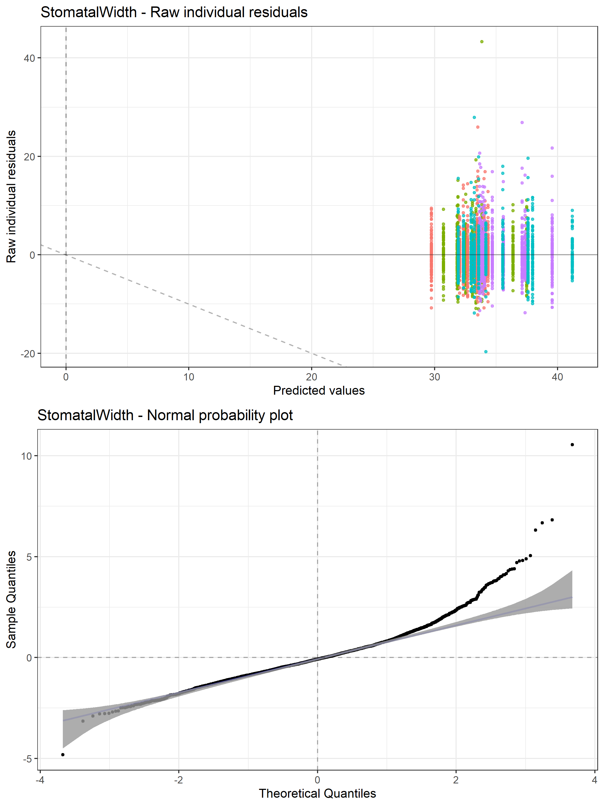

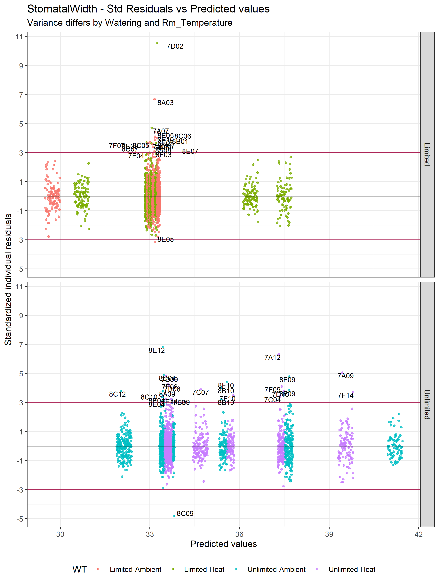

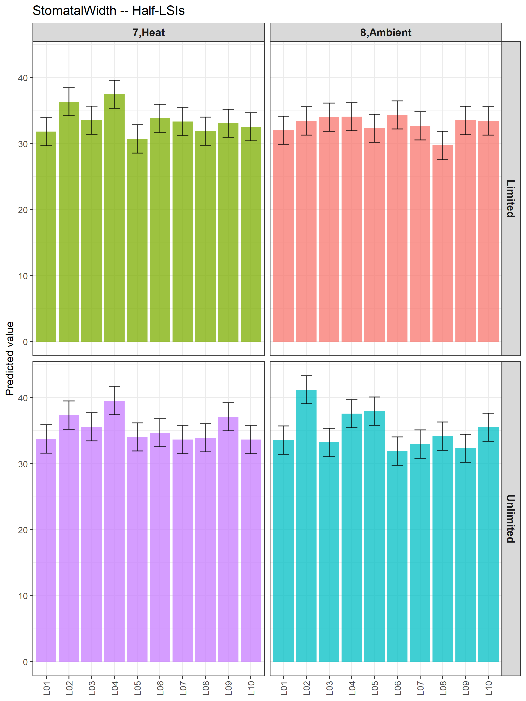

```


#### Results for StomatalLength 


  Final model converged 


#### Formulae from asreml object

fixed: StomatalLength ~ ASide/ABlock + Rm_Temperature/(AWatering * ALine +
     HWatering * HLine)
random: ~ Room:Side:Location + Room:Side:Location:SubUnit +
     Room:Side:Location:SubUnit:Cell
residual: ~ dsum(~ units | WateringRm_Temperature)


####  Summary of the fitted variance parameters for StomatalLength 

                                              component std.error    z.ratio bound %ch
Room:Side:Location                           0.09595782  1.723767  0.0556675     P   0
Room:Side:Location:SubUnit                   1.39560309  1.936181  0.7208019     P   0
Room:Side:Location:SubUnit:Cell             17.66577639  2.620247  6.7420269     P   0
WateringRm_Temperature_Limited7,Heat!R      51.79731433  2.310253 22.4206245     P   0
WateringRm_Temperature_Limited8,Ambient!R   36.03829178  1.587711 22.6982704     P   0
WateringRm_Temperature_Unlimited7,Heat!R    33.61434186  1.499633 22.4150417     P   0
WateringRm_Temperature_Unlimited8,Ambient!R 33.48591790  1.505128 22.2478926     P   0


####  Pseudo-anova table for fixed terms 


Wald tests for fixed effects.
Response: StomatalLength

                               Df denDF   F.inc   F.con Margin     Pr
(Intercept)                     1   3.0 17670.0 17670.0        0.0000
ASide                           1   3.0     0.3     0.3      B 0.6115
ASide:ABlock                    2   3.0     0.6     0.6      C 0.6007
Rm_Temperature                  1   3.0     0.3     0.3      A 0.6352
Rm_Temperature:AWatering        1   5.9     0.1     0.1      B 0.8285
Rm_Temperature:ALine            9 105.5     1.5     1.5      B 0.1748
Rm_Temperature:AWatering:ALine  9 105.5     0.5     0.5      C 0.8681
Rm_Temperature:HWatering        1   6.1     0.1     0.1      B 0.7591
Rm_Temperature:HLine            9 108.6     3.2     3.2      B 0.0019
Rm_Temperature:HWatering:HLine  9 108.8     0.5     0.5      C 0.8885


####  Sequence of model investigations for StomatalLength 

(If a row has NA for p but not denDF, DF and denDF relate to fixed and variance parameter numbers)

                                                                         terms DF denDF      p
1                                                                Initial model 43   4.0     NA
2  Start with residual heterogeneity in Watering & Rm_Temperature for Residual NA    NA     NA
3                               Try homogeneity in Rm_Temperature for Residual  0  -2.0     NA
4                                     Try homogeneity in Watering for Residual  0  -2.0     NA
5                                                                    Room:Side  1    NA     NA
6                                                Fix bound variance components  0   0.0     NA
7                                               Rm_Temperature:HWatering:HLine  9 108.8 0.8885
8                                                         Rm_Temperature:HLine  9 108.6 0.0019
9                                                     Rm_Temperature:HWatering  1   6.1 0.7591
10                                              Rm_Temperature:AWatering:ALine  9 105.5 0.8681
11                                                        Rm_Temperature:ALine  9 105.5 0.1748
12                                                    Rm_Temperature:AWatering  1   5.9 0.8285
           AIC         BIC           action
1  19973.47943 20271.46964   Starting model
2           NA          NA Changed residual
3     29.34297    16.68317        Unswapped
4     44.00225    31.34245        Unswapped
5           NA          NA         Boundary
6      0.00000     0.00000          Swapped
7           NA          NA   Nonsignificant
8           NA          NA      Significant
9           NA          NA   Nonsignificant
10          NA          NA   Nonsignificant
11          NA          NA   Nonsignificant
12          NA          NA   Nonsignificant

  Information criteria for spatial models 

NULL

Chosen terms
[1] "Rm_Temperature:HLine"

LSDs
          c   minLSD  meanLSD   maxLSD assignedLSD accuracyLSD falsePos falseNeg
overall 780 6.000523 6.271869 6.838396    6.271869  0.09032831        0        0
```

```
Joining with `by = join_by(Rm_Temperature, Watering, Line.ID)`
Joining with `by = join_by(Watering, Line.ID, Rm_Temperature)`
```


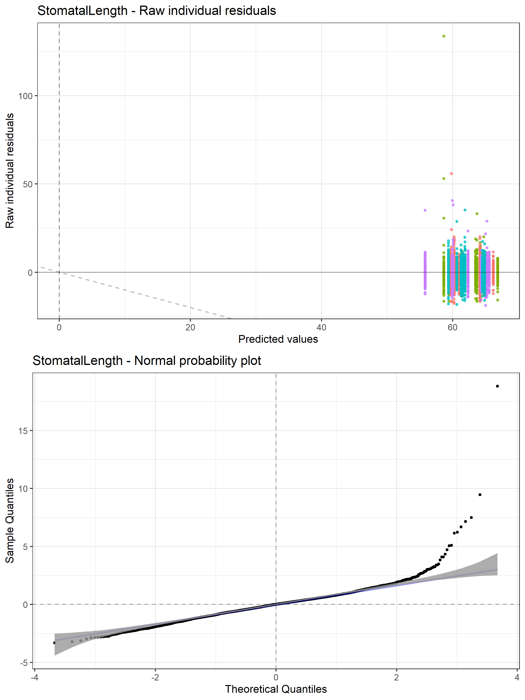

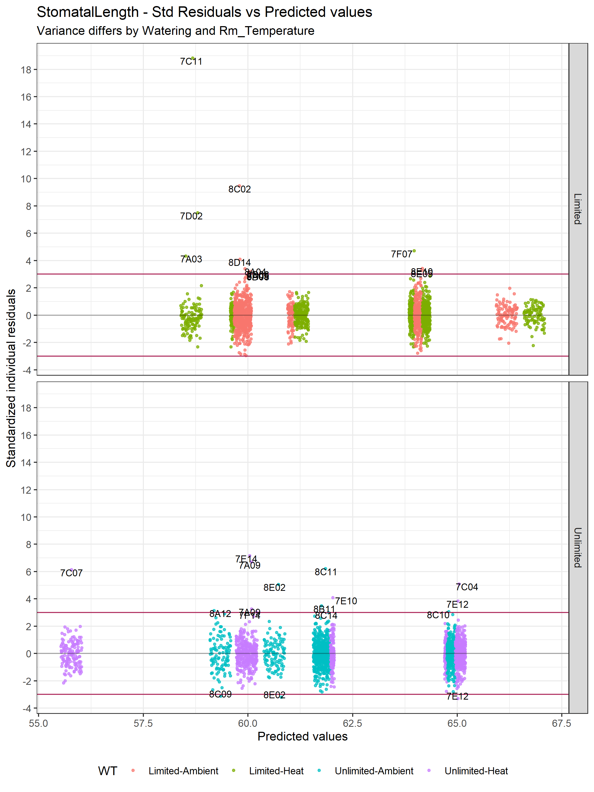

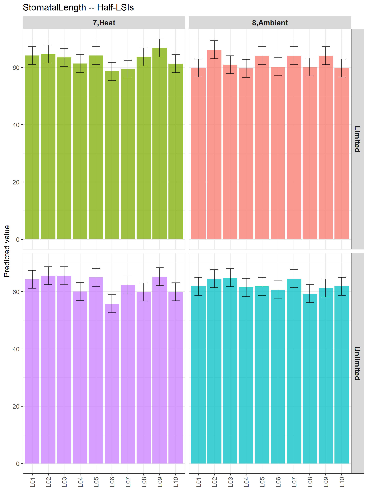

```


#### Results for PoreArea 


  Final model converged 


#### Formulae from asreml object

fixed: PoreArea ~ ASide/ABlock + Rm_Temperature/(AWatering * ALine + HWatering *
     HLine)
random: ~ Room:Side:Location + Room:Side:Location:SubUnit +
     Room:Side:Location:SubUnit:Cell
residual: ~ dsum(~ units | WateringRm_Temperature)


####  Summary of the fitted variance parameters for PoreArea 

                                             component std.error    z.ratio bound %ch
Room:Side:Location                            143.8787  1391.887  0.1033695     P   0
Room:Side:Location:SubUnit                   1063.3596  1513.633  0.7025212     P   0
Room:Side:Location:SubUnit:Cell             13603.3456  2084.202  6.5268835     P   0
WateringRm_Temperature_Limited7,Heat!R      91606.4979  4083.603 22.4327622     P   0
WateringRm_Temperature_Limited8,Ambient!R   32017.5582  1410.684 22.6964752     P   0
WateringRm_Temperature_Unlimited7,Heat!R    29987.3433  1337.760 22.4160790     P   0
WateringRm_Temperature_Unlimited8,Ambient!R 28782.4611  1293.710 22.2479966     P   0


####  Pseudo-anova table for fixed terms 


Wald tests for fixed effects.
Response: PoreArea

                               Df denDF  F.inc  F.con Margin     Pr
(Intercept)                     1   3.0 4601.0 4601.0        0.0000
ASide                           1   3.0    0.3    0.3      B 0.6178
ASide:ABlock                    2   3.0    0.6    0.6      C 0.6088
Rm_Temperature                  1   3.0    0.3    0.3      A 0.6445
Rm_Temperature:AWatering        1   5.8    0.0    0.0      B 0.8574
Rm_Temperature:ALine            9 100.8    1.4    1.4      B 0.2080
Rm_Temperature:AWatering:ALine  9 100.8    0.6    0.6      C 0.8095
Rm_Temperature:HWatering        1   6.4    0.2    0.2      B 0.7024
Rm_Temperature:HLine            9 114.3    2.8    2.8      B 0.0046
Rm_Temperature:HWatering:HLine  9 117.2    0.6    0.6      C 0.7924


####  Sequence of model investigations for PoreArea 

(If a row has NA for p but not denDF, DF and denDF relate to fixed and variance parameter numbers)

                                                                         terms DF denDF      p
1                                                                Initial model 43   4.0     NA
2  Start with residual heterogeneity in Watering & Rm_Temperature for Residual NA    NA     NA
3                               Try homogeneity in Rm_Temperature for Residual  0  -2.0     NA
4                                     Try homogeneity in Watering for Residual  0  -2.0     NA
5                                                                    Room:Side  1    NA     NA
6                                                Fix bound variance components  0   0.0     NA
7                                               Rm_Temperature:HWatering:HLine  9 117.2 0.7924
8                                                         Rm_Temperature:HLine  9 114.3 0.0046
9                                                     Rm_Temperature:HWatering  1   6.4 0.7024
10                                              Rm_Temperature:AWatering:ALine  9 100.8 0.8095
11                                                        Rm_Temperature:ALine  9 100.8 0.2080
12                                                    Rm_Temperature:AWatering  1   5.8 0.8574
          AIC        BIC           action
1  49530.2771 49828.2674   Starting model
2          NA         NA Changed residual
3    266.5488   253.8890        Unswapped
4    297.5733   284.9135        Unswapped
5          NA         NA         Boundary
6      0.0000     0.0000          Swapped
7          NA         NA   Nonsignificant
8          NA         NA      Significant
9          NA         NA   Nonsignificant
10         NA         NA   Nonsignificant
11         NA         NA   Nonsignificant
12         NA         NA   Nonsignificant

  Information criteria for spatial models 

NULL

Chosen terms
[1] "Rm_Temperature:HLine"

LSDs
          c   minLSD  meanLSD   maxLSD assignedLSD accuracyLSD falsePos falseNeg
overall 780 167.2631 177.5638 196.4971    177.5638    0.106628        2        2
```

```
Joining with `by = join_by(Rm_Temperature, Watering, Line.ID)`
Joining with `by = join_by(Watering, Line.ID, Rm_Temperature)`
```


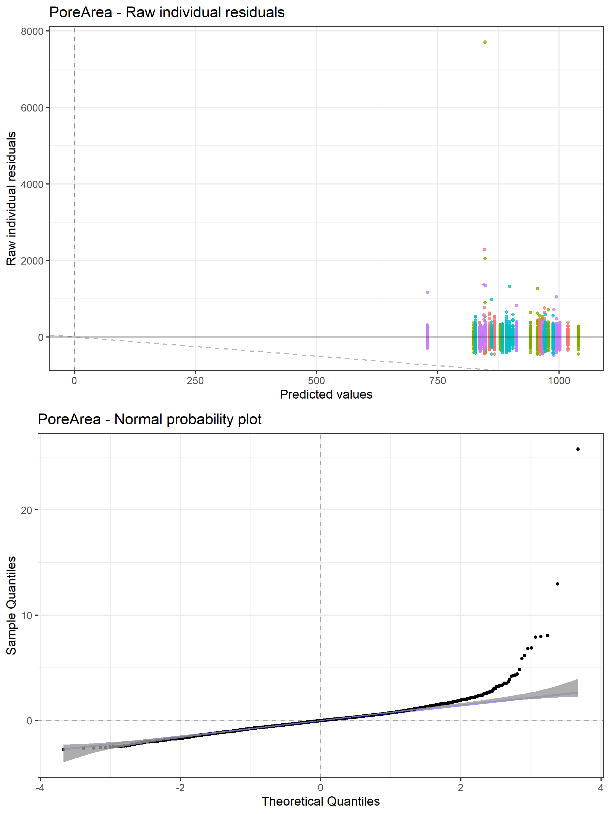

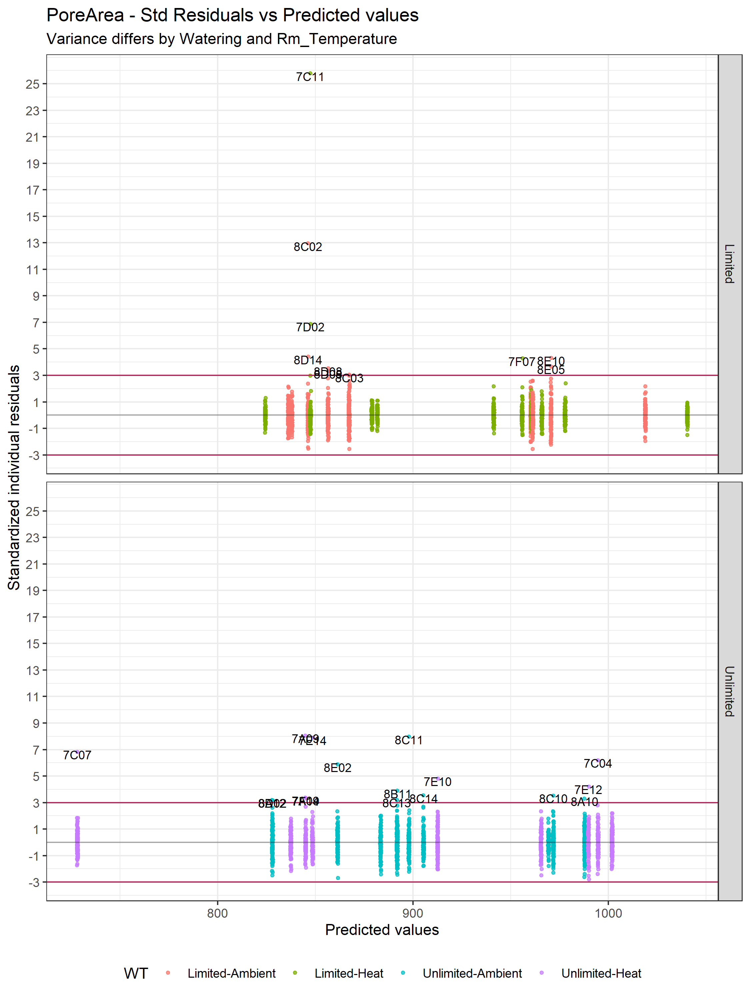

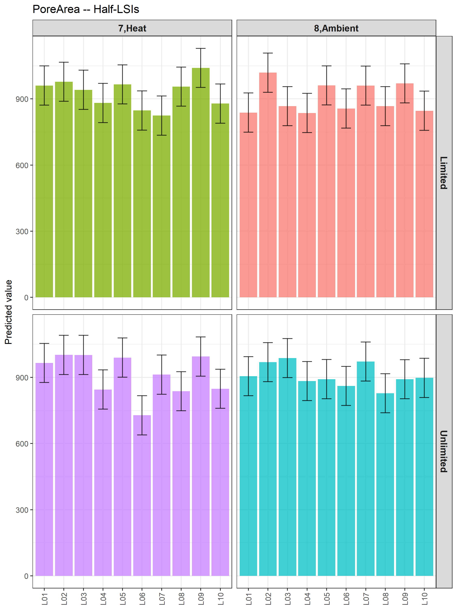

```


#### Results for gsmax 


  Final model converged 


#### Formulae from asreml object

fixed: gsmax ~ ASide/ABlock + Rm_Temperature/(AWatering * ALine + HWatering *
     HLine)
random: ~ Room:Side:Location
residual: NULL


####  Summary of the fitted variance parameters for gsmax 

                      component   std.error   z.ratio bound %ch
Room:Side:Location 0.0008122171 0.002065471 0.3932358     P   0
units!R            0.0336374469 0.004475327 7.5161981     P   0


####  Pseudo-anova table for fixed terms 


Wald tests for fixed effects.
Response: gsmax

                               Df denDF  F.inc  F.con Margin     Pr
(Intercept)                     1     3 5752.0 5752.0        0.0000
ASide                           1     3    3.1    3.0      B 0.1826
ASide:ABlock                    2     3    3.8    3.9      C 0.1468
Rm_Temperature                  1     3    0.4    0.4      A 0.5767
Rm_Temperature:AWatering        1   113    1.3    1.3      B 0.2581
Rm_Temperature:ALine            9   113    1.1    1.1      B 0.3636
Rm_Temperature:AWatering:ALine  9   113    1.8    1.8      C 0.0777
Rm_Temperature:HWatering        1   113    1.4    1.6      B 0.2153
Rm_Temperature:HLine            9   113    2.5    2.5      B 0.0106
Rm_Temperature:HWatering:HLine  9   113    0.7    0.7      C 0.7318


####  Sequence of model investigations for gsmax 

(If a row has NA for p but not denDF, DF and denDF relate to fixed and variance parameter numbers)

                                                                         terms DF denDF      p
1                                                                Initial model 43     2     NA
2  Start with residual heterogeneity in Watering & Rm_Temperature for Residual NA    NA     NA
3                               Try homogeneity in Rm_Temperature for Residual  0    -2     NA
4                    Try homogeneity in Watering & Rm_Temperature for Residual  0    -1     NA
5                                                                    Room:Side  1    NA     NA
6                                                   Room:Side:Location:SubUnit  1    NA     NA
7                                                Fix bound variance components  0     0     NA
8                                               Rm_Temperature:HWatering:HLine  9   113 0.7318
9                                                         Rm_Temperature:HLine  9   113 0.0106
10                                                    Rm_Temperature:HWatering  1   113 0.2153
11                                              Rm_Temperature:AWatering:ALine  9   113 0.0777
12                                                        Rm_Temperature:ALine  9   113 0.3636
13                                                    Rm_Temperature:AWatering  1   113 0.2581
           AIC         BIC           action
1  -330.210392 -192.109703   Starting model
2           NA          NA Changed residual
3    -1.238629   -6.745809          Swapped
4    -1.724391   -4.477981          Swapped
5           NA          NA         Boundary
6           NA          NA         Boundary
7     0.000000    0.000000          Swapped
8           NA          NA   Nonsignificant
9           NA          NA      Significant
10          NA          NA   Nonsignificant
11          NA          NA   Nonsignificant
12          NA          NA   Nonsignificant
13          NA          NA   Nonsignificant

  Information criteria for spatial models 

NULL

Chosen terms
[1] "Rm_Temperature:HLine"

LSDs
          c    minLSD   meanLSD  maxLSD assignedLSD accuracyLSD falsePos falseNeg
overall 780 0.2568615 0.2595447 0.28097   0.2595447  0.08254961        1        3
```

```
Joining with `by = join_by(Rm_Temperature, Watering, Line.ID)`
Joining with `by = join_by(Watering, Line.ID, Rm_Temperature)`
```


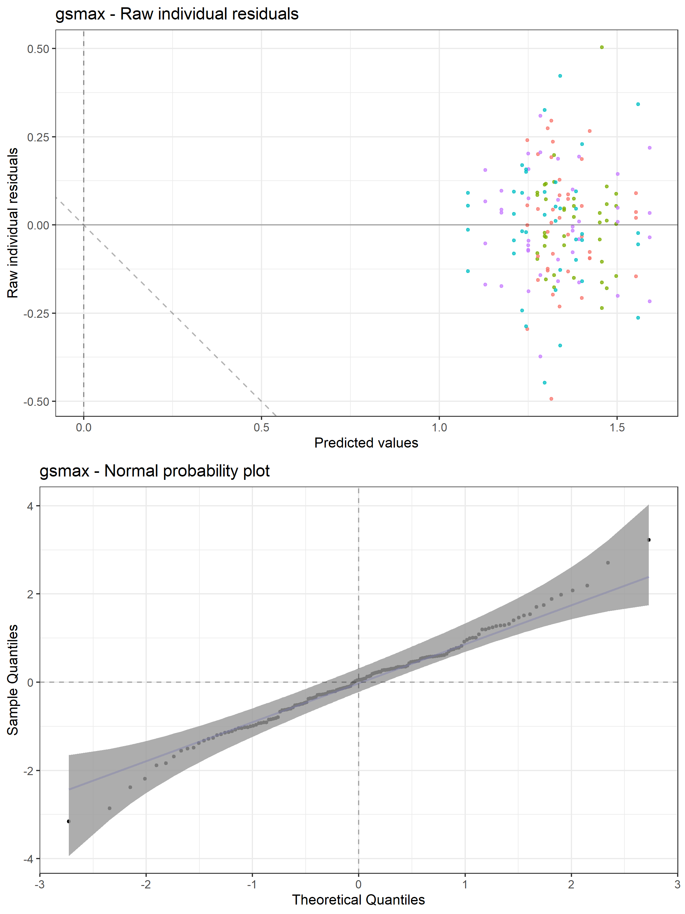


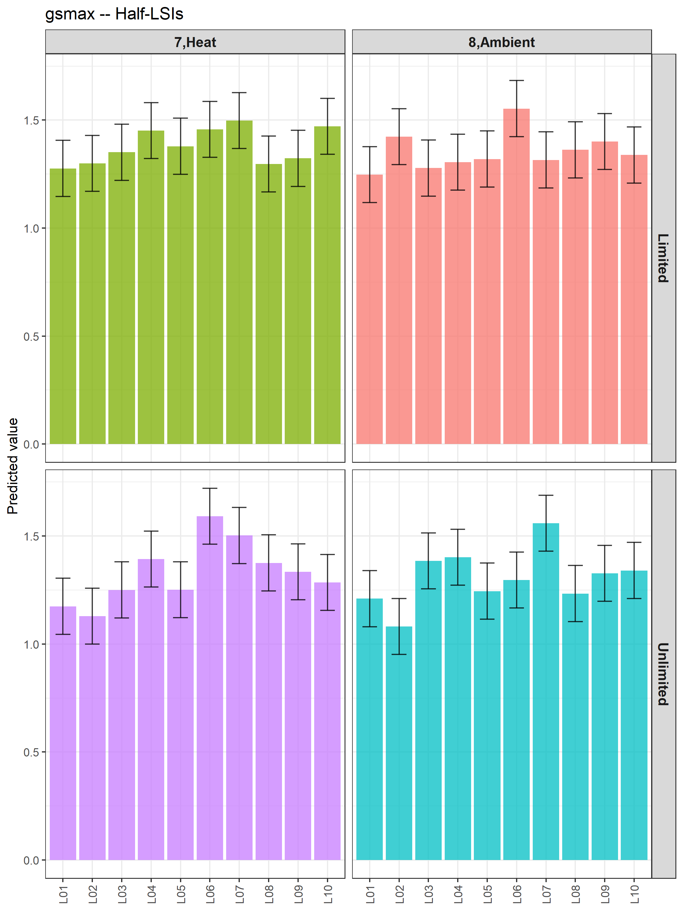

## MODEL SUMMARIES
### Wald tables


``` r
for (resp in responses.anat[kvec]) {
  tbl <- models[[resp]]$wald.tab[-1,]
  cat("\n\n", resp)
  print(kable(tbl, digits = 3))
}
```

```


 StomatalCount

|                               | Df| denDF| F.inc| F.con|Margin |    Pr|
|:------------------------------|--:|-----:|-----:|-----:|:------|-----:|
|ASide                          |  1| 101.6| 2.202| 2.017|B      | 0.159|
|ASide:ABlock                   |  2| 101.7| 5.658| 5.984|C      | 0.003|
|Rm_Temperature                 |  1| 104.0| 0.079| 0.079|A      | 0.779|
|Rm_Temperature:AWatering       |  1|  58.9| 0.942| 0.942|B      | 0.336|
|Rm_Temperature:ALine           |  9|  58.9| 0.872| 0.872|B      | 0.555|
|Rm_Temperature:AWatering:ALine |  9|  58.9| 0.827| 0.827|C      | 0.594|
|Rm_Temperature:HWatering       |  1|  56.8| 0.910| 1.064|B      | 0.307|
|Rm_Temperature:HLine           |  9|  56.8| 7.074| 7.074|B      | 0.000|
|Rm_Temperature:HWatering:HLine |  9|  56.8| 1.692| 1.692|C      | 0.112|


 StomatalDensity

|                               | Df| denDF| F.inc| F.con|Margin |    Pr|
|:------------------------------|--:|-----:|-----:|-----:|:------|-----:|
|ASide                          |  1| 101.6| 2.202| 2.017|B      | 0.159|
|ASide:ABlock                   |  2| 101.7| 5.658| 5.984|C      | 0.003|
|Rm_Temperature                 |  1| 104.0| 0.079| 0.079|A      | 0.779|
|Rm_Temperature:AWatering       |  1|  58.9| 0.942| 0.942|B      | 0.336|
|Rm_Temperature:ALine           |  9|  58.9| 0.872| 0.872|B      | 0.555|
|Rm_Temperature:AWatering:ALine |  9|  58.9| 0.827| 0.827|C      | 0.594|
|Rm_Temperature:HWatering       |  1|  56.8| 0.910| 1.064|B      | 0.307|
|Rm_Temperature:HLine           |  9|  56.8| 7.074| 7.074|B      | 0.000|
|Rm_Temperature:HWatering:HLine |  9|  56.8| 1.692| 1.692|C      | 0.112|


 StomatalArea

|                               | Df| denDF| F.inc| F.con|Margin |    Pr|
|:------------------------------|--:|-----:|-----:|-----:|:------|-----:|
|ASide                          |  1|   1.0| 2.702| 2.554|B      | 0.356|
|ASide:ABlock                   |  2|   8.0| 0.052| 0.054|C      | 0.948|
|Rm_Temperature                 |  1|   1.0| 0.431| 0.431|A      | 0.630|
|Rm_Temperature:AWatering       |  1|   7.9| 2.788| 2.801|B      | 0.133|
|Rm_Temperature:ALine           |  9| 104.9| 3.438| 3.438|B      | 0.001|
|Rm_Temperature:AWatering:ALine |  9| 104.9| 1.551| 1.551|C      | 0.140|
|Rm_Temperature:HWatering       |  1|   8.1| 1.671| 1.519|B      | 0.252|
|Rm_Temperature:HLine           |  9| 109.2| 3.321| 3.321|B      | 0.001|
|Rm_Temperature:HWatering:HLine |  9| 109.3| 0.303| 0.303|C      | 0.972|


 StomatalWidth

|                               | Df| denDF| F.inc| F.con|Margin |    Pr|
|:------------------------------|--:|-----:|-----:|-----:|:------|-----:|
|ASide                          |  1|   1.0| 2.405| 2.225|B      | 0.376|
|ASide:ABlock                   |  2|   8.0| 0.065| 0.092|C      | 0.913|
|Rm_Temperature                 |  1|   1.0| 0.312| 0.312|A      | 0.676|
|Rm_Temperature:AWatering       |  1|   7.9| 8.409| 8.446|B      | 0.020|
|Rm_Temperature:ALine           |  9| 106.1| 2.405| 2.404|B      | 0.016|
|Rm_Temperature:AWatering:ALine |  9| 106.1| 2.308| 2.308|C      | 0.021|
|Rm_Temperature:HWatering       |  1|   8.1| 7.487| 6.668|B      | 0.032|
|Rm_Temperature:HLine           |  9| 107.6| 3.178| 3.178|B      | 0.002|
|Rm_Temperature:HWatering:HLine |  9| 107.7| 0.285| 0.285|C      | 0.978|


 StomatalLength

|                               | Df| denDF| F.inc| F.con|Margin |    Pr|
|:------------------------------|--:|-----:|-----:|-----:|:------|-----:|
|ASide                          |  1|   3.0| 0.315| 0.319|B      | 0.611|
|ASide:ABlock                   |  2|   3.0| 0.600| 0.607|C      | 0.601|
|Rm_Temperature                 |  1|   3.0| 0.277| 0.277|A      | 0.635|
|Rm_Temperature:AWatering       |  1|   5.9| 0.052| 0.051|B      | 0.828|
|Rm_Temperature:ALine           |  9| 105.5| 1.454| 1.454|B      | 0.175|
|Rm_Temperature:AWatering:ALine |  9| 105.5| 0.505| 0.505|C      | 0.868|
|Rm_Temperature:HWatering       |  1|   6.1| 0.133| 0.103|B      | 0.759|
|Rm_Temperature:HLine           |  9| 108.6| 3.176| 3.176|B      | 0.002|
|Rm_Temperature:HWatering:HLine |  9| 108.8| 0.475| 0.475|C      | 0.889|


 PoreArea

|                               | Df| denDF| F.inc| F.con|Margin |    Pr|
|:------------------------------|--:|-----:|-----:|-----:|:------|-----:|
|ASide                          |  1|   3.0| 0.305| 0.308|B      | 0.618|
|ASide:ABlock                   |  2|   3.0| 0.582| 0.588|C      | 0.609|
|Rm_Temperature                 |  1|   3.0| 0.261| 0.261|A      | 0.644|
|Rm_Temperature:AWatering       |  1|   5.8| 0.036| 0.035|B      | 0.857|
|Rm_Temperature:ALine           |  9| 100.8| 1.378| 1.378|B      | 0.208|
|Rm_Temperature:AWatering:ALine |  9| 100.8| 0.582| 0.582|C      | 0.810|
|Rm_Temperature:HWatering       |  1|   6.4| 0.189| 0.160|B      | 0.702|
|Rm_Temperature:HLine           |  9| 114.3| 2.849| 2.849|B      | 0.005|
|Rm_Temperature:HWatering:HLine |  9| 117.2| 0.603| 0.603|C      | 0.792|


 gsmax

|                               | Df| denDF| F.inc| F.con|Margin |    Pr|
|:------------------------------|--:|-----:|-----:|-----:|:------|-----:|
|ASide                          |  1|     3| 3.103| 2.983|B      | 0.183|
|ASide:ABlock                   |  2|     3| 3.770| 3.891|C      | 0.147|
|Rm_Temperature                 |  1|     3| 0.390| 0.390|A      | 0.577|
|Rm_Temperature:AWatering       |  1|   113| 1.292| 1.292|B      | 0.258|
|Rm_Temperature:ALine           |  9|   113| 1.107| 1.107|B      | 0.364|
|Rm_Temperature:AWatering:ALine |  9|   113| 1.790| 1.790|C      | 0.078|
|Rm_Temperature:HWatering       |  1|   113| 1.450| 1.553|B      | 0.215|
|Rm_Temperature:HLine           |  9|   113| 2.546| 2.546|B      | 0.011|
|Rm_Temperature:HWatering:HLine |  9|   113| 0.673| 0.673|C      | 0.732|
```

### Chosen terms


``` r
tableChosenModels(models, responses.anat)
```

```
  Trait          
1 StomatalCount  
2 StomatalDensity
3 StomatalArea   
4 StomatalWidth  
5 StomatalLength 
6 PoreArea       
7 gsmax          
  Chosen.model                                                                    
1 Rm_Temperature:HLine                                                            
2 Rm_Temperature:HLine                                                            
3 Rm_Temperature:HLine + Rm_Temperature:ALine                                     
4 Rm_Temperature:HLine + Rm_Temperature:HWatering + Rm_Temperature:AWatering:ALine
5 Rm_Temperature:HLine                                                            
6 Rm_Temperature:HLine                                                            
7 Rm_Temperature:HLine                                                            
```

### Table the residual variances


``` r
tableVarModels(models, responses.anat)
```

```
  Trait           Variance.model                                 
1 StomatalCount   Variance differs by Rm_Temperature             
2 StomatalDensity Variance differs by Rm_Temperature             
3 StomatalArea    Variance differs by Rm_Temperature             
4 StomatalWidth   Variance differs by Watering and Rm_Temperature
5 StomatalLength  Variance differs by Watering and Rm_Temperature
6 PoreArea        Variance differs by Watering and Rm_Temperature
7 gsmax           Homogeneous variance                           
```

## Extremal residuals


``` r
typelabls <- c("Anat")
resptlabs <- rep(typelabls,
                 times = length(responses.anat))
print(cbind(responses.anat, resptlabs), quote=F)
```

```
     responses.anat  resptlabs
[1,] StomatalCount   Anat     
[2,] StomatalDensity Anat     
[3,] StomatalArea    Anat     
[4,] StomatalWidth   Anat     
[5,] StomatalLength  Anat     
[6,] PoreArea        Anat     
[7,] gsmax           Anat     
```

``` r
res.lim.label <- 5
Outliers.dat <- data.frame()
tbl <- data.frame()
for (resp in responses.anat[kvec]) 
{
  if(resp %in% responses.pot){
    tmp.dat <- models[[resp]]$asreml.obj$call$data
    res.dat <- within(tmp.dat, res.std <- residuals(models[[resp]]$asreml.obj, type="stdCond"))
    res.dat <- res.dat[!is.na(res.dat$res.std), ]
    outliers.dat <- subset(res.dat, abs(res.std) > res.lim.label)
    outliers.dat <- outliers.dat[c("Cell.ID", "res.std", "Rm_Temperature", 
                                   "Watering", "Line")]
    if (nrow(outliers.dat) > 0)
    { 
      Outliers.dat <- rbind(Outliers.dat,
                            data.frame(Response=resp, outliers.dat))
      tbl <- rbind(tbl,
                   data.frame(Response = resp, 
                              n        = nrow(outliers.dat),
                              rmin     = min(res.dat$res.std, na.rm=T),
                              rmax     = max(res.dat$res.std, na.rm=T)))
    }
  } else{
    tmp.dat <- models[[resp]]$asreml.obj$call$data
    res.dat <- within(tmp.dat, res.std <- residuals(models[[resp]]$asreml.obj, type="stdCond"))
    res.dat <- res.dat[!is.na(res.dat$res.std), ]
    outliers.dat <- subset(res.dat, abs(res.std) > res.lim.label)
    outliers.dat <- outliers.dat[c("Cell.ID", "Stomata", "res.std", "Rm_Temperature", 
                                   "Watering", "Line")]
    if (nrow(outliers.dat) > 0)
    { 
      Outliers.dat <- rbind(Outliers.dat,
                            data.frame(Response=resp, outliers.dat))
      tbl <- rbind(tbl,
                   data.frame(Response = resp, 
                              n        = nrow(outliers.dat),
                              rmin     = min(res.dat$res.std, na.rm=T),
                              rmax     = max(res.dat$res.std, na.rm=T)))
    }
  }
}

if (nrow(Outliers.dat)==0) {
  
  cat("\n\n #### No outliers found\n\n")
  
} else {
  
  Outliers.dat <- with(Outliers.dat, Outliers.dat[order(Cell.ID, Stomata, Response),])
  Outliers.dat <- within(Outliers.dat, res <- round(res.std,2))
  tmp.dat <- Outliers.dat[c("Cell.ID","Stomata", "res","Response", "Rm_Temperature", 
                            "Watering", "Line")]
  names(tmp.dat)[1] <- c("Plant")
  outliers.dat <- unique(tmp.dat[,-(3:4)])
  tbl <- within(tbl, {
    rmin <- ifelse(rmin < 0, round(rmin,2), NA)
    rmax <- ifelse(rmax > 0, round(rmax,2), NA)
  })
  
  msg1 <- paste("Standardised residuals outside the range (-",
                res.lim.label, ", ",res.lim.label,")",
                sep="")
  msg2 <- "Unique plants in outlier list"
  
  cat("\n\n #### Number of outliers per response\n\n"); print(tbl, right=F)
  cat("\n\n",msg1,"\n\n"); print(tmp.dat, right=F)
  cat("\n\n",msg2,"\n\n"); print(outliers.dat, right=F)
  
  tmp2.dat <- within(tmp.dat, {
    Magnitude <- abs(res)
    Direction <- factor(sign(res), levels = c(1,-1), labels = c("pos","neg"))
    Response <- factor(Response, levels = responses.anat)
    Resptype <- dae::fac.recode(Response, newlevels = resptlabs, levels = rev(typelabls))
  })
  
  lims <- c(res.lim.label,
            max(4, 0.5*ceiling(max(tmp2.dat$Magnitude)/0.5)))  #round to nearest half
  plt <- ggplot(tmp2.dat, aes(Plant, as.character(Response),
                              shape=Direction, colour=Magnitude, fill=Magnitude)) +
    facet_grid(rows = vars(Resptype), space="free", scales="free") +
    geom_point(size=2) +
    scale_colour_gradient(low="green", high="red", limits = lims) +
    scale_fill_gradient(low="green", high="red", limits = lims) +
    scale_shape_manual(values = c(24,25), drop=F) +
    labs(y=NULL) +
    scale_y_discrete(drop=F) +
    ggtitle("Outliers by Plant and Response",
            subtitle = "Coloured by magnitude of standardized residual") +
    theme_bw() +
    theme(axis.text.x = element_text(angle=90, hjust=1, vjust=0.5),
          strip.text = element_text(size=10, face="bold"))
  
  print(plt)
}
```

```


 #### Number of outliers per response

  Response       n  rmin  rmax 
1 StomatalArea   13 -4.55 16.06
2 StomatalWidth   5 -4.81 10.55
3 StomatalLength  9 -3.30 18.82
4 PoreArea        9 -2.80 25.78


 Standardised residuals outside the range (-5, 5) 

      Plant   Stomata res   Response       Rm_Temperature Watering 
19273 CER7A09 30       8.05 PoreArea       7,Heat         Unlimited
1927  CER7A09 30       8.16 StomatalArea   7,Heat         Unlimited
19272 CER7A09 30       6.69 StomatalLength 7,Heat         Unlimited
19271 CER7A09 30       5.06 StomatalWidth  7,Heat         Unlimited
4108  CER7A12 19       6.32 StomatalWidth  7,Heat         Unlimited
41322 CER7C04 24       6.18 PoreArea       7,Heat         Unlimited
4132  CER7C04 24       6.57 StomatalArea   7,Heat         Unlimited
41321 CER7C04 24       5.10 StomatalLength 7,Heat         Unlimited
28262 CER7C07 39       6.82 PoreArea       7,Heat         Unlimited
2826  CER7C07 39       5.13 StomatalArea   7,Heat         Unlimited
28261 CER7C07 39       6.14 StomatalLength 7,Heat         Unlimited
27051 CER7C11 38      25.78 PoreArea       7,Heat         Limited  
2705  CER7C11 38      18.82 StomatalLength 7,Heat         Limited  
27343 CER7D02 29       6.88 PoreArea       7,Heat         Limited  
2734  CER7D02 29      16.06 StomatalArea   7,Heat         Limited  
27342 CER7D02 29       7.49 StomatalLength 7,Heat         Limited  
27341 CER7D02 29      10.55 StomatalWidth  7,Heat         Limited  
4342  CER7E14 21       7.91 PoreArea       7,Heat         Unlimited
434   CER7E14 21       6.08 StomatalArea   7,Heat         Unlimited
4341  CER7E14 21       7.16 StomatalLength 7,Heat         Unlimited
3884  CER8A03 32       5.55 StomatalArea   8,Ambient      Limited  
38841 CER8A03 32       6.67 StomatalWidth  8,Ambient      Limited  
792   CER8C02 30      12.95 PoreArea       8,Ambient      Limited  
79    CER8C02 30       5.22 StomatalArea   8,Ambient      Limited  
791   CER8C02 30       9.47 StomatalLength 8,Ambient      Limited  
2969  CER8C05 28       5.43 StomatalArea   8,Ambient      Limited  
1762  CER8C11 20       7.96 PoreArea       8,Ambient      Unlimited
176   CER8C11 20       6.20 StomatalArea   8,Ambient      Unlimited
1761  CER8C11 20       6.22 StomatalLength 8,Ambient      Unlimited
25482 CER8E02 15       5.87 PoreArea       8,Ambient      Unlimited
2548  CER8E02 15       5.08 StomatalArea   8,Ambient      Unlimited
25481 CER8E02 15       5.06 StomatalLength 8,Ambient      Unlimited
3819  CER8E05 19       5.65 StomatalArea   8,Ambient      Limited  
1340  CER8E12 27       5.42 StomatalArea   8,Ambient      Unlimited
13401 CER8E12 27       6.82 StomatalWidth  8,Ambient      Unlimited
156   CER8F10 28       5.10 StomatalArea   8,Ambient      Unlimited
      Line                       
19273 PBI17N013-0C-0N-0N-010N-8N 
1927  PBI17N013-0C-0N-0N-010N-8N 
19272 PBI17N013-0C-0N-0N-010N-8N 
19271 PBI17N013-0C-0N-0N-010N-8N 
4108  PBI17N016-0C-0N-0N-010N-27N
41322 PBI17N016-0C-0N-0N-010N-27N
4132  PBI17N016-0C-0N-0N-010N-27N
41321 PBI17N016-0C-0N-0N-010N-27N
28262 PBI16C009-0C-0N-0N-010N-14N
2826  PBI16C009-0C-0N-0N-010N-14N
28261 PBI16C009-0C-0N-0N-010N-14N
27051 PBI16C009-0C-0N-0N-010N-14N
2705  PBI16C009-0C-0N-0N-010N-14N
27343 PBI16C009-0C-0N-0N-010N-14N
2734  PBI16C009-0C-0N-0N-010N-14N
27342 PBI16C009-0C-0N-0N-010N-14N
27341 PBI16C009-0C-0N-0N-010N-14N
4342  PBI17N002-0C-0N-0N-010N-16N
434   PBI17N002-0C-0N-0N-010N-16N
4341  PBI17N002-0C-0N-0N-010N-16N
3884  PBI17N016-0C-0N-0N-010N-27N
38841 PBI17N016-0C-0N-0N-010N-27N
792   PBI17N002-0C-0N-0N-010N-16N
79    PBI17N002-0C-0N-0N-010N-16N
791   PBI17N002-0C-0N-0N-010N-16N
2969  PBI19N007-0N-3N            
1762  PBI17N002-0C-0N-0N-010N-16N
176   PBI17N002-0C-0N-0N-010N-16N
1761  PBI17N002-0C-0N-0N-010N-16N
25482 PBI16C009-0C-0N-0N-010N-14N
2548  PBI16C009-0C-0N-0N-010N-14N
25481 PBI16C009-0C-0N-0N-010N-14N
3819  PBI17N016-0C-0N-0N-010N-27N
1340  PBI17N006-0N-0N-89N        
13401 PBI17N006-0N-0N-89N        
156   PBI17N002-0C-0N-0N-010N-16N


 Unique plants in outlier list 

      Plant   Stomata Rm_Temperature Watering  Line                       
19273 CER7A09 30      7,Heat         Unlimited PBI17N013-0C-0N-0N-010N-8N 
4108  CER7A12 19      7,Heat         Unlimited PBI17N016-0C-0N-0N-010N-27N
41322 CER7C04 24      7,Heat         Unlimited PBI17N016-0C-0N-0N-010N-27N
28262 CER7C07 39      7,Heat         Unlimited PBI16C009-0C-0N-0N-010N-14N
27051 CER7C11 38      7,Heat         Limited   PBI16C009-0C-0N-0N-010N-14N
27343 CER7D02 29      7,Heat         Limited   PBI16C009-0C-0N-0N-010N-14N
4342  CER7E14 21      7,Heat         Unlimited PBI17N002-0C-0N-0N-010N-16N
3884  CER8A03 32      8,Ambient      Limited   PBI17N016-0C-0N-0N-010N-27N
792   CER8C02 30      8,Ambient      Limited   PBI17N002-0C-0N-0N-010N-16N
2969  CER8C05 28      8,Ambient      Limited   PBI19N007-0N-3N            
1762  CER8C11 20      8,Ambient      Unlimited PBI17N002-0C-0N-0N-010N-16N
25482 CER8E02 15      8,Ambient      Unlimited PBI16C009-0C-0N-0N-010N-14N
3819  CER8E05 19      8,Ambient      Limited   PBI17N016-0C-0N-0N-010N-27N
1340  CER8E12 27      8,Ambient      Unlimited PBI17N006-0N-0N-89N        
156   CER8F10 28      8,Ambient      Unlimited PBI17N002-0C-0N-0N-010N-16N
```


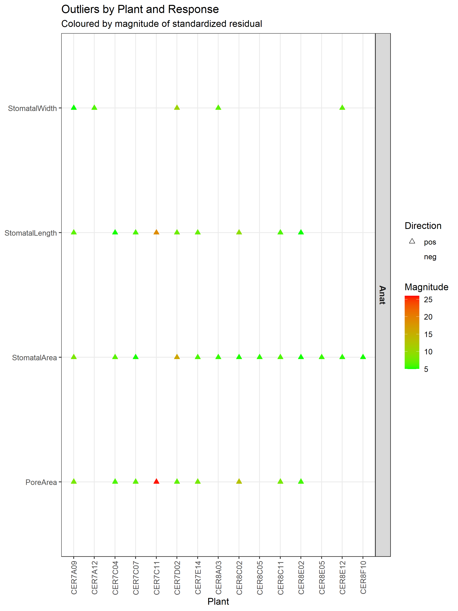

