---
output:
  pdf_document: default
  html_document: default
---
# Wheat stomatal kinetics (heat & drought)
## --- Ed Chaplin (USyd), *Apr--June 2025* ---

### Analysis of anatomical traits

### Load packages


``` r
library(knitr)
#knitr::spin("anat.anout.v2.r")
library(ggplot2)
library(asreml)
library(asremlPlus)
```

### Set up constants and files


``` r
options(width=95)
load("../data/anat.Analyses.v2.RData")
source("anat.anal.v1.stub.r")
```

## Show the results


``` r
for (resp in responses.anat[kvec]) {
  showIndvModelResults(models[[resp]], response=resp)
}
```

```


#### Results for StomatalCount 


  Final model converged 


#### Formulae from asreml object

fixed: StomatalCount ~ ASide/ABlock + Rm_Temperature/(AWatering * ALine +
     HWatering * HLine)
random: NULL
residual: ~ (dsum(~ units | Rm_Temperature))


####  Summary of the fitted variance parameters for StomatalCount 

                           component std.error  z.ratio bound %ch
Rm_Temperature_7,Heat!R     10.44401  1.959970 5.328658     P   0
Rm_Temperature_8,Ambient!R  22.31792  4.114156 5.424665     P   0


####  Pseudo-anova table for fixed terms 


Wald tests for fixed effects.
Response: StomatalCount

                               Df denDF  F.inc  F.con Margin     Pr
(Intercept)                     1 101.6 7756.0 7756.0        0.0000
ASide                           1 101.6    2.2    2.0      B 0.1586
ASide:ABlock                    2 101.7    5.7    6.0      C 0.0035
Rm_Temperature                  1 104.0    0.1    0.1      A 0.7795
Rm_Temperature:AWatering        1  58.9    0.9    0.9      B 0.3359
Rm_Temperature:ALine            9  58.9    0.9    0.9      B 0.5552
Rm_Temperature:AWatering:ALine  9  58.9    0.8    0.8      C 0.5940
Rm_Temperature:HWatering        1  56.8    0.9    1.1      B 0.3067
Rm_Temperature:HLine            9  56.8    7.1    7.1      B 0.0000
Rm_Temperature:HWatering:HLine  9  56.8    1.7    1.7      C 0.1123


####  Sequence of model investigations for StomatalCount 

(If a row has NA for p but not denDF, DF and denDF relate to fixed and variance parameter numbers)

                                                                         terms DF denDF      p
1                                                                Initial model 43   1.0     NA
2  Start with residual heterogeneity in Watering & Rm_Temperature for Residual NA    NA     NA
3                               Try homogeneity in Rm_Temperature for Residual  0  -2.0     NA
4                                     Try homogeneity in Watering for Residual  0  -2.0     NA
5                                                                    Room:Side  1    NA     NA
6                                                           Room:Side:Location  1    NA     NA
7                                                   Room:Side:Location:SubUnit  1    NA     NA
8                                                Fix bound variance components  0   0.0     NA
9                                               Rm_Temperature:HWatering:HLine  9  56.8 0.1123
10                                                        Rm_Temperature:HLine  9  56.8 0.0000
11                                                    Rm_Temperature:HWatering  1  56.8 0.3067
12                                              Rm_Temperature:AWatering:ALine  9  58.9 0.5940
13                                                        Rm_Temperature:ALine  9  58.9 0.5552
14                                                    Rm_Temperature:AWatering  1  58.9 0.3359
          AIC        BIC           action
1  649.460213 784.491998   Starting model
2          NA         NA Changed residual
3    4.283150  -1.224031        Unswapped
4   -3.861354  -9.368534          Swapped
5          NA         NA         Boundary
6          NA         NA         Boundary
7          NA         NA         Boundary
8    0.000000   0.000000          Swapped
9          NA         NA   Nonsignificant
10         NA         NA      Significant
11         NA         NA   Nonsignificant
12         NA         NA   Nonsignificant
13         NA         NA   Nonsignificant
14         NA         NA   Nonsignificant

  Information criteria for spatial models 

NULL

Chosen terms
[1] "Rm_Temperature:HLine"

LSDs
          c   minLSD  meanLSD   maxLSD assignedLSD accuracyLSD falsePos falseNeg
overall 780 4.526069 5.683925 6.616287    5.683925   0.2037072       12       22
```

```
Joining with `by = join_by(Rm_Temperature, Watering, Line.ID)`
Joining with `by = join_by(Watering, Line.ID, Rm_Temperature)`
```


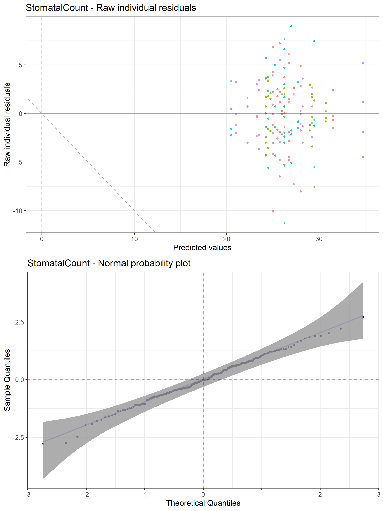

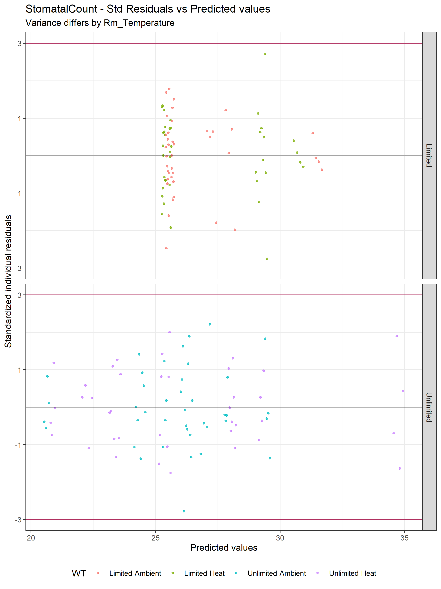


```


#### Results for StomatalDensity 


  Final model converged 


#### Formulae from asreml object

fixed: StomatalDensity ~ ASide/ABlock + Rm_Temperature/(AWatering * ALine +
     HWatering * HLine)
random: NULL
residual: ~ (dsum(~ units | Rm_Temperature))


####  Summary of the fitted variance parameters for StomatalDensity 

                           component std.error  z.ratio bound %ch
Rm_Temperature_7,Heat!R     39.48046  7.409081 5.328658     P   0
Rm_Temperature_8,Ambient!R  84.36620 15.552334 5.424665     P   0


####  Pseudo-anova table for fixed terms 


Wald tests for fixed effects.
Response: StomatalDensity

                               Df denDF  F.inc  F.con Margin     Pr
(Intercept)                     1 101.6 7756.0 7756.0        0.0000
ASide                           1 101.6    2.2    2.0      B 0.1586
ASide:ABlock                    2 101.7    5.7    6.0      C 0.0035
Rm_Temperature                  1 104.0    0.1    0.1      A 0.7795
Rm_Temperature:AWatering        1  58.9    0.9    0.9      B 0.3359
Rm_Temperature:ALine            9  58.9    0.9    0.9      B 0.5552
Rm_Temperature:AWatering:ALine  9  58.9    0.8    0.8      C 0.5940
Rm_Temperature:HWatering        1  56.8    0.9    1.1      B 0.3067
Rm_Temperature:HLine            9  56.8    7.1    7.1      B 0.0000
Rm_Temperature:HWatering:HLine  9  56.8    1.7    1.7      C 0.1123


####  Sequence of model investigations for StomatalDensity 

(If a row has NA for p but not denDF, DF and denDF relate to fixed and variance parameter numbers)

                                                                         terms DF denDF      p
1                                                                Initial model 43   1.0     NA
2  Start with residual heterogeneity in Watering & Rm_Temperature for Residual NA    NA     NA
3                               Try homogeneity in Rm_Temperature for Residual  0  -2.0     NA
4                                     Try homogeneity in Watering for Residual  0  -2.0     NA
5                                                                    Room:Side  1    NA     NA
6                                                           Room:Side:Location  1    NA     NA
7                                                   Room:Side:Location:SubUnit  1    NA     NA
8                                                Fix bound variance components  0   0.0     NA
9                                               Rm_Temperature:HWatering:HLine  9  56.8 0.1123
10                                                        Rm_Temperature:HLine  9  56.8 0.0000
11                                                    Rm_Temperature:HWatering  1  56.8 0.3067
12                                              Rm_Temperature:AWatering:ALine  9  58.9 0.5940
13                                                        Rm_Temperature:ALine  9  58.9 0.5552
14                                                    Rm_Temperature:AWatering  1  58.9 0.3359
          AIC        BIC           action
1  860.894764 995.926549   Starting model
2          NA         NA Changed residual
3    4.283150  -1.224031        Unswapped
4   -3.861354  -9.368534          Swapped
5          NA         NA         Boundary
6          NA         NA         Boundary
7          NA         NA         Boundary
8    0.000000   0.000000          Swapped
9          NA         NA   Nonsignificant
10         NA         NA      Significant
11         NA         NA   Nonsignificant
12         NA         NA   Nonsignificant
13         NA         NA   Nonsignificant
14         NA         NA   Nonsignificant

  Information criteria for spatial models 

NULL

Chosen terms
[1] "Rm_Temperature:HLine"

LSDs
          c   minLSD  meanLSD   maxLSD assignedLSD accuracyLSD falsePos falseNeg
overall 780 8.799917 11.05111 12.86387    11.05111   0.2037072       12       22
```

```
Joining with `by = join_by(Rm_Temperature, Watering, Line.ID)`
Joining with `by = join_by(Watering, Line.ID, Rm_Temperature)`
```


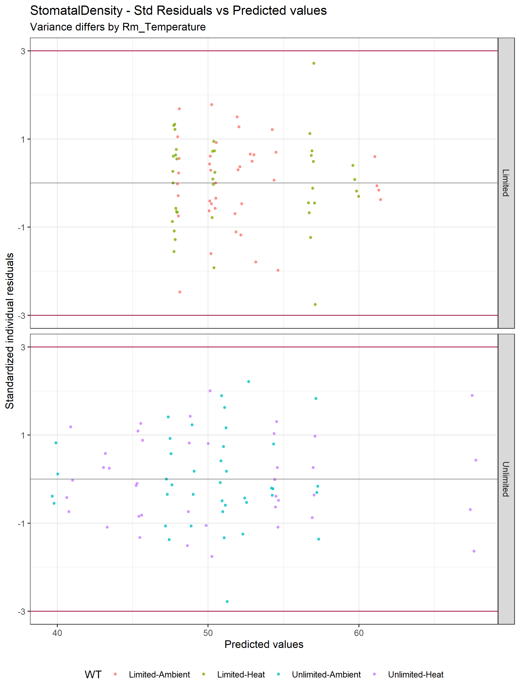


```


#### Results for StomatalArea 


  Final model converged 


#### Formulae from asreml object

fixed: StomatalArea ~ ASide/ABlock + Rm_Temperature/(AWatering * ALine +
     HWatering * HLine)
random: ~ Room:Side:Location:SubUnit + Room:Side:Location:SubUnit:Cell
residual: ~ (dsum(~ units | Rm_Temperature))


####  Summary of the fitted variance parameters for StomatalArea 

                                component std.error   z.ratio bound %ch
Room:Side:Location:SubUnit       4757.396  3744.469  1.270513     P   0
Room:Side:Location:SubUnit:Cell 28842.321  4263.616  6.764756     P   0
Rm_Temperature_7,Heat!R         62206.571  1965.546 31.648500     P   0
Rm_Temperature_8,Ambient!R      56309.328  1775.405 31.716335     P   0


####  Pseudo-anova table for fixed terms 


Wald tests for fixed effects.
Response: StomatalArea

                               Df denDF  F.inc  F.con Margin     Pr
(Intercept)                     1   9.0 5406.0 5406.0        0.0000
ASide                           1   9.0    2.6    2.5      B 0.1488
ASide:ABlock                    2   9.0    0.0    0.0      C 0.9738
Rm_Temperature                  1   9.0    0.4    0.4      A 0.5564
Rm_Temperature:AWatering        1   8.9    2.6    2.6      B 0.1418
Rm_Temperature:ALine            9 106.1    3.4    3.4      B 0.0009
Rm_Temperature:AWatering:ALine  9 106.1    1.4    1.4      C 0.1784
Rm_Temperature:HWatering        1   9.1    1.4    1.3      B 0.2868
Rm_Temperature:HLine            9 107.6    3.4    3.4      B 0.0012
Rm_Temperature:HWatering:HLine  9 107.6    0.2    0.2      C 0.9863


####  Sequence of model investigations for StomatalArea 

(If a row has NA for p but not denDF, DF and denDF relate to fixed and variance parameter numbers)

                                                                         terms DF denDF      p
1                                                                Initial model 43   3.0     NA
2  Start with residual heterogeneity in Watering & Rm_Temperature for Residual NA    NA     NA
3                               Try homogeneity in Rm_Temperature for Residual  0  -2.0     NA
4                                     Try homogeneity in Watering for Residual  0  -2.0     NA
5                                                                    Room:Side  1    NA     NA
6                                                           Room:Side:Location  1    NA     NA
7                                                Fix bound variance components  0   0.0     NA
8                                               Rm_Temperature:HWatering:HLine  9 107.6 0.9863
9                                                         Rm_Temperature:HLine  9 107.6 0.0012
10                                                    Rm_Temperature:HWatering  1   9.1 0.2868
11                                              Rm_Temperature:AWatering:ALine  9 106.1 0.1784
12                                                        Rm_Temperature:ALine  9 106.1 0.0009
13                                                    Rm_Temperature:AWatering  1   8.9 0.1418
             AIC         BIC           action
1  50522.9683907 50814.45337   Starting model
2             NA          NA Changed residual
3      0.9281318   -11.72442        Unswapped
4     -1.5501424   -14.20269          Swapped
5             NA          NA         Boundary
6             NA          NA         Boundary
7      0.0000000     0.00000          Swapped
8             NA          NA   Nonsignificant
9             NA          NA      Significant
10            NA          NA   Nonsignificant
11            NA          NA   Nonsignificant
12            NA          NA      Significant
13            NA          NA   Nonsignificant

  Information criteria for spatial models 

NULL

Chosen terms
[1] "Rm_Temperature:HLine" "Rm_Temperature:ALine"

LSDs
          c   minLSD  meanLSD   maxLSD assignedLSD accuracyLSD falsePos falseNeg
overall 780 243.1809 259.7307 283.2847    259.7307  0.09068625        5        4
```

```
Joining with `by = join_by(Rm_Temperature, Watering, Line.ID)`
Joining with `by = join_by(Watering, Line.ID, Rm_Temperature)`
```


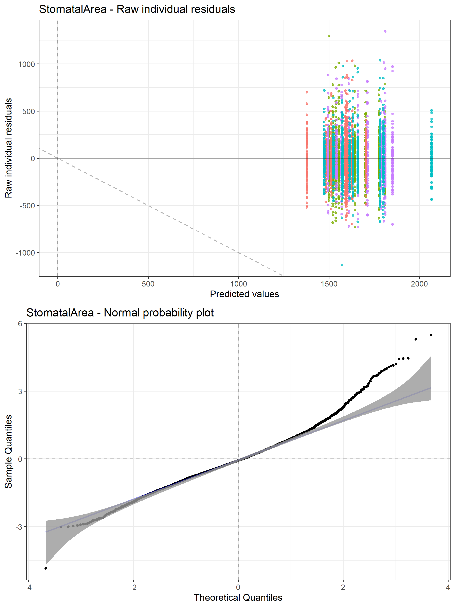

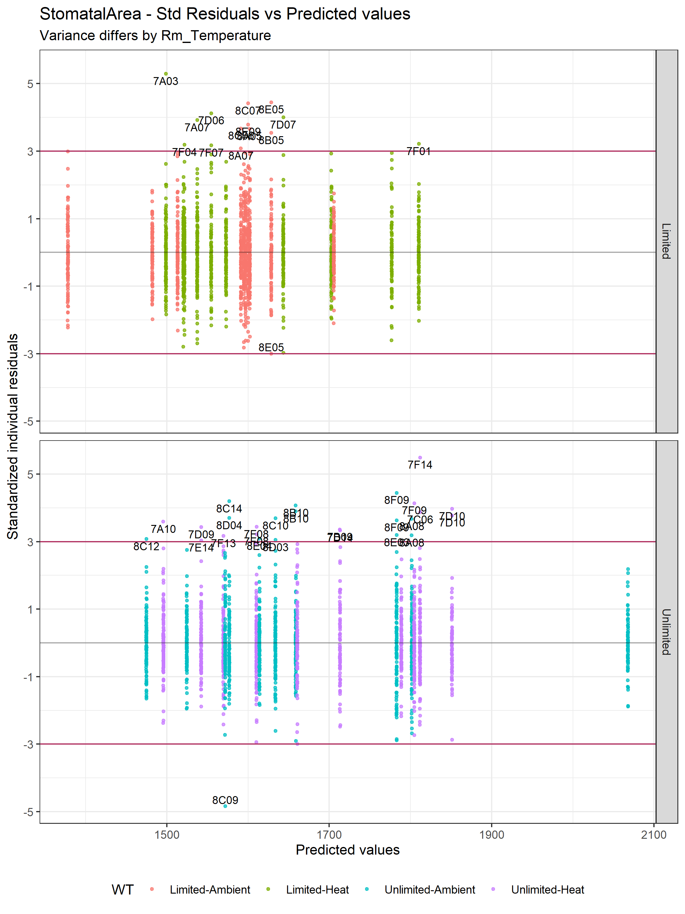

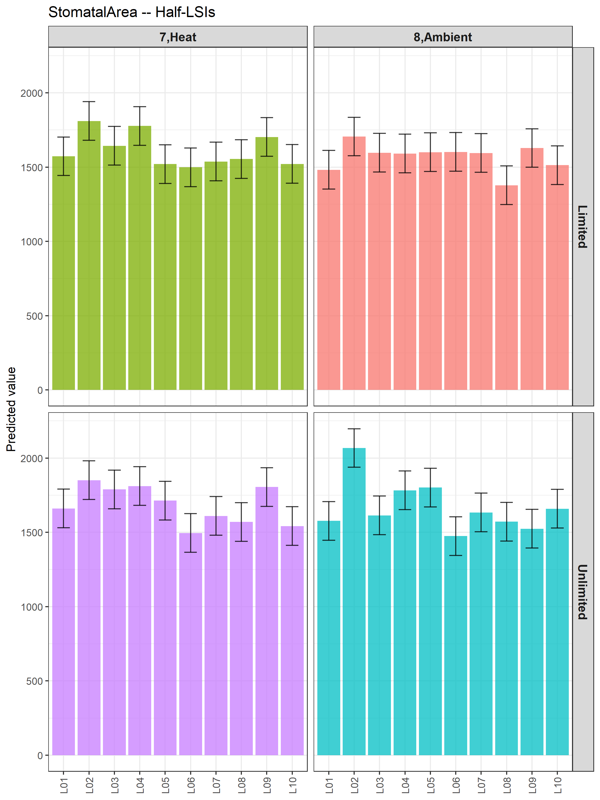

```


#### Results for StomatalWidth 


  Final model converged 


#### Formulae from asreml object

fixed: StomatalWidth ~ ASide/ABlock + Rm_Temperature/(AWatering * ALine +
     HWatering * HLine)
random: ~ Room:Side + Room:Side:Location:SubUnit +
     Room:Side:Location:SubUnit:Cell
residual: ~ (dsum(~ units | Watering))


####  Summary of the fitted variance parameters for StomatalWidth 

                                 component std.error    z.ratio bound %ch
Room:Side                        0.1308372 0.6039463  0.2166371     P   0
Room:Side:Location:SubUnit       0.2068712 0.5808275  0.3561664     P   0
Room:Side:Location:SubUnit:Cell  8.5678985 1.2597242  6.8014080     P   0
Watering_Limited!R              15.2113739 0.4768344 31.9007489     P   0
Watering_Unlimited!R            17.1399116 0.5434500 31.5390799     P   0


####  Pseudo-anova table for fixed terms 


Wald tests for fixed effects.
Response: StomatalWidth

                               Df denDF   F.inc   F.con Margin     Pr
(Intercept)                     1   1.0 11260.0 11260.0        0.0060
ASide                           1   1.0     2.4     2.2      B 0.3759
ASide:ABlock                    2   8.0     0.1     0.1      C 0.9008
Rm_Temperature                  1   1.0     0.3     0.3      A 0.6993
Rm_Temperature:AWatering        1   7.9     7.6     7.6      B 0.0248
Rm_Temperature:ALine            9 106.7     2.4     2.4      B 0.0153
Rm_Temperature:AWatering:ALine  9 106.8     2.3     2.3      C 0.0214
Rm_Temperature:HWatering        1   8.1     6.7     6.0      B 0.0397
Rm_Temperature:HLine            9 106.8     3.1     3.1      B 0.0025
Rm_Temperature:HWatering:HLine  9 106.8     0.2     0.2      C 0.9888


####  Sequence of model investigations for StomatalWidth 

(If a row has NA for p but not denDF, DF and denDF relate to fixed and variance parameter numbers)

                                                                         terms DF denDF      p
1                                                                Initial model 43   4.0     NA
2  Start with residual heterogeneity in Watering & Rm_Temperature for Residual NA    NA     NA
3                               Try homogeneity in Rm_Temperature for Residual  0  -2.0     NA
4                    Try homogeneity in Watering & Rm_Temperature for Residual  0  -1.0     NA
5                                                           Room:Side:Location  1    NA     NA
6                                                Fix bound variance components  0   0.0     NA
7                                               Rm_Temperature:HWatering:HLine  9 106.8 0.9888
8                                                         Rm_Temperature:HLine  9 106.8 0.0025
9                                                     Rm_Temperature:HWatering  1   8.1 0.0397
10                                              Rm_Temperature:AWatering:ALine  9 106.8 0.0214
            AIC         BIC           action
1  16311.353418 16609.28750   Starting model
2            NA          NA Changed residual
3     -2.227427   -14.88481          Swapped
4      5.165772    -1.16292        Unswapped
5            NA          NA         Boundary
6      0.000000     0.00000          Swapped
7            NA          NA   Nonsignificant
8            NA          NA      Significant
9            NA          NA      Significant
10           NA          NA      Significant

  Information criteria for spatial models 

NULL

Chosen terms
[1] "Rm_Temperature:HLine"           "Rm_Temperature:HWatering"      
[3] "Rm_Temperature:AWatering:ALine"

LSDs
          c   minLSD  meanLSD   maxLSD assignedLSD accuracyLSD falsePos falseNeg
overall 780 4.177098 4.289428 4.661469    4.289428  0.08673447        5        2
```

```
Joining with `by = join_by(Rm_Temperature, Watering, Line.ID)`
Joining with `by = join_by(Watering, Line.ID, Rm_Temperature)`
```


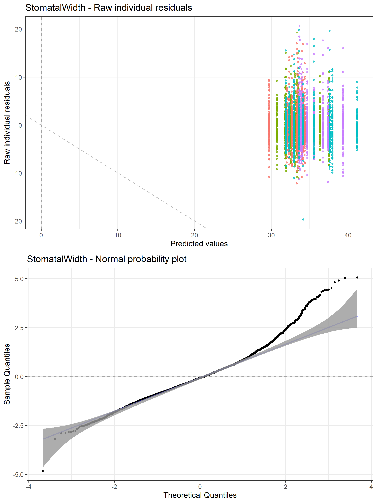

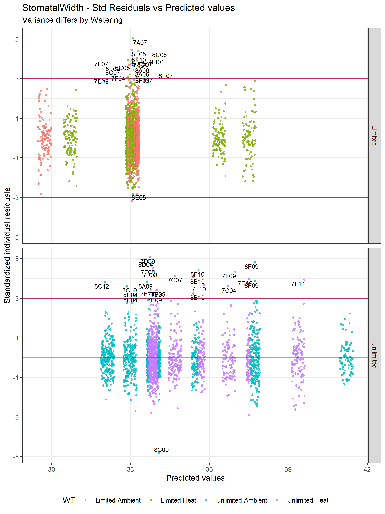

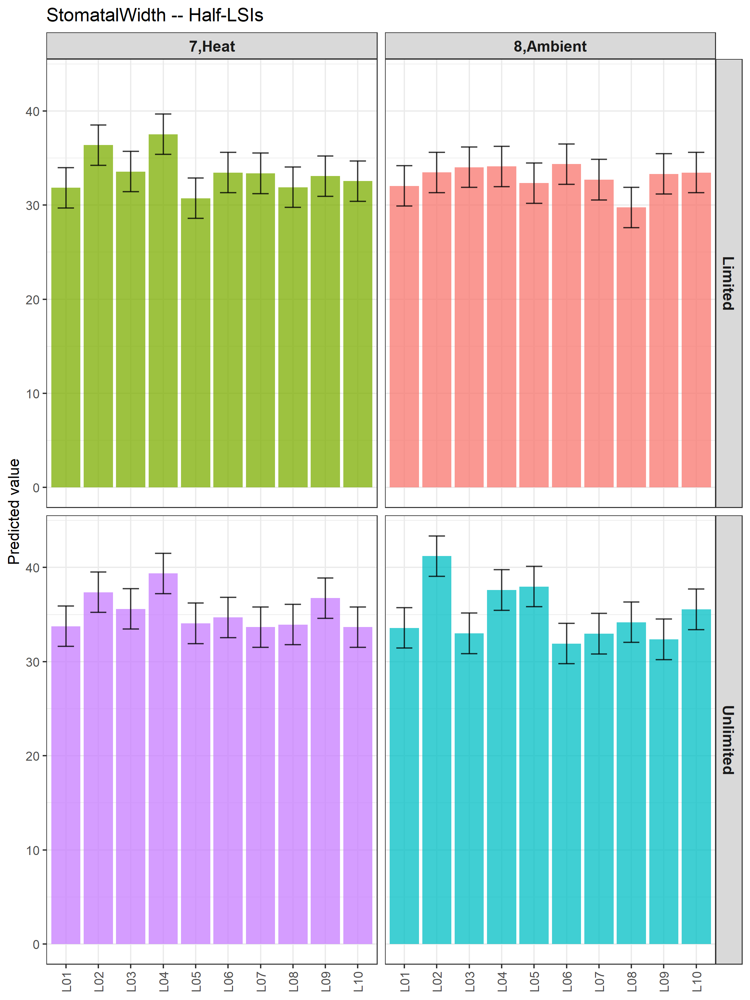

```


#### Results for StomatalLength 


  Final model converged 


#### Formulae from asreml object

fixed: StomatalLength ~ ASide/ABlock + Rm_Temperature/(AWatering * ALine +
     HWatering * HLine)
random: ~ Room:Side:Location:SubUnit + Room:Side:Location:SubUnit:Cell
residual: ~ (dsum(~ units | Watering))


####  Summary of the fitted variance parameters for StomatalLength 

                                component std.error   z.ratio bound %ch
Room:Side:Location:SubUnit       1.327791 1.5819205  0.839354     P   0
Room:Side:Location:SubUnit:Cell 18.421640 2.6845906  6.861992     P   0
Watering_Limited!R              31.823611 0.9982471 31.879492     P   0
Watering_Unlimited!R            29.839456 0.9463076 31.532511     P   0


####  Pseudo-anova table for fixed terms 


Wald tests for fixed effects.
Response: StomatalLength

                               Df denDF   F.inc   F.con Margin     Pr
(Intercept)                     1   9.0 18760.0 18760.0        0.0000
ASide                           1   9.0     0.3     0.4      B 0.5666
ASide:ABlock                    2   9.0     0.6     0.6      C 0.5814
Rm_Temperature                  1   9.0     0.2     0.2      A 0.6586
Rm_Temperature:AWatering        1   8.9     0.0     0.0      B 0.8342
Rm_Temperature:ALine            9 107.0     1.5     1.5      B 0.1642
Rm_Temperature:AWatering:ALine  9 107.0     0.5     0.5      C 0.8761
Rm_Temperature:HWatering        1   9.1     0.1     0.1      B 0.7569
Rm_Temperature:HLine            9 106.9     3.6     3.6      B 0.0007
Rm_Temperature:HWatering:HLine  9 107.0     0.4     0.4      C 0.9060


####  Sequence of model investigations for StomatalLength 

(If a row has NA for p but not denDF, DF and denDF relate to fixed and variance parameter numbers)

                                                                         terms DF denDF      p
1                                                                Initial model 43   3.0     NA
2  Start with residual heterogeneity in Watering & Rm_Temperature for Residual NA    NA     NA
3                               Try homogeneity in Rm_Temperature for Residual  0  -2.0     NA
4                    Try homogeneity in Watering & Rm_Temperature for Residual  0  -1.0     NA
5                                                                    Room:Side  1    NA     NA
6                                                           Room:Side:Location  1    NA     NA
7                                                Fix bound variance components  0   0.0     NA
8                                               Rm_Temperature:HWatering:HLine  9 107.0 0.9060
9                                                         Rm_Temperature:HLine  9 106.9 0.0007
10                                                    Rm_Temperature:HWatering  1   9.1 0.7569
11                                              Rm_Temperature:AWatering:ALine  9 107.0 0.8761
12                                                        Rm_Temperature:ALine  9 107.0 0.1642
13                                                    Rm_Temperature:AWatering  1   8.9 0.8342
             AIC          BIC           action
1   1.901561e+04 19307.161368   Starting model
2             NA           NA Changed residual
3  -1.454771e-01   -12.800929          Swapped
4   8.225861e-02    -6.245468        Unswapped
5             NA           NA         Boundary
6             NA           NA         Boundary
7   0.000000e+00     0.000000          Swapped
8             NA           NA   Nonsignificant
9             NA           NA      Significant
10            NA           NA   Nonsignificant
11            NA           NA   Nonsignificant
12            NA           NA   Nonsignificant
13            NA           NA   Nonsignificant

  Information criteria for spatial models 

NULL

Chosen terms
[1] "Rm_Temperature:HLine"

LSDs
          c   minLSD  meanLSD   maxLSD assignedLSD accuracyLSD falsePos falseNeg
overall 780 6.101866 6.325752 6.860249    6.325752   0.0844955        0        2
```

```
Joining with `by = join_by(Rm_Temperature, Watering, Line.ID)`
Joining with `by = join_by(Watering, Line.ID, Rm_Temperature)`
```


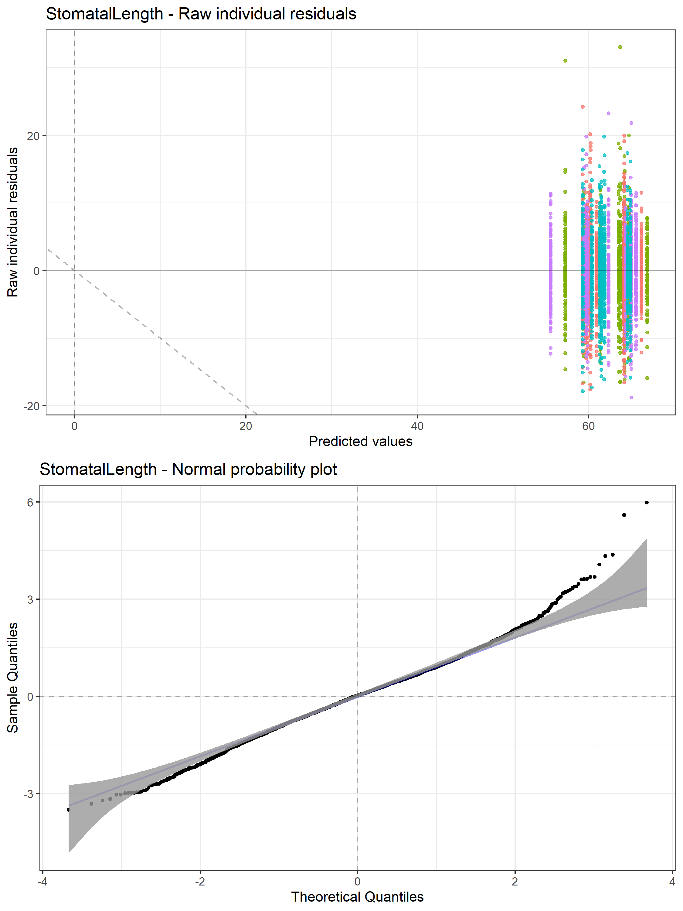

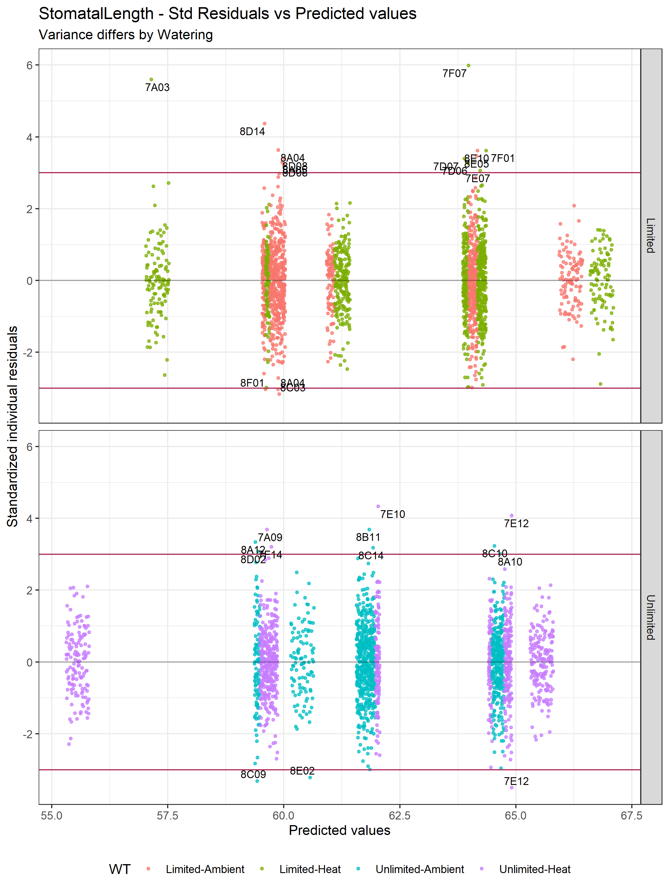

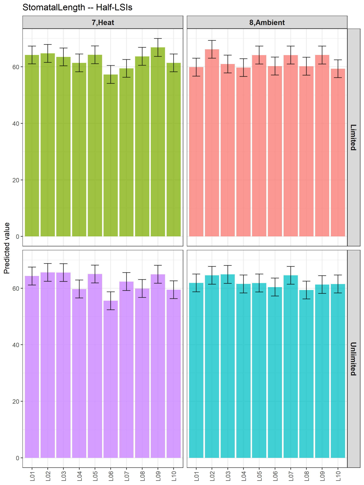

```


#### Results for PoreArea 


  Final model converged 


#### Formulae from asreml object

fixed: PoreArea ~ ASide/ABlock + Rm_Temperature/(AWatering * ALine + HWatering *
     HLine)
random: ~ Room:Side:Location + Room:Side:Location:SubUnit +
     Room:Side:Location:SubUnit:Cell
residual: ~ (dsum(~ units | Watering))


####  Summary of the fitted variance parameters for PoreArea 

                                  component std.error      z.ratio bound %ch
Room:Side:Location                 11.36383 1283.0050  0.008857201     P   0
Room:Side:Location:SubUnit        982.86895 1489.8976  0.659688943     P   0
Room:Side:Location:SubUnit:Cell 14587.83278 2134.1613  6.835393833     P   0
Watering_Limited!R              26805.54901  840.8658 31.878509641     P   0
Watering_Unlimited!R            24833.75214  787.5466 31.533057599     P   0


####  Pseudo-anova table for fixed terms 


Wald tests for fixed effects.
Response: PoreArea

                               Df denDF  F.inc  F.con Margin     Pr
(Intercept)                     1   3.0 5132.0 5132.0        0.0000
ASide                           1   3.0    0.4    0.4      B 0.5720
ASide:ABlock                    2   3.0    0.5    0.5      C 0.6405
Rm_Temperature                  1   3.0    0.2    0.2      A 0.6993
Rm_Temperature:AWatering        1   6.0    0.0    0.0      B 0.8637
Rm_Temperature:ALine            9 106.9    1.4    1.4      B 0.1946
Rm_Temperature:AWatering:ALine  9 106.9    0.6    0.6      C 0.8265
Rm_Temperature:HWatering        1   6.1    0.2    0.1      B 0.7376
Rm_Temperature:HLine            9 106.9    3.5    3.5      B 0.0007
Rm_Temperature:HWatering:HLine  9 106.9    0.5    0.5      C 0.8652


####  Sequence of model investigations for PoreArea 

(If a row has NA for p but not denDF, DF and denDF relate to fixed and variance parameter numbers)

                                                                         terms DF denDF      p
1                                                                Initial model 43   4.0     NA
2  Start with residual heterogeneity in Watering & Rm_Temperature for Residual NA    NA     NA
3                               Try homogeneity in Rm_Temperature for Residual  0  -2.0     NA
4                    Try homogeneity in Watering & Rm_Temperature for Residual  0  -1.0     NA
5                                                                    Room:Side  1    NA     NA
6                                                Fix bound variance components  0   0.0     NA
7                                               Rm_Temperature:HWatering:HLine  9 106.9 0.8652
8                                                         Rm_Temperature:HLine  9 106.9 0.0007
9                                                     Rm_Temperature:HWatering  1   6.1 0.7376
10                                              Rm_Temperature:AWatering:ALine  9 106.9 0.8265
11                                                        Rm_Temperature:ALine  9 106.9 0.1946
12                                                    Rm_Temperature:AWatering  1   6.0 0.8637
             AIC          BIC           action
1  47142.0576204 47439.946747   Starting model
2             NA           NA Changed residual
3     -1.8820831   -14.537535          Swapped
4      0.9685117    -5.359214        Unswapped
5             NA           NA         Boundary
6      0.0000000     0.000000          Swapped
7             NA           NA   Nonsignificant
8             NA           NA      Significant
9             NA           NA   Nonsignificant
10            NA           NA   Nonsignificant
11            NA           NA   Nonsignificant
12            NA           NA   Nonsignificant

  Information criteria for spatial models 

NULL

Chosen terms
[1] "Rm_Temperature:HLine"

LSDs
          c  minLSD  meanLSD   maxLSD assignedLSD accuracyLSD falsePos falseNeg
overall 780 171.924 178.0534 193.0861    178.0534   0.0844282        0        0
```

```
Joining with `by = join_by(Rm_Temperature, Watering, Line.ID)`
Joining with `by = join_by(Watering, Line.ID, Rm_Temperature)`
```


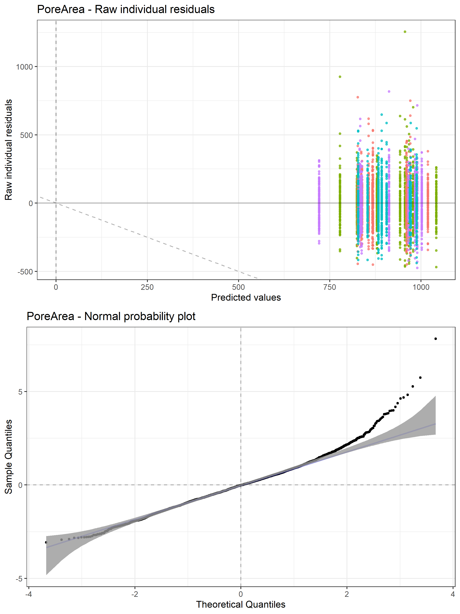

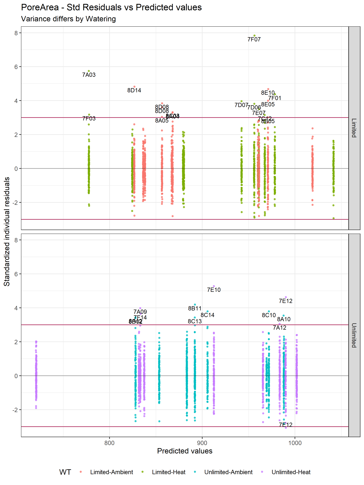

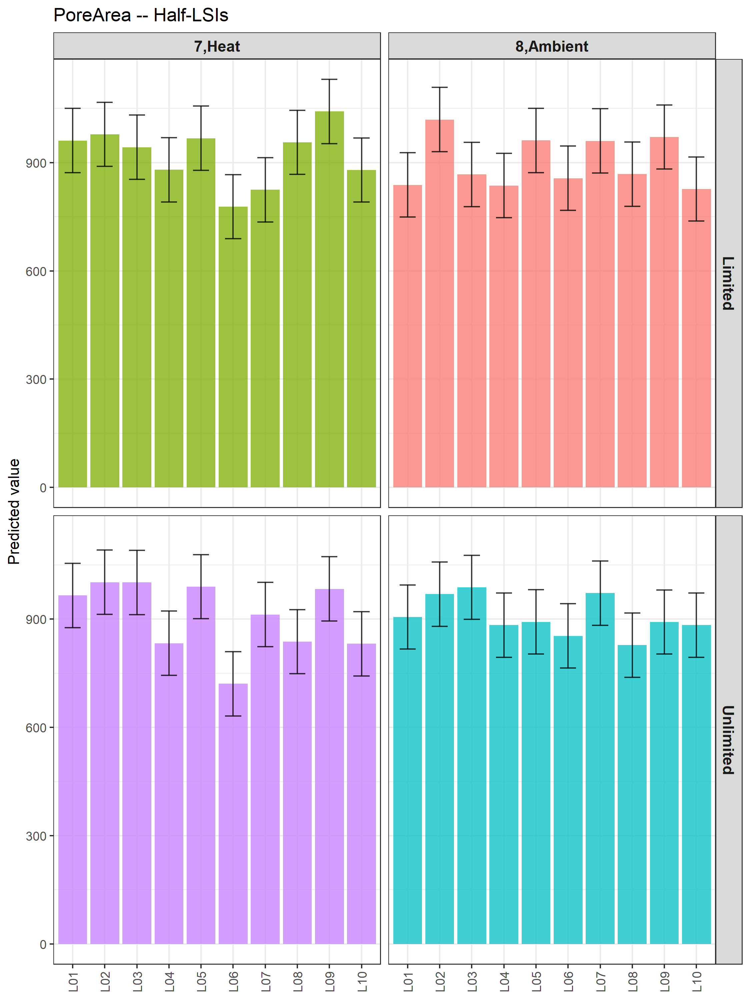

```


#### Results for gsmax 


  Final model converged 


#### Formulae from asreml object

fixed: gsmax ~ ASide/ABlock + Rm_Temperature/(AWatering * ALine + HWatering *
     HLine)
random: ~ Room:Side:Location
residual: NULL


####  Summary of the fitted variance parameters for gsmax 

                      component   std.error   z.ratio bound %ch
Room:Side:Location 0.0008122171 0.002065471 0.3932358     P   0
units!R            0.0336374469 0.004475327 7.5161981     P   0


####  Pseudo-anova table for fixed terms 


Wald tests for fixed effects.
Response: gsmax

                               Df denDF  F.inc  F.con Margin     Pr
(Intercept)                     1     3 5752.0 5752.0        0.0000
ASide                           1     3    3.1    3.0      B 0.1826
ASide:ABlock                    2     3    3.8    3.9      C 0.1468
Rm_Temperature                  1     3    0.4    0.4      A 0.5767
Rm_Temperature:AWatering        1   113    1.3    1.3      B 0.2581
Rm_Temperature:ALine            9   113    1.1    1.1      B 0.3636
Rm_Temperature:AWatering:ALine  9   113    1.8    1.8      C 0.0777
Rm_Temperature:HWatering        1   113    1.4    1.6      B 0.2153
Rm_Temperature:HLine            9   113    2.5    2.5      B 0.0106
Rm_Temperature:HWatering:HLine  9   113    0.7    0.7      C 0.7318


####  Sequence of model investigations for gsmax 

(If a row has NA for p but not denDF, DF and denDF relate to fixed and variance parameter numbers)

                                                                         terms DF denDF      p
1                                                                Initial model 43     2     NA
2  Start with residual heterogeneity in Watering & Rm_Temperature for Residual NA    NA     NA
3                               Try homogeneity in Rm_Temperature for Residual  0    -2     NA
4                    Try homogeneity in Watering & Rm_Temperature for Residual  0    -1     NA
5                                                                    Room:Side  1    NA     NA
6                                                   Room:Side:Location:SubUnit  1    NA     NA
7                                                Fix bound variance components  0     0     NA
8                                               Rm_Temperature:HWatering:HLine  9   113 0.7318
9                                                         Rm_Temperature:HLine  9   113 0.0106
10                                                    Rm_Temperature:HWatering  1   113 0.2153
11                                              Rm_Temperature:AWatering:ALine  9   113 0.0777
12                                                        Rm_Temperature:ALine  9   113 0.3636
13                                                    Rm_Temperature:AWatering  1   113 0.2581
           AIC         BIC           action
1  -330.210392 -192.109703   Starting model
2           NA          NA Changed residual
3    -1.238629   -6.745809          Swapped
4    -1.724391   -4.477981          Swapped
5           NA          NA         Boundary
6           NA          NA         Boundary
7     0.000000    0.000000          Swapped
8           NA          NA   Nonsignificant
9           NA          NA      Significant
10          NA          NA   Nonsignificant
11          NA          NA   Nonsignificant
12          NA          NA   Nonsignificant
13          NA          NA   Nonsignificant

  Information criteria for spatial models 

NULL

Chosen terms
[1] "Rm_Temperature:HLine"

LSDs
          c    minLSD   meanLSD  maxLSD assignedLSD accuracyLSD falsePos falseNeg
overall 780 0.2568615 0.2595447 0.28097   0.2595447  0.08254961        1        3
```

```
Joining with `by = join_by(Rm_Temperature, Watering, Line.ID)`
Joining with `by = join_by(Watering, Line.ID, Rm_Temperature)`
```


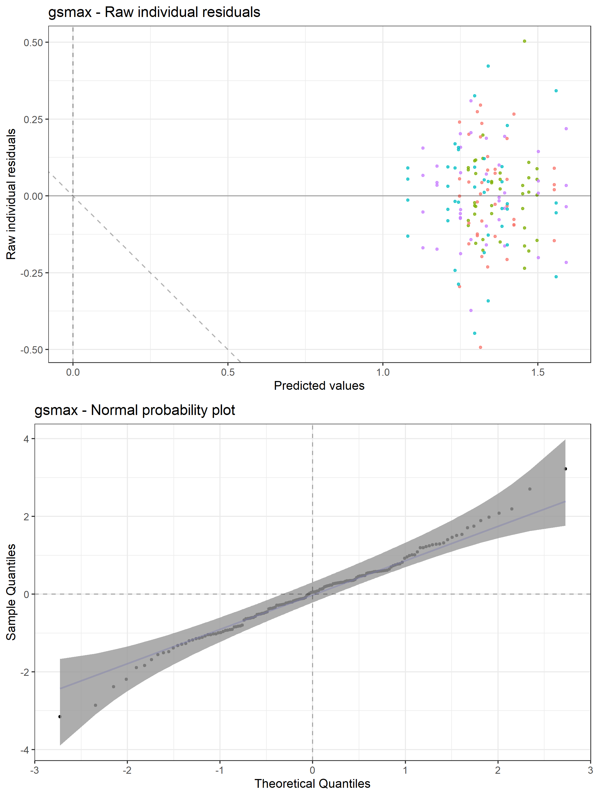

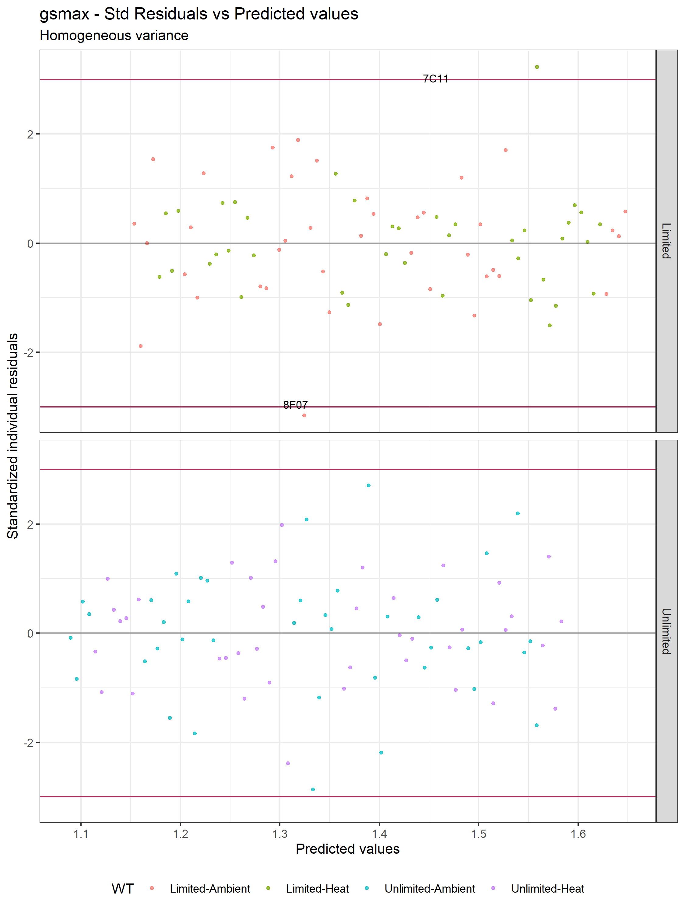


## MODEL SUMMARIES
### Wald tables


``` r
for (resp in responses.anat[kvec]) {
  tbl <- models[[resp]]$wald.tab[-1,]
  cat("\n\n", resp)
  print(kable(tbl, digits = 3))
}
```

```


 StomatalCount

|                               | Df| denDF| F.inc| F.con|Margin |    Pr|
|:------------------------------|--:|-----:|-----:|-----:|:------|-----:|
|ASide                          |  1| 101.6| 2.202| 2.017|B      | 0.159|
|ASide:ABlock                   |  2| 101.7| 5.658| 5.984|C      | 0.003|
|Rm_Temperature                 |  1| 104.0| 0.079| 0.079|A      | 0.779|
|Rm_Temperature:AWatering       |  1|  58.9| 0.942| 0.942|B      | 0.336|
|Rm_Temperature:ALine           |  9|  58.9| 0.872| 0.872|B      | 0.555|
|Rm_Temperature:AWatering:ALine |  9|  58.9| 0.827| 0.827|C      | 0.594|
|Rm_Temperature:HWatering       |  1|  56.8| 0.910| 1.064|B      | 0.307|
|Rm_Temperature:HLine           |  9|  56.8| 7.074| 7.074|B      | 0.000|
|Rm_Temperature:HWatering:HLine |  9|  56.8| 1.692| 1.692|C      | 0.112|


 StomatalDensity

|                               | Df| denDF| F.inc| F.con|Margin |    Pr|
|:------------------------------|--:|-----:|-----:|-----:|:------|-----:|
|ASide                          |  1| 101.6| 2.202| 2.017|B      | 0.159|
|ASide:ABlock                   |  2| 101.7| 5.658| 5.984|C      | 0.003|
|Rm_Temperature                 |  1| 104.0| 0.079| 0.079|A      | 0.779|
|Rm_Temperature:AWatering       |  1|  58.9| 0.942| 0.942|B      | 0.336|
|Rm_Temperature:ALine           |  9|  58.9| 0.872| 0.872|B      | 0.555|
|Rm_Temperature:AWatering:ALine |  9|  58.9| 0.827| 0.827|C      | 0.594|
|Rm_Temperature:HWatering       |  1|  56.8| 0.910| 1.064|B      | 0.307|
|Rm_Temperature:HLine           |  9|  56.8| 7.074| 7.074|B      | 0.000|
|Rm_Temperature:HWatering:HLine |  9|  56.8| 1.692| 1.692|C      | 0.112|


 StomatalArea

|                               | Df| denDF| F.inc| F.con|Margin |    Pr|
|:------------------------------|--:|-----:|-----:|-----:|:------|-----:|
|ASide                          |  1|   9.0| 2.643| 2.493|B      | 0.149|
|ASide:ABlock                   |  2|   9.0| 0.027| 0.027|C      | 0.974|
|Rm_Temperature                 |  1|   9.0| 0.373| 0.373|A      | 0.556|
|Rm_Temperature:AWatering       |  1|   8.9| 2.588| 2.599|B      | 0.142|
|Rm_Temperature:ALine           |  9| 106.1| 3.437| 3.437|B      | 0.001|
|Rm_Temperature:AWatering:ALine |  9| 106.1| 1.446| 1.445|C      | 0.178|
|Rm_Temperature:HWatering       |  1|   9.1| 1.410| 1.280|B      | 0.287|
|Rm_Temperature:HLine           |  9| 107.6| 3.360| 3.360|B      | 0.001|
|Rm_Temperature:HWatering:HLine |  9| 107.6| 0.247| 0.247|C      | 0.986|


 StomatalWidth

|                               | Df| denDF| F.inc| F.con|Margin |    Pr|
|:------------------------------|--:|-----:|-----:|-----:|:------|-----:|
|ASide                          |  1|   1.0| 2.416| 2.226|B      | 0.376|
|ASide:ABlock                   |  2|   8.0| 0.075| 0.106|C      | 0.901|
|Rm_Temperature                 |  1|   1.0| 0.261| 0.261|A      | 0.699|
|Rm_Temperature:AWatering       |  1|   7.9| 7.614| 7.648|B      | 0.025|
|Rm_Temperature:ALine           |  9| 106.7| 2.419| 2.419|B      | 0.015|
|Rm_Temperature:AWatering:ALine |  9| 106.8| 2.294| 2.294|C      | 0.021|
|Rm_Temperature:HWatering       |  1|   8.1| 6.725| 5.995|B      | 0.040|
|Rm_Temperature:HLine           |  9| 106.8| 3.090| 3.090|B      | 0.002|
|Rm_Temperature:HWatering:HLine |  9| 106.8| 0.234| 0.234|C      | 0.989|


 StomatalLength

|                               | Df| denDF| F.inc| F.con|Margin |    Pr|
|:------------------------------|--:|-----:|-----:|-----:|:------|-----:|
|ASide                          |  1|   9.0| 0.348| 0.354|B      | 0.567|
|ASide:ABlock                   |  2|   9.0| 0.569| 0.576|C      | 0.581|
|Rm_Temperature                 |  1|   9.0| 0.209| 0.209|A      | 0.659|
|Rm_Temperature:AWatering       |  1|   8.9| 0.047| 0.046|B      | 0.834|
|Rm_Temperature:ALine           |  9| 107.0| 1.481| 1.481|B      | 0.164|
|Rm_Temperature:AWatering:ALine |  9| 107.0| 0.494| 0.494|C      | 0.876|
|Rm_Temperature:HWatering       |  1|   9.1| 0.136| 0.102|B      | 0.757|
|Rm_Temperature:HLine           |  9| 106.9| 3.554| 3.554|B      | 0.001|
|Rm_Temperature:HWatering:HLine |  9| 107.0| 0.448| 0.448|C      | 0.906|


 PoreArea

|                               | Df| denDF| F.inc| F.con|Margin |    Pr|
|:------------------------------|--:|-----:|-----:|-----:|:------|-----:|
|ASide                          |  1|   3.0| 0.391| 0.400|B      | 0.572|
|ASide:ABlock                   |  2|   3.0| 0.511| 0.519|C      | 0.640|
|Rm_Temperature                 |  1|   3.0| 0.181| 0.181|A      | 0.699|
|Rm_Temperature:AWatering       |  1|   6.0| 0.033| 0.032|B      | 0.864|
|Rm_Temperature:ALine           |  9| 106.9| 1.406| 1.406|B      | 0.195|
|Rm_Temperature:AWatering:ALine |  9| 106.9| 0.560| 0.560|C      | 0.827|
|Rm_Temperature:HWatering       |  1|   6.1| 0.163| 0.123|B      | 0.738|
|Rm_Temperature:HLine           |  9| 106.9| 3.520| 3.520|B      | 0.001|
|Rm_Temperature:HWatering:HLine |  9| 106.9| 0.509| 0.509|C      | 0.865|


 gsmax

|                               | Df| denDF| F.inc| F.con|Margin |    Pr|
|:------------------------------|--:|-----:|-----:|-----:|:------|-----:|
|ASide                          |  1|     3| 3.103| 2.983|B      | 0.183|
|ASide:ABlock                   |  2|     3| 3.770| 3.891|C      | 0.147|
|Rm_Temperature                 |  1|     3| 0.390| 0.390|A      | 0.577|
|Rm_Temperature:AWatering       |  1|   113| 1.292| 1.292|B      | 0.258|
|Rm_Temperature:ALine           |  9|   113| 1.107| 1.107|B      | 0.364|
|Rm_Temperature:AWatering:ALine |  9|   113| 1.790| 1.790|C      | 0.078|
|Rm_Temperature:HWatering       |  1|   113| 1.450| 1.553|B      | 0.215|
|Rm_Temperature:HLine           |  9|   113| 2.546| 2.546|B      | 0.011|
|Rm_Temperature:HWatering:HLine |  9|   113| 0.673| 0.673|C      | 0.732|
```

### Chosen terms


``` r
tableChosenModels(models, responses.anat)
```

```
  Trait          
1 StomatalCount  
2 StomatalDensity
3 StomatalArea   
4 StomatalWidth  
5 StomatalLength 
6 PoreArea       
7 gsmax          
  Chosen.model                                                                    
1 Rm_Temperature:HLine                                                            
2 Rm_Temperature:HLine                                                            
3 Rm_Temperature:HLine + Rm_Temperature:ALine                                     
4 Rm_Temperature:HLine + Rm_Temperature:HWatering + Rm_Temperature:AWatering:ALine
5 Rm_Temperature:HLine                                                            
6 Rm_Temperature:HLine                                                            
7 Rm_Temperature:HLine                                                            
```

### Table the residual variances


``` r
tableVarModels(models, responses.anat)
```

```
  Trait           Variance.model                    
1 StomatalCount   Variance differs by Rm_Temperature
2 StomatalDensity Variance differs by Rm_Temperature
3 StomatalArea    Variance differs by Rm_Temperature
4 StomatalWidth   Variance differs by Watering      
5 StomatalLength  Variance differs by Watering      
6 PoreArea        Variance differs by Watering      
7 gsmax           Homogeneous variance              
```

## Extremal residuals


``` r
typelabls <- c("Anat")
resptlabs <- rep(typelabls,
                 times = length(responses.anat))
print(cbind(responses.anat, resptlabs), quote=F)
```

```
     responses.anat  resptlabs
[1,] StomatalCount   Anat     
[2,] StomatalDensity Anat     
[3,] StomatalArea    Anat     
[4,] StomatalWidth   Anat     
[5,] StomatalLength  Anat     
[6,] PoreArea        Anat     
[7,] gsmax           Anat     
```

``` r
res.lim.label <- 5
Outliers.dat <- data.frame()
tbl <- data.frame()
for (resp in responses.anat[kvec]) 
{
  if(resp %in% responses.pot){
    tmp.dat <- models[[resp]]$asreml.obj$call$data
    res.dat <- within(tmp.dat, res.std <- residuals(models[[resp]]$asreml.obj, type="stdCond"))
    res.dat <- res.dat[!is.na(res.dat$res.std), ]
    outliers.dat <- subset(res.dat, abs(res.std) > res.lim.label)
    outliers.dat <- outliers.dat[c("Cell.ID", "res.std", "Rm_Temperature", 
                                   "Watering", "Line")]
    if (nrow(outliers.dat) > 0)
    { 
      Outliers.dat <- rbind(Outliers.dat,
                            data.frame(Response=resp, outliers.dat))
      tbl <- rbind(tbl,
                   data.frame(Response = resp, 
                              n        = nrow(outliers.dat),
                              rmin     = min(res.dat$res.std, na.rm=T),
                              rmax     = max(res.dat$res.std, na.rm=T)))
    }
  } else{
    tmp.dat <- models[[resp]]$asreml.obj$call$data
    res.dat <- within(tmp.dat, res.std <- residuals(models[[resp]]$asreml.obj, type="stdCond"))
    res.dat <- res.dat[!is.na(res.dat$res.std), ]
    outliers.dat <- subset(res.dat, abs(res.std) > res.lim.label)
    outliers.dat <- outliers.dat[c("Cell.ID", "Stomata", "res.std", "Rm_Temperature", 
                                   "Watering", "Line")]
    if (nrow(outliers.dat) > 0)
    { 
      Outliers.dat <- rbind(Outliers.dat,
                            data.frame(Response=resp, outliers.dat))
      tbl <- rbind(tbl,
                   data.frame(Response = resp, 
                              n        = nrow(outliers.dat),
                              rmin     = min(res.dat$res.std, na.rm=T),
                              rmax     = max(res.dat$res.std, na.rm=T)))
    }
  }
}

if (nrow(Outliers.dat)==0) {
  
  cat("\n\n #### No outliers found\n\n")
  
} else {
  
  Outliers.dat <- with(Outliers.dat, Outliers.dat[order(Cell.ID, Stomata, Response),])
  Outliers.dat <- within(Outliers.dat, res <- round(res.std,2))
  tmp.dat <- Outliers.dat[c("Cell.ID","Stomata", "res","Response", "Rm_Temperature", 
                            "Watering", "Line")]
  names(tmp.dat)[1] <- c("Plant")
  outliers.dat <- unique(tmp.dat[,-(3:4)])
  tbl <- within(tbl, {
    rmin <- ifelse(rmin < 0, round(rmin,2), NA)
    rmax <- ifelse(rmax > 0, round(rmax,2), NA)
  })
  
  msg1 <- paste("Standardised residuals outside the range (-",
                res.lim.label, ", ",res.lim.label,")",
                sep="")
  msg2 <- "Unique plants in outlier list"
  
  cat("\n\n #### Number of outliers per response\n\n"); print(tbl, right=F)
  cat("\n\n",msg1,"\n\n"); print(tmp.dat, right=F)
  cat("\n\n",msg2,"\n\n"); print(outliers.dat, right=F)
  
  tmp2.dat <- within(tmp.dat, {
    Magnitude <- abs(res)
    Direction <- factor(sign(res), levels = c(1,-1), labels = c("pos","neg"))
    Response <- factor(Response, levels = responses.anat)
    Resptype <- dae::fac.recode(Response, newlevels = resptlabs, levels = rev(typelabls))
  })
  
  lims <- c(res.lim.label,
            max(4, 0.5*ceiling(max(tmp2.dat$Magnitude)/0.5)))  #round to nearest half
  plt <- ggplot(tmp2.dat, aes(Plant, as.character(Response),
                              shape=Direction, colour=Magnitude, fill=Magnitude)) +
    facet_grid(rows = vars(Resptype), space="free", scales="free") +
    geom_point(size=2) +
    scale_colour_gradient(low="green", high="red", limits = lims) +
    scale_fill_gradient(low="green", high="red", limits = lims) +
    scale_shape_manual(values = c(24,25), drop=F) +
    labs(y=NULL) +
    scale_y_discrete(drop=F) +
    ggtitle("Outliers by Plant and Response",
            subtitle = "Coloured by magnitude of standardized residual") +
    theme_bw() +
    theme(axis.text.x = element_text(angle=90, hjust=1, vjust=0.5),
          strip.text = element_text(size=10, face="bold"))
  
  print(plt)
}
```

```


 #### Number of outliers per response

  Response       n rmin  rmax
1 StomatalArea   2 -4.84 5.49
2 StomatalWidth  2 -4.83 5.06
3 StomatalLength 2 -3.50 5.99
4 PoreArea       3 -3.07 7.83


 Standardised residuals outside the range (-5, 5) 

      Plant   Stomata res  Response       Rm_Temperature Watering  Line                       
26662 CER7A03 28      5.74 PoreArea       7,Heat         Limited   PBI16C009-0C-0N-0N-010N-14N
2666  CER7A03 28      5.29 StomatalArea   7,Heat         Limited   PBI16C009-0C-0N-0N-010N-14N
26661 CER7A03 28      5.60 StomatalLength 7,Heat         Limited   PBI16C009-0C-0N-0N-010N-14N
3142  CER7A07 29      5.03 StomatalWidth  7,Heat         Limited   PBI19N007-0N-3N            
412   CER7D09 31      5.06 StomatalWidth  7,Heat         Unlimited PBI17N002-0C-0N-0N-010N-16N
3315  CER7E10 23      5.28 PoreArea       7,Heat         Unlimited PBI19N007-0N-3N            
36581 CER7F07 16      7.83 PoreArea       7,Heat         Limited   PBI17N007-0C-0N-0N-010N-8N 
3658  CER7F07 16      5.99 StomatalLength 7,Heat         Limited   PBI17N007-0C-0N-0N-010N-8N 
2009  CER7F14 26      5.49 StomatalArea   7,Heat         Unlimited PBI17N013-0C-0N-0N-010N-8N 


 Unique plants in outlier list 

      Plant   Stomata Rm_Temperature Watering  Line                       
26662 CER7A03 28      7,Heat         Limited   PBI16C009-0C-0N-0N-010N-14N
3142  CER7A07 29      7,Heat         Limited   PBI19N007-0N-3N            
412   CER7D09 31      7,Heat         Unlimited PBI17N002-0C-0N-0N-010N-16N
3315  CER7E10 23      7,Heat         Unlimited PBI19N007-0N-3N            
36581 CER7F07 16      7,Heat         Limited   PBI17N007-0C-0N-0N-010N-8N 
2009  CER7F14 26      7,Heat         Unlimited PBI17N013-0C-0N-0N-010N-8N 
```


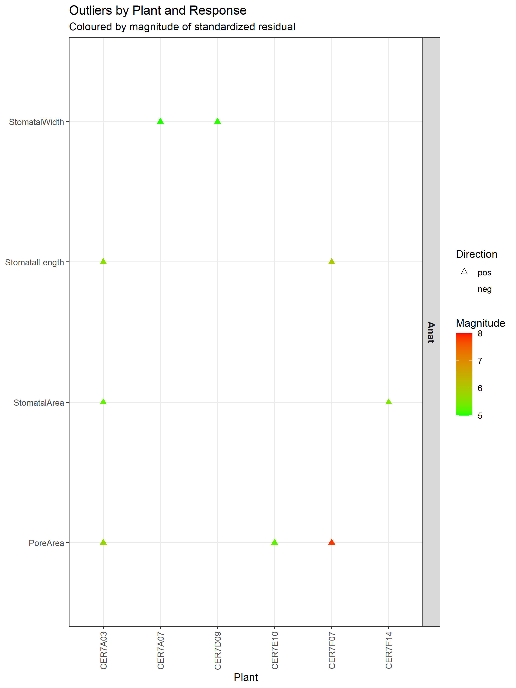

