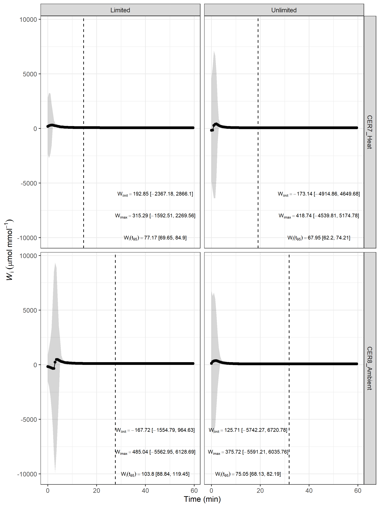
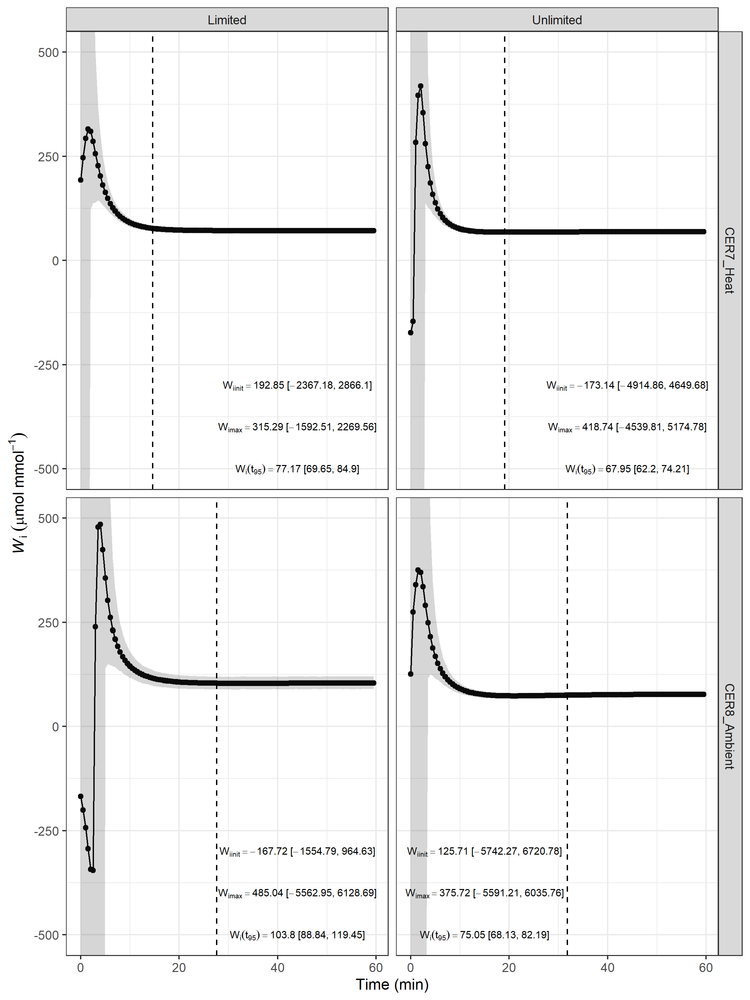

---
output:
  pdf_document: default
  html_document: default
---
# Wheat stomatal kinetics (heat & drought)
## --- Ed Chaplin (USyd), *Apr--June 2025* ---
### Li-6800 INTRINSIC WATER USE EFFICIENCY 

* Using predictions of A and gsw in the light off to light on portion to construct a plot of intrinsic water use efficiency
* 

### Load the libraries


``` r
library(knitr)
#knitr::spin("li6800.iWUE_i.v1.r")
library(ggplot2)
opts_chunk$set("tidy" = FALSE, "dev" = "png", "dpi" = 300, 
               "fig.width" = 7.5, "fig.height" = 10, "comment"=NA, fig.path = "figures/increase/")
library(dae)
library(dplyr)
library(brms) ##package used to fit bayesian regression model using Stan
library(tidyr)
library(emmeans)
library(tidybayes)
library(pracma)
```

### Set up constants and files


``` r
options(width=90)
load("../data/stomatalCondParamEstimation_A_i.v1.Rdata")
load("../data/stomatalCondParamEstimation_i.v1.Rdata")
saveFile <- "../data/iWUE.v1.Rdata"
```

### Using these models, I want to take draws from the posterior and then take the ratio of these to form my iWUE


``` r
pred.df <- expand.grid(tmin = unique(li6800.on.dat$tmin),
                       Room_Temperature = unique(li6800.on.dat$Room_Temperature),
                       Watering = unique(li6800.on.dat$Watering))

pred_A <- posterior_epred(fit_on_A_final,
                          newdata = pred.df,
                          re_formula = NA)

pred_g_i <- posterior_epred(fit_on_final,
                            newdata = pred.df,
                            re_formula = NA)
##now that I've got my draws from the posterior, I should just be able to divide A/gs
pred_Wi <- pred_A/pred_g_i

hdi_mat <- apply(pred_Wi, 2, function(x) {
  tidybayes::median_hdi(x)
})

##some of these have more than 1 row, which are they?
which(sapply(hdi_mat, nrow)!=1)
```

```
[1] 123 335
```

``` r
hdi_mat[123]
```

```
[[1]]
         y     ymin     ymax .width .point .interval
1 230.0454 144.2445 394.0007   0.95 median       hdi
2 230.0454 406.6292 407.0591   0.95 median       hdi
```

``` r
hdi_mat[335]
```

```
[[1]]
        y     ymin     ymax .width .point .interval
1 227.696 144.0923 367.5849   0.95 median       hdi
2 227.696 368.6171 378.5503   0.95 median       hdi
3 227.696 381.5380 385.3900   0.95 median       hdi
```

``` r
##retain just the interval including the medians - this isn't strictly legit
##but will do for our purposes
hdi_mat[123][[1]] <- hdi_mat[123][[1]][1,]
hdi_mat[335][[1]] <- hdi_mat[335][[1]][1,]

##great, now append the big matrix to my dataframe
pred.Wi.df <- cbind(pred.df, do.call(rbind, hdi_mat))

##figure out what the minimum and maximum iWUE is for each treatment
Wi.summ.df <- pred.Wi.df %>% group_by(Room_Temperature, Watering) %>% summarise(
  max.Wi = max(y),
  max.Wi.upper = ymax[which.max(y)],
  max.Wi.lower = ymin[which.max(y)],
  init.Wi = first(y),
  init.Wi.upper = first(ymax),
  init.Wi.lower = first(ymin)) %>% ungroup
```

```
`summarise()` has regrouped the output.
 Summaries were computed grouped by Room_Temperature and Watering.
 Output is grouped by Room_Temperature.
 Use `summarise(.groups = "drop_last")` to silence this message.
 Use `summarise(.by = c(Room_Temperature, Watering))` for per-operation grouping
  (`?dplyr::dplyr_by`) instead.
```

``` r
##append t95 for each treatment
Wi.summ.df <- left_join(Wi.summ.df, li6800.A.i.param %>% select(Room_Temperature,
                                                                Watering,
                                                                t95_emmean))
```

```
Joining with `by = join_by(Room_Temperature, Watering)`
```

``` r
##next, determine the value of the Wi closest to t95
Wi.at.t95 <- pred.Wi.df %>% left_join(Wi.summ.df, by = c("Room_Temperature",
                                                       "Watering")) %>%
  group_by(Room_Temperature, Watering) %>%
  slice_min(abs(tmin - t95_emmean), n=1, with_ties = FALSE) %>%
  ungroup()
Wi.summ.df$Wi.at.t95 <- Wi.at.t95$y
Wi.summ.df$Wi.at.t95.upper <- Wi.at.t95$ymax
Wi.summ.df$Wi.at.t95.lower <- Wi.at.t95$ymin

##tidy up for plot
pred.Wi.df$Watering <- dae::fac.recast(pred.Wi.df$Watering,
                                       newlevels = c("Limited", "Unlimited"))
Wi.summ.df$Watering <- dae::fac.recast(Wi.summ.df$Watering,
                                          newlevels = c("Limited", "Unlimited"))

pred.Wi.df$Room_Temperature <- dae::fac.recast(pred.Wi.df$Room_Temperature,
                                       newlevels = c('CER7_Heat', "CER8_Ambient"))
Wi.summ.df$Room_Temperature <- dae::fac.recast(Wi.summ.df$Room_Temperature,
                                       newlevels =  c('CER7_Heat', "CER8_Ambient"))

Wi.summ.df <- within(Wi.summ.df, {
  Wi.max.plot <- paste0("W[imax]==", round(max.Wi, 2), "*' ['*", 
                        round(max.Wi.lower, 2), "*', '*", round(max.Wi.upper, 2),
                        "*']'")
  Wi.init.plot <- paste0("W[iinit]==", round(init.Wi, 2), "*' ['*", 
                        round(init.Wi.lower, 2), "*', '*", round(init.Wi.upper, 2),
                        "*']'")
  Wi.t95.plot <- paste0("W[i](t[95])==", round(Wi.at.t95, 2), "*' ['*", 
                      round(Wi.at.t95.lower, 2), "*', '*", round(Wi.at.t95.upper, 2),
                      "*']'")
})
Wi.summ.df$x.text <- 44
Wi.summ.df$x.text[Wi.summ.df$Watering == "Unlimited" &
                    Wi.summ.df$Room_Temperature == "CER8_Ambient"] <- 15
```

### Put together a plot of iWUE


``` r
ggplot(pred.Wi.df, aes(x=tmin, y=y)) +
  geom_point() + geom_line() +
  facet_grid(Room_Temperature ~ Watering) +
  geom_ribbon(aes(ymin = ymin, ymax = ymax), alpha = 0.2) +
  # coord_cartesian(ylim = c(-500, 500)) +
  theme_bw() +
  ylab(expression(italic(W)[i]~(mu*mol~mmol^-1))) +
  xlab("Time (min)") +
  geom_vline(data =Wi.summ.df, aes(xintercept = t95_emmean), linetype = "dashed") +
  geom_text(data = Wi.summ.df, aes(x = x.text, y = -6000, label = Wi.init.plot), 
            parse = TRUE, size = 2.5) +
  geom_text(data = Wi.summ.df, aes(x = x.text, y = -8000, label = Wi.max.plot), 
            parse = TRUE, size = 2.5)  +
  geom_text(data = Wi.summ.df, aes(x = x.text, y = -10000, label = Wi.t95.plot), 
            parse = TRUE, size = 2.5)
```



``` r
ggsave("figures/Wi_Unzoomed.png", width = 8, height = 8)
ggsave("figures/Wi_Unzoomed.pdf", width = 8, height = 8)
ggsave("figures/Wi_Unzoomed.tiff", width = 8, height = 8)

ggplot(pred.Wi.df, aes(x=tmin, y=y)) +
  geom_point() + geom_line() +
  facet_grid(Room_Temperature ~ Watering) +
  geom_ribbon(aes(ymin = ymin, ymax = ymax), alpha = 0.2) +
  coord_cartesian(ylim = c(-500, 500)) +
  theme_bw() +
  ylab(expression(italic(W)[i]~(mu*mol~mmol^-1))) +
  xlab("Time (min)") +
  geom_vline(data =Wi.summ.df, aes(xintercept = t95_emmean), linetype = "dashed") +
  geom_text(data = Wi.summ.df, aes(x = x.text, y = -300, label = Wi.init.plot), 
            parse = TRUE, size = 2.5) +
  geom_text(data = Wi.summ.df, aes(x = x.text, y = -400, label = Wi.max.plot), 
            parse = TRUE, size = 2.5)  +
  geom_text(data = Wi.summ.df, aes(x = x.text, y = -500, label = Wi.t95.plot), 
            parse = TRUE, size = 2.5)
```



``` r
ggsave("figures/Wi_Zoomed.png", width = 8, height = 8)
ggsave("figures/Wi_Zoomed.pdf", width = 8, height = 8)
ggsave("figures/Wi_Zoomed.tiff", width = 8, height = 8)
```

### Save data and export


``` r
save.image(saveFile)
```

