# Wheat stomatal kinetics (heat & drought)
## --- Ed Chaplin (USyd), *Apr--June 2025* ---
### Li-6800 STOMATAL CONDUCTANCE MODEL FITTING - LIGHT OFF TO LIGHT ON (INCREASE)

* This script will attempt to fit the methods of Woning et al (2026) and McAusland et al (2016) using the script supplied by Silvere Vialet-Chabrand
* The models fitted in the script look to be the Cumulative Distribution Weibull (CDWeibull) models described in Eqn 4.1 of Woning et al (2026)
* I've also adapted the script to incorporate the McAusland model
* Scripts supplied by Silvere can be found in the gs_fit.zip directory
* There are two scripts in this directory: fit_per_curve.r and fit_per_species.r
* Fit_per_curve looks to take each individual plant and fit a curve to it, 
while fit_per_species fits some parameters (tau and theta) at a species (treatment in our setting) level and others at a replicate level
* In an email from Silvere (shared by Chris and put in the \textit{Materials from Ed} directory), 
Silvere prefers the fit_per_species approach, as do I, as this seems to align better with conventional analysis approaches

### Load the libraries


``` r
library(knitr)
#knitr::spin("li6800.stomatalCondModel.v1.r")
library(ggplot2)
opts_chunk$set("tidy" = FALSE, "dev" = "png", "dpi" = 300, 
               "fig.width" = 7.5, "fig.height" = 10, "comment"=NA, fig.path = "figures/")
library(dae)
library(dplyr)
library(growthPheno) # calcLagged
packageVersion("growthPheno")
```

```
[1] '3.1.18'
```

``` r
library(brms) ##package used to fit bayesian regression model using Stan
```

### Set up constants and files


``` r
options(width=90)
load("../data/li6800.v1.Rdata")
saveFile <- "../data/stomatalCondModel.v1.Rdata"
```

### Define TW to be unique for each treatment


``` r
li6800.dat$TW <- paste(li6800.dat$Temperature, li6800.dat$Watering, sep="_")
li6800.dat$TW <- factor(li6800.dat$TW)
```

### Define th and tmin, to be time in hours and minutes respectively


``` r
li6800.dat$th <- li6800.dat$xElapsed/3600
li6800.dat$tmin <- li6800.dat$xElapsed/60
```

### Explore the gs profiles of just the light on portion of the experiment


``` r
plotProfiles(li6800.dat %>% filter(Light == "On"), response = "gsw",
             individuals = "TWR", times = "tmin",
             facet.x = "Temperature",
             facet.y = "Watering",
             y.title = "gsw",
             x.title = "hours",
             title = "gsw",
             breaks.spacing.x = 5,
             alpha = 0.75)
```


### Explore the gs profiles of just the second light off portion of the experiment


``` r
# plotProfiles(li6800.dat %>% filter(Light == "Off" & th > 2), response = "gsw",
#              individuals = "TWR", times = "th",
#              facet.x = "Temperature",
#              facet.y = "Watering",
#              y.title = "gsw",
#              x.title = "hours",
#              title = "gsw",
#              breaks.spacing.x = 5,
#              alpha = 0.75)
```

### Following *fit_per_species.R*
* Script begins by specifying a stomatal conductance model and setting priors on the parameters
* I have played a little with the priors specified in the script by Silvere, to be more representative of this dataset
* Following discussion with Ed on 22/04, perhaps we want to select a different ``training" dataset for each treatment combination - need to explore what impact this has
* I haven't implemented the above dot point, as the model is refit for each treatment - it's just the compliation of the tool that fits the model under the hood that doesn't need to be re-initialised and keeps the same structure

#### Stomatal conductance model - CDWeibull from Woning et al 2026


``` r
nlform <- bf(gsw ~ g1 + (g0 - g1) * exp(-((th / tau)^theta)),
             g0 ~ 1 + (1 | Rep),
             g1 ~ 1 + (1 | Rep),
             tau ~ 1,
             theta ~ 1,
             nl = TRUE)
```

#### Stomatal conductance model - McAusland from McAusland et al 2016


``` r
nlform_mc <- bf(gsw ~ g0 + (g1 - g0) * exp(-exp(((lambda - tmin)/k)+1)),
             g0 ~ 1 + (1 | Rep),
             g1 ~ 1 + (1 | Rep),
             k ~ 1,
             lambda ~ 1,
             nl = TRUE)

priors <- c(prior(normal(0.025, 0.02), nlpar = "g0"),
            prior(normal(0.3, 0.2), nlpar = "g1"),
            prior(normal(0, 0.01), class = "sd", nlpar = "g0"),
            prior(normal(0, 0.05), class = "sd", nlpar = "g1"),
            prior(normal(0.25, 1), nlpar = "tau", lb = 0),
            prior(normal(2, 2), nlpar = "theta", lb = 0),
            prior(student_t(3, 0, 0.01), class = "sigma"))

priors_mc <- c(prior(normal(0.025, 0.02), nlpar = "g0"),
            prior(normal(0.3, 0.2), nlpar = "g1"),
            prior(normal(0, 0.01), class = "sd", nlpar = "g0"),
            prior(normal(0, 0.05), class = "sd", nlpar = "g1"),
            prior(normal(3, 2), nlpar = "k", lb = 0),
            prior(normal(4, 2), nlpar = "lambda", lb = 0),
            prior(student_t(3, 0, 0.01), class = "sigma"))
```

#### Initialise the model
Looks like to initialise the model, the dataframe is subset for the first plant in the first rep and for PAR == 1, which is the period where the light is switched on


``` r
# pick a small but valid dataset
dd_init <- subset(li6800.dat, Light == "On" & TW == li6800.dat$TW[1] & th != 0)
dd_init$th <- dd_init$th - dd_init$th[1]
dd_init$tmin <- dd_init$tmin - dd_init$tmin[1]

##remove the first observation from the analysis - it's still impacted by the change in lighting
dd_init <- subset(dd_init, th != 0)
head(dd_init)
```

```
    obs         time elapsed              date   hhmmss       time.elapsed        A
125 126 1750032134.5    3661 20250616 10:02:14 10:02:14 61.000000000000021 1.296567
126 127 1750032164.5    3691 20250616 10:02:44 10:02:44 61.500000000000021 1.385702
127 128 1750032194.5    3721 20250616 10:03:14 10:03:14 62.000000000000021 1.067099
128 129 1750032224.5    3751 20250616 10:03:44 10:03:44 62.500000000000014 1.284658
129 130 1750032254.5    3781 20250616 10:04:14 10:04:14 63.000000000000014 1.230181
130 131 1750032284.5    3811 20250616 10:04:44 10:04:44 63.500000000000014 1.372948
              gsw  TleafEB     light           Timestamp time.diff xElapsed xElapsed.min
125 -0.0028748183 24.75610  999.9787 2025-06-16 10:02:14        30     3660         61.0
126 -0.0025839934 24.84859  999.9951 2025-06-16 10:02:44        30     3690         61.5
127 -0.0001403046 24.91740 1000.0007 2025-06-16 10:03:14        30     3720         62.0
128  0.0026056428 24.98566 1000.0335 2025-06-16 10:03:44        30     3750         62.5
129  0.0005737584 25.07066 1000.0050 2025-06-16 10:04:14        30     3780         63.0
130  0.0044335864 25.10999 1000.0035 2025-06-16 10:04:44        30     3810         63.5
    Line Temperature Watering Rep       TWR Location Light      TW          th tmin
125  L01         Amb      Lim   1 Amb_Lim_1      D13    On Amb_Lim 0.008333333  0.5
126  L01         Amb      Lim   1 Amb_Lim_1      D13    On Amb_Lim 0.016666667  1.0
127  L01         Amb      Lim   1 Amb_Lim_1      D13    On Amb_Lim 0.025000000  1.5
128  L01         Amb      Lim   1 Amb_Lim_1      D13    On Amb_Lim 0.033333333  2.0
129  L01         Amb      Lim   1 Amb_Lim_1      D13    On Amb_Lim 0.041666667  2.5
130  L01         Amb      Lim   1 Amb_Lim_1      D13    On Amb_Lim 0.050000000  3.0
```

``` r
plotProfiles(dd_init, response = "gsw",
             individuals = "TWR", times = "tmin",
             y.title = "gsw",
             x.title = "hours",
             title = "gsw",
             breaks.spacing.x = 5,
             alpha = 0.75)
```

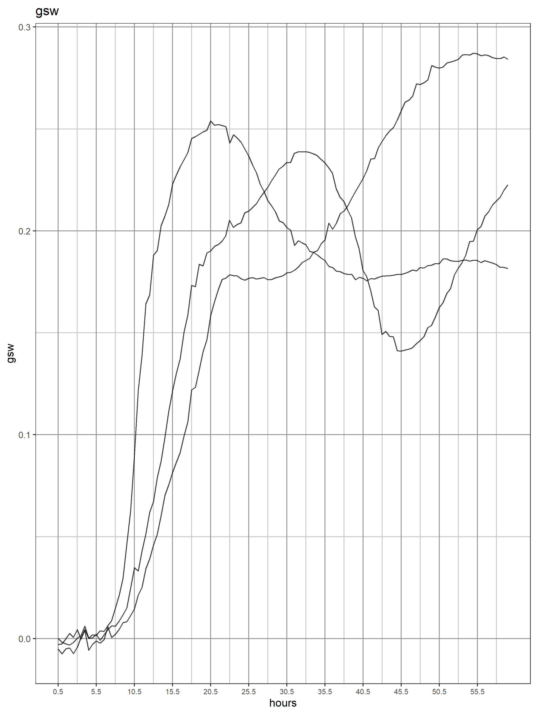

``` r
# Configure and compile the model
fit_init <- brm(
  formula = nlform,
  data = dd_init,
  prior = priors,
  chains = 4,
  cores = 4,
  iter = 3000,
  warmup = 2000,
  control = list(
    adapt_delta = 0.99,
    max_treedepth = 12,
    metric = "diag_e"
  )
)
```

```
Compiling Stan program...
```

```
Start sampling
```

``` r
print(summary(fit_init))
```

```
 Family: gaussian 
  Links: mu = identity 
Formula: gsw ~ g1 + (g0 - g1) * exp(-((th/tau)^theta)) 
         g0 ~ 1 + (1 | Rep)
         g1 ~ 1 + (1 | Rep)
         tau ~ 1
         theta ~ 1
   Data: dd_init (Number of observations: 362) 
  Draws: 4 chains, each with iter = 3000; warmup = 2000; thin = 1;
         total post-warmup draws = 4000

Multilevel Hyperparameters:
~Rep (Number of levels: 3) 
                 Estimate Est.Error l-95% CI u-95% CI Rhat Bulk_ESS Tail_ESS
sd(g0_Intercept)     0.02      0.01     0.01     0.03 1.00     2488     2008
sd(g1_Intercept)     0.02      0.02     0.01     0.07 1.00     1327     1486

Regression Coefficients:
                Estimate Est.Error l-95% CI u-95% CI Rhat Bulk_ESS Tail_ESS
g0_Intercept        0.00      0.01    -0.02     0.03 1.00     2052     2438
g1_Intercept        0.21      0.02     0.17     0.24 1.00     1209     1115
tau_Intercept       0.26      0.01     0.24     0.27 1.00     4138     2890
theta_Intercept     3.62      0.40     2.94     4.49 1.00     4217     2982

Further Distributional Parameters:
      Estimate Est.Error l-95% CI u-95% CI Rhat Bulk_ESS Tail_ESS
sigma     0.04      0.00     0.03     0.04 1.00     4369     2798

Draws were sampled using sampling(NUTS). For each parameter, Bulk_ESS
and Tail_ESS are effective sample size measures, and Rhat is the potential
scale reduction factor on split chains (at convergence, Rhat = 1).
```

``` r
plot(fit_init)
```

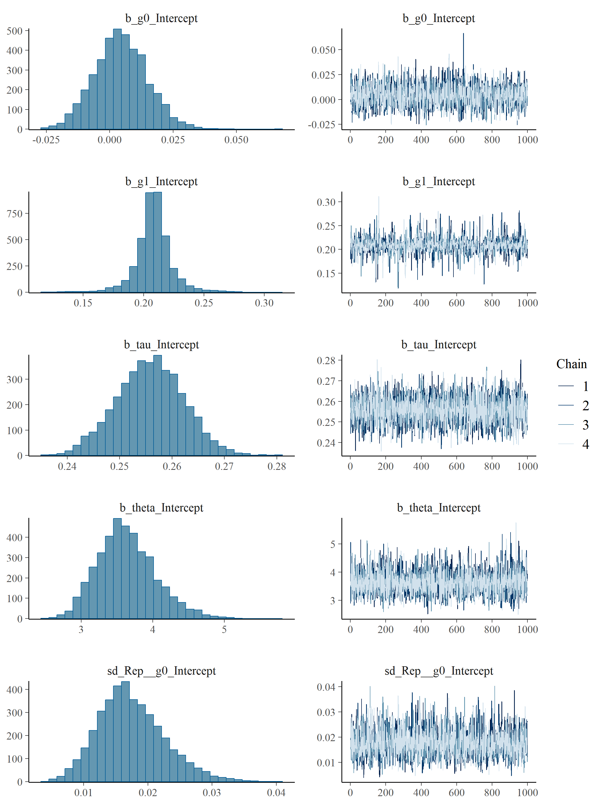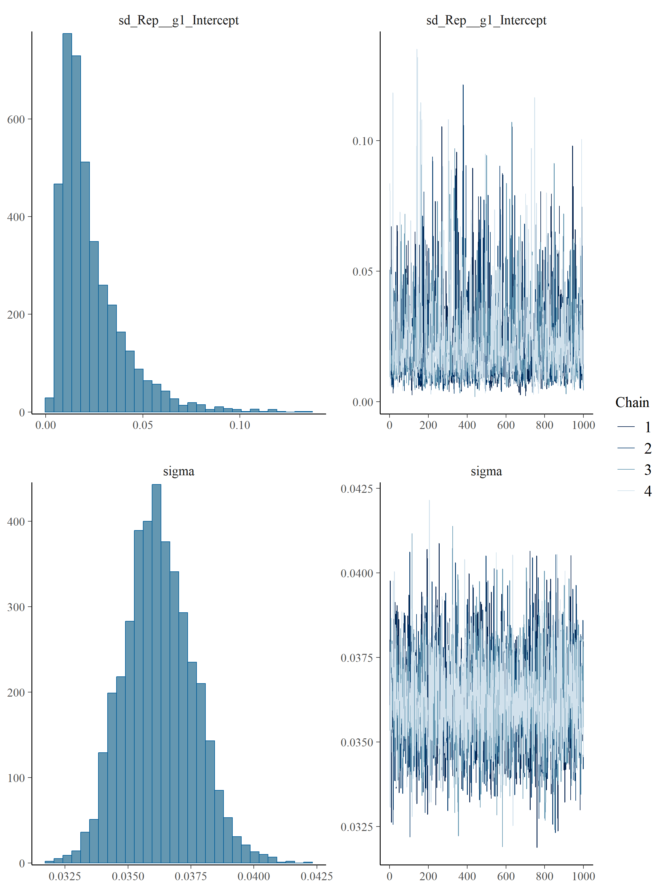

``` r
pairs(fit_init)
```

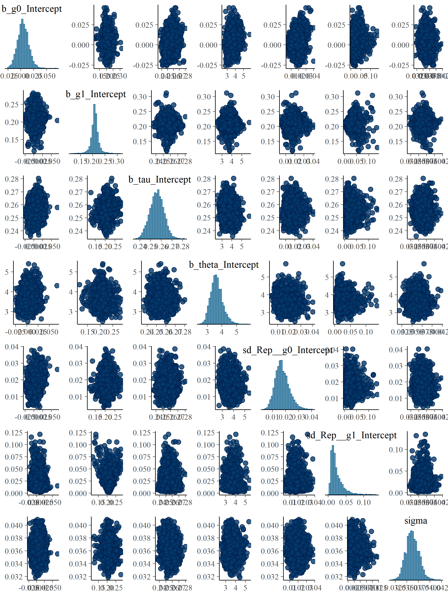

``` r
mcmc_plot(fit_init, type = "trace")
```

```
No divergences to plot.
```

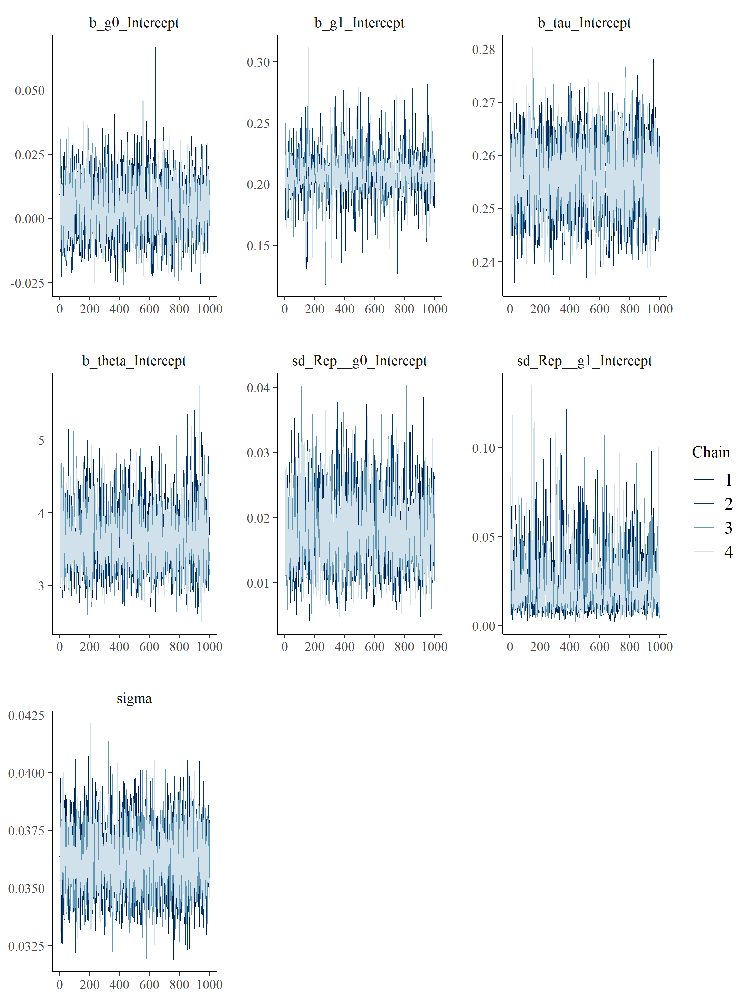

``` r
rstan::check_hmc_diagnostics(fit_init$fit)
```

```

Divergences:
```

```
0 of 4000 iterations ended with a divergence.
```

```

Tree depth:
```

```
0 of 4000 iterations saturated the maximum tree depth of 12.
```

```

Energy:
```

```
E-BFMI indicated no pathological behavior.
```

``` r
loo(fit_init)
```

```

Computed from 4000 by 362 log-likelihood matrix.

         Estimate   SE
elpd_loo    682.2 11.4
p_loo         8.3  0.7
looic     -1364.4 22.8
------
MCSE of elpd_loo is 0.0.
MCSE and ESS estimates assume MCMC draws (r_eff in [0.7, 1.2]).

All Pareto k estimates are good (k < 0.7).
See help('pareto-k-diagnostic') for details.
```

``` r
pp_check(fit_init)  # compares density of the observed data with data generated from posterior predictive distribution
```

```
Using 10 posterior draws for ppc type 'dens_overlay' by default.
```

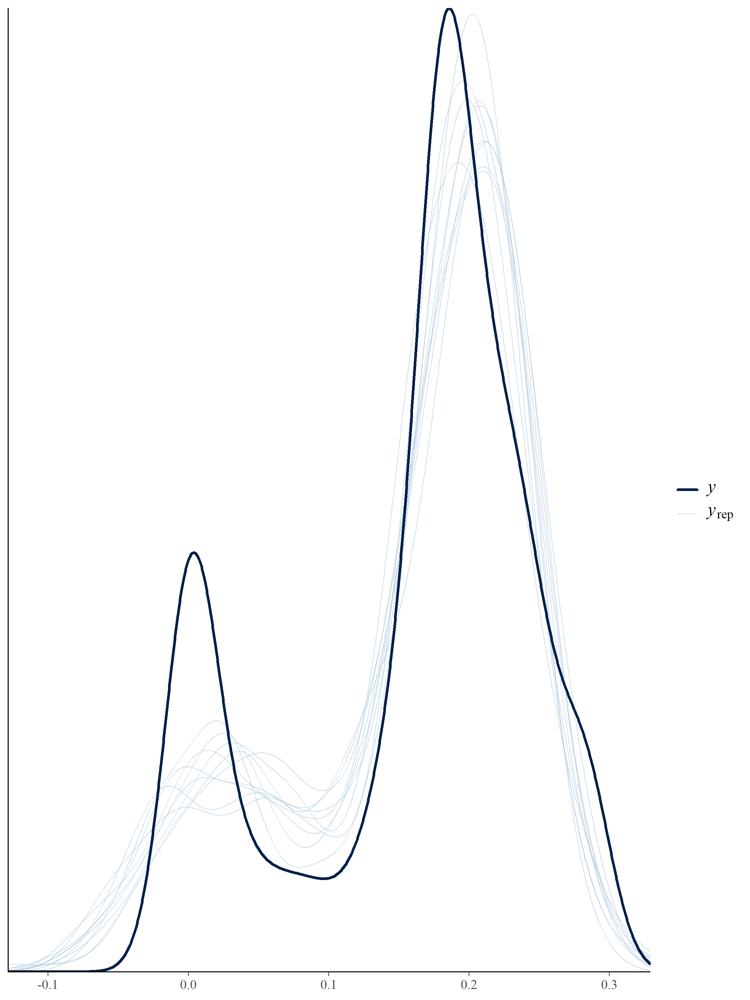

``` r
pp_check(fit_init, type = "error_hist", ndraws = 12)
```

```
`stat_bin()` using `bins = 30`. Pick better value `binwidth`.
```

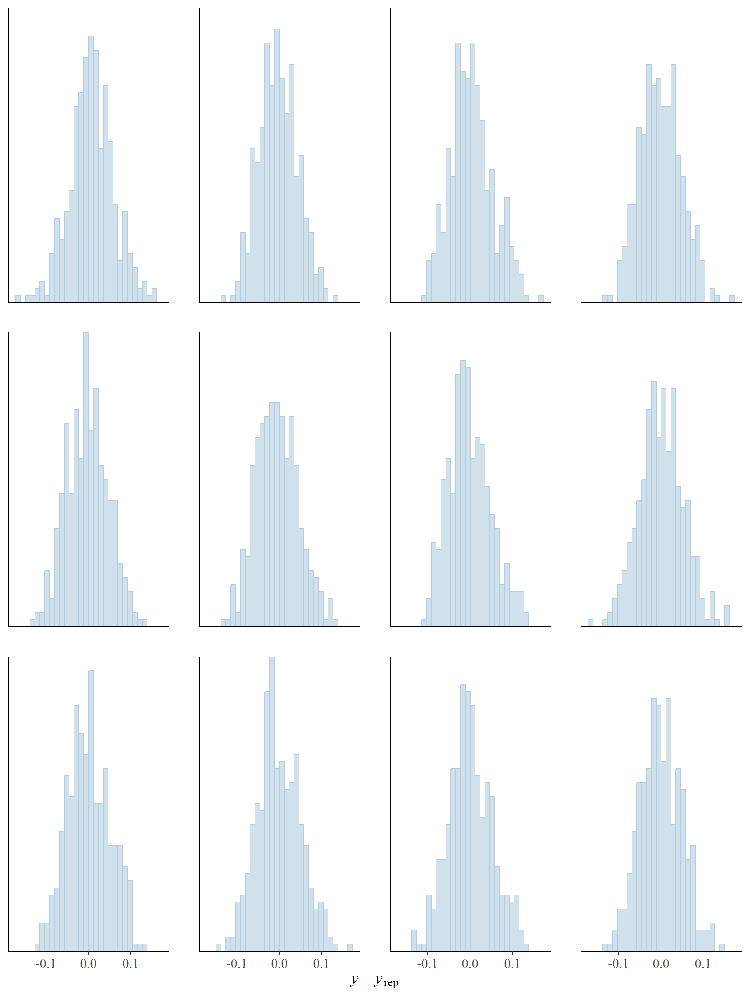

``` r
pp_check(fit_init, type = "scatter_avg", ndraws = 1000)
```

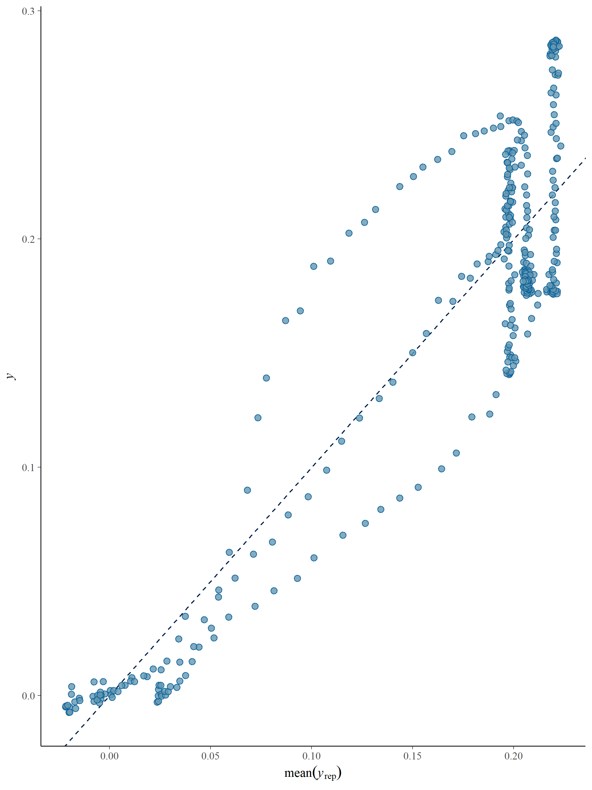

``` r
pp_check(fit_init, type = "stat_2d")
```

```
Using all posterior draws for ppc type 'stat_2d' by default.
```

```
Note: in most cases the default test statistic 'mean' is too weak to detect anything of interest.
```

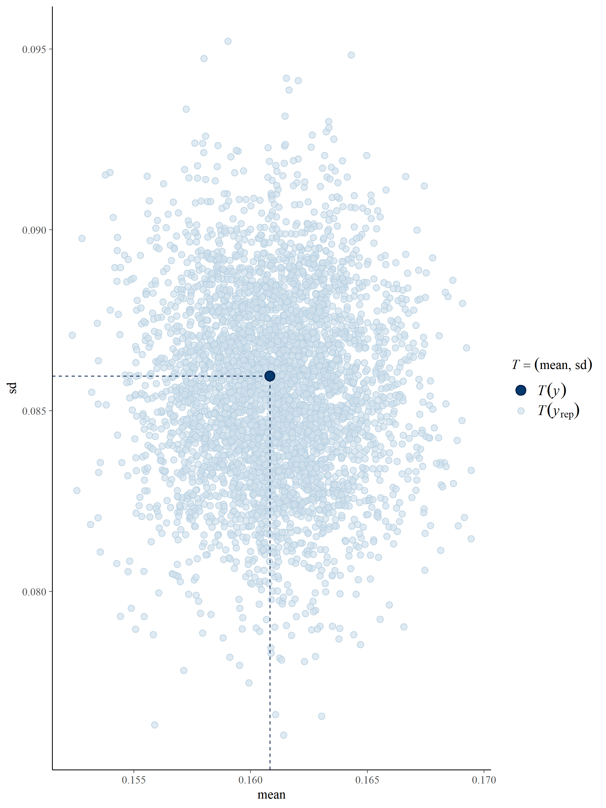

``` r
pp_check(fit_init, type = "loo_ribbon")
```

```
Using all posterior draws for ppc type 'loo_ribbon' by default.
```

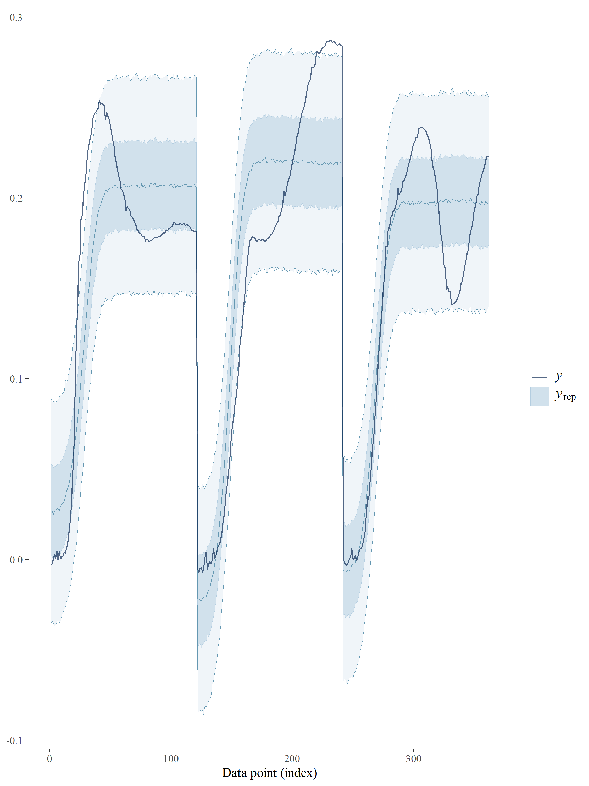

``` r
plot(gsw~th, dd_init, pch=16, main = unique(dd_init$TW))
points(fitted(fit_init)[,1]~th, dd_init, pch=16, col="red")
```

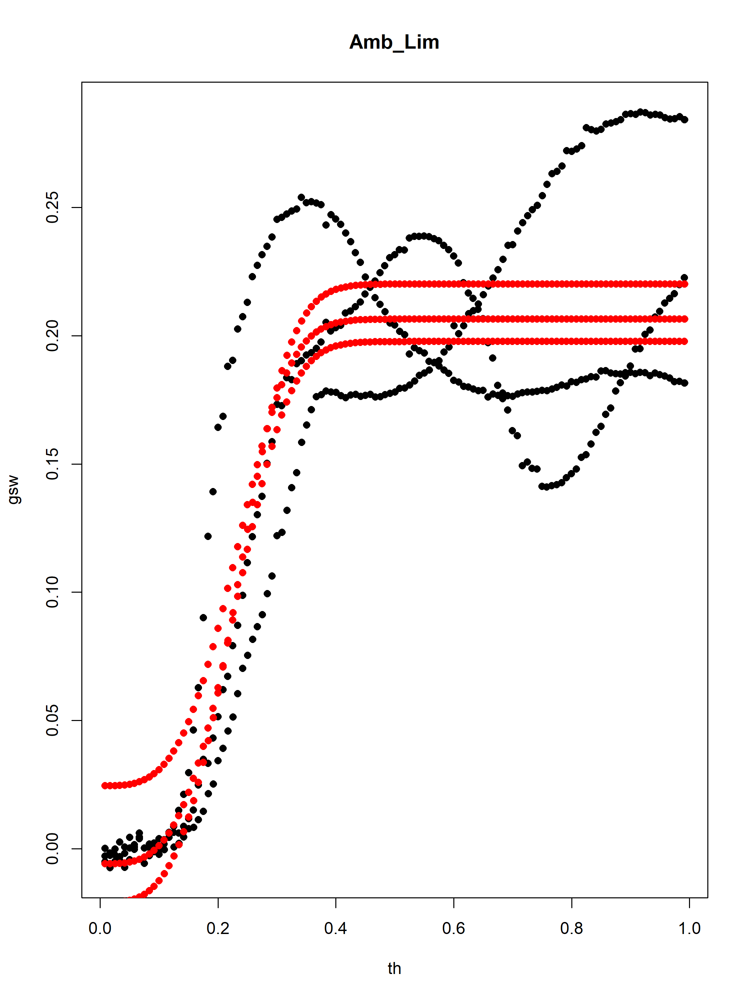

``` r
# Configure and compile the model - McAusland
fit_init_mc <- brm(
  formula = nlform_mc,
  data = dd_init,
  prior = priors_mc,
  chains = 4,
  cores = 4,
  iter = 3000,
  warmup = 2000,
  control = list(
    adapt_delta = 0.99,
    max_treedepth = 12,
    metric = "diag_e"
  )
)
```

```
Compiling Stan program...
```

```
Start sampling
```

``` r
print(summary(fit_init_mc))
```

```
 Family: gaussian 
  Links: mu = identity 
Formula: gsw ~ g0 + (g1 - g0) * exp(-exp(((lambda - tmin)/k) + 1)) 
         g0 ~ 1 + (1 | Rep)
         g1 ~ 1 + (1 | Rep)
         k ~ 1
         lambda ~ 1
   Data: dd_init (Number of observations: 362) 
  Draws: 4 chains, each with iter = 3000; warmup = 2000; thin = 1;
         total post-warmup draws = 4000

Multilevel Hyperparameters:
~Rep (Number of levels: 3) 
                 Estimate Est.Error l-95% CI u-95% CI Rhat Bulk_ESS Tail_ESS
sd(g0_Intercept)     0.02      0.01     0.01     0.03 1.00     2465     2157
sd(g1_Intercept)     0.02      0.02     0.01     0.07 1.00     1342     1939

Regression Coefficients:
                 Estimate Est.Error l-95% CI u-95% CI Rhat Bulk_ESS Tail_ESS
g0_Intercept         0.01      0.01    -0.01     0.03 1.00     2056     2445
g1_Intercept         0.21      0.02     0.18     0.25 1.00     1432     1533
k_Intercept          3.89      0.40     3.12     4.71 1.00     2287     2114
lambda_Intercept     8.25      0.62     6.99     9.42 1.00     2426     1911

Further Distributional Parameters:
      Estimate Est.Error l-95% CI u-95% CI Rhat Bulk_ESS Tail_ESS
sigma     0.04      0.00     0.03     0.04 1.00     3759     2748

Draws were sampled using sampling(NUTS). For each parameter, Bulk_ESS
and Tail_ESS are effective sample size measures, and Rhat is the potential
scale reduction factor on split chains (at convergence, Rhat = 1).
```

``` r
plot(fit_init_mc)
```

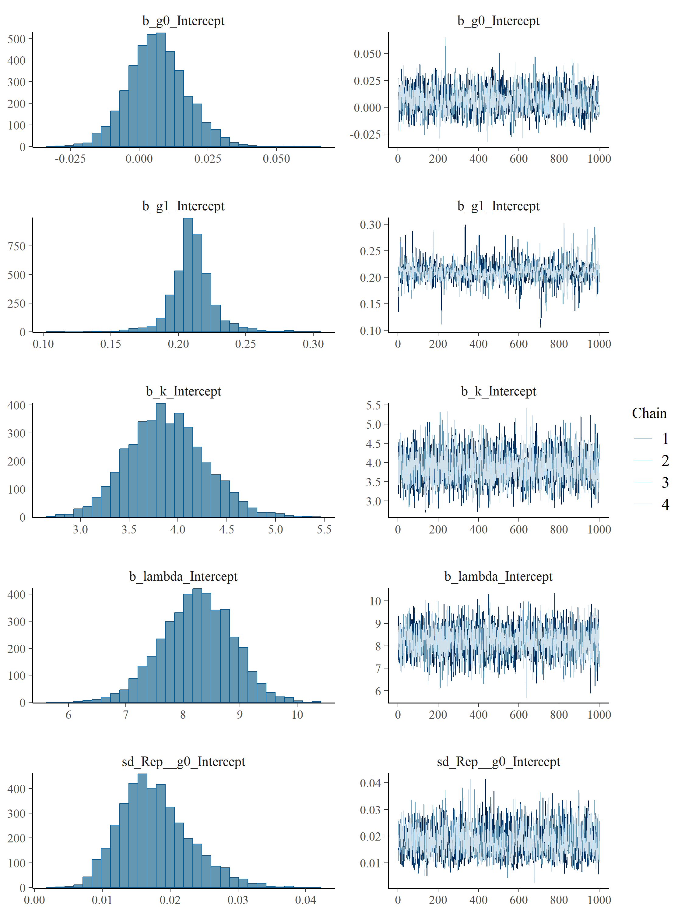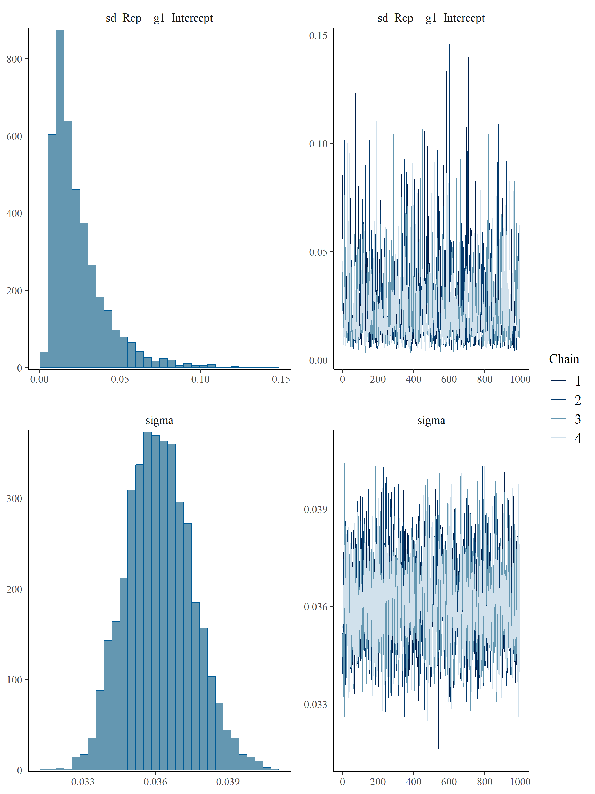

``` r
pairs(fit_init_mc)
```

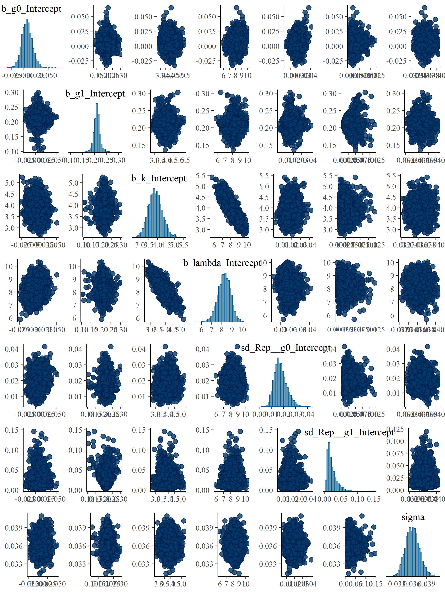

``` r
mcmc_plot(fit_init_mc, type = "trace")
```

```
No divergences to plot.
```

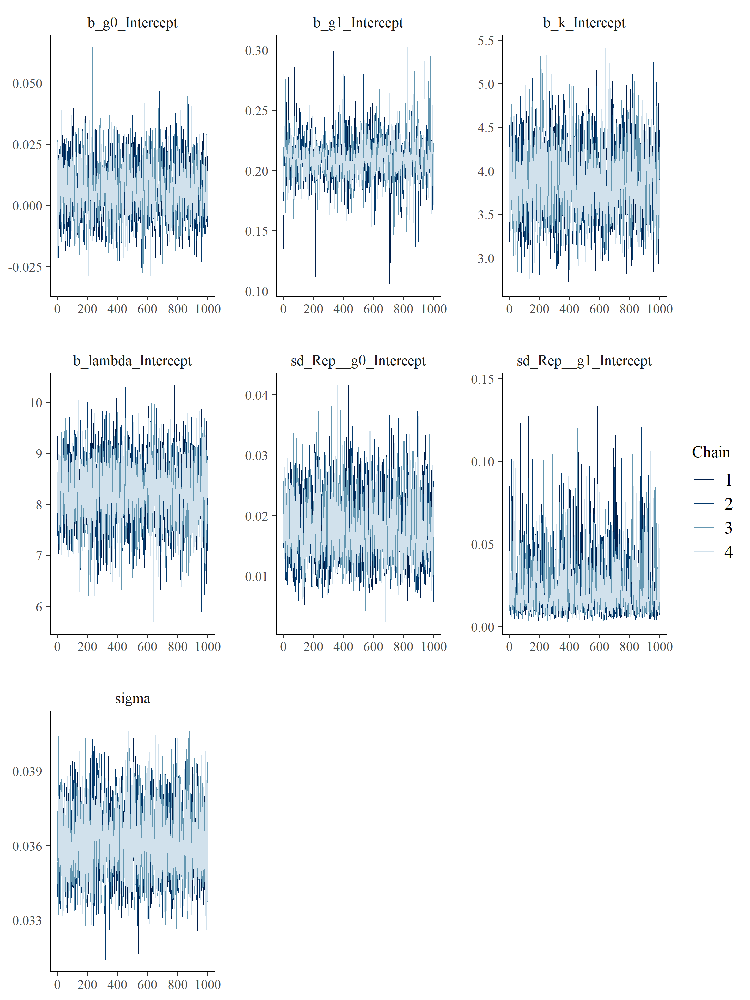

``` r
rstan::check_hmc_diagnostics(fit_init_mc$fit)
```

```

Divergences:
```

```
0 of 4000 iterations ended with a divergence.
```

```

Tree depth:
```

```
0 of 4000 iterations saturated the maximum tree depth of 12.
```

```

Energy:
```

```
E-BFMI indicated no pathological behavior.
```

``` r
loo(fit_init_mc)
```

```

Computed from 4000 by 362 log-likelihood matrix.

         Estimate   SE
elpd_loo    683.8 10.8
p_loo         7.4  0.5
looic     -1367.6 21.5
------
MCSE of elpd_loo is 0.0.
MCSE and ESS estimates assume MCMC draws (r_eff in [0.6, 1.4]).

All Pareto k estimates are good (k < 0.7).
See help('pareto-k-diagnostic') for details.
```

``` r
pp_check(fit_init_mc)  # compares density of the observed data with data generated from posterior predictive distribution
```

```
Using 10 posterior draws for ppc type 'dens_overlay' by default.
```

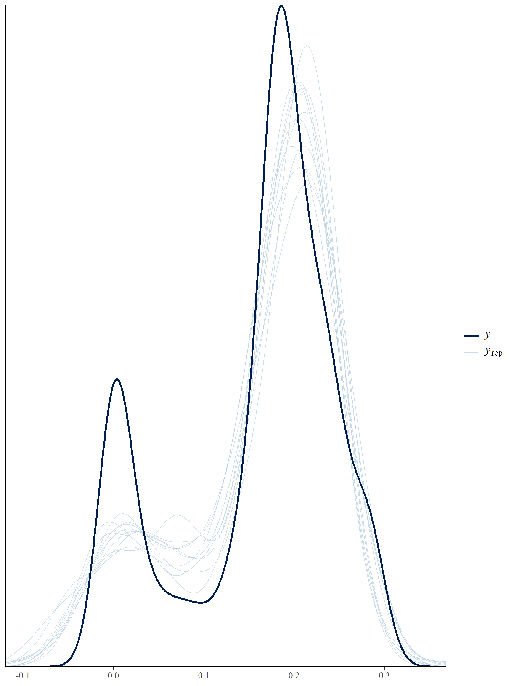

``` r
pp_check(fit_init_mc, type = "error_hist", ndraws = 12)
```

```
`stat_bin()` using `bins = 30`. Pick better value `binwidth`.
```

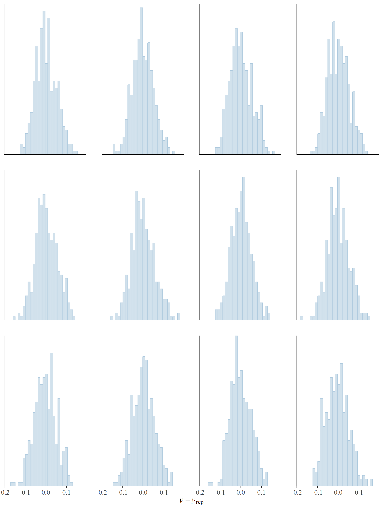

``` r
pp_check(fit_init_mc, type = "scatter_avg", ndraws = 1000)
```

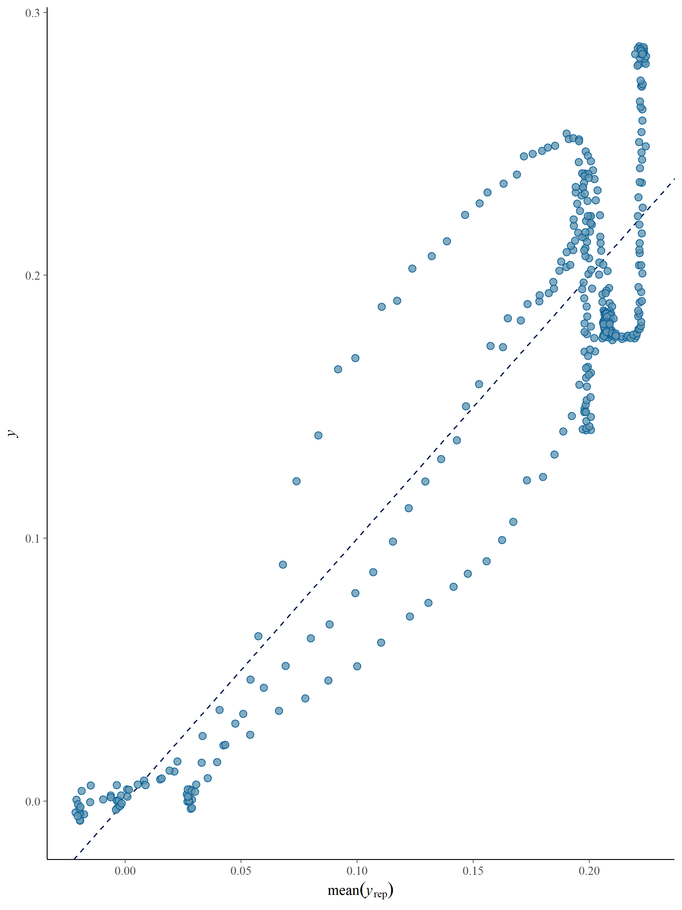

``` r
pp_check(fit_init_mc, type = "stat_2d")
```

```
Using all posterior draws for ppc type 'stat_2d' by default.
```

```
Note: in most cases the default test statistic 'mean' is too weak to detect anything of interest.
```

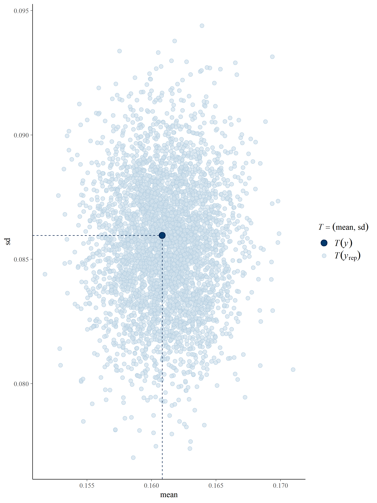

``` r
pp_check(fit_init_mc, type = "loo_ribbon")
```

```
Using all posterior draws for ppc type 'loo_ribbon' by default.
```


``` r
plot(gsw~tmin, dd_init, pch=16, main = unique(dd_init$TW))
points(fitted(fit_init_mc)[,1]~tmin, dd_init, pch=16, col="red")
```

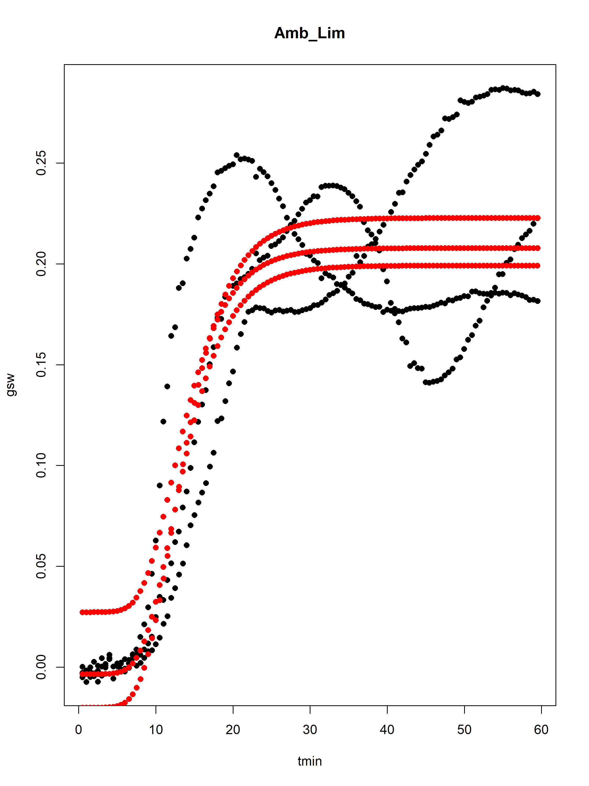

``` r
##look at the effects from the model
fixef(fit_init_mc)
```

```
                    Estimate  Est.Error        Q2.5      Q97.5
g0_Intercept     0.006295694 0.01047479 -0.01348454 0.02836868
g1_Intercept     0.210402955 0.01673132  0.17579356 0.24760004
k_Intercept      3.886291880 0.40419120  3.11996669 4.71396805
lambda_Intercept 8.251805579 0.62262196  6.98736242 9.41688717
```

``` r
ranef(fit_init_mc)
```

```
$Rep
, , g0_Intercept

      Estimate  Est.Error          Q2.5        Q97.5
1  0.020949477 0.01119357 -0.0007292416  0.043427621
2 -0.026614061 0.01188657 -0.0520274499 -0.005218338
3 -0.009747738 0.01110657 -0.0320285019  0.011479550

, , g1_Intercept

      Estimate  Est.Error        Q2.5      Q97.5
1 -0.002717884 0.01676378 -0.04090802 0.03151394
2  0.012318557 0.01674310 -0.02463374 0.04767445
3 -0.011244594 0.01678590 -0.04963560 0.02215376
```

``` r
coef(fit_init_mc)
```

```
$Rep
, , g0_Intercept

      Estimate   Est.Error         Q2.5        Q97.5
1  0.027245170 0.008708821  0.009919749  0.044033097
2 -0.020318368 0.008419636 -0.037033165 -0.004004882
3 -0.003452045 0.007745855 -0.018861618  0.012165388

, , g1_Intercept

   Estimate   Est.Error      Q2.5     Q97.5
1 0.2076851 0.003801702 0.2001832 0.2151240
2 0.2227215 0.004316269 0.2142689 0.2310003
3 0.1991584 0.003918706 0.1913650 0.2067884

, , k_Intercept

  Estimate Est.Error     Q2.5    Q97.5
1 3.886292 0.4041912 3.119967 4.713968
2 3.886292 0.4041912 3.119967 4.713968
3 3.886292 0.4041912 3.119967 4.713968

, , lambda_Intercept

  Estimate Est.Error     Q2.5    Q97.5
1 8.251806  0.622622 6.987362 9.416887
2 8.251806  0.622622 6.987362 9.416887
3 8.251806  0.622622 6.987362 9.416887
```

#### Write a function to process each individual treatment


``` r
process <- function(d1, fit_template) {
  dd <- subset(d1, Light == "On" & th != 0 & !is.na(gsw))
  
  # t=0 at the light step 
  dd$th <- dd$th - dd$th[1]
  dd$tmin <- dd$tmin - dd$tmin[1]
  
  ##remove the first time point, as seems to be impacted by change of lighting still
  dd <- subset(dd, th != 0)
  
  fit <- update(
    fit_template,
    newdata = dd,
    recompile = NULL,
    refresh = 0
  )
  
  # Check diagnostics, Important!
  print(summary(fit))
  rstan::check_hmc_diagnostics(fit$fit)
  #plot(fit)
  #pp_check(fit)
  # plot(gsw~th, dd, pch=16, main = unique(dd$TW))
  # points(fitted(fit)[,1]~th, dd, pch=16, col="red")
  
  return(fit)
}
```

#### Implement loop


``` r
# Main loop that select each plant per species
fits <- list()

for (i in unique(li6800.dat$TW)) {
  d1 <- subset(li6800.dat, TW == i)
  
  cat("TW:", i, "\n")
  
  fits[[i]] <- process(d1, fit_init)
}
```

```
TW: Amb_Lim 
```

```
Start sampling
```

```
 Family: gaussian 
  Links: mu = identity 
Formula: gsw ~ g1 + (g0 - g1) * exp(-((th/tau)^theta)) 
         g0 ~ 1 + (1 | Rep)
         g1 ~ 1 + (1 | Rep)
         tau ~ 1
         theta ~ 1
   Data: dd (Number of observations: 362) 
  Draws: 4 chains, each with iter = 3000; warmup = 2000; thin = 1;
         total post-warmup draws = 4000

Multilevel Hyperparameters:
~Rep (Number of levels: 3) 
                 Estimate Est.Error l-95% CI u-95% CI Rhat Bulk_ESS Tail_ESS
sd(g0_Intercept)     0.02      0.01     0.01     0.03 1.00     2085     2044
sd(g1_Intercept)     0.02      0.02     0.01     0.07 1.00     1158     1816

Regression Coefficients:
                Estimate Est.Error l-95% CI u-95% CI Rhat Bulk_ESS Tail_ESS
g0_Intercept        0.00      0.01    -0.01     0.03 1.00     1809     2447
g1_Intercept        0.21      0.02     0.17     0.24 1.00     1245     1350
tau_Intercept       0.26      0.01     0.24     0.27 1.00     3528     2677
theta_Intercept     3.63      0.41     2.90     4.51 1.00     3877     2621

Further Distributional Parameters:
      Estimate Est.Error l-95% CI u-95% CI Rhat Bulk_ESS Tail_ESS
sigma     0.04      0.00     0.03     0.04 1.00     3671     2618

Draws were sampled using sampling(NUTS). For each parameter, Bulk_ESS
and Tail_ESS are effective sample size measures, and Rhat is the potential
scale reduction factor on split chains (at convergence, Rhat = 1).

Divergences:
```

```
0 of 4000 iterations ended with a divergence.
```

```

Tree depth:
```

```
0 of 4000 iterations saturated the maximum tree depth of 12.
```

```

Energy:
```

```
E-BFMI indicated no pathological behavior.
```

```
TW: Amb_Unlim 
```

```
Start sampling
```

```
 Family: gaussian 
  Links: mu = identity 
Formula: gsw ~ g1 + (g0 - g1) * exp(-((th/tau)^theta)) 
         g0 ~ 1 + (1 | Rep)
         g1 ~ 1 + (1 | Rep)
         tau ~ 1
         theta ~ 1
   Data: dd (Number of observations: 363) 
  Draws: 4 chains, each with iter = 3000; warmup = 2000; thin = 1;
         total post-warmup draws = 4000

Multilevel Hyperparameters:
~Rep (Number of levels: 3) 
                 Estimate Est.Error l-95% CI u-95% CI Rhat Bulk_ESS Tail_ESS
sd(g0_Intercept)     0.03      0.01     0.02     0.04 1.00     2728     2487
sd(g1_Intercept)     0.05      0.02     0.02     0.10 1.00     2215     2507

Regression Coefficients:
                Estimate Est.Error l-95% CI u-95% CI Rhat Bulk_ESS Tail_ESS
g0_Intercept        0.01      0.01    -0.02     0.04 1.00     2487     2364
g1_Intercept        0.34      0.03     0.28     0.40 1.00     1528     1934
tau_Intercept       0.22      0.01     0.21     0.23 1.00     4343     2349
theta_Intercept     1.69      0.19     1.37     2.10 1.00     3475     2684

Further Distributional Parameters:
      Estimate Est.Error l-95% CI u-95% CI Rhat Bulk_ESS Tail_ESS
sigma     0.03      0.00     0.03     0.03 1.00     4351     2692

Draws were sampled using sampling(NUTS). For each parameter, Bulk_ESS
and Tail_ESS are effective sample size measures, and Rhat is the potential
scale reduction factor on split chains (at convergence, Rhat = 1).

Divergences:
```

```
0 of 4000 iterations ended with a divergence.
```

```

Tree depth:
```

```
0 of 4000 iterations saturated the maximum tree depth of 12.
```

```

Energy:
```

```
E-BFMI indicated no pathological behavior.
```

```
TW: Heat_Lim 
```

```
Start sampling
```

```
 Family: gaussian 
  Links: mu = identity 
Formula: gsw ~ g1 + (g0 - g1) * exp(-((th/tau)^theta)) 
         g0 ~ 1 + (1 | Rep)
         g1 ~ 1 + (1 | Rep)
         tau ~ 1
         theta ~ 1
   Data: dd (Number of observations: 362) 
  Draws: 4 chains, each with iter = 3000; warmup = 2000; thin = 1;
         total post-warmup draws = 4000

Multilevel Hyperparameters:
~Rep (Number of levels: 3) 
                 Estimate Est.Error l-95% CI u-95% CI Rhat Bulk_ESS Tail_ESS
sd(g0_Intercept)     0.02      0.01     0.02     0.04 1.00     2728     2576
sd(g1_Intercept)     0.05      0.02     0.02     0.10 1.00     1760     1948

Regression Coefficients:
                Estimate Est.Error l-95% CI u-95% CI Rhat Bulk_ESS Tail_ESS
g0_Intercept        0.02      0.01    -0.01     0.04 1.00     2038     2834
g1_Intercept        0.33      0.03     0.27     0.39 1.00     1274     1773
tau_Intercept       0.12      0.00     0.12     0.13 1.00     3921     2842
theta_Intercept     3.28      0.35     2.68     4.08 1.00     3841     2631

Further Distributional Parameters:
      Estimate Est.Error l-95% CI u-95% CI Rhat Bulk_ESS Tail_ESS
sigma     0.04      0.00     0.04     0.04 1.00     3835     2768

Draws were sampled using sampling(NUTS). For each parameter, Bulk_ESS
and Tail_ESS are effective sample size measures, and Rhat is the potential
scale reduction factor on split chains (at convergence, Rhat = 1).

Divergences:
```

```
0 of 4000 iterations ended with a divergence.
```

```

Tree depth:
```

```
0 of 4000 iterations saturated the maximum tree depth of 12.
```

```

Energy:
```

```
E-BFMI indicated no pathological behavior.
```

```
TW: Heat_Unlim 
```

```
Start sampling
```

```
 Family: gaussian 
  Links: mu = identity 
Formula: gsw ~ g1 + (g0 - g1) * exp(-((th/tau)^theta)) 
         g0 ~ 1 + (1 | Rep)
         g1 ~ 1 + (1 | Rep)
         tau ~ 1
         theta ~ 1
   Data: dd (Number of observations: 363) 
  Draws: 4 chains, each with iter = 3000; warmup = 2000; thin = 1;
         total post-warmup draws = 4000

Multilevel Hyperparameters:
~Rep (Number of levels: 3) 
                 Estimate Est.Error l-95% CI u-95% CI Rhat Bulk_ESS Tail_ESS
sd(g0_Intercept)     0.03      0.01     0.02     0.04 1.00     3208     2526
sd(g1_Intercept)     0.05      0.02     0.02     0.10 1.00     2064     2312

Regression Coefficients:
                Estimate Est.Error l-95% CI u-95% CI Rhat Bulk_ESS Tail_ESS
g0_Intercept       -0.00      0.01    -0.03     0.03 1.00     2437     2553
g1_Intercept        0.45      0.03     0.38     0.50 1.00     1895     2355
tau_Intercept       0.30      0.01     0.28     0.32 1.00     4134     2675
theta_Intercept     0.99      0.04     0.91     1.08 1.00     4635     2488

Further Distributional Parameters:
      Estimate Est.Error l-95% CI u-95% CI Rhat Bulk_ESS Tail_ESS
sigma     0.02      0.00     0.02     0.02 1.00     4636     2579

Draws were sampled using sampling(NUTS). For each parameter, Bulk_ESS
and Tail_ESS are effective sample size measures, and Rhat is the potential
scale reduction factor on split chains (at convergence, Rhat = 1).

Divergences:
```

```
0 of 4000 iterations ended with a divergence.
```

```

Tree depth:
```

```
0 of 4000 iterations saturated the maximum tree depth of 12.
```

```

Energy:
```

```
E-BFMI indicated no pathological behavior.
```

#### Explore model output


``` r
pp_check(fits[[1]])  # compares density of the observed data with data generated from posterior predictive distribution
```

```
Using 10 posterior draws for ppc type 'dens_overlay' by default.
```

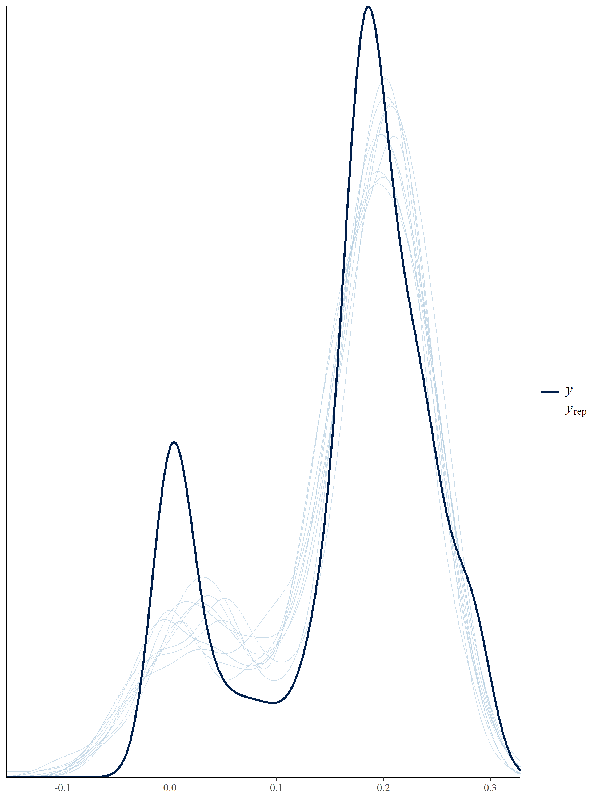

``` r
pp_check(fits[[2]])  # compares density of the observed data with data generated from posterior predictive distribution
```

```
Using 10 posterior draws for ppc type 'dens_overlay' by default.
```

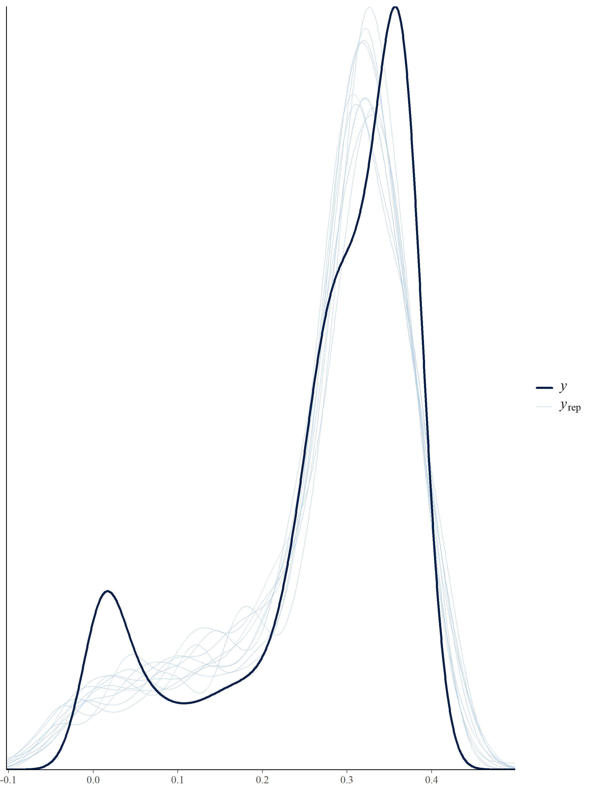

``` r
pp_check(fits[[3]])  # compares density of the observed data with data generated from posterior predictive distribution
```

```
Using 10 posterior draws for ppc type 'dens_overlay' by default.
```

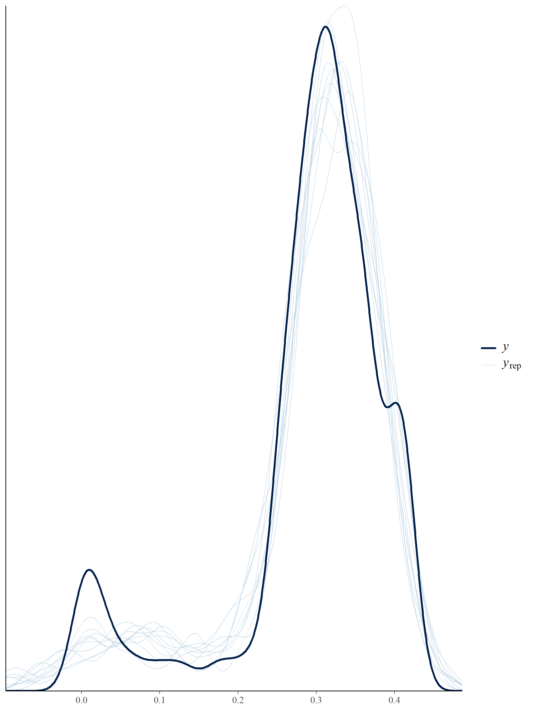

``` r
pp_check(fits[[4]])  # compares density of the observed data with data generated from posterior predictive distribution
```

```
Using 10 posterior draws for ppc type 'dens_overlay' by default.
```

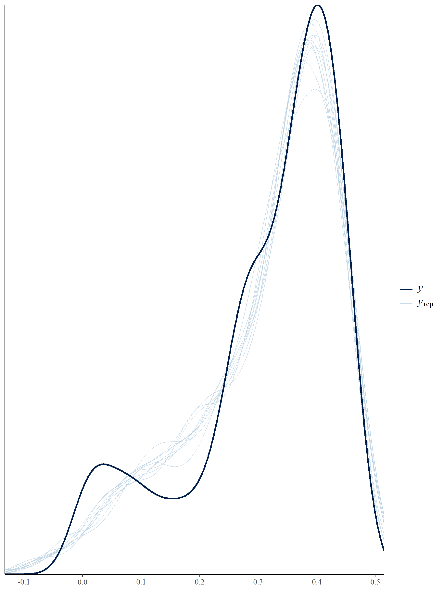

``` r
##look at the effects from the model
coef(fits[[1]])
```

```
$Rep
, , g0_Intercept

      Estimate   Est.Error         Q2.5        Q97.5
1  0.024709082 0.009032411  0.006739129  0.041692043
2 -0.021019839 0.008681191 -0.038474675 -0.004386133
3 -0.005961814 0.008012432 -0.021892174  0.009612515

, , g1_Intercept

   Estimate   Est.Error      Q2.5     Q97.5
1 0.2064874 0.003862761 0.1990560 0.2139283
2 0.2201829 0.004352910 0.2118064 0.2289362
3 0.1976703 0.003942969 0.1902129 0.2053321

, , tau_Intercept

   Estimate   Est.Error      Q2.5     Q97.5
1 0.2558642 0.006304297 0.2437392 0.2688277
2 0.2558642 0.006304297 0.2437392 0.2688277
3 0.2558642 0.006304297 0.2437392 0.2688277

, , theta_Intercept

  Estimate Est.Error     Q2.5    Q97.5
1 3.629805 0.4064256 2.897691 4.513568
2 3.629805 0.4064256 2.897691 4.513568
3 3.629805 0.4064256 2.897691 4.513568
```

``` r
coef(fits[[2]])
```

```
$Rep
, , g0_Intercept

     Estimate  Est.Error        Q2.5       Q97.5
1 -0.03881376 0.01104922 -0.06173122 -0.01794485
2 -0.03435950 0.01224458 -0.05870510 -0.01143171
3  0.07375470 0.01116197  0.05055255  0.09466186

, , g1_Intercept

   Estimate   Est.Error      Q2.5     Q97.5
1 0.3229578 0.004252659 0.3148702 0.3316377
2 0.3124836 0.004569983 0.3038724 0.3218753
3 0.3804359 0.004095607 0.3728421 0.3889206

, , tau_Intercept

   Estimate   Est.Error      Q2.5     Q97.5
1 0.2211964 0.005610705 0.2104382 0.2320738
2 0.2211964 0.005610705 0.2104382 0.2320738
3 0.2211964 0.005610705 0.2104382 0.2320738

, , theta_Intercept

  Estimate Est.Error     Q2.5    Q97.5
1 1.694929 0.1877928 1.365817 2.096421
2 1.694929 0.1877928 1.365817 2.096421
3 1.694929 0.1877928 1.365817 2.096421
```

``` r
coef(fits[[3]])
```

```
$Rep
, , g0_Intercept

     Estimate  Est.Error         Q2.5        Q97.5
1  0.01929135 0.01296845 -0.007022041  0.044611142
2  0.05444349 0.01400097  0.027005716  0.081655356
3 -0.03697188 0.01366640 -0.063453981 -0.009981462

, , g1_Intercept

   Estimate   Est.Error      Q2.5     Q97.5
1 0.2921235 0.003880608 0.2846370 0.2999281
2 0.3662629 0.003802753 0.3587512 0.3735332
3 0.3230966 0.003790047 0.3159194 0.3307380

, , tau_Intercept

   Estimate   Est.Error      Q2.5     Q97.5
1 0.1233902 0.003160401 0.1172104 0.1295691
2 0.1233902 0.003160401 0.1172104 0.1295691
3 0.1233902 0.003160401 0.1172104 0.1295691

, , theta_Intercept

  Estimate Est.Error    Q2.5    Q97.5
1 3.281039 0.3524464 2.68487 4.078005
2 3.281039 0.3524464 2.68487 4.078005
3 3.281039 0.3524464 2.68487 4.078005
```

``` r
coef(fits[[4]])
```

```
$Rep
, , g0_Intercept

       Estimate   Est.Error         Q2.5       Q97.5
1  0.0006385577 0.009488994 -0.018250723  0.01919906
2  0.0254995941 0.008402648  0.007987397  0.04142138
3 -0.0937274249 0.010560083 -0.114877901 -0.07359698

, , g1_Intercept

   Estimate   Est.Error      Q2.5     Q97.5
1 0.4772436 0.007141009 0.4643644 0.4917251
2 0.4094023 0.006278359 0.3980369 0.4225271
3 0.4652970 0.008492802 0.4496869 0.4829693

, , tau_Intercept

   Estimate   Est.Error      Q2.5     Q97.5
1 0.3000025 0.009473112 0.2827639 0.3198764
2 0.3000025 0.009473112 0.2827639 0.3198764
3 0.3000025 0.009473112 0.2827639 0.3198764

, , theta_Intercept

   Estimate  Est.Error      Q2.5    Q97.5
1 0.9929341 0.04196244 0.9105017 1.077379
2 0.9929341 0.04196244 0.9105017 1.077379
3 0.9929341 0.04196244 0.9105017 1.077379
```

#### Implement loop - McAusland


``` r
# Main loop that select each plant per species
fits_mc <- list()

for (i in unique(li6800.dat$TW)) {
  d1 <- subset(li6800.dat, TW == i)
  
  cat("TW:", i, "\n")
  
  fits_mc[[i]] <- process(d1, fit_init_mc)
}
```

```
TW: Amb_Lim 
```

```
Start sampling
```

```
 Family: gaussian 
  Links: mu = identity 
Formula: gsw ~ g0 + (g1 - g0) * exp(-exp(((lambda - tmin)/k) + 1)) 
         g0 ~ 1 + (1 | Rep)
         g1 ~ 1 + (1 | Rep)
         k ~ 1
         lambda ~ 1
   Data: dd (Number of observations: 362) 
  Draws: 4 chains, each with iter = 3000; warmup = 2000; thin = 1;
         total post-warmup draws = 4000

Multilevel Hyperparameters:
~Rep (Number of levels: 3) 
                 Estimate Est.Error l-95% CI u-95% CI Rhat Bulk_ESS Tail_ESS
sd(g0_Intercept)     0.02      0.01     0.01     0.03 1.00     2292     2240
sd(g1_Intercept)     0.02      0.02     0.01     0.07 1.00     1144     1703

Regression Coefficients:
                 Estimate Est.Error l-95% CI u-95% CI Rhat Bulk_ESS Tail_ESS
g0_Intercept         0.01      0.01    -0.01     0.03 1.00     1993     2363
g1_Intercept         0.21      0.02     0.18     0.25 1.00     1476     1325
k_Intercept          3.87      0.40     3.14     4.69 1.00     2683     2400
lambda_Intercept     8.26      0.62     6.98     9.42 1.00     2692     2390

Further Distributional Parameters:
      Estimate Est.Error l-95% CI u-95% CI Rhat Bulk_ESS Tail_ESS
sigma     0.04      0.00     0.03     0.04 1.00     3835     2852

Draws were sampled using sampling(NUTS). For each parameter, Bulk_ESS
and Tail_ESS are effective sample size measures, and Rhat is the potential
scale reduction factor on split chains (at convergence, Rhat = 1).

Divergences:
```

```
0 of 4000 iterations ended with a divergence.
```

```

Tree depth:
```

```
0 of 4000 iterations saturated the maximum tree depth of 12.
```

```

Energy:
```

```
E-BFMI indicated no pathological behavior.
```

```
TW: Amb_Unlim 
```

```
Start sampling
```

```
 Family: gaussian 
  Links: mu = identity 
Formula: gsw ~ g0 + (g1 - g0) * exp(-exp(((lambda - tmin)/k) + 1)) 
         g0 ~ 1 + (1 | Rep)
         g1 ~ 1 + (1 | Rep)
         k ~ 1
         lambda ~ 1
   Data: dd (Number of observations: 363) 
  Draws: 4 chains, each with iter = 3000; warmup = 2000; thin = 1;
         total post-warmup draws = 4000

Multilevel Hyperparameters:
~Rep (Number of levels: 3) 
                 Estimate Est.Error l-95% CI u-95% CI Rhat Bulk_ESS Tail_ESS
sd(g0_Intercept)     0.03      0.01     0.02     0.04 1.00     2795     2608
sd(g1_Intercept)     0.05      0.02     0.02     0.10 1.00     1554     2148

Regression Coefficients:
                 Estimate Est.Error l-95% CI u-95% CI Rhat Bulk_ESS Tail_ESS
g0_Intercept         0.02      0.01    -0.01     0.04 1.00     2625     2564
g1_Intercept         0.34      0.03     0.28     0.40 1.00     1727     1862
k_Intercept          5.57      0.38     4.86     6.36 1.00     2055     1606
lambda_Intercept     3.37      0.70     1.90     4.62 1.00     2007     1275

Further Distributional Parameters:
      Estimate Est.Error l-95% CI u-95% CI Rhat Bulk_ESS Tail_ESS
sigma     0.03      0.00     0.03     0.03 1.00     3923     2470

Draws were sampled using sampling(NUTS). For each parameter, Bulk_ESS
and Tail_ESS are effective sample size measures, and Rhat is the potential
scale reduction factor on split chains (at convergence, Rhat = 1).

Divergences:
```

```
0 of 4000 iterations ended with a divergence.
```

```

Tree depth:
```

```
0 of 4000 iterations saturated the maximum tree depth of 12.
```

```

Energy:
```

```
E-BFMI indicated no pathological behavior.
```

```
TW: Heat_Lim 
```

```
Start sampling
```

```
 Family: gaussian 
  Links: mu = identity 
Formula: gsw ~ g0 + (g1 - g0) * exp(-exp(((lambda - tmin)/k) + 1)) 
         g0 ~ 1 + (1 | Rep)
         g1 ~ 1 + (1 | Rep)
         k ~ 1
         lambda ~ 1
   Data: dd (Number of observations: 362) 
  Draws: 4 chains, each with iter = 3000; warmup = 2000; thin = 1;
         total post-warmup draws = 4000

Multilevel Hyperparameters:
~Rep (Number of levels: 3) 
                 Estimate Est.Error l-95% CI u-95% CI Rhat Bulk_ESS Tail_ESS
sd(g0_Intercept)     0.02      0.01     0.02     0.04 1.00     3010     2685
sd(g1_Intercept)     0.05      0.02     0.02     0.10 1.00     1962     2623

Regression Coefficients:
                 Estimate Est.Error l-95% CI u-95% CI Rhat Bulk_ESS Tail_ESS
g0_Intercept         0.02      0.01    -0.00     0.05 1.00     2229     2574
g1_Intercept         0.33      0.03     0.27     0.39 1.00     1512     1379
k_Intercept          1.82      0.17     1.49     2.17 1.00     2726     2406
lambda_Intercept     4.01      0.33     3.34     4.64 1.00     2670     2688

Further Distributional Parameters:
      Estimate Est.Error l-95% CI u-95% CI Rhat Bulk_ESS Tail_ESS
sigma     0.04      0.00     0.04     0.04 1.00     4382     2850

Draws were sampled using sampling(NUTS). For each parameter, Bulk_ESS
and Tail_ESS are effective sample size measures, and Rhat is the potential
scale reduction factor on split chains (at convergence, Rhat = 1).

Divergences:
```

```
0 of 4000 iterations ended with a divergence.
```

```

Tree depth:
```

```
0 of 4000 iterations saturated the maximum tree depth of 12.
```

```

Energy:
```

```
E-BFMI indicated no pathological behavior.
```

```
TW: Heat_Unlim 
```

```
Start sampling
```

```
 Family: gaussian 
  Links: mu = identity 
Formula: gsw ~ g0 + (g1 - g0) * exp(-exp(((lambda - tmin)/k) + 1)) 
         g0 ~ 1 + (1 | Rep)
         g1 ~ 1 + (1 | Rep)
         k ~ 1
         lambda ~ 1
   Data: dd (Number of observations: 363) 
  Draws: 4 chains, each with iter = 3000; warmup = 2000; thin = 1;
         total post-warmup draws = 4000

Multilevel Hyperparameters:
~Rep (Number of levels: 3) 
                 Estimate Est.Error l-95% CI u-95% CI Rhat Bulk_ESS Tail_ESS
sd(g0_Intercept)     0.03      0.00     0.02     0.04 1.00     2664     1996
sd(g1_Intercept)     0.04      0.02     0.02     0.09 1.00     1646     2446

Regression Coefficients:
                 Estimate Est.Error l-95% CI u-95% CI Rhat Bulk_ESS Tail_ESS
g0_Intercept         0.01      0.01    -0.02     0.04 1.00     2152     2246
g1_Intercept         0.41      0.03     0.36     0.47 1.00     1624     1706
k_Intercept          9.11      0.22     8.67     9.57 1.00     4067     2406
lambda_Intercept     0.18      0.17     0.01     0.62 1.00     3208     1923

Further Distributional Parameters:
      Estimate Est.Error l-95% CI u-95% CI Rhat Bulk_ESS Tail_ESS
sigma     0.03      0.00     0.03     0.03 1.00     3878     2780

Draws were sampled using sampling(NUTS). For each parameter, Bulk_ESS
and Tail_ESS are effective sample size measures, and Rhat is the potential
scale reduction factor on split chains (at convergence, Rhat = 1).

Divergences:
```

```
0 of 4000 iterations ended with a divergence.
```

```

Tree depth:
```

```
0 of 4000 iterations saturated the maximum tree depth of 12.
```

```

Energy:
```

```
E-BFMI indicated no pathological behavior.
```

#### Explore model output


``` r
pp_check(fits_mc[[1]])  # compares density of the observed data with data generated from posterior predictive distribution
```

```
Using 10 posterior draws for ppc type 'dens_overlay' by default.
```

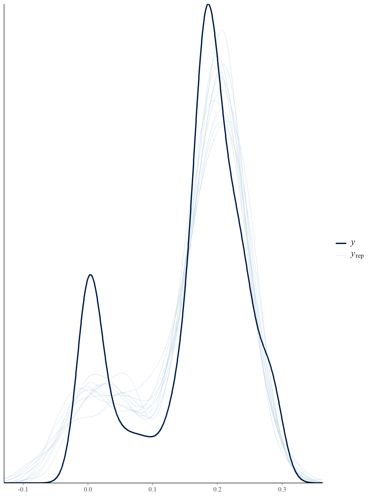

``` r
pp_check(fits_mc[[2]])  # compares density of the observed data with data generated from posterior predictive distribution
```

```
Using 10 posterior draws for ppc type 'dens_overlay' by default.
```

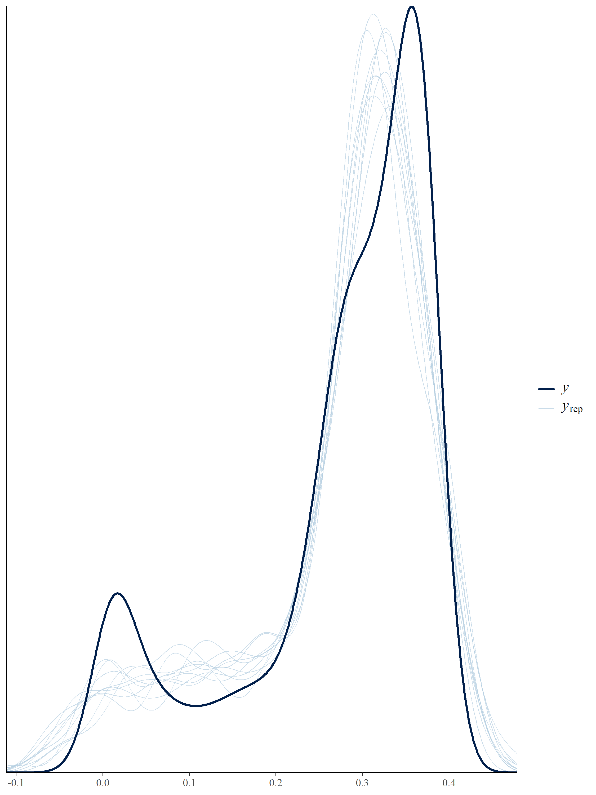

``` r
pp_check(fits_mc[[3]])  # compares density of the observed data with data generated from posterior predictive distribution
```

```
Using 10 posterior draws for ppc type 'dens_overlay' by default.
```

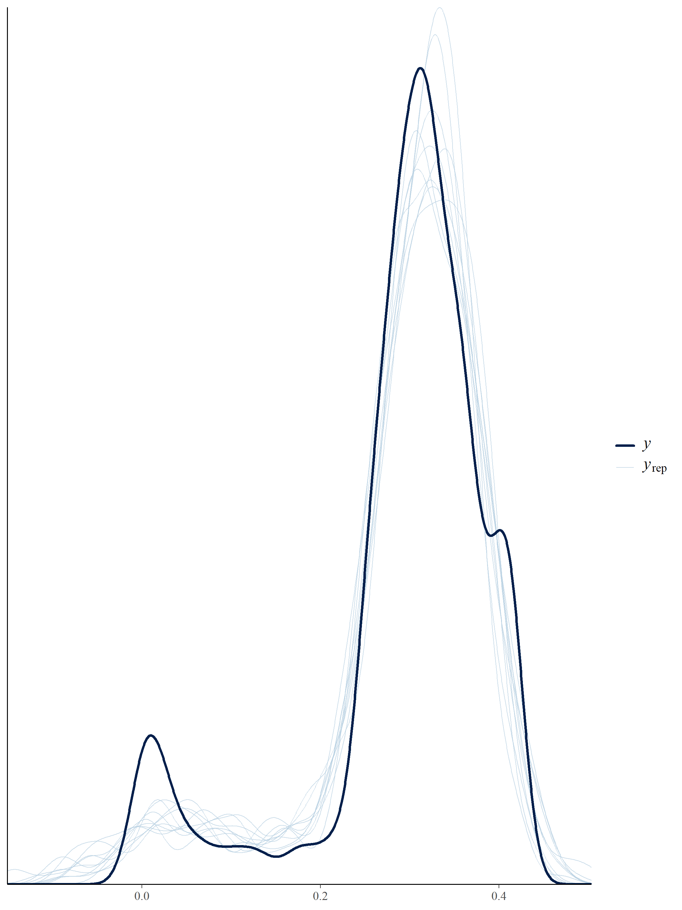

``` r
pp_check(fits_mc[[4]])  # compares density of the observed data with data generated from posterior predictive distribution
```

```
Using 10 posterior draws for ppc type 'dens_overlay' by default.
```

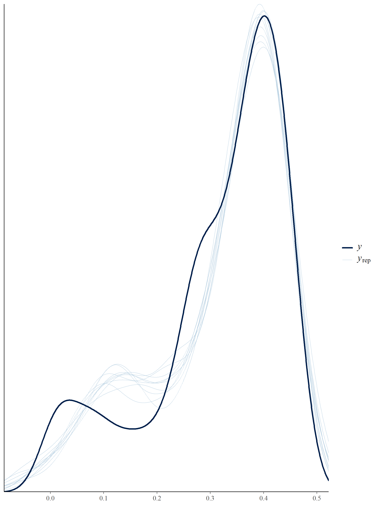

``` r
##look at the effects from the model
coef(fits_mc[[1]])
```

```
$Rep
, , g0_Intercept

      Estimate   Est.Error        Q2.5        Q97.5
1  0.027258796 0.008730001  0.01026407  0.043869996
2 -0.019924923 0.008439288 -0.03686060 -0.004137106
3 -0.003563281 0.007682720 -0.01895273  0.011246029

, , g1_Intercept

   Estimate   Est.Error      Q2.5     Q97.5
1 0.2078080 0.003828868 0.2002072 0.2151816
2 0.2226186 0.004402910 0.2139891 0.2313058
3 0.1992060 0.004063406 0.1914651 0.2073752

, , k_Intercept

  Estimate Est.Error     Q2.5    Q97.5
1 3.873031 0.3974788 3.137333 4.685143
2 3.873031 0.3974788 3.137333 4.685143
3 3.873031 0.3974788 3.137333 4.685143

, , lambda_Intercept

  Estimate Est.Error    Q2.5    Q97.5
1 8.264089 0.6153309 6.97591 9.420192
2 8.264089 0.6153309 6.97591 9.420192
3 8.264089 0.6153309 6.97591 9.420192
```

``` r
coef(fits_mc[[2]])
```

```
$Rep
, , g0_Intercept

     Estimate  Est.Error        Q2.5        Q97.5
1 -0.03044909 0.01121367 -0.05449736 -0.010318612
2 -0.02455838 0.01130000 -0.04796108 -0.004137453
3  0.08350944 0.01082626  0.06073727  0.103520070

, , g1_Intercept

   Estimate   Est.Error      Q2.5     Q97.5
1 0.3228998 0.003331581 0.3164616 0.3293831
2 0.3120204 0.003546913 0.3050990 0.3190912
3 0.3798033 0.003316981 0.3733381 0.3864232

, , k_Intercept

  Estimate Est.Error     Q2.5    Q97.5
1 5.567891 0.3782663 4.858067 6.355141
2 5.567891 0.3782663 4.858067 6.355141
3 5.567891 0.3782663 4.858067 6.355141

, , lambda_Intercept

  Estimate Est.Error    Q2.5    Q97.5
1 3.369782 0.6953573 1.89574 4.622949
2 3.369782 0.6953573 1.89574 4.622949
3 3.369782 0.6953573 1.89574 4.622949
```

``` r
coef(fits_mc[[3]])
```

```
$Rep
, , g0_Intercept

     Estimate  Est.Error         Q2.5        Q97.5
1  0.02640826 0.01269284  0.001309044  0.052346919
2  0.06173217 0.01380792  0.034081230  0.088115522
3 -0.02924586 0.01338256 -0.056018518 -0.003501927

, , g1_Intercept

   Estimate   Est.Error      Q2.5     Q97.5
1 0.2925075 0.003932147 0.2847246 0.3001497
2 0.3667079 0.003942359 0.3587169 0.3745243
3 0.3237720 0.004016295 0.3158444 0.3317509

, , k_Intercept

  Estimate Est.Error    Q2.5   Q97.5
1 1.818276 0.1736247 1.49368 2.16871
2 1.818276 0.1736247 1.49368 2.16871
3 1.818276 0.1736247 1.49368 2.16871

, , lambda_Intercept

  Estimate Est.Error     Q2.5    Q97.5
1 4.012421 0.3288525 3.338736 4.638432
2 4.012421 0.3288525 3.338736 4.638432
3 4.012421 0.3288525 3.338736 4.638432
```

``` r
coef(fits_mc[[4]])
```

```
$Rep
, , g0_Intercept

     Estimate   Est.Error         Q2.5       Q97.5
1  0.01929538 0.008246535  0.003246013  0.03521683
2  0.04329485 0.007510811  0.028790492  0.05833644
3 -0.06692797 0.008521984 -0.083399324 -0.05045197

, , g1_Intercept

   Estimate   Est.Error      Q2.5     Q97.5
1 0.4430403 0.003644562 0.4359041 0.4503086
2 0.3809119 0.003653421 0.3738788 0.3881815
3 0.4239423 0.004058671 0.4159306 0.4319012

, , k_Intercept

  Estimate Est.Error     Q2.5    Q97.5
1 9.114184 0.2240185 8.671145 9.565178
2 9.114184 0.2240185 8.671145 9.565178
3 9.114184 0.2240185 8.671145 9.565178

, , lambda_Intercept

   Estimate Est.Error       Q2.5     Q97.5
1 0.1810032 0.1709726 0.00550481 0.6237149
2 0.1810032 0.1709726 0.00550481 0.6237149
3 0.1810032 0.1709726 0.00550481 0.6237149
```

``` r
##calculate Slmax
Slmax.calc <- function(coef){
  ##pull out ceofficients, as they relate to parameters in Woning et al 2026
  gi <- coef$Rep[, "Estimate", "g0_Intercept"]
  gf <- coef$Rep[, "Estimate", "g1_Intercept"]
  lambda_c <- coef$Rep[, "Estimate", "theta_Intercept"]
  tau_c <- coef$Rep[, "Estimate", "tau_Intercept"]
  
  numerator_calc <- -1*(gi - gf) * lambda_c * exp((lambda_c - 1)/lambda_c)
  denominator_calc <- ((lambda_c - 1)/lambda_c)^(1/lambda_c) * tau_c
  
  numerator_calc/denominator_calc
}

Slmax.calc(coef(fits[[1]]))
```

```
       1        2        3 
5.815968 7.717245 6.515176 
```

``` r
Slmax.calc(coef(fits[[2]]))
```

```
       1        2        3 
7.068439 6.776759 5.992060 
```

``` r
Slmax.calc(coef(fits[[3]]))
```

```
       1        2        3 
16.24330 18.56444 21.43699 
```

``` r
Slmax.calc(coef(fits[[4]]))
```

```
  1   2   3 
NaN NaN NaN 
```

``` r
##these values seem off - go thing we're more interested in the McAusland model!

##calculate Slmax for the McAusland model
Slmax.calc.mc <- function(coef){
  ##pull out ceofficients, as they relate to parameters in McAusland 2016
  gi <- coef$Rep[, "Estimate", "g0_Intercept"]
  gf <- coef$Rep[, "Estimate", "g1_Intercept"]
  k <- coef$Rep[, "Estimate", "k_Intercept"]
  
  (gf - gi)/(k*exp(1))
}

Slmax.calc.mc(coef(fits_mc[[1]]))
```

```
         1          2          3 
0.01714945 0.02303797 0.01926002 
```

``` r
Slmax.calc.mc(coef(fits_mc[[2]]))
```

```
         1          2          3 
0.02334633 0.02223830 0.01957661 
```

``` r
Slmax.calc.mc(coef(fits_mc[[3]]))
```

```
         1          2          3 
0.05383805 0.06170366 0.07142370 
```

``` r
Slmax.calc.mc(coef(fits_mc[[4]]))
```

```
         1          2          3 
0.01710379 0.01362737 0.01981319 
```

### Save data


``` r
save.image(saveFile)
```

