---
output:
  pdf_document: default
  html_document: default
---
# Wheat stomatal kinetics (heat & drought)
## --- Ed Chaplin (USyd), *Apr--June 2025* ---
### Li-6800 STOMATAL CONDUCTANCE MODEL FITTING TO A - LIGHT OFF TO LIGHT ON (INCREASE)

* Using approach fit to gs data to now analyse A
* The model fit to A is slightly simpler than for gs as there is no lag parameter (lambda)

### Load the libraries


``` r
library(knitr)
#knitr::spin("li6800.stomatalCondModel_A_i.v1.r")
library(ggplot2)
opts_chunk$set("tidy" = FALSE, "dev" = "png", "dpi" = 300, 
               "fig.width" = 7.5, "fig.height" = 10, "comment"=NA, fig.path = "figures/increaseA/")
library(dae)
library(dplyr)
library(growthPheno) # calcLagged
packageVersion("growthPheno")
```

```
[1] '3.1.18'
```

``` r
library(brms) ##package used to fit bayesian regression model using Stan
```

### Set up constants and files


``` r
options(width=90)
load("../data/li6800.v1.Rdata")
saveFile <- "../data/stomatalCondModel_A_i.v1.Rdata"
```

### Define TW to be unique for each treatment


``` r
li6800.dat$TW <- paste(li6800.dat$Temperature, li6800.dat$Watering, sep="_")
li6800.dat$TW <- factor(li6800.dat$TW)
```

### Define th and tmin, to be time in hours and minutes respectively


``` r
li6800.dat$th <- li6800.dat$xElapsed/3600
li6800.dat$tmin <- li6800.dat$xElapsed/60
```

### Add other useful variables


``` r
li6800.dat$Room <- "CER7"
li6800.dat$Room[li6800.dat$Temperature == "Amb"] <- "CER8"
li6800.dat <- within(li6800.dat, {
  Room_Temperature <- paste(Room, Temperature, sep="_")
  Room <- factor(Room)
  Room_Temperature <- factor(Room_Temperature)
  Watering <- factor(Watering)
})
```

### Explore the gs profiles of just the light on portion of the experiment


``` r
plotProfiles(li6800.dat %>% filter(Light == "On"), response = "A",
             individuals = "TWR", times = "tmin",
             facet.x = "Room_Temperature",
             facet.y = "Watering",
             y.title = "A",
             x.title = "minutes",
             title = "A",
             breaks.spacing.x = 5,
             alpha = 0.75)
```


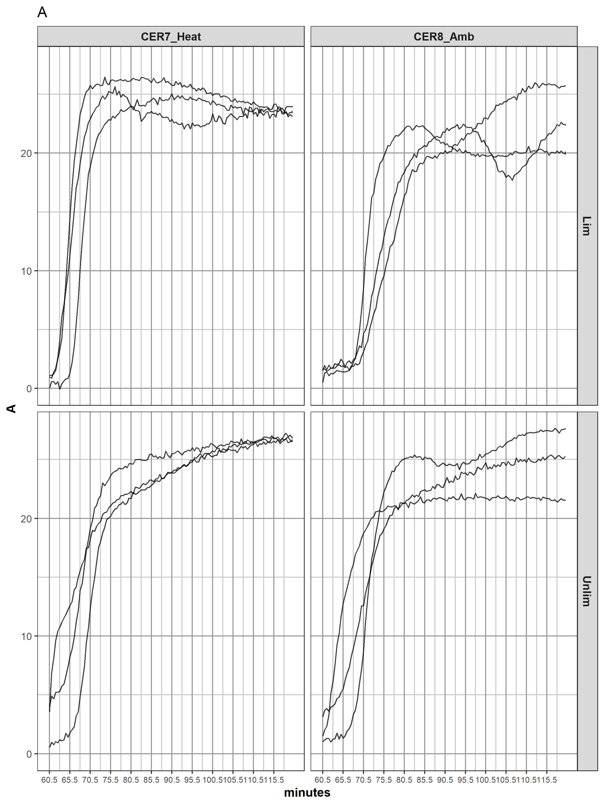

### Following approach implemented for analysis of gs data
* Script begins by specifying a model for A and setting priors on the parameters
#### Model for A, based on McAusland et al 2016, where we don't have a lag (lambda) parameter


``` r
nlform_A <- bf(A ~ g0 + (g1 - g0) * exp(-exp(((-tmin)/k)+1)),
             g0 ~ 1 + Room_Temperature*Watering +
               (1 | Rep),
             g1 ~ 1 + Room_Temperature*Watering +
               (1 | Rep),
             k ~ 1+ Room_Temperature*Watering,
             nl = TRUE)

priors_A <- c(prior(normal(0.5, 0.1), nlpar = "g0"),
            prior(normal(25, 1), nlpar = "g1"),
            prior(normal(0, 0.5), class = "sd", nlpar = "g0"),
            prior(normal(0, 1), class = "sd", nlpar = "g1"),
            prior(normal(3, 0.5), nlpar = "k", lb = 0),
            prior(student_t(3, 0, 0.5), class = "sigma"))

plot(1.5 + (25 - 1.5) * exp(-exp(((- seq(0, 60, 0.5))/3) + 1)) ~
       seq(0, 60, 0.5))
```


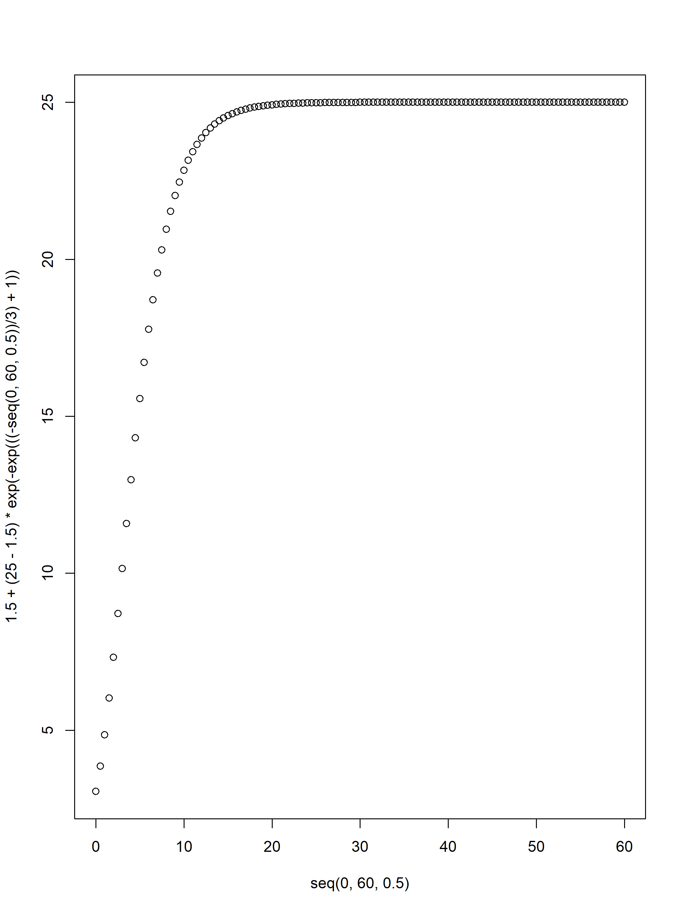

#### Put finishing touches on dataframe
Subset for light on portion and remove th == 0 if it's present, as the light was still on at that point


``` r
li6800.on.dat <- subset(li6800.dat, Light == "On" & th != 0)
##in this case, we can align the time access to all start from zero
li6800.on.dat$th <- li6800.on.dat$th - li6800.on.dat$th[1]
li6800.on.dat$tmin <- li6800.on.dat$tmin - li6800.on.dat$tmin[1]

plotProfiles(li6800.on.dat, response = "A",
             individuals = "TWR", times = "tmin",
             y.title = "A",
             x.title = "minutes",
             title = "A",
             breaks.spacing.x = 5,
             alpha = 0.75)
```


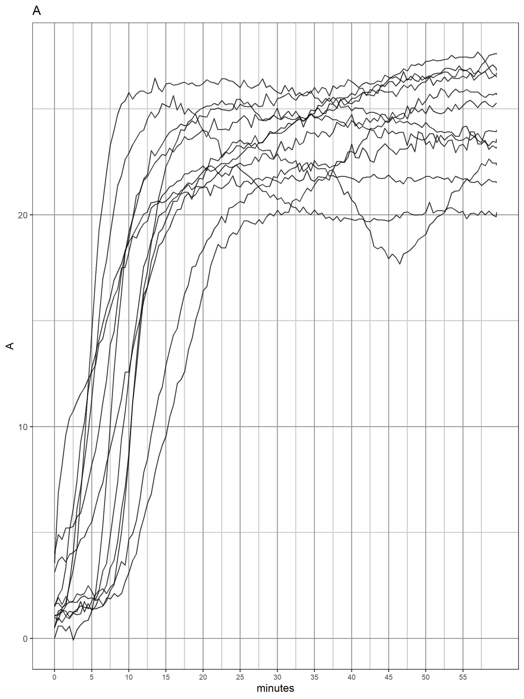

#### Fit the model


``` r
# Configure and compile the model - McAusland
fit_on_A_max <- brm(
  formula = nlform_A,
  data = li6800.on.dat,
  prior = priors_A,
  chains = 6,
  cores = 6,
  iter = 10000,
  warmup = 6000,
  control = list(
    adapt_delta = 0.99,
    max_treedepth = 12,
    metric = "diag_e"
  )
)
```

```
Compiling Stan program...
```

```
Start sampling
```

``` r
print(summary(fit_on_A_max))
```

```
 Family: gaussian 
  Links: mu = identity 
Formula: A ~ g0 + (g1 - g0) * exp(-exp(((-tmin)/k) + 1)) 
         g0 ~ 1 + Room_Temperature * Watering + (1 | Rep)
         g1 ~ 1 + Room_Temperature * Watering + (1 | Rep)
         k ~ 1 + Room_Temperature * Watering
   Data: li6800.on.dat (Number of observations: 1462) 
  Draws: 6 chains, each with iter = 10000; warmup = 6000; thin = 1;
         total post-warmup draws = 24000

Multilevel Hyperparameters:
~Rep (Number of levels: 3) 
                 Estimate Est.Error l-95% CI u-95% CI Rhat Bulk_ESS Tail_ESS
sd(g0_Intercept)     1.39      0.25     0.94     1.93 1.00    14402    15098
sd(g1_Intercept)     0.99      0.42     0.43     2.03 1.00    11460    14547

Regression Coefficients:
                                          Estimate Est.Error l-95% CI u-95% CI Rhat Bulk_ESS Tail_ESS
g0_Intercept                                  0.46      0.10     0.26     0.66 1.00    32677    17452
g0_Room_TemperatureCER8_Amb                   0.46      0.10     0.27     0.65 1.00    31280    17115
g0_WateringUnlim                              0.67      0.10     0.48     0.87 1.00    31498    17291
g0_Room_TemperatureCER8_Amb:WateringUnlim     0.66      0.10     0.46     0.85 1.00    31475    17011
g1_Intercept                                 24.16      0.53    23.21    25.32 1.00    10967    13376
g1_Room_TemperatureCER8_Amb                  -2.37      0.22    -2.80    -1.92 1.00    19303    17952
g1_WateringUnlim                              1.48      0.21     1.06     1.90 1.00    19648    18365
g1_Room_TemperatureCER8_Amb:WateringUnlim     3.17      0.28     2.60     3.72 1.00    19617    17167
k_Intercept                                   3.71      0.10     3.52     3.90 1.00    23691    19141
k_Room_TemperatureCER8_Amb                    3.33      0.16     3.02     3.64 1.00    24504    18863
k_WateringUnlim                               1.16      0.14     0.89     1.44 1.00    22866    16044
k_Room_TemperatureCER8_Amb:WateringUnlim      0.03      0.03     0.00     0.11 1.00    22519    11548

Further Distributional Parameters:
      Estimate Est.Error l-95% CI u-95% CI Rhat Bulk_ESS Tail_ESS
sigma     2.52      0.05     2.43     2.62 1.00    29296    18414

Draws were sampled using sampling(NUTS). For each parameter, Bulk_ESS
and Tail_ESS are effective sample size measures, and Rhat is the potential
scale reduction factor on split chains (at convergence, Rhat = 1).
```

``` r
plot(fit_on_A_max, ask = FALSE)
```


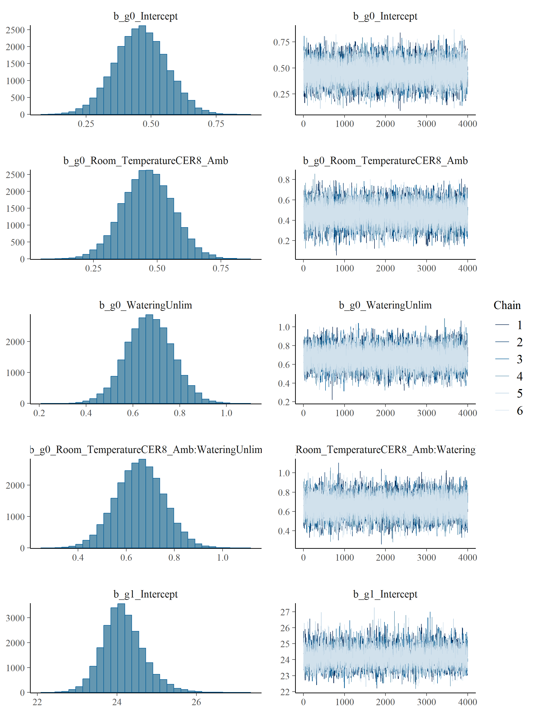

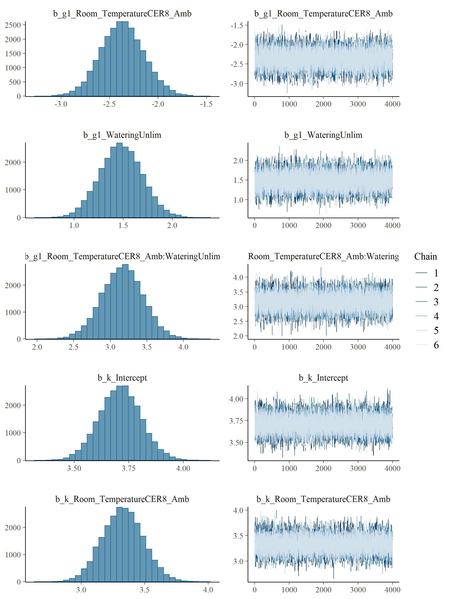

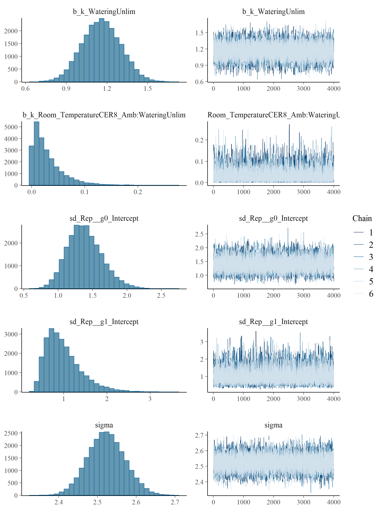

``` r
pairs(fit_on_A_max)
```


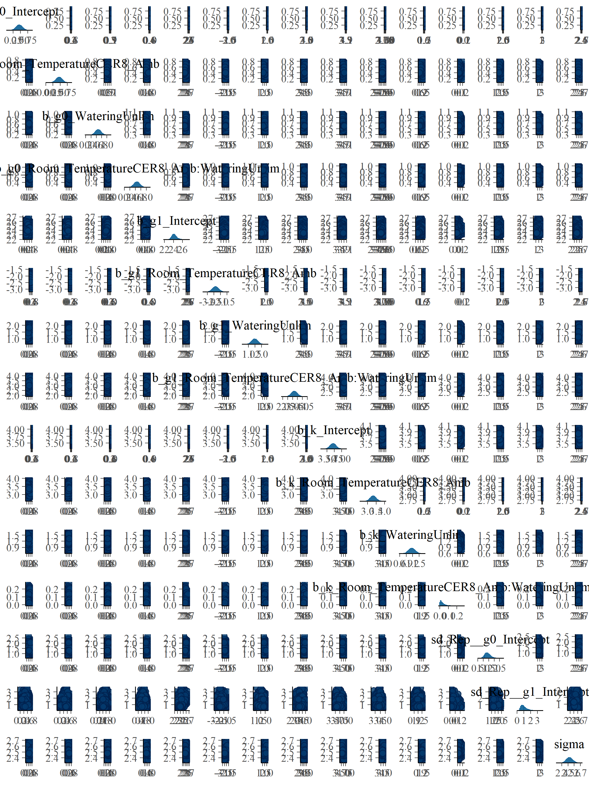

``` r
mcmc_plot(fit_on_A_max, type = "trace")
```

```
No divergences to plot.
```


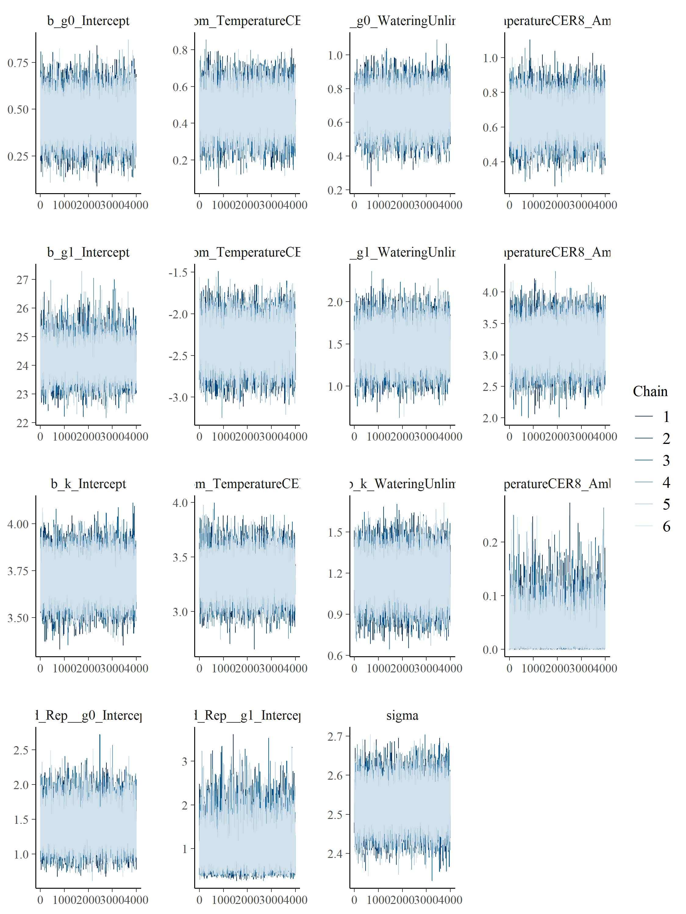

``` r
rstan::check_hmc_diagnostics(fit_on_A_max$fit)
```

```

Divergences:
```

```
0 of 24000 iterations ended with a divergence.
```

```

Tree depth:
```

```
0 of 24000 iterations saturated the maximum tree depth of 12.
```

```

Energy:
```

```
E-BFMI indicated no pathological behavior.
```

``` r
loo(fit_on_A_max)
```

```

Computed from 24000 by 1462 log-likelihood matrix.

         Estimate   SE
elpd_loo  -3437.1 36.1
p_loo        16.9  1.1
looic      6874.3 72.1
------
MCSE of elpd_loo is 0.0.
MCSE and ESS estimates assume MCMC draws (r_eff in [0.8, 1.5]).

All Pareto k estimates are good (k < 0.7).
See help('pareto-k-diagnostic') for details.
```

``` r
pp_check(fit_on_A_max)  # compares density of the observed data with data generated from posterior predictive distribution
```

```
Using 10 posterior draws for ppc type 'dens_overlay' by default.
```


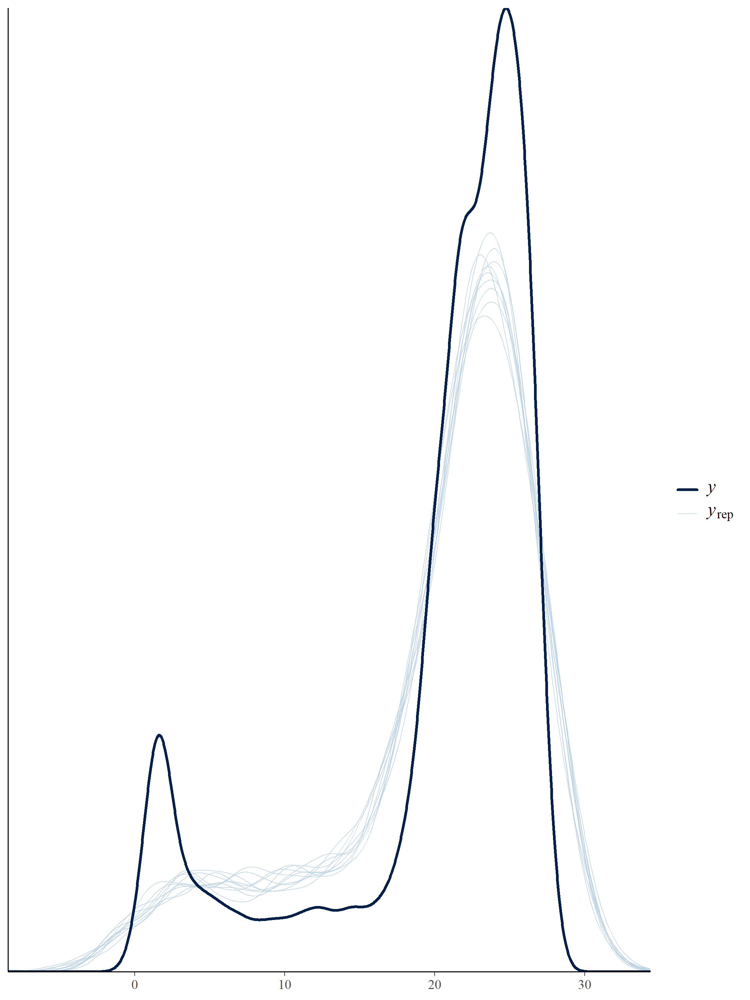

``` r
pp_check(fit_on_A_max, type = "error_hist", ndraws = 12)
```

```
`stat_bin()` using `bins = 30`. Pick better value `binwidth`.
```


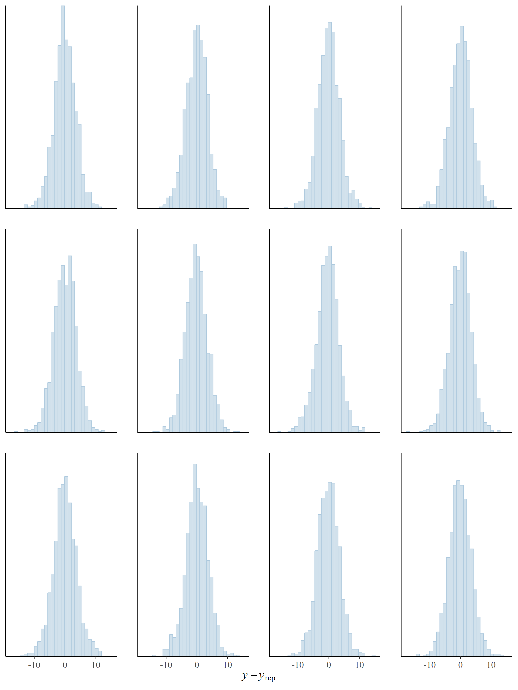

``` r
pp_check(fit_on_A_max, type = "scatter_avg", ndraws = 1000)
```


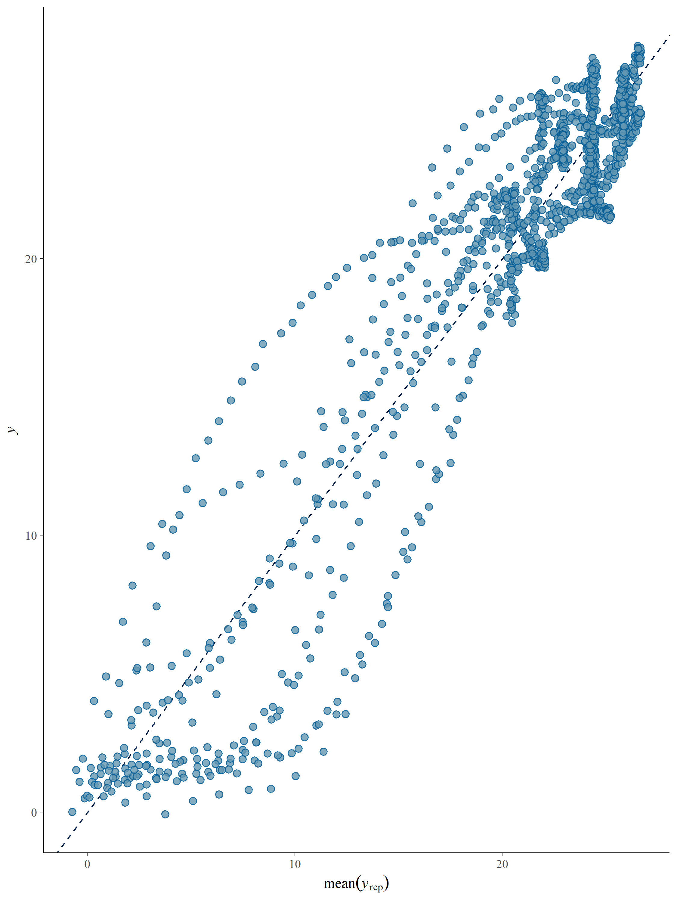

``` r
pp_check(fit_on_A_max, type = "stat_2d")
```

```
Using all posterior draws for ppc type 'stat_2d' by default.
```

```
Note: in most cases the default test statistic 'mean' is too weak to detect anything of interest.
```


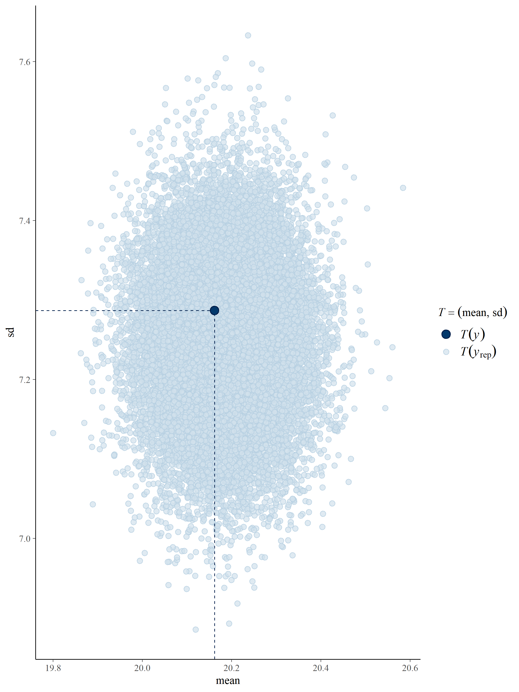

``` r
pp_check(fit_on_A_max, type = "loo_ribbon")
```

```
Using all posterior draws for ppc type 'loo_ribbon' by default.
```


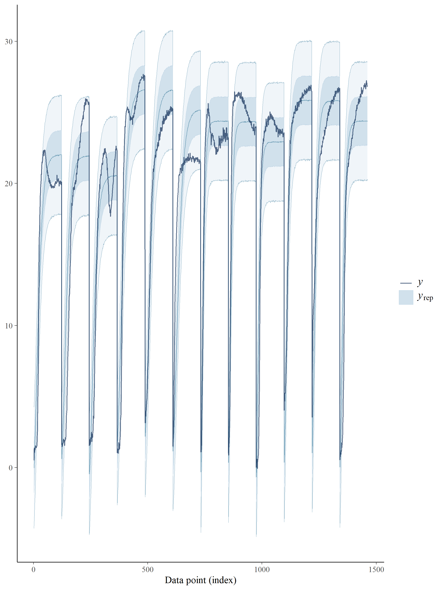

``` r
plot(A~tmin, li6800.on.dat, pch=16)
points(fitted(fit_on_A_max)[,1]~tmin, li6800.on.dat, pch=16, col="red")
```


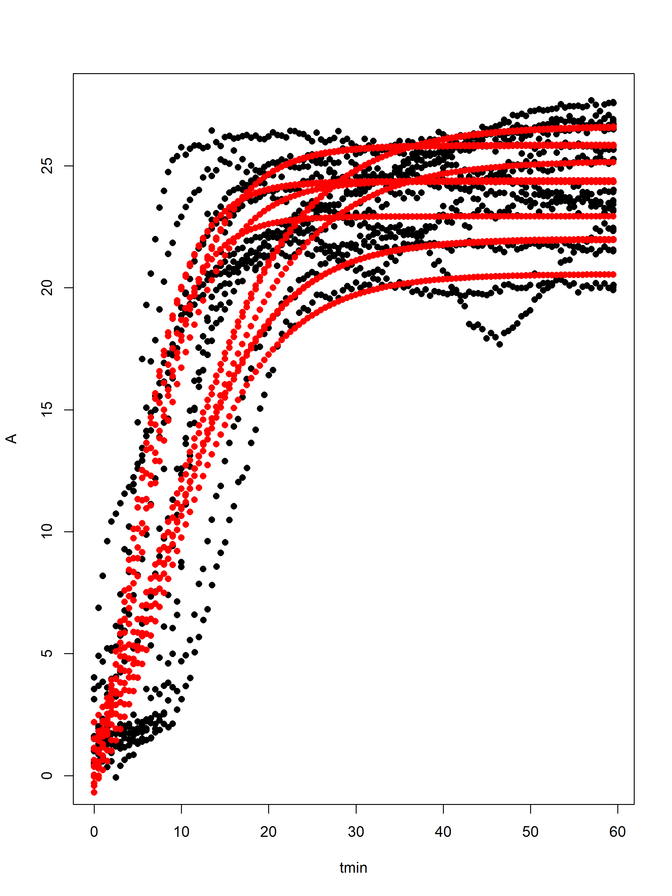

``` r
##make the above plot prettier
li6800.on.plot <- li6800.on.dat
li6800.on.plot$fitted <- fitted(fit_on_A_max)[,1]
li6800.on.plot$fitted.fixed <- fitted(fit_on_A_max, re_formula = NA)[,1]

ggplot(li6800.on.plot, aes(x= tmin, y = A, group = Rep)) +
  geom_point() +
  facet_grid(Room_Temperature ~ Watering) +
  geom_point(aes(y=fitted), colour = "red") +
  geom_line(aes(y=fitted), colour = "red")
```


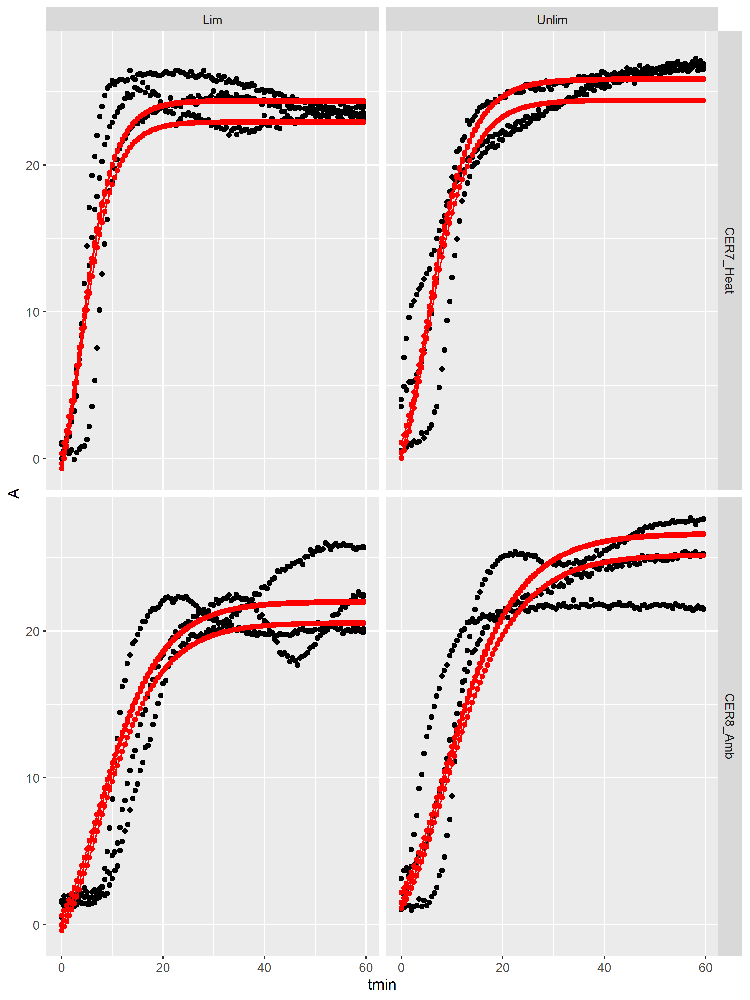

``` r
ggplot(li6800.on.plot, aes(x= tmin, y = A, group = Rep)) +
  geom_point() +
  facet_grid(Room_Temperature ~ Watering) +
  geom_point(aes(y=fitted), colour = "red") +
  geom_line(aes(y=fitted), colour = "red") +
  geom_point(aes(y=fitted.fixed), colour = "blue") +
  geom_line(aes(y=fitted.fixed), colour = "blue")
```


#### Testing contribution of effects in the model


``` r
# fit_on_A_current <- fit_on_A_max
# 
# nlform_A_reduced <- bf(A ~ g0 + (g1 - g0) * exp(-exp(((-tmin)/k)+1)),
#                g0 ~ 1 + Room_Temperature+Watering +
#                  (1 | Rep),
#                g1 ~ 1 + Room_Temperature*Watering +
#                  (1 | Rep),
#                k ~ 1+  Watering, #Room_Temperature +
#                nl = TRUE)
# 
# # Fit the model
# fit_on_A_reduced <- brm(
#   formula = nlform_A_reduced,
#   data = li6800.on.dat,
#   prior = priors_A,
#   chains = 6,
#   cores = 6,
#   iter = 10000,
#   warmup = 6000,
#   control = list(
#     adapt_delta = 0.99,
#     max_treedepth = 12,
#     metric = "diag_e"
#   )
# )
# 
# 
# print(summary(fit_on_A_reduced))
# loo(fit_on_A_reduced)
# loo(fit_on_A_current)
# plot(A~tmin, li6800.on.dat, pch=16)
# points(fitted(fit_on_A_reduced)[,1]~tmin, li6800.on.dat, pch=16, col="red")
# coef(fit_on_A_reduced)
# 
# fit_on_A_current <- add_criterion(fit_on_A_current, "loo")
# fit_on_A_reduced <- add_criterion(fit_on_A_reduced, "loo")
# 
# loo_compare(fit_on_A_current, fit_on_A_reduced)
##TWO WAY INTERACTIONS
##k: Drop Room_Temperature:Watering interaction
##g1: Retain Room_Temperature:Watering interaction
##g0: Retain Room_Temperature:Watering interaction

##MAIN EFFECT
##k: Retain Watering main effect
##k: Retain Room_Temperature main effect
# fit_on_A_current <- fit_on_A_reduced
# print(summary(fit_on_A_current))
```

#### Fit final model


``` r
##Final model:
##g0: Room_Temperature*Watering
##g1: Room_Temperature*Watering
##k: Room_Temperature + Watering

nlform_A_final <- bf(A ~ g0 + (g1 - g0) * exp(-exp(((-tmin)/k)+1)),
               g0 ~ 1 + Room_Temperature*Watering +
                 (1 | Rep),
               g1 ~ 1 + Room_Temperature*Watering +
                 (1 | Rep),
               k ~ 1+  Room_Temperature + Watering,
               nl = TRUE)

# Fit the model
fit_on_A_final <- brm(
  formula = nlform_A_final,
  data = li6800.on.dat,
  prior = priors_A,
  chains = 6,
  cores = 6,
  iter = 10000,
  warmup = 6000,
  control = list(
    adapt_delta = 0.99,
    max_treedepth = 12,
    metric = "diag_e"
  )
)
```

```
Compiling Stan program...
```

```
Start sampling
```

``` r
print(summary(fit_on_A_final))
```

```
 Family: gaussian 
  Links: mu = identity 
Formula: A ~ g0 + (g1 - g0) * exp(-exp(((-tmin)/k) + 1)) 
         g0 ~ 1 + Room_Temperature * Watering + (1 | Rep)
         g1 ~ 1 + Room_Temperature * Watering + (1 | Rep)
         k ~ 1 + Room_Temperature + Watering
   Data: li6800.on.dat (Number of observations: 1462) 
  Draws: 6 chains, each with iter = 10000; warmup = 6000; thin = 1;
         total post-warmup draws = 24000

Multilevel Hyperparameters:
~Rep (Number of levels: 3) 
                 Estimate Est.Error l-95% CI u-95% CI Rhat Bulk_ESS Tail_ESS
sd(g0_Intercept)     1.39      0.25     0.95     1.93 1.00    13804    16268
sd(g1_Intercept)     1.00      0.41     0.44     2.01 1.00    11896    13652

Regression Coefficients:
                                          Estimate Est.Error l-95% CI u-95% CI Rhat Bulk_ESS Tail_ESS
g0_Intercept                                  0.46      0.10     0.27     0.66 1.00    30110    16523
g0_Room_TemperatureCER8_Amb                   0.46      0.10     0.27     0.65 1.00    31234    17946
g0_WateringUnlim                              0.67      0.10     0.48     0.86 1.00    30890    17084
g0_Room_TemperatureCER8_Amb:WateringUnlim     0.66      0.10     0.46     0.85 1.00    30943    18423
g1_Intercept                                 24.15      0.53    23.18    25.28 1.00     9940    12894
g1_Room_TemperatureCER8_Amb                  -2.37      0.22    -2.81    -1.94 1.00    17721    17928
g1_WateringUnlim                              1.48      0.22     1.07     1.90 1.00    18463    18378
g1_Room_TemperatureCER8_Amb:WateringUnlim     3.15      0.29     2.59     3.71 1.00    18010    17784
k_Intercept                                   3.71      0.10     3.53     3.90 1.00    22420    18011
k_Room_TemperatureCER8_Amb                    3.34      0.16     3.02     3.65 1.00    22088    19103
k_WateringUnlim                               1.16      0.14     0.89     1.45 1.00    21697    16391

Further Distributional Parameters:
      Estimate Est.Error l-95% CI u-95% CI Rhat Bulk_ESS Tail_ESS
sigma     2.52      0.05     2.43     2.62 1.00    27090    17465

Draws were sampled using sampling(NUTS). For each parameter, Bulk_ESS
and Tail_ESS are effective sample size measures, and Rhat is the potential
scale reduction factor on split chains (at convergence, Rhat = 1).
```

``` r
pp_check(fit_on_A_final)
```

```
Using 10 posterior draws for ppc type 'dens_overlay' by default.
```


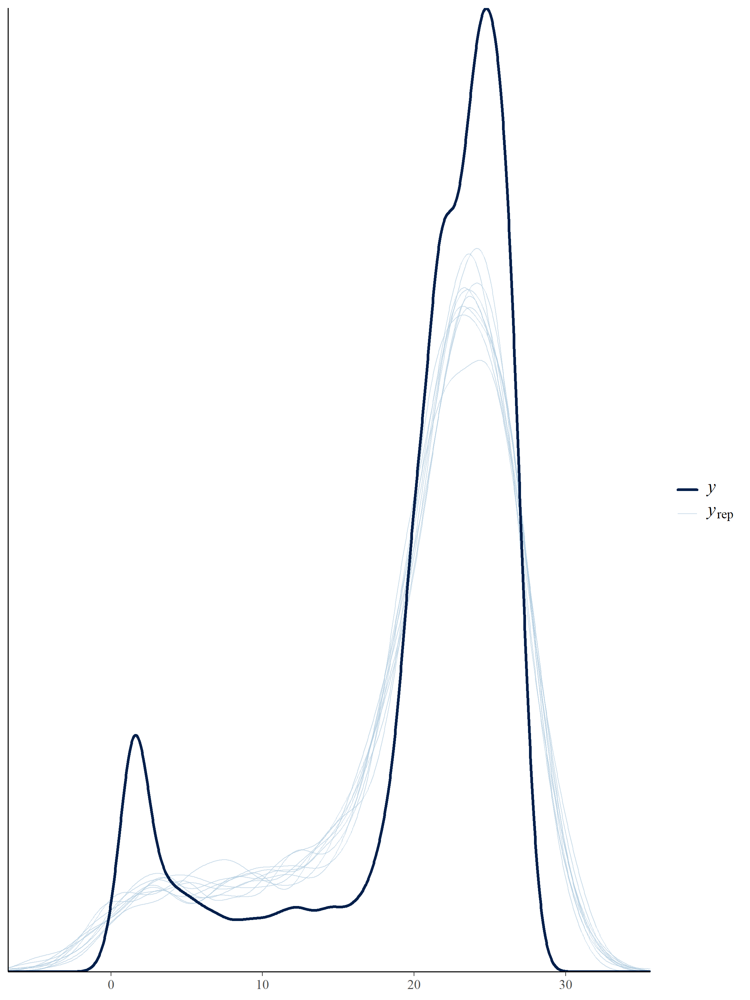

``` r
rstan::check_hmc_diagnostics(fit_on_A_final$fit)
```

```

Divergences:
```

```
0 of 24000 iterations ended with a divergence.
```

```

Tree depth:
```

```
0 of 24000 iterations saturated the maximum tree depth of 12.
```

```

Energy:
```

```
E-BFMI indicated no pathological behavior.
```

``` r
##make the above plot prettier
li6800.on.plot <- li6800.on.dat
li6800.on.plot$fitted <- fitted(fit_on_A_final)[,1]
li6800.on.plot$fitted.fixed <- fitted(fit_on_A_final, re_formula = NA)[,1]

ggplot(li6800.on.plot, aes(x= tmin, y = A, group = Rep)) +
  geom_point() +
  facet_grid(Room_Temperature ~ Watering) +
  geom_point(aes(y=fitted), colour = "red") +
  geom_line(aes(y=fitted), colour = "red")
```


``` r
ggplot(li6800.on.plot, aes(x= tmin, y = A, group = Rep)) +
  geom_point() +
  facet_grid(Room_Temperature ~ Watering) +
  geom_point(aes(y=fitted), colour = "red") +
  geom_line(aes(y=fitted), colour = "red") +
  geom_point(aes(y=fitted.fixed), colour = "blue") +
  geom_line(aes(y=fitted.fixed), colour = "blue")
```


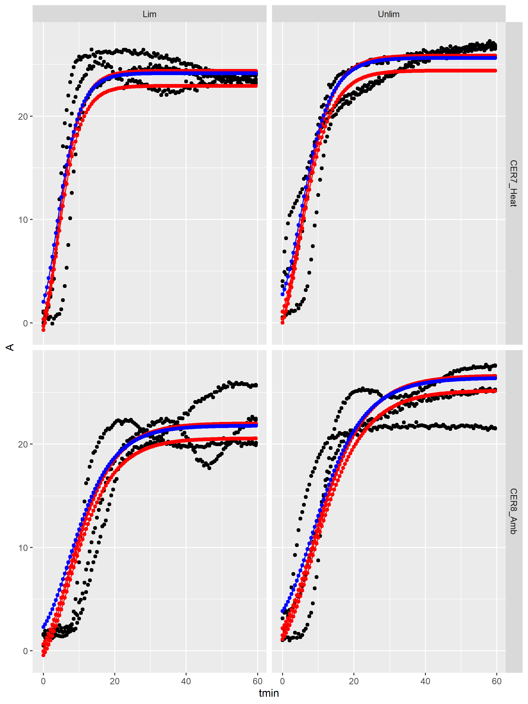

### Save data


``` r
save.image(saveFile)
```

