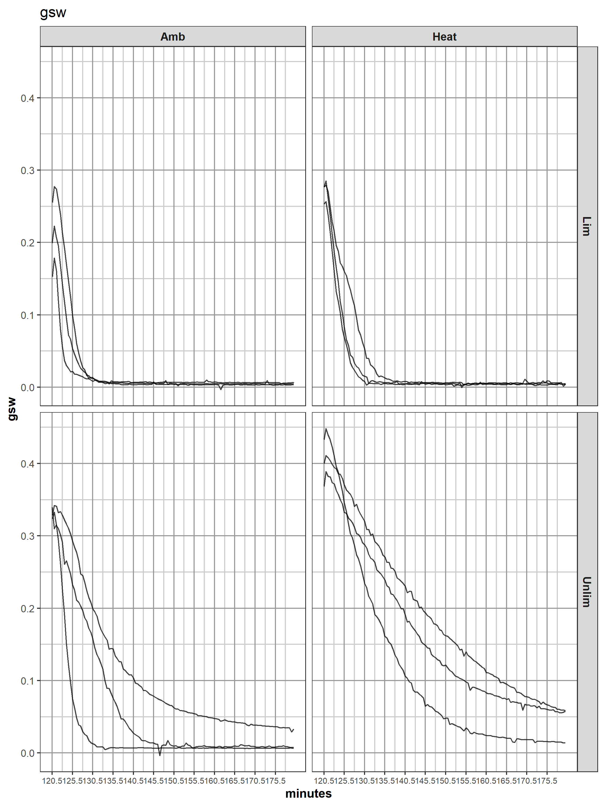
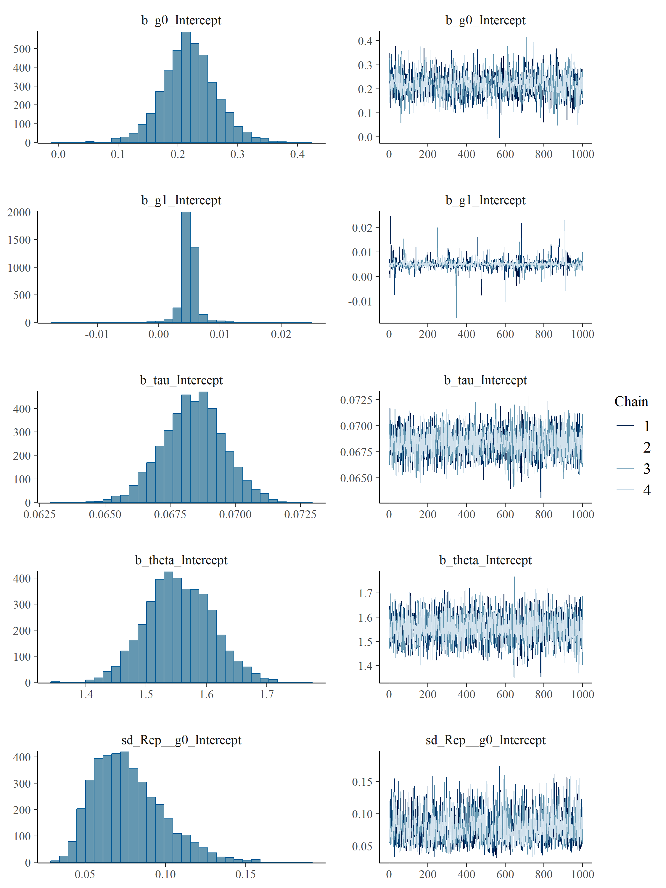
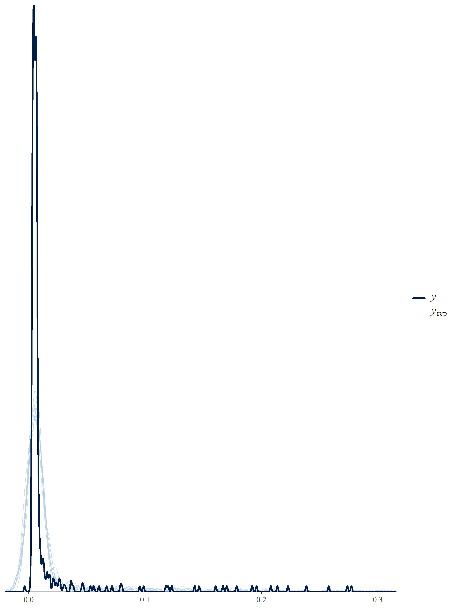
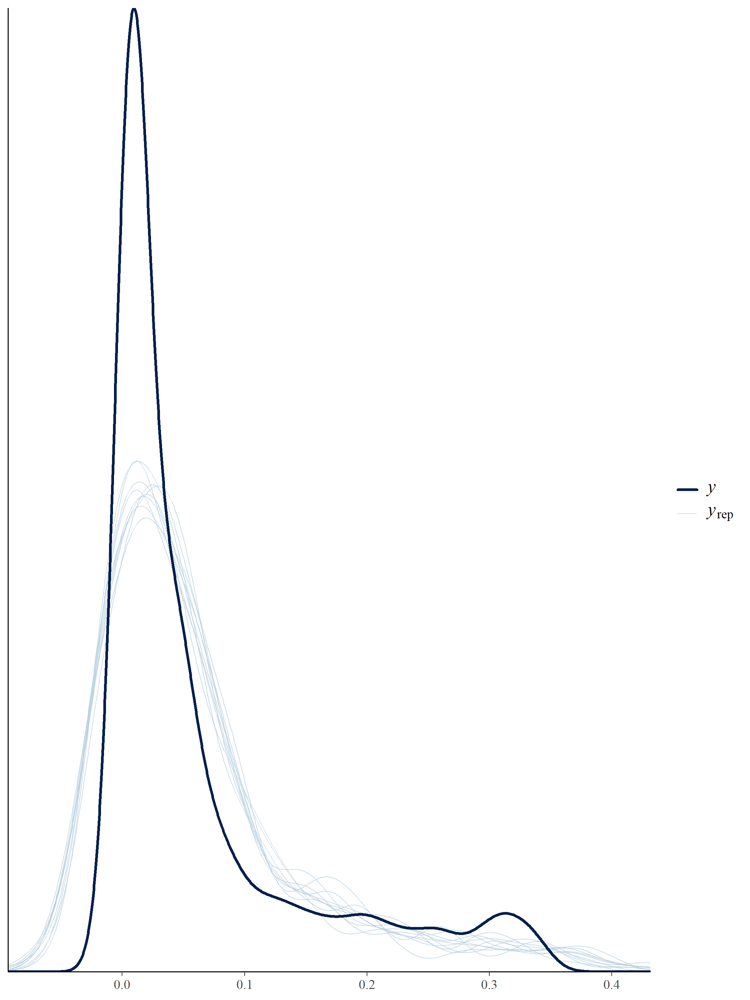
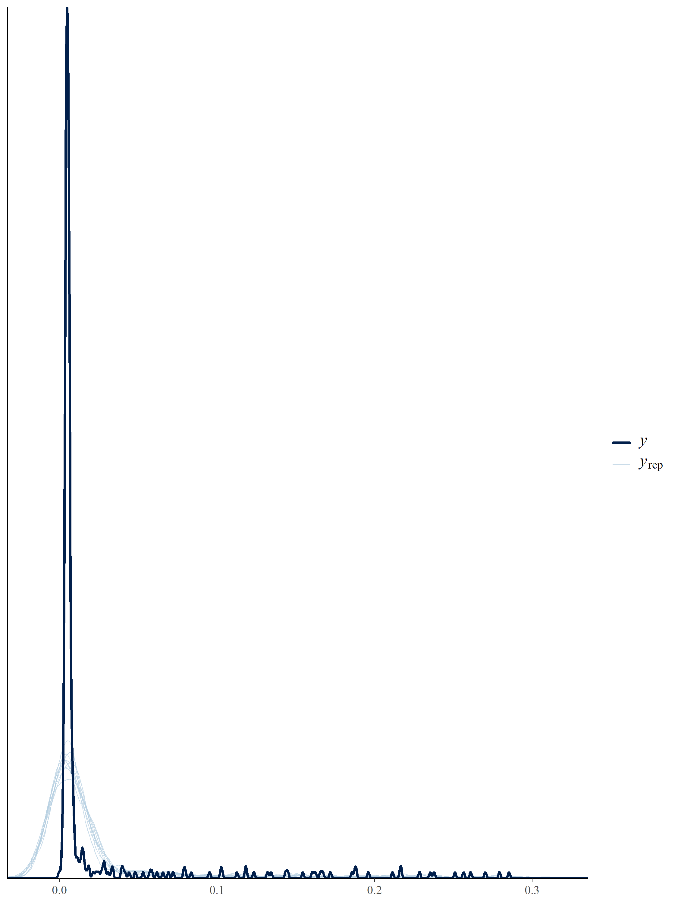
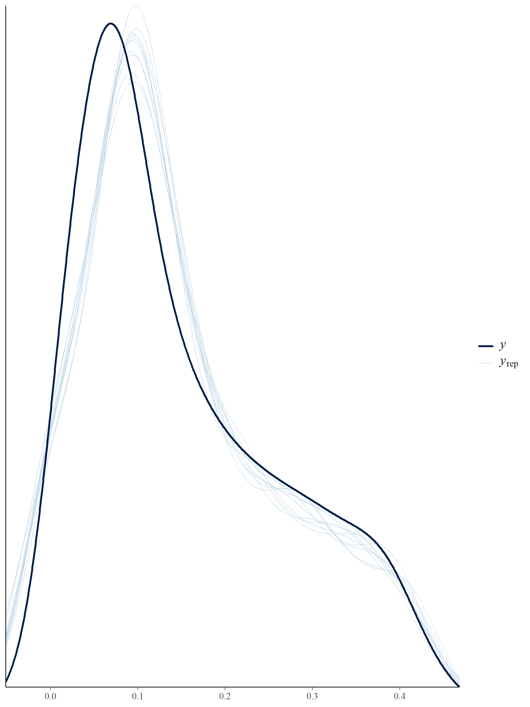
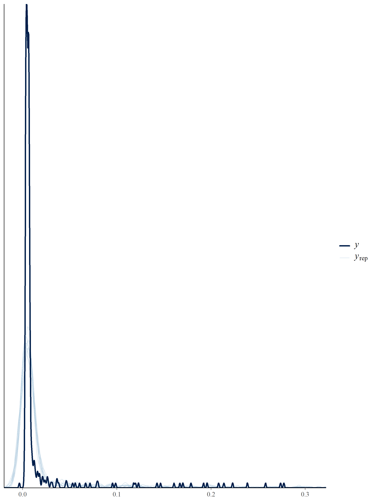
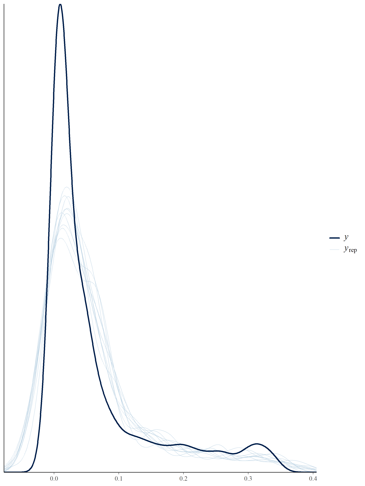
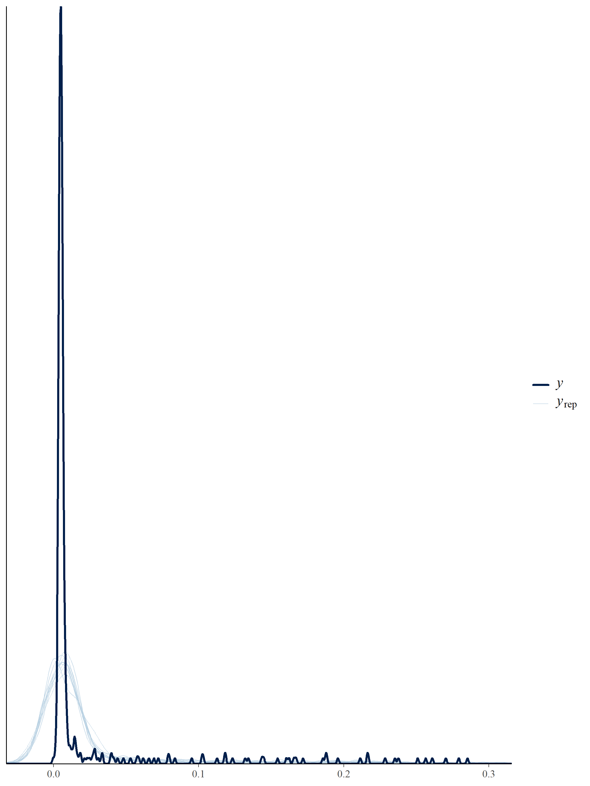
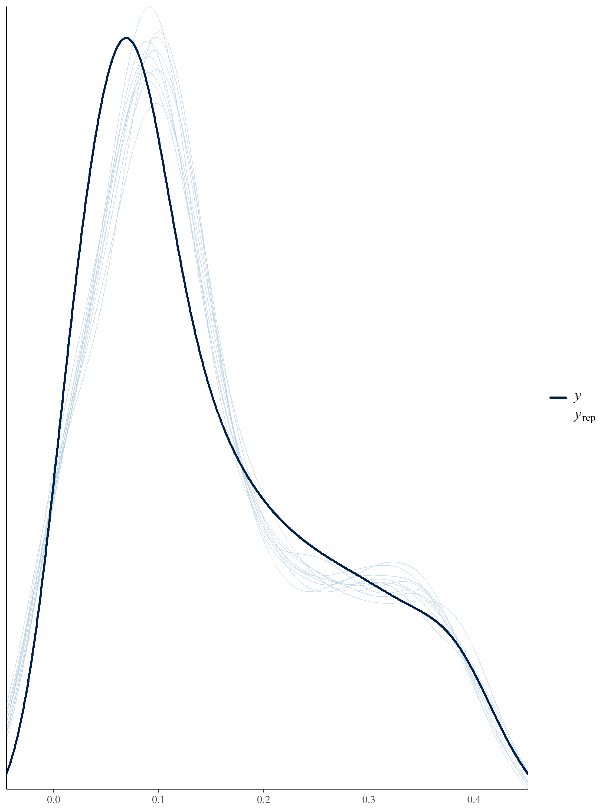

---
output:
  pdf_document: default
  html_document: default
---
# Wheat stomatal kinetics (heat & drought)
## --- Ed Chaplin (USyd), *Apr--June 2025* ---
### Li-6800 STOMATAL CONDUCTANCE MODEL FITTING - LIGHT ON TO LIGHT OFF (DECREASE)

* This script focuses on the portion of the gs response when the light is swtiched off (_i script was when light switched on)
* This script will attempt to fit the methods of Woning et al (2026) and McAusland et al (2016) using the script supplied by Silvere Vialet-Chabrand
* The models fitted in the script look to be the Cumulative Distribution Weibull (CDWeibull) models described in Eqn 4.1 of Woning et al (2026)
* I've also adapted the script to incorporate the McAusland model
* Scripts supplied by Silvere can be found in the gs_fit.zip directory
* There are two scripts in this directory: fit_per_curve.r and fit_per_species.r
* Fit_per_curve looks to take each individual plant and fit a curve to it, 
while fit_per_species fits some parameters (tau and theta) at a species (treatment in our setting) level and others at a replicate level
* In an email from Silvere (shared by Chris and put in the \textit{Materials from Ed} directory), 
Silvere prefers the fit_per_species approach, as do I, as this seems to align better with conventional analysis approaches

### Load the libraries


``` r
library(knitr)
#knitr::spin("li6800.stomatalCondModel_d.v1.r")
library(ggplot2)
opts_chunk$set("tidy" = FALSE, "dev" = "png", "dpi" = 300, 
               "fig.width" = 7.5, "fig.height" = 10, "comment"=NA, fig.path = "figures/decrease/")
library(dae)
library(dplyr)
library(growthPheno) # calcLagged
packageVersion("growthPheno")
```

```
[1] '3.1.18'
```

``` r
library(brms) ##package used to fit bayesian regression model using Stan
```

### Set up constants and files


``` r
options(width=90)
load("../data/li6800.v1.Rdata")
saveFile <- "../data/stomatalCondModel_d.v1.Rdata"
```

### Define TW to be unique for each treatment


``` r
li6800.dat$TW <- paste(li6800.dat$Temperature, li6800.dat$Watering, sep="_")
li6800.dat$TW <- factor(li6800.dat$TW)
```

### Define th and tmin, to be time in hours and minutes respectively


``` r
li6800.dat$th <- li6800.dat$xElapsed/3600
li6800.dat$tmin <- li6800.dat$xElapsed/60
```

### Explore the gs profiles of just the second light off portion of the experiment
Most responses show a slight increase before the decreasing response begins


``` r
plotProfiles(li6800.dat %>% filter(Light == "Off" & th > 2), response = "gsw",
             individuals = "TWR", times = "tmin",
             facet.x = "Temperature",
             facet.y = "Watering",
             y.title = "gsw",
             x.title = "minutes",
             title = "gsw",
             breaks.spacing.x = 5,
             alpha = 0.75)
```




### Following *fit_per_species.R*
* Script begins by specifying a stomatal conductance model and setting priors on the parameters
* I have played a little with the priors specified in the script by Silvere, to be more representative of this dataset
* Following discussion with Ed on 22/04, perhaps we want to select a different ``training" dataset for each treatment combination - need to explore what impact this has
* I haven't implemented the above dot point, as the model is refit for each treatment - it's just the compliation of the tool that fits the model under the hood that doesn't need to be re-initialised and keeps the same structure

#### Stomatal conductance model - CDWeibull from Woning et al 2026


``` r
nlform <- bf(gsw ~ g1 + (g0 - g1) * exp(-((th / tau)^theta)),
             g0 ~ 1 + (1 | Rep),
             g1 ~ 1 + (1 | Rep),
             tau ~ 1,
             theta ~ 1,
             nl = TRUE)
```

#### Stomatal conductance model - McAusland from McAusland et al 2016


``` r
nlform_mc <- bf(gsw ~ g0 + (g1 - g0) * exp(-exp(((lambda - tmin)/k)+1)),
             g0 ~ 1 + (1 | Rep),
             g1 ~ 1 + (1 | Rep),
             k ~ 1,
             lambda ~ 1,
             nl = TRUE)

priors <- c(prior(normal(0.1, 0.2), nlpar = "g0"),
            prior(normal(0.01, 0.02), nlpar = "g1"),
            prior(normal(0, 0.05), class = "sd", nlpar = "g0"),
            prior(normal(0, 0.01), class = "sd", nlpar = "g1"),
            prior(normal(0.25, 1), nlpar = "tau", lb = 0),
            prior(normal(2, 2), nlpar = "theta", lb = 0),
            prior(student_t(3, 0, 0.01), class = "sigma"))

priors_mc <- c(prior(normal(0.1, 0.2), nlpar = "g0"),
            prior(normal(0.01, 0.02), nlpar = "g1"),
            prior(normal(0, 0.05), class = "sd", nlpar = "g0"),
            prior(normal(0, 0.01), class = "sd", nlpar = "g1"),
            prior(normal(3, 2), nlpar = "k", lb = 0),
            prior(normal(0.5, 2), nlpar = "lambda", lb = 0),
            prior(student_t(3, 0, 0.01), class = "sigma"))
```

#### Initialise the model
Looks like to initialise the model, the dataframe is subset for the first treatment and in this case, for the second period where the light is turned off


``` r
# pick a small but valid dataset
dd_init <- subset(li6800.dat, Light == "Off" & TW == li6800.dat$TW[1] & th != 0 & th > 2)
##did all reps experience the light off treatment at the same time?
dd_init %>% group_by(Rep) %>% summarise(min(th)) %>% as.data.frame()
```

```
  Rep  min(th)
1   1 2.008611
2   2 2.008611
3   3 2.008333
```

``` r
##No, not quite the same

##Align each rep to make sure time 0 is the same
dd_init <- dd_init %>% group_by(Rep) %>% mutate(th = th - th[1]) %>% as.data.frame()
min(dd_init$th)
```

```
[1] 0
```

``` r
dd_init <- dd_init %>% group_by(Rep) %>% mutate(tmin = tmin - tmin[1]) %>% as.data.frame()
dd_init %>% group_by(Rep) %>% summarise(min(tmin)) %>% as.data.frame()
```

```
  Rep min(tmin)
1   1         0
2   2         0
3   3         0
```

``` r
##remove the first observation from the analysis - it's still impacted by the change in lighting
dd_init <- subset(dd_init, th != 0)
head(dd_init)
```

```
  obs       time elapsed              date   hhmmss       time.elapsed          A
2 248 1750035735  7261.5 20250616 11:02:15 11:02:15 121.01666666666667 -0.2493814
3 249 1750035765  7291.5 20250616 11:02:45 11:02:45 121.51666666666667 -0.1601209
4 250 1750035795  7321.5 20250616 11:03:15 11:03:15 122.01666666666667 -0.2313070
5 251 1750035825  7351.5 20250616 11:03:45 11:03:45 122.51666666666667 -0.5208630
6 252 1750035855  7381.5 20250616 11:04:15 11:04:15 123.01666666666665 -0.5604924
7 253 1750035885  7411.5 20250616 11:04:45 11:04:45 123.51666666666665 -0.6880039
         gsw  TleafEB      light           Timestamp time.diff xElapsed xElapsed.min Line
2 0.17873507 23.19755 0.00500015 2025-06-16 11:02:15        30     7261     121.0167  L01
3 0.16073484 23.17416 0.00500015 2025-06-16 11:02:45        30     7291     121.5167  L01
4 0.11976668 23.26813 0.00500015 2025-06-16 11:03:15        30     7321     122.0167  L01
5 0.07891084 23.38981 0.00500015 2025-06-16 11:03:45        30     7351     122.5167  L01
6 0.05592311 23.46132 0.00500015 2025-06-16 11:04:15        30     7381     123.0167  L01
7 0.03665226 23.52198 0.00500015 2025-06-16 11:04:45        30     7411     123.5167  L01
  Temperature Watering Rep       TWR Location Light      TW          th tmin
2         Amb      Lim   1 Amb_Lim_1      D13   Off Amb_Lim 0.008333333  0.5
3         Amb      Lim   1 Amb_Lim_1      D13   Off Amb_Lim 0.016666667  1.0
4         Amb      Lim   1 Amb_Lim_1      D13   Off Amb_Lim 0.025000000  1.5
5         Amb      Lim   1 Amb_Lim_1      D13   Off Amb_Lim 0.033333333  2.0
6         Amb      Lim   1 Amb_Lim_1      D13   Off Amb_Lim 0.041666667  2.5
7         Amb      Lim   1 Amb_Lim_1      D13   Off Amb_Lim 0.050000000  3.0
```

``` r
plotProfiles(dd_init, response = "gsw",
             individuals = "TWR", times = "tmin",
             y.title = "gsw",
             x.title = "hours",
             title = "gsw",
             breaks.spacing.x = 5,
             alpha = 0.75)
```


``` r
# Configure and compile the model
fit_init <- brm(
  formula = nlform,
  data = dd_init,
  prior = priors,
  chains = 4,
  cores = 4,
  iter = 3000,
  warmup = 2000,
  control = list(
    adapt_delta = 0.99,
    max_treedepth = 12,
    metric = "diag_e"
  )
)
```

```
Compiling Stan program...
```

```
Start sampling
```

``` r
print(summary(fit_init))
```

```
 Family: gaussian 
  Links: mu = identity 
Formula: gsw ~ g1 + (g0 - g1) * exp(-((th/tau)^theta)) 
         g0 ~ 1 + (1 | Rep)
         g1 ~ 1 + (1 | Rep)
         tau ~ 1
         theta ~ 1
   Data: dd_init (Number of observations: 360) 
  Draws: 4 chains, each with iter = 3000; warmup = 2000; thin = 1;
         total post-warmup draws = 4000

Multilevel Hyperparameters:
~Rep (Number of levels: 3) 
                 Estimate Est.Error l-95% CI u-95% CI Rhat Bulk_ESS Tail_ESS
sd(g0_Intercept)     0.08      0.02     0.04     0.13 1.00     2087     2259
sd(g1_Intercept)     0.00      0.00     0.00     0.01 1.00      945     1313

Regression Coefficients:
                Estimate Est.Error l-95% CI u-95% CI Rhat Bulk_ESS Tail_ESS
g0_Intercept        0.22      0.04     0.13     0.31 1.00     1320     1641
g1_Intercept        0.01      0.00     0.00     0.01 1.00     1954     1223
tau_Intercept       0.07      0.00     0.07     0.07 1.00     2987     2303
theta_Intercept     1.55      0.05     1.45     1.66 1.00     3089     2489

Further Distributional Parameters:
      Estimate Est.Error l-95% CI u-95% CI Rhat Bulk_ESS Tail_ESS
sigma     0.01      0.00     0.01     0.01 1.00     3802     2806

Draws were sampled using sampling(NUTS). For each parameter, Bulk_ESS
and Tail_ESS are effective sample size measures, and Rhat is the potential
scale reduction factor on split chains (at convergence, Rhat = 1).
```

``` r
plot(fit_init)
```




``` r
pairs(fit_init)
mcmc_plot(fit_init, type = "trace")
```

```
No divergences to plot.
```

``` r
rstan::check_hmc_diagnostics(fit_init$fit)
```

```

Divergences:
```

```
0 of 4000 iterations ended with a divergence.
```

```

Tree depth:
```

```
0 of 4000 iterations saturated the maximum tree depth of 12.
```

```

Energy:
```

```
E-BFMI indicated no pathological behavior.
```

``` r
loo(fit_init)
```

```
Warning: Found 3 observations with a pareto_k > 0.7 in model 'fit_init'. We recommend to set 'moment_match = TRUE' in order to perform moment matching for problematic
observations.
```

```

Computed from 4000 by 360 log-likelihood matrix.

         Estimate    SE
elpd_loo   1266.1  62.5
p_loo        63.8  25.3
looic     -2532.2 124.9
------
MCSE of elpd_loo is NA.
MCSE and ESS estimates assume MCMC draws (r_eff in [0.6, 1.4]).

Pareto k diagnostic values:
                         Count Pct.    Min. ESS
(-Inf, 0.7]   (good)     357   99.2%   120     
   (0.7, 1]   (bad)        0    0.0%   <NA>    
   (1, Inf)   (very bad)   3    0.8%   <NA>    
See help('pareto-k-diagnostic') for details.
```

``` r
pp_check(fit_init)  # compares density of the observed data with data generated from posterior predictive distribution
```

```
Using 10 posterior draws for ppc type 'dens_overlay' by default.
```

``` r
pp_check(fit_init, type = "error_hist", ndraws = 12)
```

```
`stat_bin()` using `bins = 30`. Pick better value `binwidth`.
```

``` r
pp_check(fit_init, type = "scatter_avg", ndraws = 1000)
pp_check(fit_init, type = "stat_2d")
```

```
Using all posterior draws for ppc type 'stat_2d' by default.
```

```
Note: in most cases the default test statistic 'mean' is too weak to detect anything of interest.
```

``` r
pp_check(fit_init, type = "loo_ribbon")
```

```
Using all posterior draws for ppc type 'loo_ribbon' by default.
```

```
Warning: Found 3 observations with a pareto_k > 0.7 in model '.x1'. We recommend to set 'moment_match = TRUE' in order to perform moment matching for problematic
observations.
```

``` r
plot(gsw~th, dd_init, pch=16, main = unique(dd_init$TW))
points(fitted(fit_init)[,1]~th, dd_init, pch=16, col="red")

# Configure and compile the model - McAusland
fit_init_mc <- brm(
  formula = nlform_mc,
  data = dd_init,
  prior = priors_mc,
  chains = 4,
  cores = 4,
  iter = 3000,
  warmup = 2000,
  control = list(
    adapt_delta = 0.99,
    max_treedepth = 12,
    metric = "diag_e"
  )
)
```

```
Compiling Stan program...
```

```
Start sampling
```

``` r
print(summary(fit_init_mc))
```

```
 Family: gaussian 
  Links: mu = identity 
Formula: gsw ~ g0 + (g1 - g0) * exp(-exp(((lambda - tmin)/k) + 1)) 
         g0 ~ 1 + (1 | Rep)
         g1 ~ 1 + (1 | Rep)
         k ~ 1
         lambda ~ 1
   Data: dd_init (Number of observations: 360) 
  Draws: 4 chains, each with iter = 3000; warmup = 2000; thin = 1;
         total post-warmup draws = 4000

Multilevel Hyperparameters:
~Rep (Number of levels: 3) 
                 Estimate Est.Error l-95% CI u-95% CI Rhat Bulk_ESS Tail_ESS
sd(g0_Intercept)     0.08      0.02     0.05     0.13 1.00     2104     2640
sd(g1_Intercept)     0.00      0.00     0.00     0.01 1.00      719     1609

Regression Coefficients:
                 Estimate Est.Error l-95% CI u-95% CI Rhat Bulk_ESS Tail_ESS
g0_Intercept         0.23      0.05     0.14     0.32 1.00     1258     1888
g1_Intercept         0.00      0.00     0.00     0.01 1.00     2211     1801
k_Intercept          2.05      0.06     1.93     2.16 1.00     1996     2219
lambda_Intercept     0.31      0.17     0.02     0.65 1.00     1778     1119

Further Distributional Parameters:
      Estimate Est.Error l-95% CI u-95% CI Rhat Bulk_ESS Tail_ESS
sigma     0.01      0.00     0.01     0.01 1.00     3674     2424

Draws were sampled using sampling(NUTS). For each parameter, Bulk_ESS
and Tail_ESS are effective sample size measures, and Rhat is the potential
scale reduction factor on split chains (at convergence, Rhat = 1).
```

``` r
plot(fit_init_mc)
pairs(fit_init_mc)
mcmc_plot(fit_init_mc, type = "trace")
```

```
No divergences to plot.
```

``` r
rstan::check_hmc_diagnostics(fit_init_mc$fit)
```

```

Divergences:
```

```
0 of 4000 iterations ended with a divergence.
```

```

Tree depth:
```

```
0 of 4000 iterations saturated the maximum tree depth of 12.
```

```

Energy:
```

```
E-BFMI indicated no pathological behavior.
```

``` r
loo(fit_init_mc)
```

```
Warning: Found 4 observations with a pareto_k > 0.7 in model 'fit_init_mc'. We recommend to set 'moment_match = TRUE' in order to perform moment matching for
problematic observations.
```

```

Computed from 4000 by 360 log-likelihood matrix.

         Estimate    SE
elpd_loo   1266.4  64.0
p_loo        63.8  25.9
looic     -2532.8 128.0
------
MCSE of elpd_loo is NA.
MCSE and ESS estimates assume MCMC draws (r_eff in [0.6, 1.0]).

Pareto k diagnostic values:
                         Count Pct.    Min. ESS
(-Inf, 0.7]   (good)     356   98.9%   169     
   (0.7, 1]   (bad)        1    0.3%   <NA>    
   (1, Inf)   (very bad)   3    0.8%   <NA>    
See help('pareto-k-diagnostic') for details.
```

``` r
pp_check(fit_init_mc)  # compares density of the observed data with data generated from posterior predictive distribution
```

```
Using 10 posterior draws for ppc type 'dens_overlay' by default.
```

``` r
pp_check(fit_init_mc, type = "error_hist", ndraws = 12)
```

```
`stat_bin()` using `bins = 30`. Pick better value `binwidth`.
```

``` r
pp_check(fit_init_mc, type = "scatter_avg", ndraws = 1000)
pp_check(fit_init_mc, type = "stat_2d")
```

```
Using all posterior draws for ppc type 'stat_2d' by default.
```

```
Note: in most cases the default test statistic 'mean' is too weak to detect anything of interest.
```

``` r
pp_check(fit_init_mc, type = "loo_ribbon")
```

```
Using all posterior draws for ppc type 'loo_ribbon' by default.
```

```
Warning: Found 4 observations with a pareto_k > 0.7 in model '.x1'. We recommend to set 'moment_match = TRUE' in order to perform moment matching for problematic
observations.
```

``` r
plot(gsw~tmin, dd_init, pch=16, main = unique(dd_init$TW))
points(fitted(fit_init_mc)[,1]~tmin, dd_init, pch=16, col="red")

##look at the effects from the model
fixef(fit_init_mc)
```

```
                    Estimate   Est.Error        Q2.5     Q97.5
g0_Intercept     0.229883429 0.046303004 0.137274661 0.3195572
g1_Intercept     0.004852431 0.001443374 0.002010497 0.0076548
k_Intercept      2.049558431 0.059807735 1.926573697 2.1568549
lambda_Intercept 0.310913377 0.168413911 0.022037355 0.6500969
```

``` r
ranef(fit_init_mc)
```

```
$Rep
, , g0_Intercept

      Estimate  Est.Error        Q2.5        Q97.5
1 -0.091228874 0.04592758 -0.17928250 0.0005640637
2  0.105691821 0.04597811  0.01728755 0.1990838907
3  0.005852785 0.04587804 -0.08068000 0.0986305682

, , g1_Intercept

       Estimate   Est.Error         Q2.5       Q97.5
1  4.275408e-04 0.001458358 -0.002130065 0.003607764
2 -4.344861e-04 0.001489064 -0.003502498 0.002229820
3 -5.595208e-06 0.001445341 -0.002898810 0.002791264
```

``` r
coef(fit_init_mc)
```

```
$Rep
, , g0_Intercept

   Estimate   Est.Error      Q2.5     Q97.5
1 0.1386546 0.005090006 0.1288094 0.1487158
2 0.3355752 0.009205130 0.3177973 0.3526596
3 0.2357362 0.006966562 0.2225104 0.2492589

, , g1_Intercept

     Estimate    Est.Error        Q2.5       Q97.5
1 0.005279972 0.0005727510 0.004227926 0.006469462
2 0.004417945 0.0006004524 0.003140743 0.005530270
3 0.004846835 0.0005467958 0.003781358 0.005928959

, , k_Intercept

  Estimate  Est.Error     Q2.5    Q97.5
1 2.049558 0.05980774 1.926574 2.156855
2 2.049558 0.05980774 1.926574 2.156855
3 2.049558 0.05980774 1.926574 2.156855

, , lambda_Intercept

   Estimate Est.Error       Q2.5     Q97.5
1 0.3109134 0.1684139 0.02203735 0.6500969
2 0.3109134 0.1684139 0.02203735 0.6500969
3 0.3109134 0.1684139 0.02203735 0.6500969
```

#### Write a function to process each individual treatment


``` r
process <- function(d1, fit_template) {
  dd <- subset(d1, Light == "Off" & th != 0 & !is.na(gsw) & th > 2)
  ##align each replicate to have the same t = 0 value
  dd <- dd %>% group_by(Rep) %>% mutate(th = th - th[1]) %>% as.data.frame()
  dd <- dd %>% group_by(Rep) %>% mutate(tmin = tmin - tmin[1]) %>% as.data.frame()
  
  ##remove the first time point, as seems to be impacted by change of lighting still
  dd <- subset(dd, th != 0)
  
  fit <- update(
    fit_template,
    newdata = dd,
    recompile = NULL,
    refresh = 0
  )
  
  # Check diagnostics, Important!
  print(summary(fit))
  rstan::check_hmc_diagnostics(fit$fit)
  #plot(fit)
  #pp_check(fit)
  # plot(gsw~th, dd, pch=16, main = unique(dd$TW))
  # points(fitted(fit)[,1]~th, dd, pch=16, col="red")
  
  return(fit)
}
```

#### Implement loop


``` r
# Main loop that select each plant per species
fits <- list()

for (i in unique(li6800.dat$TW)) {
  d1 <- subset(li6800.dat, TW == i)
  
  cat("TW:", i, "\n")
  
  fits[[i]] <- process(d1, fit_init)
}
```

```
TW: Amb_Lim 
```

```
Start sampling
```

```
 Family: gaussian 
  Links: mu = identity 
Formula: gsw ~ g1 + (g0 - g1) * exp(-((th/tau)^theta)) 
         g0 ~ 1 + (1 | Rep)
         g1 ~ 1 + (1 | Rep)
         tau ~ 1
         theta ~ 1
   Data: dd (Number of observations: 360) 
  Draws: 4 chains, each with iter = 3000; warmup = 2000; thin = 1;
         total post-warmup draws = 4000

Multilevel Hyperparameters:
~Rep (Number of levels: 3) 
                 Estimate Est.Error l-95% CI u-95% CI Rhat Bulk_ESS Tail_ESS
sd(g0_Intercept)     0.08      0.02     0.04     0.13 1.00     2146     2376
sd(g1_Intercept)     0.00      0.00     0.00     0.01 1.00     1024     1512

Regression Coefficients:
                Estimate Est.Error l-95% CI u-95% CI Rhat Bulk_ESS Tail_ESS
g0_Intercept        0.22      0.05     0.13     0.31 1.00     1646     1598
g1_Intercept        0.01      0.00     0.00     0.01 1.00     1797     1300
tau_Intercept       0.07      0.00     0.07     0.07 1.00     2998     2768
theta_Intercept     1.55      0.05     1.45     1.66 1.00     2888     2710

Further Distributional Parameters:
      Estimate Est.Error l-95% CI u-95% CI Rhat Bulk_ESS Tail_ESS
sigma     0.01      0.00     0.01     0.01 1.00     3557     2844

Draws were sampled using sampling(NUTS). For each parameter, Bulk_ESS
and Tail_ESS are effective sample size measures, and Rhat is the potential
scale reduction factor on split chains (at convergence, Rhat = 1).

Divergences:
```

```
0 of 4000 iterations ended with a divergence.
```

```

Tree depth:
```

```
0 of 4000 iterations saturated the maximum tree depth of 12.
```

```

Energy:
```

```
E-BFMI indicated no pathological behavior.
```

```
TW: Amb_Unlim 
```

```
Start sampling
```

```
 Family: gaussian 
  Links: mu = identity 
Formula: gsw ~ g1 + (g0 - g1) * exp(-((th/tau)^theta)) 
         g0 ~ 1 + (1 | Rep)
         g1 ~ 1 + (1 | Rep)
         tau ~ 1
         theta ~ 1
   Data: dd (Number of observations: 360) 
  Draws: 4 chains, each with iter = 3000; warmup = 2000; thin = 1;
         total post-warmup draws = 4000

Multilevel Hyperparameters:
~Rep (Number of levels: 3) 
                 Estimate Est.Error l-95% CI u-95% CI Rhat Bulk_ESS Tail_ESS
sd(g0_Intercept)     0.08      0.02     0.05     0.14 1.00     2998     2858
sd(g1_Intercept)     0.02      0.00     0.01     0.03 1.00     2840     2737

Regression Coefficients:
                Estimate Est.Error l-95% CI u-95% CI Rhat Bulk_ESS Tail_ESS
g0_Intercept        0.31      0.05     0.21     0.41 1.00     1971     2245
g1_Intercept        0.01      0.01    -0.01     0.03 1.00     1898     1797
tau_Intercept       0.16      0.01     0.15     0.18 1.00     3254     2359
theta_Intercept     1.15      0.07     1.02     1.29 1.00     3502     2085

Further Distributional Parameters:
      Estimate Est.Error l-95% CI u-95% CI Rhat Bulk_ESS Tail_ESS
sigma     0.02      0.00     0.02     0.02 1.00     4253     2810

Draws were sampled using sampling(NUTS). For each parameter, Bulk_ESS
and Tail_ESS are effective sample size measures, and Rhat is the potential
scale reduction factor on split chains (at convergence, Rhat = 1).

Divergences:
```

```
0 of 4000 iterations ended with a divergence.
```

```

Tree depth:
```

```
0 of 4000 iterations saturated the maximum tree depth of 12.
```

```

Energy:
```

```
E-BFMI indicated no pathological behavior.
```

```
TW: Heat_Lim 
```

```
Start sampling
```

```
 Family: gaussian 
  Links: mu = identity 
Formula: gsw ~ g1 + (g0 - g1) * exp(-((th/tau)^theta)) 
         g0 ~ 1 + (1 | Rep)
         g1 ~ 1 + (1 | Rep)
         tau ~ 1
         theta ~ 1
   Data: dd (Number of observations: 360) 
  Draws: 4 chains, each with iter = 3000; warmup = 2000; thin = 1;
         total post-warmup draws = 4000

Multilevel Hyperparameters:
~Rep (Number of levels: 3) 
                 Estimate Est.Error l-95% CI u-95% CI Rhat Bulk_ESS Tail_ESS
sd(g0_Intercept)     0.05      0.02     0.02     0.11 1.00     1923     2236
sd(g1_Intercept)     0.01      0.00     0.00     0.02 1.00     1517     2496

Regression Coefficients:
                Estimate Est.Error l-95% CI u-95% CI Rhat Bulk_ESS Tail_ESS
g0_Intercept        0.28      0.03     0.21     0.35 1.00     1549     1690
g1_Intercept        0.00      0.00    -0.00     0.01 1.00     1833     1856
tau_Intercept       0.08      0.00     0.08     0.09 1.00     2573     2746
theta_Intercept     1.29      0.05     1.19     1.39 1.00     2764     2717

Further Distributional Parameters:
      Estimate Est.Error l-95% CI u-95% CI Rhat Bulk_ESS Tail_ESS
sigma     0.01      0.00     0.01     0.01 1.00     3911     2741

Draws were sampled using sampling(NUTS). For each parameter, Bulk_ESS
and Tail_ESS are effective sample size measures, and Rhat is the potential
scale reduction factor on split chains (at convergence, Rhat = 1).

Divergences:
```

```
0 of 4000 iterations ended with a divergence.
```

```

Tree depth:
```

```
0 of 4000 iterations saturated the maximum tree depth of 12.
```

```

Energy:
```

```
E-BFMI indicated no pathological behavior.
```

```
TW: Heat_Unlim 
```

```
Start sampling
```

```
 Family: gaussian 
  Links: mu = identity 
Formula: gsw ~ g1 + (g0 - g1) * exp(-((th/tau)^theta)) 
         g0 ~ 1 + (1 | Rep)
         g1 ~ 1 + (1 | Rep)
         tau ~ 1
         theta ~ 1
   Data: dd (Number of observations: 359) 
  Draws: 4 chains, each with iter = 3000; warmup = 2000; thin = 1;
         total post-warmup draws = 4000

Multilevel Hyperparameters:
~Rep (Number of levels: 3) 
                 Estimate Est.Error l-95% CI u-95% CI Rhat Bulk_ESS Tail_ESS
sd(g0_Intercept)     0.04      0.02     0.01     0.09 1.00     2033     2097
sd(g1_Intercept)     0.03      0.00     0.02     0.04 1.00     2748     2357

Regression Coefficients:
                Estimate Est.Error l-95% CI u-95% CI Rhat Bulk_ESS Tail_ESS
g0_Intercept        0.42      0.03     0.36     0.47 1.00     1717     1762
g1_Intercept        0.03      0.01     0.00     0.05 1.00     2101     2400
tau_Intercept       0.32      0.01     0.31     0.34 1.00     4334     2463
theta_Intercept     1.15      0.04     1.08     1.23 1.00     4364     2675

Further Distributional Parameters:
      Estimate Est.Error l-95% CI u-95% CI Rhat Bulk_ESS Tail_ESS
sigma     0.02      0.00     0.01     0.02 1.00     4933     2846

Draws were sampled using sampling(NUTS). For each parameter, Bulk_ESS
and Tail_ESS are effective sample size measures, and Rhat is the potential
scale reduction factor on split chains (at convergence, Rhat = 1).

Divergences:
```

```
0 of 4000 iterations ended with a divergence.
```

```

Tree depth:
```

```
0 of 4000 iterations saturated the maximum tree depth of 12.
```

```

Energy:
```

```
E-BFMI indicated no pathological behavior.
```

#### Explore model output


``` r
pp_check(fits[[1]])  # compares density of the observed data with data generated from posterior predictive distribution
```

```
Using 10 posterior draws for ppc type 'dens_overlay' by default.
```




``` r
pp_check(fits[[2]])  # compares density of the observed data with data generated from posterior predictive distribution
```

```
Using 10 posterior draws for ppc type 'dens_overlay' by default.
```




``` r
pp_check(fits[[3]])  # compares density of the observed data with data generated from posterior predictive distribution
```

```
Using 10 posterior draws for ppc type 'dens_overlay' by default.
```




``` r
pp_check(fits[[4]])  # compares density of the observed data with data generated from posterior predictive distribution
```

```
Using 10 posterior draws for ppc type 'dens_overlay' by default.
```




``` r
##look at the effects from the model
coef(fits[[1]])
```

```
$Rep
, , g0_Intercept

   Estimate   Est.Error      Q2.5     Q97.5
1 0.1329724 0.003847905 0.1253525 0.1404203
2 0.3216930 0.005622353 0.3110817 0.3329664
3 0.2258317 0.004587431 0.2171923 0.2349754

, , g1_Intercept

     Estimate    Est.Error        Q2.5       Q97.5
1 0.005395946 0.0005773330 0.004358219 0.006584860
2 0.004596116 0.0005940522 0.003388403 0.005695028
3 0.004987075 0.0005514779 0.003847328 0.006082965

, , tau_Intercept

    Estimate   Est.Error      Q2.5      Q97.5
1 0.06835627 0.001187466 0.0660343 0.07065476
2 0.06835627 0.001187466 0.0660343 0.07065476
3 0.06835627 0.001187466 0.0660343 0.07065476

, , theta_Intercept

  Estimate Est.Error     Q2.5    Q97.5
1 1.554072 0.0545752 1.452951 1.661904
2 1.554072 0.0545752 1.452951 1.661904
3 1.554072 0.0545752 1.452951 1.661904
```

``` r
coef(fits[[2]])
```

```
$Rep
, , g0_Intercept

   Estimate  Est.Error      Q2.5     Q97.5
1 0.2042284 0.01075171 0.1841181 0.2262510
2 0.4128474 0.01275414 0.3889197 0.4393593
3 0.3593736 0.01252226 0.3361289 0.3852192

, , g1_Intercept

      Estimate   Est.Error          Q2.5        Q97.5
1 -0.006389860 0.002475838 -0.0113200911 -0.001601512
2  0.049350889 0.002994922  0.0432948211  0.054978086
3  0.004753793 0.002779143 -0.0008398256  0.010141658

, , tau_Intercept

   Estimate   Est.Error      Q2.5     Q97.5
1 0.1648896 0.006728904 0.1514244 0.1779469
2 0.1648896 0.006728904 0.1514244 0.1779469
3 0.1648896 0.006728904 0.1514244 0.1779469

, , theta_Intercept

  Estimate  Est.Error     Q2.5    Q97.5
1  1.15039 0.06937248 1.018143 1.288032
2  1.15039 0.06937248 1.018143 1.288032
3  1.15039 0.06937248 1.018143 1.288032
```

``` r
coef(fits[[3]])
```

```
$Rep
, , g0_Intercept

   Estimate   Est.Error      Q2.5     Q97.5
1 0.2421683 0.006719446 0.2294968 0.2557625
2 0.2758274 0.007154192 0.2623721 0.2898263
3 0.3342134 0.007668462 0.3198251 0.3499784

, , g1_Intercept

     Estimate    Est.Error          Q2.5       Q97.5
1 0.001217234 0.0009522576 -0.0006798856 0.003090383
2 0.002604616 0.0009568184  0.0007130785 0.004473655
3 0.009444175 0.0010091098  0.0075205310 0.011425419

, , tau_Intercept

    Estimate   Est.Error       Q2.5      Q97.5
1 0.08264939 0.002136392 0.07836406 0.08683397
2 0.08264939 0.002136392 0.07836406 0.08683397
3 0.08264939 0.002136392 0.07836406 0.08683397

, , theta_Intercept

  Estimate  Est.Error     Q2.5    Q97.5
1 1.290669 0.05150207 1.193288 1.394812
2 1.290669 0.05150207 1.193288 1.394812
3 1.290669 0.05150207 1.193288 1.394812
```

``` r
coef(fits[[4]])
```

```
$Rep
, , g0_Intercept

   Estimate   Est.Error      Q2.5     Q97.5
1 0.4545593 0.006022657 0.4427312 0.4666988
2 0.4147245 0.005865851 0.4036166 0.4265405
3 0.4113004 0.006715623 0.3984232 0.4244821

, , g1_Intercept

     Estimate   Est.Error        Q2.5       Q97.5
1  0.07372181 0.004179903  0.06506093  0.08147178
2  0.04951829 0.003980153  0.04139849  0.05685148
3 -0.02155075 0.004443405 -0.03071347 -0.01305708

, , tau_Intercept

   Estimate   Est.Error      Q2.5    Q97.5
1 0.3247652 0.006298784 0.3126202 0.337453
2 0.3247652 0.006298784 0.3126202 0.337453
3 0.3247652 0.006298784 0.3126202 0.337453

, , theta_Intercept

  Estimate  Est.Error     Q2.5    Q97.5
1 1.153307 0.03975597 1.077058 1.230027
2 1.153307 0.03975597 1.077058 1.230027
3 1.153307 0.03975597 1.077058 1.230027
```

#### Implement loop - McAusland


``` r
# Main loop that select each plant per species
fits_mc <- list()

for (i in unique(li6800.dat$TW)) {
  d1 <- subset(li6800.dat, TW == i)
  
  cat("TW:", i, "\n")
  
  fits_mc[[i]] <- process(d1, fit_init_mc)
}
```

```
TW: Amb_Lim 
```

```
Start sampling
```

```
 Family: gaussian 
  Links: mu = identity 
Formula: gsw ~ g0 + (g1 - g0) * exp(-exp(((lambda - tmin)/k) + 1)) 
         g0 ~ 1 + (1 | Rep)
         g1 ~ 1 + (1 | Rep)
         k ~ 1
         lambda ~ 1
   Data: dd (Number of observations: 360) 
  Draws: 4 chains, each with iter = 3000; warmup = 2000; thin = 1;
         total post-warmup draws = 4000

Multilevel Hyperparameters:
~Rep (Number of levels: 3) 
                 Estimate Est.Error l-95% CI u-95% CI Rhat Bulk_ESS Tail_ESS
sd(g0_Intercept)     0.08      0.02     0.05     0.13 1.00     2125     2294
sd(g1_Intercept)     0.00      0.00     0.00     0.01 1.00     1031     1693

Regression Coefficients:
                 Estimate Est.Error l-95% CI u-95% CI Rhat Bulk_ESS Tail_ESS
g0_Intercept         0.23      0.05     0.13     0.32 1.00     1506     1833
g1_Intercept         0.00      0.00     0.00     0.01 1.00     1735     1782
k_Intercept          2.05      0.06     1.93     2.15 1.00     2431     2765
lambda_Intercept     0.32      0.16     0.03     0.65 1.00     2201     1702

Further Distributional Parameters:
      Estimate Est.Error l-95% CI u-95% CI Rhat Bulk_ESS Tail_ESS
sigma     0.01      0.00     0.01     0.01 1.00     3354     2524

Draws were sampled using sampling(NUTS). For each parameter, Bulk_ESS
and Tail_ESS are effective sample size measures, and Rhat is the potential
scale reduction factor on split chains (at convergence, Rhat = 1).

Divergences:
```

```
0 of 4000 iterations ended with a divergence.
```

```

Tree depth:
```

```
0 of 4000 iterations saturated the maximum tree depth of 12.
```

```

Energy:
```

```
E-BFMI indicated no pathological behavior.
```

```
TW: Amb_Unlim 
```

```
Start sampling
```

```
 Family: gaussian 
  Links: mu = identity 
Formula: gsw ~ g0 + (g1 - g0) * exp(-exp(((lambda - tmin)/k) + 1)) 
         g0 ~ 1 + (1 | Rep)
         g1 ~ 1 + (1 | Rep)
         k ~ 1
         lambda ~ 1
   Data: dd (Number of observations: 360) 
  Draws: 4 chains, each with iter = 3000; warmup = 2000; thin = 1;
         total post-warmup draws = 4000

Multilevel Hyperparameters:
~Rep (Number of levels: 3) 
                 Estimate Est.Error l-95% CI u-95% CI Rhat Bulk_ESS Tail_ESS
sd(g0_Intercept)     0.08      0.02     0.05     0.14 1.00     2576     2078
sd(g1_Intercept)     0.02      0.00     0.01     0.03 1.00     2900     2375

Regression Coefficients:
                 Estimate Est.Error l-95% CI u-95% CI Rhat Bulk_ESS Tail_ESS
g0_Intercept         0.30      0.05     0.20     0.40 1.00     1896     1950
g1_Intercept         0.02      0.01    -0.00     0.04 1.00     1972     2286
k_Intercept          5.67      0.17     5.34     6.02 1.00     4132     2948
lambda_Intercept     0.23      0.21     0.01     0.77 1.00     3051     1971

Further Distributional Parameters:
      Estimate Est.Error l-95% CI u-95% CI Rhat Bulk_ESS Tail_ESS
sigma     0.02      0.00     0.02     0.02 1.00     3925     2856

Draws were sampled using sampling(NUTS). For each parameter, Bulk_ESS
and Tail_ESS are effective sample size measures, and Rhat is the potential
scale reduction factor on split chains (at convergence, Rhat = 1).

Divergences:
```

```
0 of 4000 iterations ended with a divergence.
```

```

Tree depth:
```

```
0 of 4000 iterations saturated the maximum tree depth of 12.
```

```

Energy:
```

```
E-BFMI indicated no pathological behavior.
```

```
TW: Heat_Lim 
```

```
Start sampling
```

```
 Family: gaussian 
  Links: mu = identity 
Formula: gsw ~ g0 + (g1 - g0) * exp(-exp(((lambda - tmin)/k) + 1)) 
         g0 ~ 1 + (1 | Rep)
         g1 ~ 1 + (1 | Rep)
         k ~ 1
         lambda ~ 1
   Data: dd (Number of observations: 360) 
  Draws: 4 chains, each with iter = 3000; warmup = 2000; thin = 1;
         total post-warmup draws = 4000

Multilevel Hyperparameters:
~Rep (Number of levels: 3) 
                 Estimate Est.Error l-95% CI u-95% CI Rhat Bulk_ESS Tail_ESS
sd(g0_Intercept)     0.05      0.02     0.03     0.11 1.00     1951     2498
sd(g1_Intercept)     0.01      0.00     0.00     0.02 1.00     1498     2435

Regression Coefficients:
                 Estimate Est.Error l-95% CI u-95% CI Rhat Bulk_ESS Tail_ESS
g0_Intercept         0.28      0.03     0.21     0.34 1.00     1587     1796
g1_Intercept         0.01      0.00    -0.00     0.01 1.00     1594     1483
k_Intercept          2.76      0.05     2.67     2.86 1.00     3351     2557
lambda_Intercept     0.08      0.07     0.00     0.28 1.00     2558     1504

Further Distributional Parameters:
      Estimate Est.Error l-95% CI u-95% CI Rhat Bulk_ESS Tail_ESS
sigma     0.01      0.00     0.01     0.01 1.00     4075     2580

Draws were sampled using sampling(NUTS). For each parameter, Bulk_ESS
and Tail_ESS are effective sample size measures, and Rhat is the potential
scale reduction factor on split chains (at convergence, Rhat = 1).

Divergences:
```

```
0 of 4000 iterations ended with a divergence.
```

```

Tree depth:
```

```
0 of 4000 iterations saturated the maximum tree depth of 12.
```

```

Energy:
```

```
E-BFMI indicated no pathological behavior.
```

```
TW: Heat_Unlim 
```

```
Start sampling
```

```
 Family: gaussian 
  Links: mu = identity 
Formula: gsw ~ g0 + (g1 - g0) * exp(-exp(((lambda - tmin)/k) + 1)) 
         g0 ~ 1 + (1 | Rep)
         g1 ~ 1 + (1 | Rep)
         k ~ 1
         lambda ~ 1
   Data: dd (Number of observations: 359) 
  Draws: 4 chains, each with iter = 3000; warmup = 2000; thin = 1;
         total post-warmup draws = 4000

Multilevel Hyperparameters:
~Rep (Number of levels: 3) 
                 Estimate Est.Error l-95% CI u-95% CI Rhat Bulk_ESS Tail_ESS
sd(g0_Intercept)     0.04      0.02     0.01     0.09 1.00     1380     2322
sd(g1_Intercept)     0.03      0.00     0.02     0.04 1.00     2767     2425

Regression Coefficients:
                 Estimate Est.Error l-95% CI u-95% CI Rhat Bulk_ESS Tail_ESS
g0_Intercept         0.42      0.02     0.37     0.47 1.00     1580     1418
g1_Intercept         0.04      0.01     0.01     0.06 1.00     1743     2237
k_Intercept         10.38      0.17    10.06    10.71 1.00     4470     2823
lambda_Intercept     0.13      0.12     0.00     0.46 1.00     3173     1940

Further Distributional Parameters:
      Estimate Est.Error l-95% CI u-95% CI Rhat Bulk_ESS Tail_ESS
sigma     0.02      0.00     0.02     0.02 1.00     3894     2994

Draws were sampled using sampling(NUTS). For each parameter, Bulk_ESS
and Tail_ESS are effective sample size measures, and Rhat is the potential
scale reduction factor on split chains (at convergence, Rhat = 1).

Divergences:
```

```
0 of 4000 iterations ended with a divergence.
```

```

Tree depth:
```

```
0 of 4000 iterations saturated the maximum tree depth of 12.
```

```

Energy:
```

```
E-BFMI indicated no pathological behavior.
```

#### Explore model output


``` r
pp_check(fits_mc[[1]])  # compares density of the observed data with data generated from posterior predictive distribution
```

```
Using 10 posterior draws for ppc type 'dens_overlay' by default.
```




``` r
pp_check(fits_mc[[2]])  # compares density of the observed data with data generated from posterior predictive distribution
```

```
Using 10 posterior draws for ppc type 'dens_overlay' by default.
```




``` r
pp_check(fits_mc[[3]])  # compares density of the observed data with data generated from posterior predictive distribution
```

```
Using 10 posterior draws for ppc type 'dens_overlay' by default.
```




``` r
pp_check(fits_mc[[4]])  # compares density of the observed data with data generated from posterior predictive distribution
```

```
Using 10 posterior draws for ppc type 'dens_overlay' by default.
```




``` r
##look at the effects from the model
coef(fits_mc[[1]])
```

```
$Rep
, , g0_Intercept

   Estimate   Est.Error      Q2.5     Q97.5
1 0.1384141 0.004975710 0.1291628 0.1482931
2 0.3353007 0.009047044 0.3177864 0.3520133
3 0.2355376 0.006841797 0.2220550 0.2484287

, , g1_Intercept

     Estimate    Est.Error        Q2.5       Q97.5
1 0.005302086 0.0005938692 0.004224201 0.006506353
2 0.004412347 0.0005955393 0.003185705 0.005484691
3 0.004848032 0.0005486344 0.003757229 0.005928964

, , k_Intercept

  Estimate  Est.Error     Q2.5    Q97.5
1 2.047518 0.05728931 1.932608 2.151341
2 2.047518 0.05728931 1.932608 2.151341
3 2.047518 0.05728931 1.932608 2.151341

, , lambda_Intercept

   Estimate Est.Error       Q2.5     Q97.5
1 0.3163441 0.1622396 0.03216015 0.6503677
2 0.3163441 0.1622396 0.03216015 0.6503677
3 0.3163441 0.1622396 0.03216015 0.6503677
```

``` r
coef(fits_mc[[2]])
```

```
$Rep
, , g0_Intercept

   Estimate   Est.Error      Q2.5     Q97.5
1 0.1919900 0.008795859 0.1746675 0.2100581
2 0.3991551 0.009125452 0.3813341 0.4166533
3 0.3473872 0.009333004 0.3284343 0.3658136

, , g1_Intercept

      Estimate   Est.Error         Q2.5       Q97.5
1 -0.003535083 0.002428413 -0.008302244 0.001158876
2  0.052826217 0.002643167  0.047653404 0.058075629
3  0.007827864 0.002557470  0.002731961 0.012756785

, , k_Intercept

  Estimate Est.Error     Q2.5    Q97.5
1 5.674558 0.1727914 5.336378 6.018727
2 5.674558 0.1727914 5.336378 6.018727
3 5.674558 0.1727914 5.336378 6.018727

, , lambda_Intercept

   Estimate Est.Error        Q2.5     Q97.5
1 0.2256573  0.208743 0.006365455 0.7699986
2 0.2256573  0.208743 0.006365455 0.7699986
3 0.2256573  0.208743 0.006365455 0.7699986
```

``` r
coef(fits_mc[[3]])
```

```
$Rep
, , g0_Intercept

   Estimate   Est.Error      Q2.5     Q97.5
1 0.2435664 0.005752257 0.2321113 0.2547861
2 0.2774384 0.005904326 0.2657673 0.2887070
3 0.3358704 0.005954749 0.3236077 0.3470392

, , g1_Intercept

     Estimate    Est.Error          Q2.5       Q97.5
1 0.001487176 0.0009882934 -0.0004655899 0.003404447
2 0.002895836 0.0009988062  0.0008363025 0.004819181
3 0.009779107 0.0010398077  0.0077311488 0.011731105

, , k_Intercept

  Estimate Est.Error     Q2.5    Q97.5
1 2.764216 0.0508161 2.665741 2.862319
2 2.764216 0.0508161 2.665741 2.862319
3 2.764216 0.0508161 2.665741 2.862319

, , lambda_Intercept

    Estimate  Est.Error        Q2.5    Q97.5
1 0.07918597 0.07451556 0.001999653 0.276487
2 0.07918597 0.07451556 0.001999653 0.276487
3 0.07918597 0.07451556 0.001999653 0.276487
```

``` r
coef(fits_mc[[4]])
```

```
$Rep
, , g0_Intercept

   Estimate   Est.Error      Q2.5     Q97.5
1 0.4507939 0.004613368 0.4416832 0.4596940
2 0.4119849 0.004592865 0.4027983 0.4208326
3 0.4075044 0.005037208 0.3974152 0.4175345

, , g1_Intercept

      Estimate   Est.Error        Q2.5        Q97.5
1  0.088817514 0.002603927  0.08370045 0.0938382376
2  0.063706828 0.002555549  0.05853810 0.0686295230
3 -0.004507825 0.002569296 -0.00953819 0.0003197625

, , k_Intercept

  Estimate Est.Error     Q2.5    Q97.5
1 10.37565 0.1667201 10.05508 10.71101
2 10.37565 0.1667201 10.05508 10.71101
3 10.37565 0.1667201 10.05508 10.71101

, , lambda_Intercept

   Estimate Est.Error        Q2.5     Q97.5
1 0.1296608 0.1248296 0.004850181 0.4605251
2 0.1296608 0.1248296 0.004850181 0.4605251
3 0.1296608 0.1248296 0.004850181 0.4605251
```

``` r
##calculate Slmax
Slmax.calc <- function(coef){
  ##pull out ceofficients, as they relate to parameters in Woning et al 2026
  gi <- coef$Rep[, "Estimate", "g0_Intercept"]
  gf <- coef$Rep[, "Estimate", "g1_Intercept"]
  lambda_c <- coef$Rep[, "Estimate", "theta_Intercept"]
  tau_c <- coef$Rep[, "Estimate", "tau_Intercept"]
  
  numerator_calc <- -1*(gi - gf) * lambda_c * exp((lambda_c - 1)/lambda_c)
  denominator_calc <- ((lambda_c - 1)/lambda_c)^(1/lambda_c) * tau_c
  
  numerator_calc/denominator_calc
}

Slmax.calc(coef(fits[[1]]))
```

```
         1          2          3 
 -8.044805 -19.995723 -13.926178 
```

``` r
Slmax.calc(coef(fits[[2]]))
```

```
         1          2          3 
 -9.818234 -16.944843 -16.531046 
```

``` r
Slmax.calc(coef(fits[[3]]))
```

```
        1         2         3 
-14.95971 -16.96334 -20.16365 
```

``` r
Slmax.calc(coef(fits[[4]]))
```

```
         1          2          3 
 -8.886519  -8.521777 -10.100215 
```

``` r
##these values seem off - go thing we're more interested in the McAusland model!

##calculate Slmax for the McAusland model
Slmax.calc.mc <- function(coef){
  ##pull out ceofficients, as they relate to parameters in McAusland 2016
  gi <- coef$Rep[, "Estimate", "g0_Intercept"]
  gf <- coef$Rep[, "Estimate", "g1_Intercept"]
  k <- coef$Rep[, "Estimate", "k_Intercept"]
  
  (gf - gi)/(k*exp(1))
}

Slmax.calc.mc(coef(fits_mc[[1]]))
```

```
          1           2           3 
-0.02391636 -0.05945102 -0.04144821 
```

``` r
Slmax.calc.mc(coef(fits_mc[[2]]))
```

```
          1           2           3 
-0.01267582 -0.02245237 -0.02201351 
```

``` r
Slmax.calc.mc(coef(fits_mc[[3]]))
```

```
          1           2           3 
-0.03221744 -0.03653787 -0.04339831 
```

``` r
Slmax.calc.mc(coef(fits_mc[[4]]))
```

```
          1           2           3 
-0.01283424 -0.01234855 -0.01460831 
```

### Save data


``` r
save.image(saveFile)
```

