---
output:
  pdf_document: default
  html_document: default
---
# Wheat stomatal kinetics (heat & drought)
## --- Ed Chaplin (USyd), *Apr--June 2025* ---
### Li-6800 STOMATAL CONDUCTANCE MODEL FITTING - LIGHT ON TO LIGHT OFF (DECREASE)

* This script focuses on the portion of the gs response when the light is swtiched off (_i script was when light switched on)
* This script will attempt to fit the methods of Woning et al (2026) and McAusland et al (2016) using the script supplied by Silvere Vialet-Chabrand
* The models fitted in the script look to be the Cumulative Distribution Weibull (CDWeibull) models described in Eqn 4.1 of Woning et al (2026)
* I've also adapted the script to incorporate the McAusland model
* Scripts supplied by Silvere can be found in the gs_fit.zip directory
* There are two scripts in this directory: fit_per_curve.r and fit_per_species.r
* Fit_per_curve looks to take each individual plant and fit a curve to it, 
while fit_per_species fits some parameters (tau and theta) at a species (treatment in our setting) level and others at a replicate level
* In an email from Silvere (shared by Chris and put in the \textit{Materials from Ed} directory), 
Silvere prefers the fit_per_species approach, as do I, as this seems to align better with conventional analysis approaches

### Changes in v2
* Using learnings from li600 data, returning to this script to fit the treatments as fixed effects in the same model, rather than fitting each response separately
* Only fitting McAusland parameterisation in this case and ditching the need to fit multiple models

### Load the libraries


``` r
library(knitr)
#knitr::spin("li6800.stomatalCondModel_d.v2.r")
library(ggplot2)
opts_chunk$set("tidy" = FALSE, "dev" = "png", "dpi" = 300, 
               "fig.width" = 7.5, "fig.height" = 10, "comment"=NA, fig.path = "figures/decrease/")
library(dae)
library(dplyr)
library(growthPheno) # calcLagged
packageVersion("growthPheno")
```

```
[1] '3.1.18'
```

``` r
library(brms) ##package used to fit bayesian regression model using Stan
```

### Set up constants and files


``` r
options(width=90)
load("../data/li6800.v1.Rdata")
saveFile <- "../data/stomatalCondModel_d.v2.RData"
```

### Define TW to be unique for each treatment


``` r
li6800.dat$TW <- paste(li6800.dat$Temperature, li6800.dat$Watering, sep="_")
li6800.dat$TW <- factor(li6800.dat$TW)
```

### Define th and tmin, to be time in hours and minutes respectively


``` r
li6800.dat$th <- li6800.dat$xElapsed/3600
li6800.dat$tmin <- li6800.dat$xElapsed/60
```

### Add other useful variables


``` r
li6800.dat$Room <- "CER7"
li6800.dat$Room[li6800.dat$Temperature == "Amb"] <- "CER8"
li6800.dat <- within(li6800.dat, {
  Room_Temperature <- paste(Room, Temperature, sep="_")
  Room <- factor(Room)
  Room_Temperature <- factor(Room_Temperature)
  Watering <- factor(Watering)
})
```

###find the minimum time when the light was on


``` r
min(li6800.dat$tmin[li6800.dat$Light == "On" & li6800.dat$tmin > 0]) ##60.5
```

```
[1] 60.5
```

``` r
max(li6800.dat$tmin[li6800.dat$Light == "On"]) ##120.0167
```

```
[1] 120.0167
```

``` r
li6800.dat$tmin[li6800.dat$Light == "Off" &
                  li6800.dat$tmin > 60.5 &
                  li6800.dat$tmin < 120.0167] ##nothing in between these two times
```

```
[1] NA NA NA
```

### Explore the gs profiles of just the light on portion of the experiment


``` r
plotProfiles(li6800.dat %>% filter(Light == "Off" & tmin > 120), response = "gsw",
             individuals = "TWR", times = "tmin",
             facet.x = "Room_Temperature",
             facet.y = "Watering",
             y.title = "gsw",
             x.title = "minutes",
             title = "gsw",
             breaks.spacing.x = 5,
             alpha = 0.75)
```


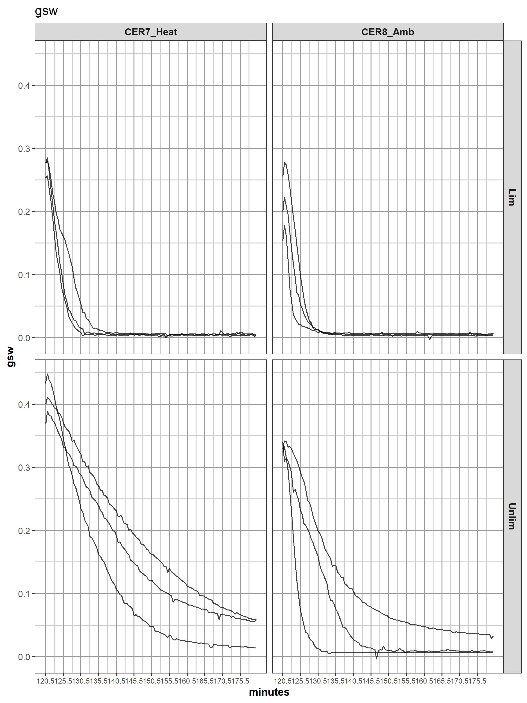

### Following *fit_per_species.R*
* Script begins by specifying a stomatal conductance model and setting priors on the parameters
* I have played a little with the priors specified in the script by Silvere, to be more representative of this dataset
* Following discussion with Ed on 22/04, perhaps we want to select a different ``training" dataset for each treatment combination - need to explore what impact this has
* I haven't implemented the above dot point, as the model is refit for each treatment - it's just the compliation of the tool that fits the model under the hood that doesn't need to be re-initialised and keeps the same structure

#### Stomatal conductance model - McAusland from McAusland et al 2016


``` r
nlform_mc <- bf(gsw ~ g0 + (g1 - g0) * exp(-exp(((lambda - tmin)/k)+1)),
             g0 ~ 1 + Room_Temperature*Watering +
               (1 | Rep),
             g1 ~ 1 + Room_Temperature*Watering +
               (1 | Rep),
             k ~ 1+ Room_Temperature*Watering,
             lambda ~ 1+ Room_Temperature*Watering,
             nl = TRUE)

priors_mc <- c(prior(normal(0.3, 0.1), nlpar = "g0"),
            prior(normal(0, 0.02), nlpar = "g1"),
            prior(normal(0, 0.1), class = "sd", nlpar = "g0"),
            prior(normal(0, 0.02), class = "sd", nlpar = "g1"),
            prior(normal(3, 0.1), nlpar = "k", lb = 0),
            prior(normal(0.5, 0.25), nlpar = "lambda", lb = 0),
            prior(student_t(3, 0, 0.01), class = "sigma"))

plot(0.3 + (0 - 0.3) * exp(-exp(((0.5 - seq(0, 60, 0.5))/3) + 1)) ~
       seq(0, 60, 0.5))
```


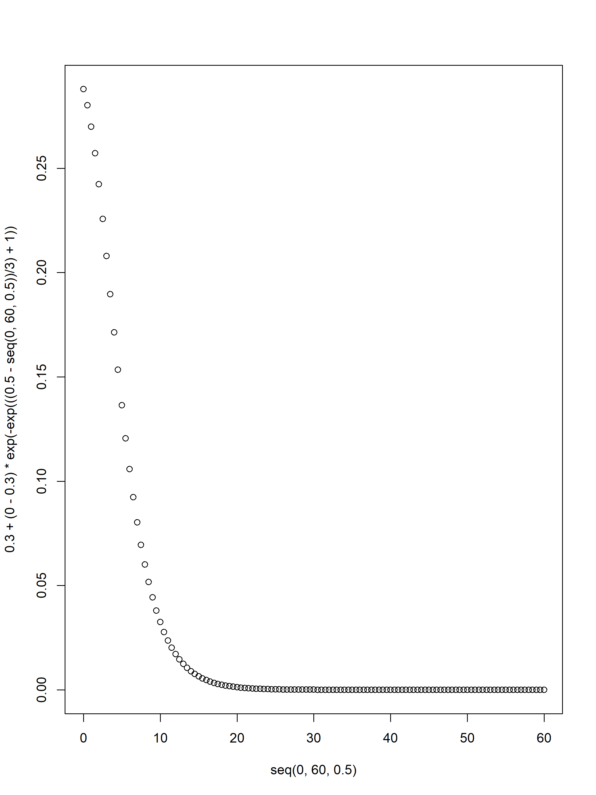

#### Put finishing touches on dataframe
Subset for light on portion and remove th == 0 if it's present, as the light was still on at that point


``` r
li6800.off.dat <- subset(li6800.dat, Light == "Off" & tmin > 120)
li6800.off.dat %>% group_by(Rep) %>% summarise(min(tmin))
```

```
# A tibble: 3 C 2
  Rep   `min(tmin)`
  <fct>       <dbl>
1 1            120.
2 2            121.
3 3            120.
```

``` r
##Align each rep to make sure time 0 is the same
li6800.off.dat <- li6800.off.dat %>% group_by(Rep) %>% mutate(tmin = tmin - min(tmin)) %>% as.data.frame()
li6800.off.dat %>% group_by(Rep) %>% summarise(min(tmin)) %>% as.data.frame()
```

```
  Rep min(tmin)
1   1         0
2   2         0
3   3         0
```

``` r
plotProfiles(li6800.off.dat, response = "gsw",
             individuals = "TWR", times = "tmin",
             y.title = "gsw",
             x.title = "minutes",
             title = "gsw",
             breaks.spacing.x = 5,
             alpha = 0.75)
```


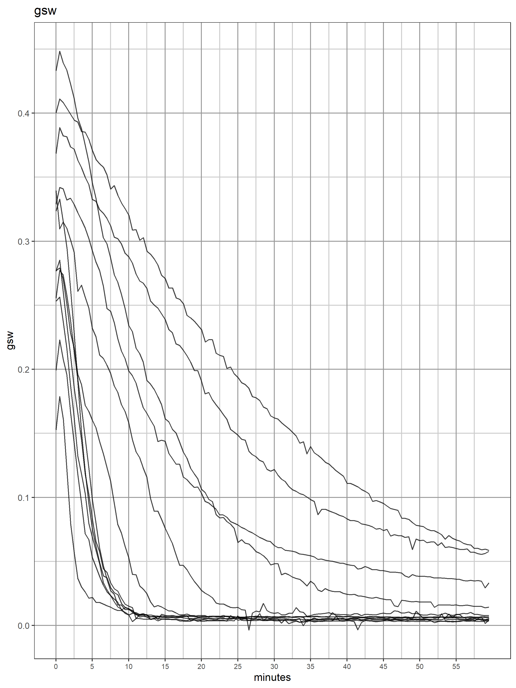

#### Fit the model


``` r
# Configure and compile the model - McAusland
fit_off_max <- brm(
  formula = nlform_mc,
  data = li6800.off.dat,
  prior = priors_mc,
  chains = 6,
  cores = 6,
  iter = 10000,
  warmup = 6000,
  control = list(
    adapt_delta = 0.99,
    max_treedepth = 12,
    metric = "diag_e"
  )
)
```

```
Compiling Stan program...
```

```
Start sampling
```

``` r
print(summary(fit_off_max))
```

```
 Family: gaussian 
  Links: mu = identity 
Formula: gsw ~ g0 + (g1 - g0) * exp(-exp(((lambda - tmin)/k) + 1)) 
         g0 ~ 1 + Room_Temperature * Watering + (1 | Rep)
         g1 ~ 1 + Room_Temperature * Watering + (1 | Rep)
         k ~ 1 + Room_Temperature * Watering
         lambda ~ 1 + Room_Temperature * Watering
   Data: li6800.off.dat (Number of observations: 1451) 
  Draws: 6 chains, each with iter = 10000; warmup = 6000; thin = 1;
         total post-warmup draws = 24000

Multilevel Hyperparameters:
~Rep (Number of levels: 3) 
                 Estimate Est.Error l-95% CI u-95% CI Rhat Bulk_ESS Tail_ESS
sd(g0_Intercept)     0.07      0.04     0.03     0.17 1.00    12188    13708
sd(g1_Intercept)     0.02      0.01     0.01     0.04 1.00    12318    13769

Regression Coefficients:
                                              Estimate Est.Error l-95% CI u-95% CI Rhat
g0_Intercept                                      0.28      0.04     0.20     0.36 1.00
g0_Room_TemperatureCER8_Amb                      -0.13      0.01    -0.16    -0.11 1.00
g0_WateringUnlim                                  0.19      0.01     0.17     0.21 1.00
g0_Room_TemperatureCER8_Amb:WateringUnlim        -0.11      0.01    -0.13    -0.08 1.00
g1_Intercept                                      0.00      0.01    -0.01     0.02 1.00
g1_Room_TemperatureCER8_Amb                      -0.01      0.00    -0.01    -0.00 1.00
g1_WateringUnlim                                  0.08      0.00     0.07     0.08 1.00
g1_Room_TemperatureCER8_Amb:WateringUnlim        -0.08      0.00    -0.09    -0.07 1.00
k_Intercept                                       3.05      0.08     2.89     3.21 1.00
k_Room_TemperatureCER8_Amb                        2.59      0.10     2.39     2.80 1.00
k_WateringUnlim                                   3.38      0.09     3.20     3.56 1.00
k_Room_TemperatureCER8_Amb:WateringUnlim          2.81      0.10     2.61     3.00 1.00
lambda_Intercept                                  0.12      0.10     0.00     0.37 1.00
lambda_Room_TemperatureCER8_Amb                   0.07      0.07     0.00     0.25 1.00
lambda_WateringUnlim                              0.67      0.23     0.23     1.12 1.00
lambda_Room_TemperatureCER8_Amb:WateringUnlim     0.16      0.13     0.01     0.48 1.00
                                              Bulk_ESS Tail_ESS
g0_Intercept                                     11416    12130
g0_Room_TemperatureCER8_Amb                      16459    16997
g0_WateringUnlim                                 15098    17044
g0_Room_TemperatureCER8_Amb:WateringUnlim        15057    16896
g1_Intercept                                     11497    13384
g1_Room_TemperatureCER8_Amb                      22037    18567
g1_WateringUnlim                                 22129    19812
g1_Room_TemperatureCER8_Amb:WateringUnlim        19836    17661
k_Intercept                                      27217    18855
k_Room_TemperatureCER8_Amb                       27818    18030
k_WateringUnlim                                  27070    18561
k_Room_TemperatureCER8_Amb:WateringUnlim         29541    17455
lambda_Intercept                                 18965    11122
lambda_Room_TemperatureCER8_Amb                  20591    11453
lambda_WateringUnlim                             18477    10695
lambda_Room_TemperatureCER8_Amb:WateringUnlim    17694    10873

Further Distributional Parameters:
      Estimate Est.Error l-95% CI u-95% CI Rhat Bulk_ESS Tail_ESS
sigma     0.04      0.00     0.03     0.04 1.00    27768    18358

Draws were sampled using sampling(NUTS). For each parameter, Bulk_ESS
and Tail_ESS are effective sample size measures, and Rhat is the potential
scale reduction factor on split chains (at convergence, Rhat = 1).
```

``` r
plot(fit_off_max, ask = FALSE)
```


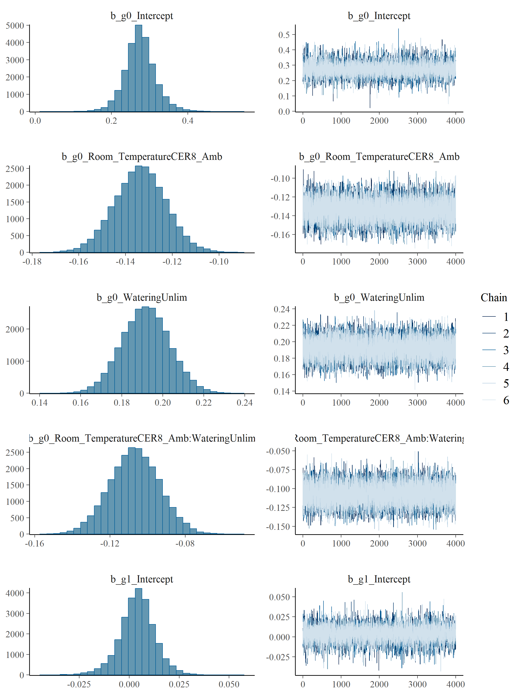

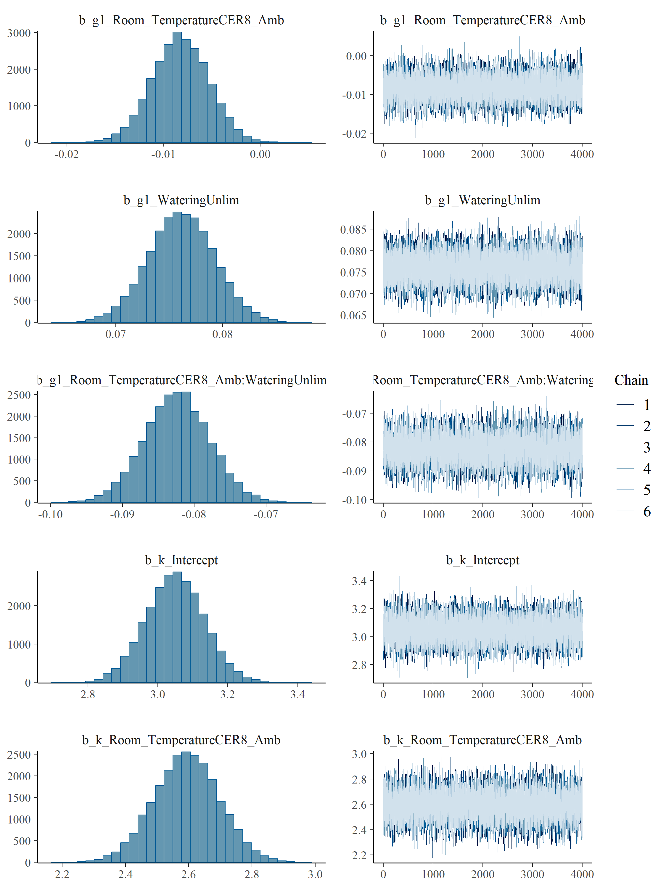

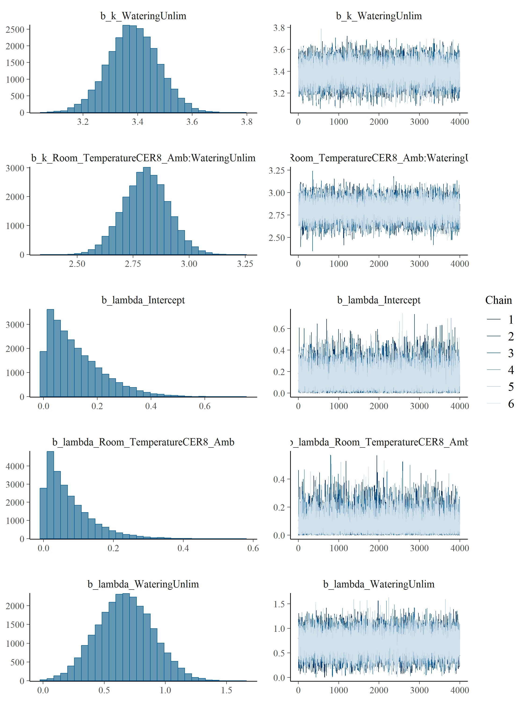

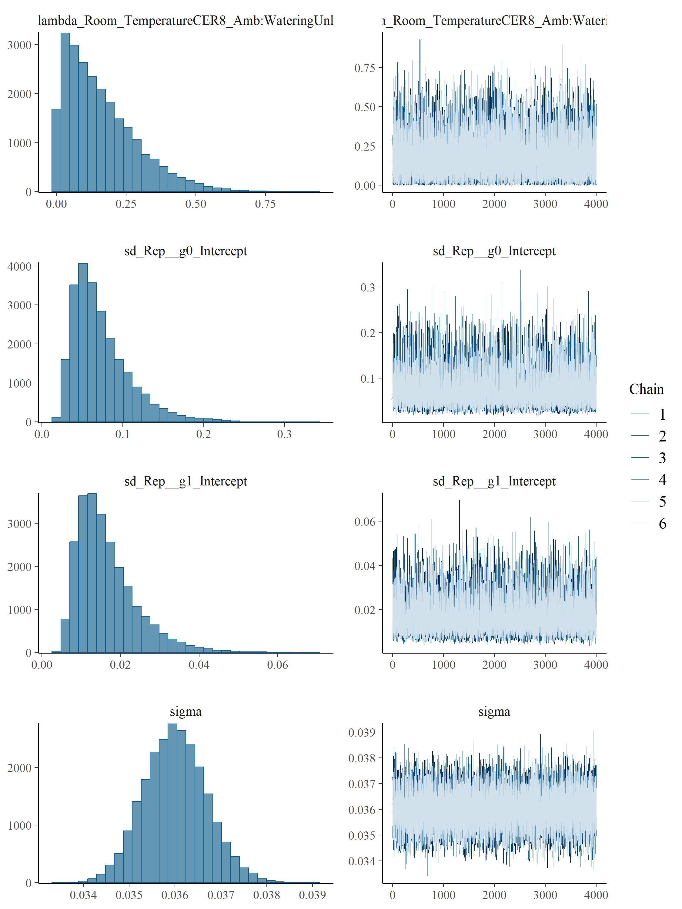

``` r
pairs(fit_off_max)
```


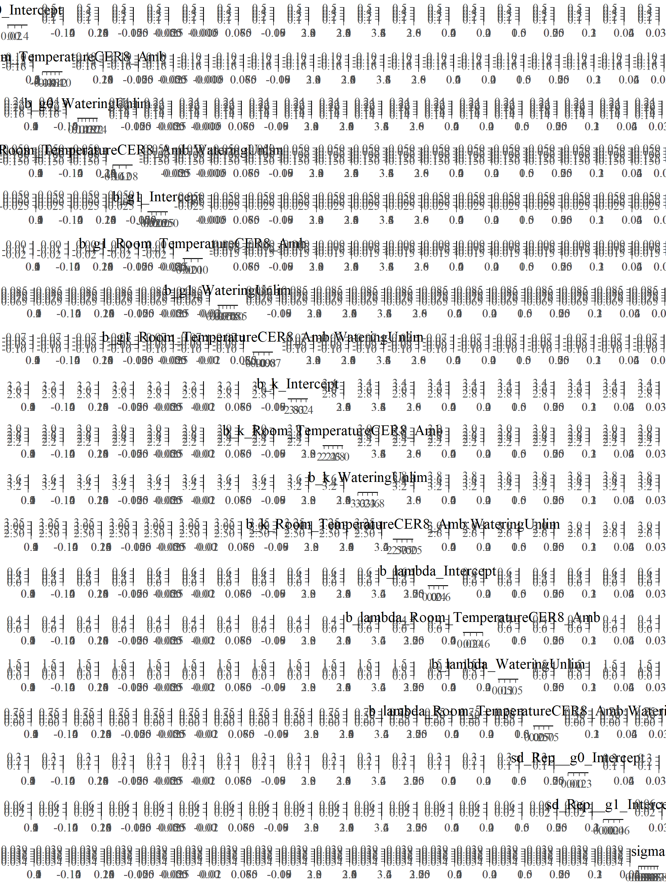

``` r
mcmc_plot(fit_off_max, type = "trace")
```

```
No divergences to plot.
```


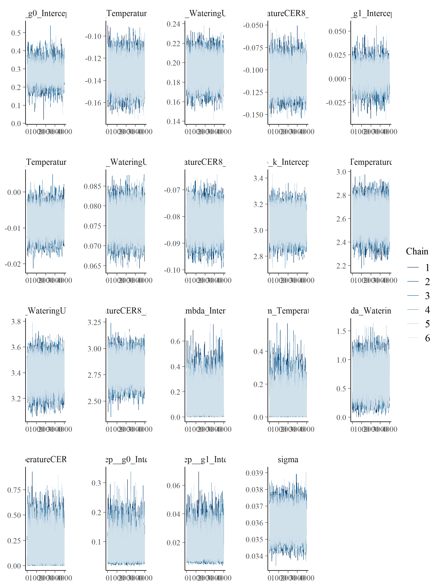

``` r
rstan::check_hmc_diagnostics(fit_off_max$fit)
```

```

Divergences:
```

```
0 of 24000 iterations ended with a divergence.
```

```

Tree depth:
```

```
0 of 24000 iterations saturated the maximum tree depth of 12.
```

```

Energy:
```

```
E-BFMI indicated no pathological behavior.
```

``` r
loo(fit_off_max)
```

```

Computed from 24000 by 1451 log-likelihood matrix.

         Estimate   SE
elpd_loo   2751.5 39.3
p_loo        23.3  2.1
looic     -5503.0 78.6
------
MCSE of elpd_loo is 0.0.
MCSE and ESS estimates assume MCMC draws (r_eff in [0.7, 1.3]).

All Pareto k estimates are good (k < 0.7).
See help('pareto-k-diagnostic') for details.
```

``` r
pp_check(fit_off_max)  # compares density of the observed data with data generated from posterior predictive distribution
```

```
Using 10 posterior draws for ppc type 'dens_overlay' by default.
```


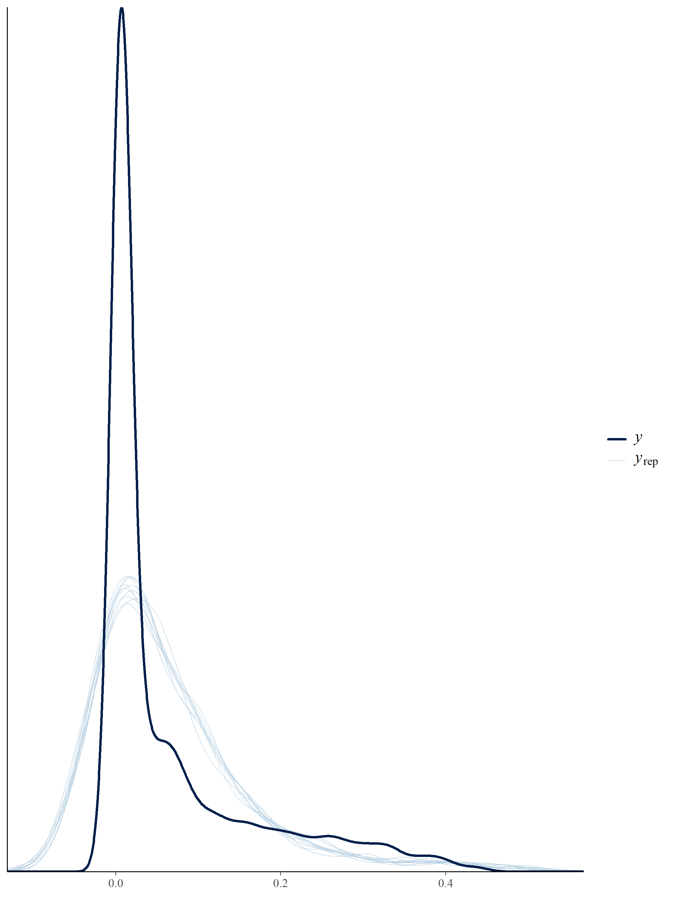

``` r
pp_check(fit_off_max, type = "error_hist", ndraws = 12)
```

```
`stat_bin()` using `bins = 30`. Pick better value `binwidth`.
```


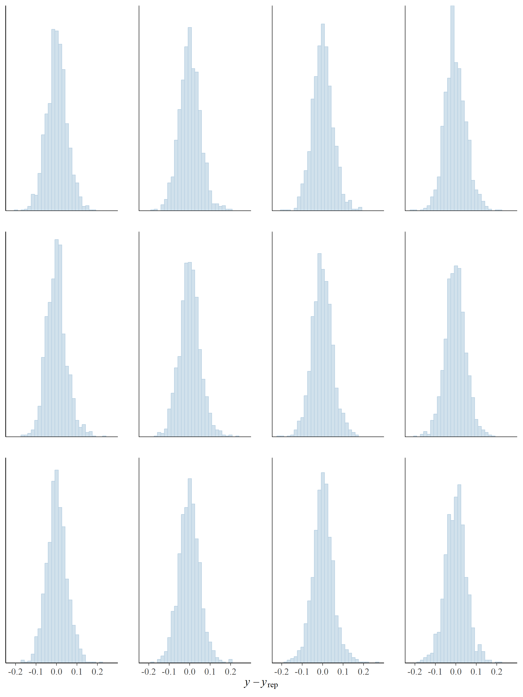

``` r
pp_check(fit_off_max, type = "scatter_avg", ndraws = 1000)
```


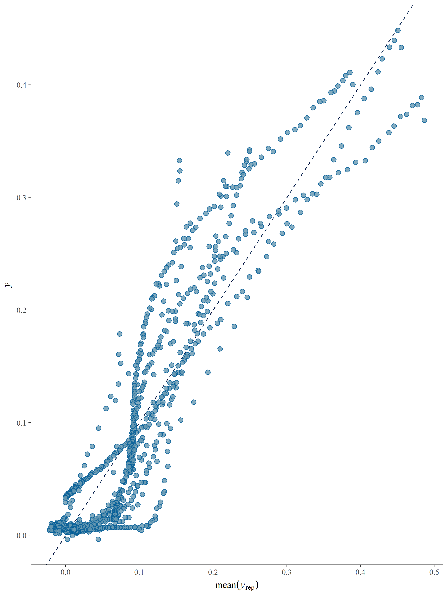

``` r
pp_check(fit_off_max, type = "stat_2d")
```

```
Using all posterior draws for ppc type 'stat_2d' by default.
```

```
Note: in most cases the default test statistic 'mean' is too weak to detect anything of interest.
```


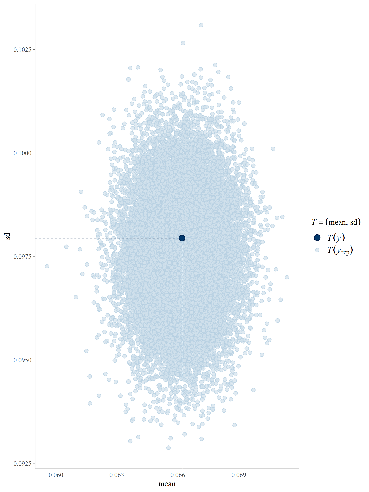

``` r
pp_check(fit_off_max, type = "loo_ribbon")
```

```
Using all posterior draws for ppc type 'loo_ribbon' by default.
```


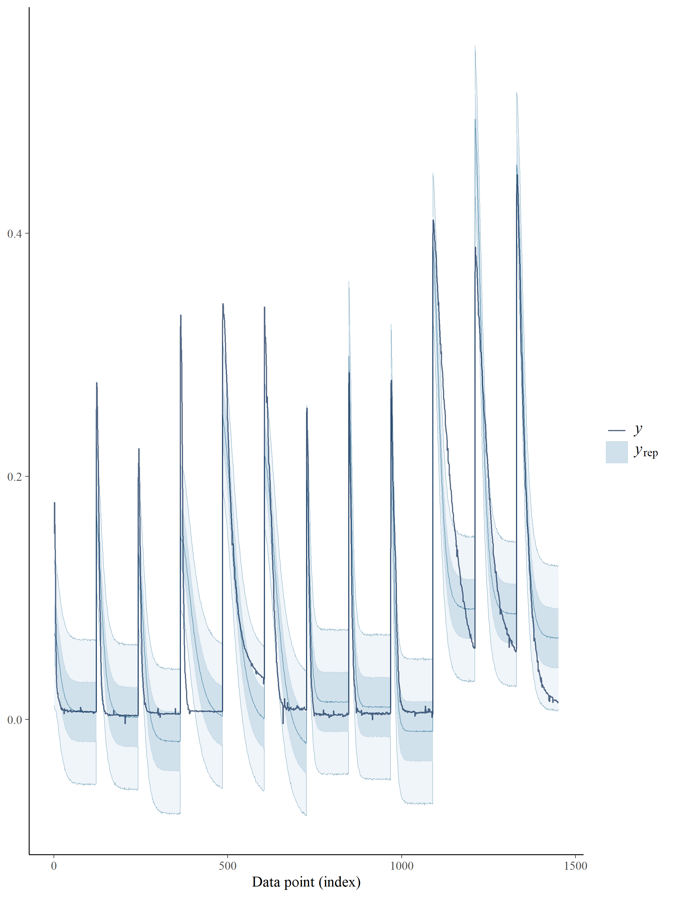

``` r
plot(gsw~tmin, li6800.off.dat, pch=16)
points(fitted(fit_off_max)[,1]~tmin, li6800.off.dat, pch=16, col="red")
```


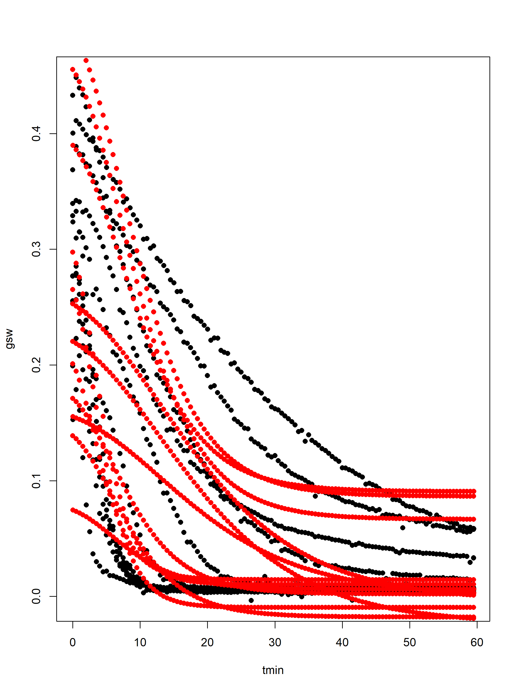

``` r
##make the above plot prettier
li6800.off.plot <- li6800.off.dat
li6800.off.plot$fitted <- fitted(fit_off_max)[,1]
li6800.off.plot$fitted.fixed <- fitted(fit_off_max, re_formula = NA)[,1]

ggplot(li6800.off.plot, aes(x= tmin, y = gsw, group = Rep)) +
  geom_point() +
  facet_grid(Room_Temperature ~ Watering) +
  geom_point(aes(y=fitted), colour = "red") +
  geom_line(aes(y=fitted), colour = "red")
```


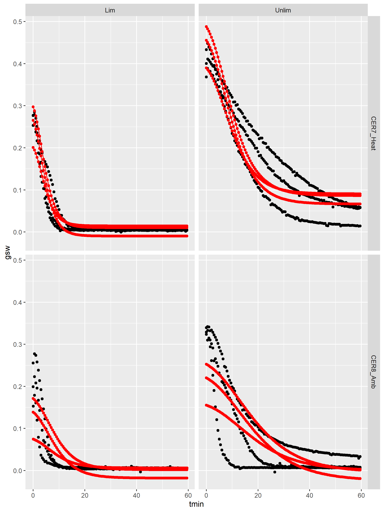

``` r
ggplot(li6800.off.plot, aes(x= tmin, y = gsw, group = Rep)) +
  geom_point() +
  facet_grid(Room_Temperature ~ Watering) +
  geom_point(aes(y=fitted), colour = "red") +
  geom_line(aes(y=fitted), colour = "red") +
  geom_point(aes(y=fitted.fixed), colour = "blue") +
  geom_line(aes(y=fitted.fixed), colour = "blue")
```


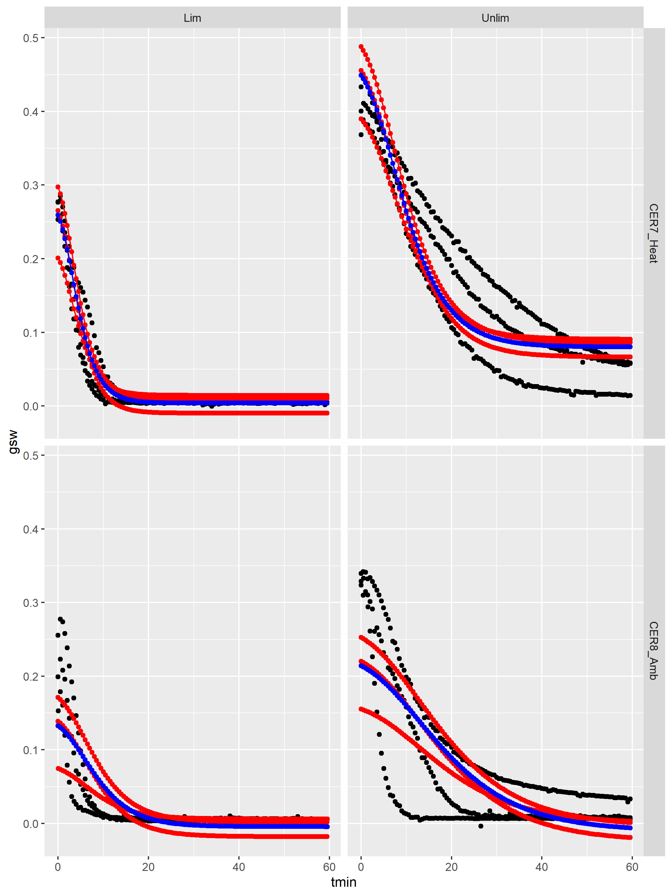

#### Testing contribution of effects in the model


``` r
# nlform_mc_reduced <- bf(gsw ~ g0 + (g1 - g0) * exp(-exp(((lambda - tmin)/k)+1)),
#                         g0 ~ 1 + Room_Temperature*Watering +
#                           (1 | Rep),
#                         g1 ~ 1 + Room_Temperature*Watering +
#                           (1 | Rep),
#                         k ~ 1,
#                         lambda ~ 1 + Watering,
#                         nl = TRUE)
# 
# # Fit the model
# fit_off_reduced <- brm(
#   formula = nlform_mc_reduced,
#   data = li6800.off.dat,
#   prior = priors_mc,
#   chains = 6,
#   cores = 6,
#   iter = 10000,
#   warmup = 6000,
#   control = list(
#     adapt_delta = 0.99,
#     max_treedepth = 12,
#     metric = "diag_e"
#   )
# )
# 
# print(summary(fit_off_reduced))
# loo(fit_off_reduced)
# loo(fit_off_current)
# plot(gsw~tmin, li6800.off.dat, pch=16)
# points(fitted(fit_off_reduced)[,1]~tmin, li6800.off.dat, pch=16, col="red")
# coef(fit_off_reduced)
# 
# fit_off_current <- add_criterion(fit_off_current, "loo")
# fit_off_reduced <- add_criterion(fit_off_reduced, "loo")
# 
# loo_compare(fit_off_current, fit_off_reduced)
##Lambda: Drop Room_Temperature:Watering interaction
##k: Drop Room_Temperature:Watering interaction
#g1: Retain Room_Temperature:Watering interaction
#g0: Retain Room_Temperature:Watering interaction

##Lambda: Drop Room_Temperature main effect
##lambda: Retain Watering main effect
##k: Drop Room_Temperature main effect
##k: Retain Watering main effect
#fit_off_current <- fit_off_reduced
#print(summary(fit_off_current))
```

#### Fit the final model


``` r
#g0: Room_Temperature:Watering
#g1: Room_Temperature:Watering
#k: Watering
#lambda: Watering
nlform_mc_final <- bf(gsw ~ g0 + (g1 - g0) * exp(-exp(((lambda - tmin)/k)+1)),
                        g0 ~ 1 + Room_Temperature*Watering +
                          (1 | Rep),
                        g1 ~ 1 + Room_Temperature*Watering +
                          (1 | Rep),
                        k ~ 1 + Watering,
                        lambda ~ 1 + Watering,
                        nl = TRUE)

# Fit the final model
fit_off_final <- brm(
  formula = nlform_mc_final,
  data = li6800.off.dat,
  prior = priors_mc,
  chains = 6,
  cores = 6,
  iter = 10000,
  warmup = 6000,
  control = list(
    adapt_delta = 0.99,
    max_treedepth = 12,
    metric = "diag_e"
  )
)
```

```
Compiling Stan program...
```

```
Start sampling
```

``` r
print(summary(fit_off_final))
```

```
 Family: gaussian 
  Links: mu = identity 
Formula: gsw ~ g0 + (g1 - g0) * exp(-exp(((lambda - tmin)/k) + 1)) 
         g0 ~ 1 + Room_Temperature * Watering + (1 | Rep)
         g1 ~ 1 + Room_Temperature * Watering + (1 | Rep)
         k ~ 1 + Watering
         lambda ~ 1 + Watering
   Data: li6800.off.dat (Number of observations: 1451) 
  Draws: 6 chains, each with iter = 10000; warmup = 6000; thin = 1;
         total post-warmup draws = 24000

Multilevel Hyperparameters:
~Rep (Number of levels: 3) 
                 Estimate Est.Error l-95% CI u-95% CI Rhat Bulk_ESS Tail_ESS
sd(g0_Intercept)     0.07      0.04     0.02     0.16 1.00    11785    14141
sd(g1_Intercept)     0.02      0.01     0.01     0.03 1.00    13170    14993

Regression Coefficients:
                                          Estimate Est.Error l-95% CI u-95% CI Rhat
g0_Intercept                                  0.27      0.04     0.20     0.36 1.00
g0_Room_TemperatureCER8_Amb                  -0.07      0.01    -0.09    -0.05 1.00
g0_WateringUnlim                              0.18      0.01     0.16     0.20 1.00
g0_Room_TemperatureCER8_Amb:WateringUnlim    -0.10      0.01    -0.13    -0.08 1.00
g1_Intercept                                  0.00      0.01    -0.01     0.02 1.00
g1_Room_TemperatureCER8_Amb                  -0.00      0.00    -0.01     0.00 1.00
g1_WateringUnlim                              0.08      0.00     0.07     0.08 1.00
g1_Room_TemperatureCER8_Amb:WateringUnlim    -0.06      0.00    -0.07    -0.06 1.00
k_Intercept                                   3.07      0.08     2.92     3.22 1.00
k_WateringUnlim                               3.50      0.09     3.33     3.67 1.00
lambda_Intercept                              0.19      0.13     0.01     0.49 1.00
lambda_WateringUnlim                          0.98      0.22     0.54     1.41 1.00
                                          Bulk_ESS Tail_ESS
g0_Intercept                                 10754    12041
g0_Room_TemperatureCER8_Amb                  17643    17443
g0_WateringUnlim                             17217    17981
g0_Room_TemperatureCER8_Amb:WateringUnlim    16292    17108
g1_Intercept                                 11775    13342
g1_Room_TemperatureCER8_Amb                  24306    19896
g1_WateringUnlim                             22213    19406
g1_Room_TemperatureCER8_Amb:WateringUnlim    20295    18877
k_Intercept                                  26763    17678
k_WateringUnlim                              27430    16888
lambda_Intercept                             16580    10020
lambda_WateringUnlim                         23583    14106

Further Distributional Parameters:
      Estimate Est.Error l-95% CI u-95% CI Rhat Bulk_ESS Tail_ESS
sigma     0.03      0.00     0.03     0.03 1.00    31230    17133

Draws were sampled using sampling(NUTS). For each parameter, Bulk_ESS
and Tail_ESS are effective sample size measures, and Rhat is the potential
scale reduction factor on split chains (at convergence, Rhat = 1).
```

``` r
pp_check(fit_off_final)
```

```
Using 10 posterior draws for ppc type 'dens_overlay' by default.
```


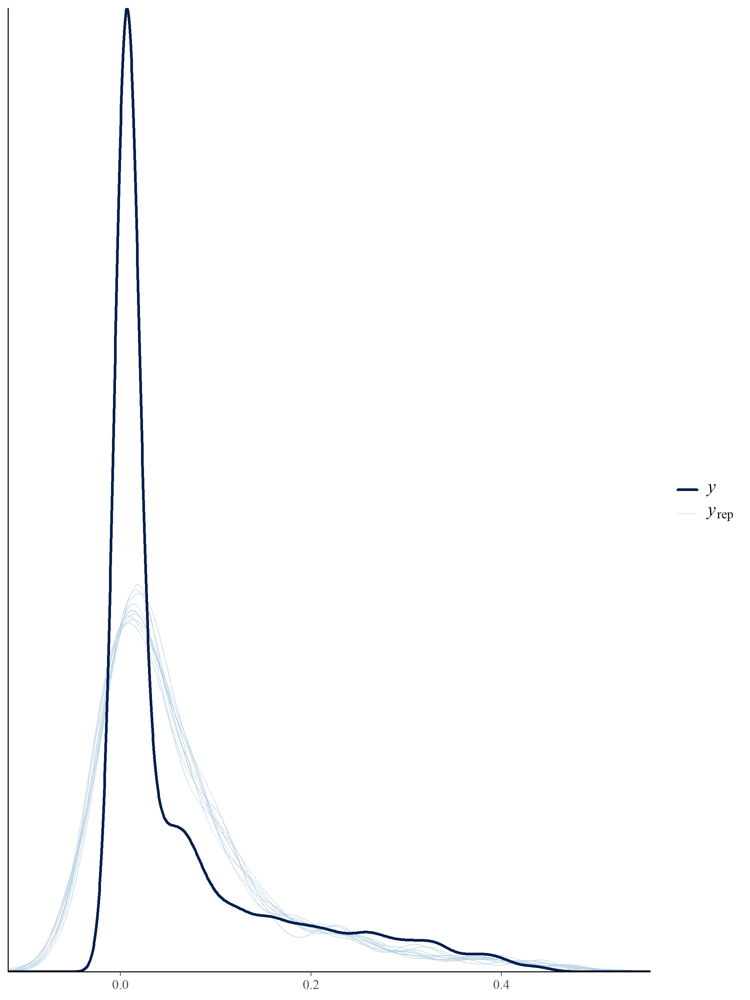

``` r
rstan::check_hmc_diagnostics(fit_off_final$fit)
```

```

Divergences:
```

```
0 of 24000 iterations ended with a divergence.
```

```

Tree depth:
```

```
0 of 24000 iterations saturated the maximum tree depth of 12.
```

```

Energy:
```

```
E-BFMI indicated no pathological behavior.
```

``` r
##make the above plot prettier
li6800.off.plot <- li6800.off.dat
li6800.off.plot$fitted <- fitted(fit_off_final)[,1]
li6800.off.plot$fitted.fixed <- fitted(fit_off_final, re_formula = NA)[,1]

ggplot(li6800.off.plot, aes(x= tmin, y = gsw, group = Rep)) +
  geom_point() +
  facet_grid(Room_Temperature ~ Watering) +
  geom_point(aes(y=fitted), colour = "red") +
  geom_line(aes(y=fitted), colour = "red")
```


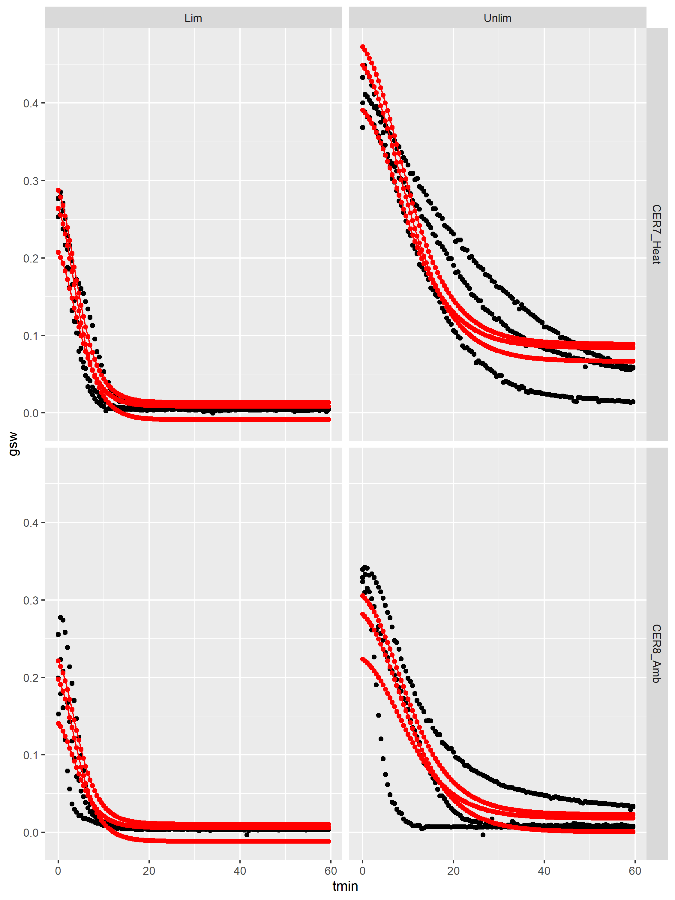

``` r
ggplot(li6800.off.plot, aes(x= tmin, y = gsw, group = Rep)) +
  geom_point() +
  facet_grid(Room_Temperature ~ Watering) +
  geom_point(aes(y=fitted), colour = "red") +
  geom_line(aes(y=fitted), colour = "red") +
  geom_point(aes(y=fitted.fixed), colour = "blue") +
  geom_line(aes(y=fitted.fixed), colour = "blue")
```


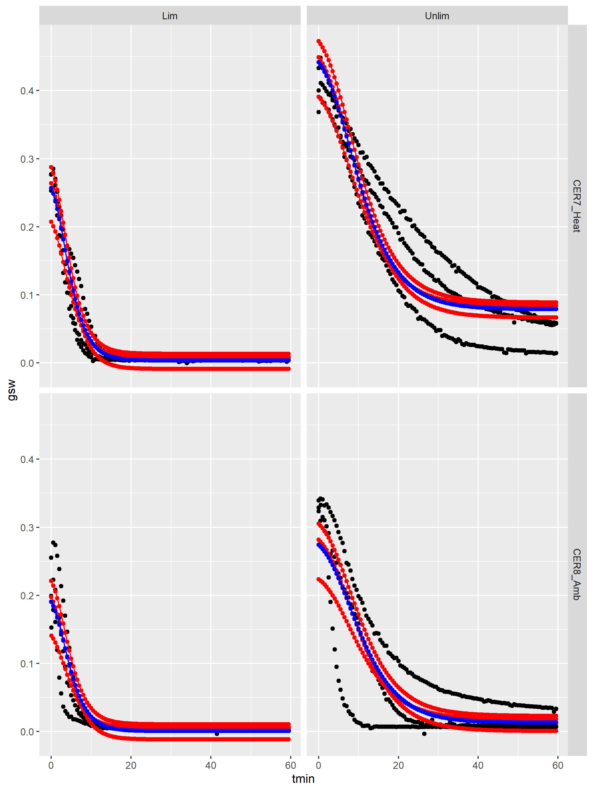

``` r
##I will set up an output script to get the parameters, etc. from these models
# ##calculate Slmax for the McAusland model
# Slmax.calc.mc <- function(coef){
#   ##pull out ceofficients, as they relate to parameters in McAusland 2016
#   gi <- coef$Rep[, "Estimate", "g0_Intercept"]
#   gf <- coef$Rep[, "Estimate", "g1_Intercept"]
#   k <- coef$Rep[, "Estimate", "k_Intercept"]
#   
#   (gf - gi)/(k*exp(1))
# }
# 
# Slmax.calc.mc(coef(fits_mc[[1]]))
# Slmax.calc.mc(coef(fits_mc[[2]]))
# Slmax.calc.mc(coef(fits_mc[[3]]))
# Slmax.calc.mc(coef(fits_mc[[4]]))
```

### Save data


``` r
save.image(saveFile)
```

