---
output:
  pdf_document: default
  html_document: default
---
# Wheat stomatal kinetics (heat & drought)
## --- Ed Chaplin (USyd), *Apr--June 2025* ---
### Li-6800 STOMATAL CONDUCTANCE MODEL FITTING - LIGHT OFF TO LIGHT ON (INCREASE)

* This script will attempt to fit the methods of Woning et al (2026) and McAusland et al (2016) using the script supplied by Silvere Vialet-Chabrand
* The models fitted in the script look to be the Cumulative Distribution Weibull (CDWeibull) models described in Eqn 4.1 of Woning et al (2026)
* I've also adapted the script to incorporate the McAusland model
* Scripts supplied by Silvere can be found in the gs_fit.zip directory
* There are two scripts in this directory: fit_per_curve.r and fit_per_species.r
* Fit_per_curve looks to take each individual plant and fit a curve to it, 
while fit_per_species fits some parameters (tau and theta) at a species (treatment in our setting) level and others at a replicate level
* In an email from Silvere (shared by Chris and put in the \textit{Materials from Ed} directory), 
Silvere prefers the fit_per_species approach, as do I, as this seems to align better with conventional analysis approaches

### Load the libraries


``` r
library(knitr)
#knitr::spin("li6800.stomatalCondModel_i.v1.r")
library(ggplot2)
opts_chunk$set("tidy" = FALSE, "dev" = "png", "dpi" = 300, 
               "fig.width" = 7.5, "fig.height" = 10, "comment"=NA, fig.path = "figures/increase/")
library(dae)
library(dplyr)
library(growthPheno) # calcLagged
packageVersion("growthPheno")
```

```
[1] '3.1.18'
```

``` r
library(brms) ##package used to fit bayesian regression model using Stan
```

### Set up constants and files


``` r
options(width=90)
load("../data/li6800.v1.Rdata")
saveFile <- "../data/stomatalCondModel_i.v1.Rdata"
```

### Define TW to be unique for each treatment


``` r
li6800.dat$TW <- paste(li6800.dat$Temperature, li6800.dat$Watering, sep="_")
li6800.dat$TW <- factor(li6800.dat$TW)
```

### Define th and tmin, to be time in hours and minutes respectively


``` r
li6800.dat$th <- li6800.dat$xElapsed/3600
li6800.dat$tmin <- li6800.dat$xElapsed/60
```

### Explore the gs profiles of just the light on portion of the experiment


``` r
plotProfiles(li6800.dat %>% filter(Light == "On"), response = "gsw",
             individuals = "TWR", times = "tmin",
             facet.x = "Temperature",
             facet.y = "Watering",
             y.title = "gsw",
             x.title = "hours",
             title = "gsw",
             breaks.spacing.x = 5,
             alpha = 0.75)
```


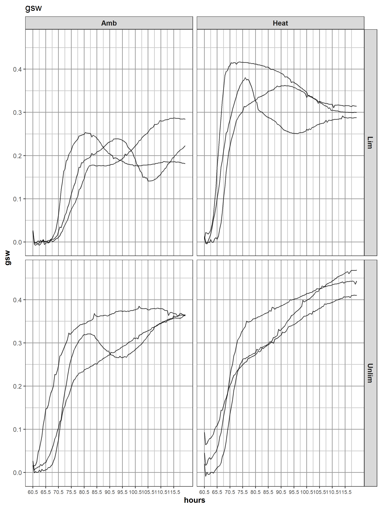

### Explore the gs profiles of just the second light off portion of the experiment


``` r
# plotProfiles(li6800.dat %>% filter(Light == "Off" & th > 2), response = "gsw",
#              individuals = "TWR", times = "th",
#              facet.x = "Temperature",
#              facet.y = "Watering",
#              y.title = "gsw",
#              x.title = "hours",
#              title = "gsw",
#              breaks.spacing.x = 5,
#              alpha = 0.75)
```

### Following *fit_per_species.R*
* Script begins by specifying a stomatal conductance model and setting priors on the parameters
* I have played a little with the priors specified in the script by Silvere, to be more representative of this dataset
* Following discussion with Ed on 22/04, perhaps we want to select a different ``training" dataset for each treatment combination - need to explore what impact this has
* I haven't implemented the above dot point, as the model is refit for each treatment - it's just the compliation of the tool that fits the model under the hood that doesn't need to be re-initialised and keeps the same structure

#### Stomatal conductance model - CDWeibull from Woning et al 2026


``` r
nlform <- bf(gsw ~ g1 + (g0 - g1) * exp(-((th / tau)^theta)),
             g0 ~ 1 + (1 | Rep),
             g1 ~ 1 + (1 | Rep),
             tau ~ 1,
             theta ~ 1,
             nl = TRUE)
```

#### Stomatal conductance model - McAusland from McAusland et al 2016


``` r
nlform_mc <- bf(gsw ~ g0 + (g1 - g0) * exp(-exp(((lambda - tmin)/k)+1)),
             g0 ~ 1 + (1 | Rep),
             g1 ~ 1 + (1 | Rep),
             k ~ 1,
             lambda ~ 1,
             nl = TRUE)

priors <- c(prior(normal(0.025, 0.02), nlpar = "g0"),
            prior(normal(0.3, 0.2), nlpar = "g1"),
            prior(normal(0, 0.01), class = "sd", nlpar = "g0"),
            prior(normal(0, 0.05), class = "sd", nlpar = "g1"),
            prior(normal(0.25, 1), nlpar = "tau", lb = 0),
            prior(normal(2, 2), nlpar = "theta", lb = 0),
            prior(student_t(3, 0, 0.01), class = "sigma"))

priors_mc <- c(prior(normal(0.025, 0.02), nlpar = "g0"),
            prior(normal(0.3, 0.2), nlpar = "g1"),
            prior(normal(0, 0.01), class = "sd", nlpar = "g0"),
            prior(normal(0, 0.05), class = "sd", nlpar = "g1"),
            prior(normal(3, 2), nlpar = "k", lb = 0),
            prior(normal(4, 2), nlpar = "lambda", lb = 0),
            prior(student_t(3, 0, 0.01), class = "sigma"))
```

#### Initialise the model
Looks like to initialise the model, the dataframe is subset for the first plant in the first rep and for PAR == 1, which is the period where the light is switched on


``` r
# pick a small but valid dataset
dd_init <- subset(li6800.dat, Light == "On" & TW == li6800.dat$TW[1] & th != 0)
dd_init$th <- dd_init$th - dd_init$th[1]
dd_init$tmin <- dd_init$tmin - dd_init$tmin[1]

##remove the first observation from the analysis - it's still impacted by the change in lighting
dd_init <- subset(dd_init, th != 0)
head(dd_init)
```

```
    obs         time elapsed              date   hhmmss       time.elapsed        A
125 126 1750032134.5    3661 20250616 10:02:14 10:02:14 61.000000000000021 1.296567
126 127 1750032164.5    3691 20250616 10:02:44 10:02:44 61.500000000000021 1.385702
127 128 1750032194.5    3721 20250616 10:03:14 10:03:14 62.000000000000021 1.067099
128 129 1750032224.5    3751 20250616 10:03:44 10:03:44 62.500000000000014 1.284658
129 130 1750032254.5    3781 20250616 10:04:14 10:04:14 63.000000000000014 1.230181
130 131 1750032284.5    3811 20250616 10:04:44 10:04:44 63.500000000000014 1.372948
              gsw  TleafEB     light           Timestamp time.diff xElapsed xElapsed.min
125 -0.0028748183 24.75610  999.9787 2025-06-16 10:02:14        30     3660         61.0
126 -0.0025839934 24.84859  999.9951 2025-06-16 10:02:44        30     3690         61.5
127 -0.0001403046 24.91740 1000.0007 2025-06-16 10:03:14        30     3720         62.0
128  0.0026056428 24.98566 1000.0335 2025-06-16 10:03:44        30     3750         62.5
129  0.0005737584 25.07066 1000.0050 2025-06-16 10:04:14        30     3780         63.0
130  0.0044335864 25.10999 1000.0035 2025-06-16 10:04:44        30     3810         63.5
    Line Temperature Watering Rep       TWR Location Light      TW          th tmin
125  L01         Amb      Lim   1 Amb_Lim_1      D13    On Amb_Lim 0.008333333  0.5
126  L01         Amb      Lim   1 Amb_Lim_1      D13    On Amb_Lim 0.016666667  1.0
127  L01         Amb      Lim   1 Amb_Lim_1      D13    On Amb_Lim 0.025000000  1.5
128  L01         Amb      Lim   1 Amb_Lim_1      D13    On Amb_Lim 0.033333333  2.0
129  L01         Amb      Lim   1 Amb_Lim_1      D13    On Amb_Lim 0.041666667  2.5
130  L01         Amb      Lim   1 Amb_Lim_1      D13    On Amb_Lim 0.050000000  3.0
```

``` r
plotProfiles(dd_init, response = "gsw",
             individuals = "TWR", times = "tmin",
             y.title = "gsw",
             x.title = "hours",
             title = "gsw",
             breaks.spacing.x = 5,
             alpha = 0.75)
```


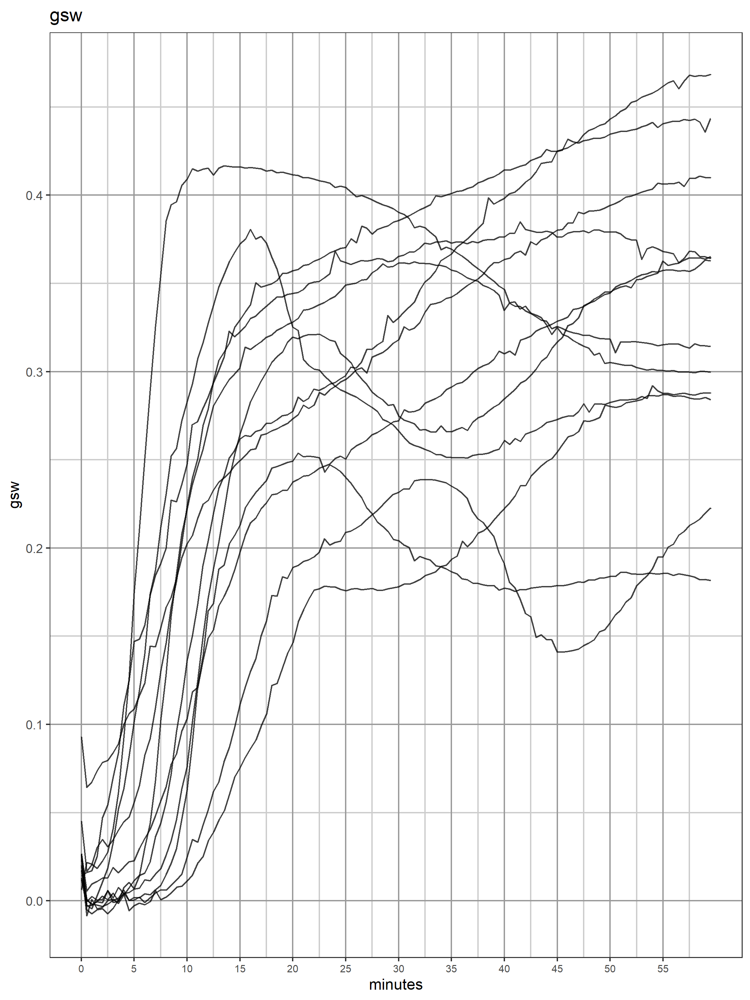

``` r
# Configure and compile the model
fit_init <- brm(
  formula = nlform,
  data = dd_init,
  prior = priors,
  chains = 4,
  cores = 4,
  iter = 3000,
  warmup = 2000,
  control = list(
    adapt_delta = 0.99,
    max_treedepth = 12,
    metric = "diag_e"
  )
)
```

```
Compiling Stan program...
```

```
Start sampling
```

``` r
print(summary(fit_init))
```

```
 Family: gaussian 
  Links: mu = identity 
Formula: gsw ~ g1 + (g0 - g1) * exp(-((th/tau)^theta)) 
         g0 ~ 1 + (1 | Rep)
         g1 ~ 1 + (1 | Rep)
         tau ~ 1
         theta ~ 1
   Data: dd_init (Number of observations: 362) 
  Draws: 4 chains, each with iter = 3000; warmup = 2000; thin = 1;
         total post-warmup draws = 4000

Multilevel Hyperparameters:
~Rep (Number of levels: 3) 
                 Estimate Est.Error l-95% CI u-95% CI Rhat Bulk_ESS Tail_ESS
sd(g0_Intercept)     0.02      0.01     0.01     0.03 1.00     2624     2151
sd(g1_Intercept)     0.02      0.02     0.01     0.07 1.00     1317     2443

Regression Coefficients:
                Estimate Est.Error l-95% CI u-95% CI Rhat Bulk_ESS Tail_ESS
g0_Intercept        0.00      0.01    -0.02     0.03 1.00     2042     2564
g1_Intercept        0.21      0.02     0.18     0.24 1.00     1866     1702
tau_Intercept       0.26      0.01     0.24     0.27 1.00     4122     2832
theta_Intercept     3.64      0.41     2.93     4.53 1.00     3862     2353

Further Distributional Parameters:
      Estimate Est.Error l-95% CI u-95% CI Rhat Bulk_ESS Tail_ESS
sigma     0.04      0.00     0.03     0.04 1.00     3596     2475

Draws were sampled using sampling(NUTS). For each parameter, Bulk_ESS
and Tail_ESS are effective sample size measures, and Rhat is the potential
scale reduction factor on split chains (at convergence, Rhat = 1).
```

``` r
plot(fit_init)
```


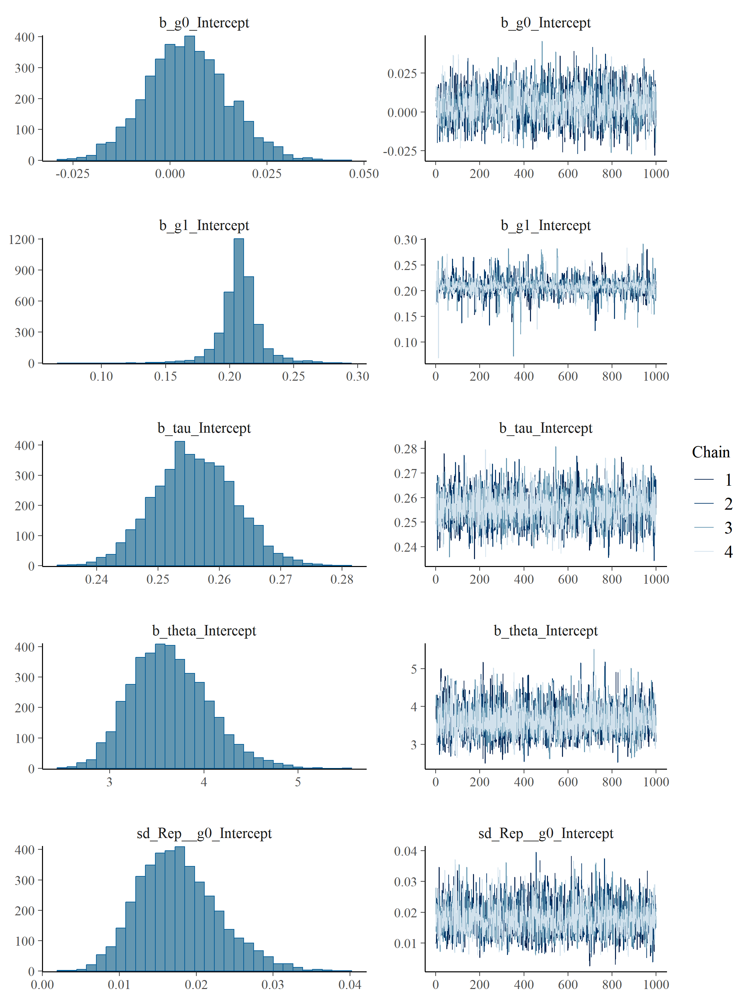

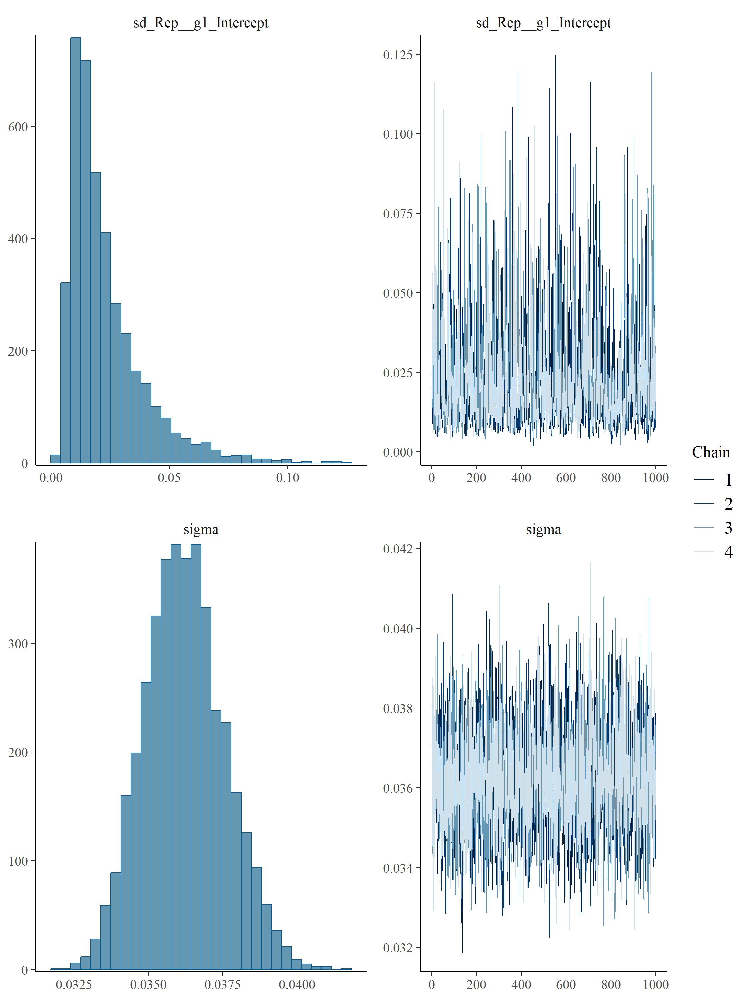

``` r
pairs(fit_init)
```


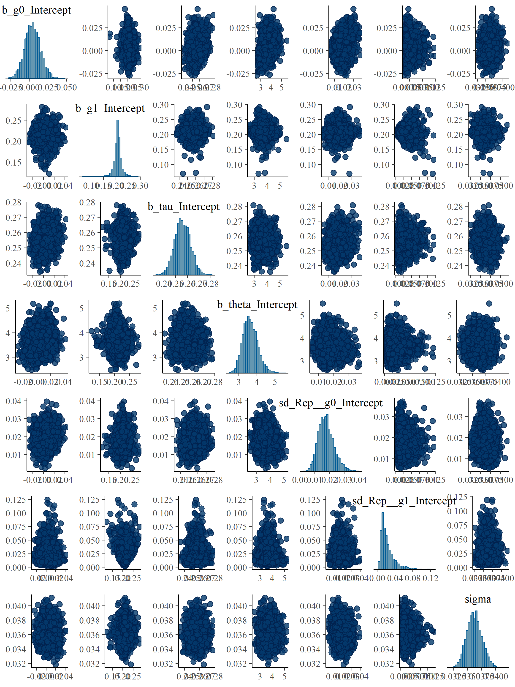

``` r
mcmc_plot(fit_init, type = "trace")
```

```
No divergences to plot.
```


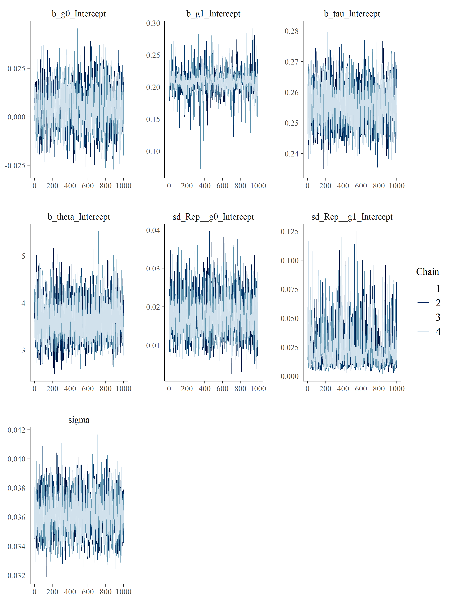

``` r
rstan::check_hmc_diagnostics(fit_init$fit)
```

```

Divergences:
```

```
0 of 4000 iterations ended with a divergence.
```

```

Tree depth:
```

```
0 of 4000 iterations saturated the maximum tree depth of 12.
```

```

Energy:
```

```
E-BFMI indicated no pathological behavior.
```

``` r
loo(fit_init)
```

```

Computed from 4000 by 362 log-likelihood matrix.

         Estimate   SE
elpd_loo    682.2 11.4
p_loo         8.4  0.7
looic     -1364.4 22.8
------
MCSE of elpd_loo is 0.0.
MCSE and ESS estimates assume MCMC draws (r_eff in [0.7, 1.2]).

All Pareto k estimates are good (k < 0.7).
See help('pareto-k-diagnostic') for details.
```

``` r
pp_check(fit_init)  # compares density of the observed data with data generated from posterior predictive distribution
```

```
Using 10 posterior draws for ppc type 'dens_overlay' by default.
```


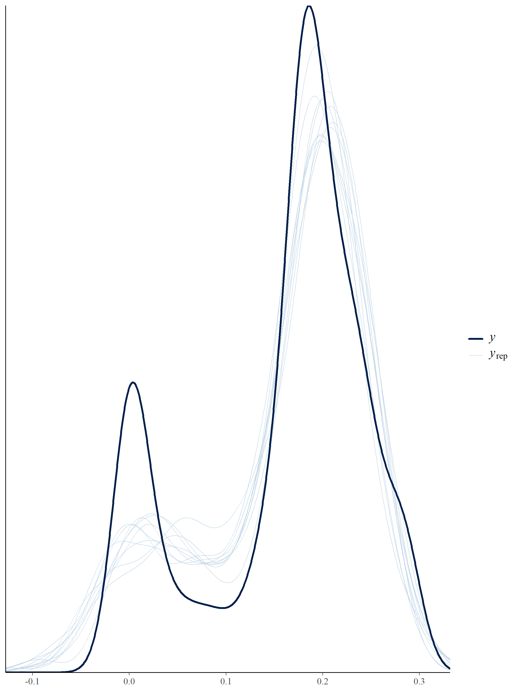

``` r
pp_check(fit_init, type = "error_hist", ndraws = 12)
```

```
`stat_bin()` using `bins = 30`. Pick better value `binwidth`.
```


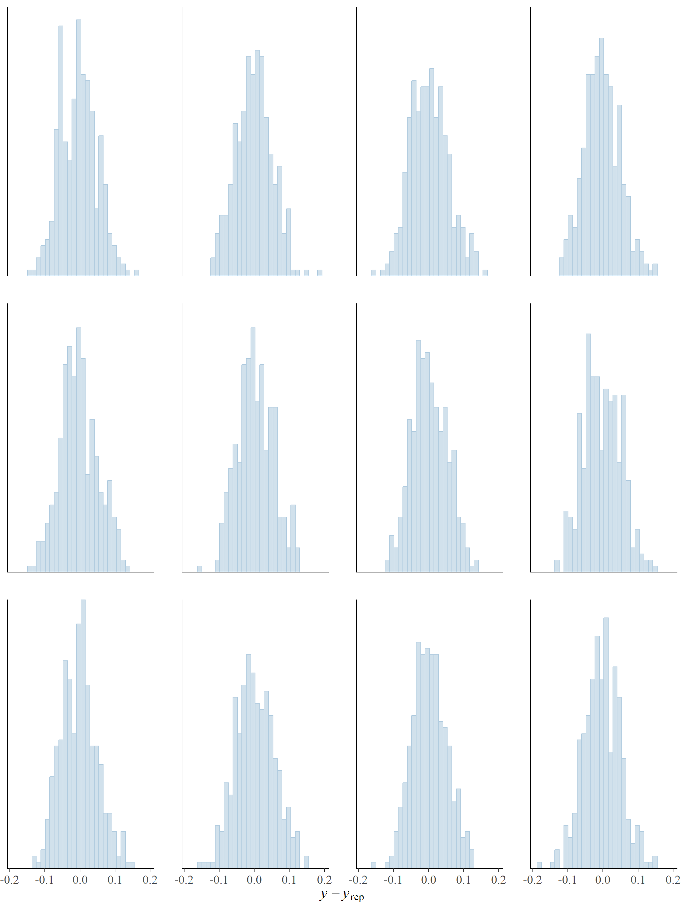

``` r
pp_check(fit_init, type = "scatter_avg", ndraws = 1000)
```


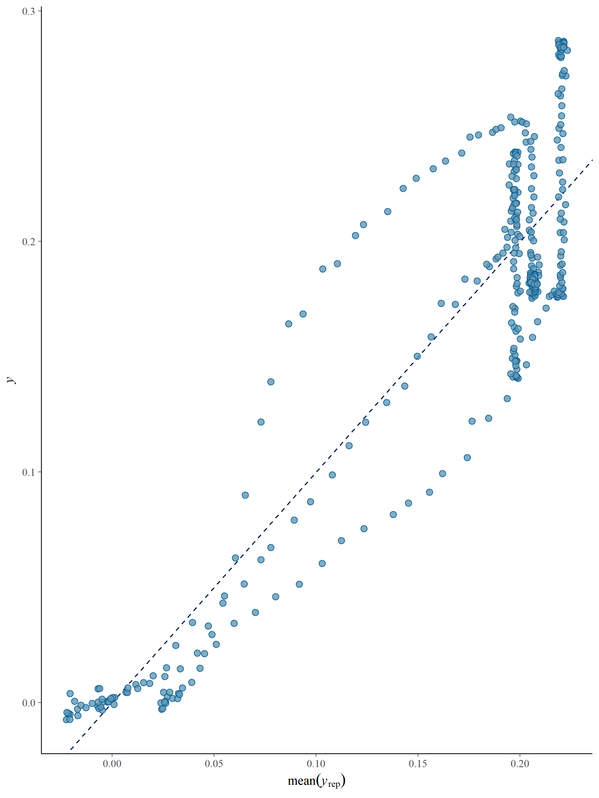

``` r
pp_check(fit_init, type = "stat_2d")
```

```
Using all posterior draws for ppc type 'stat_2d' by default.
```

```
Note: in most cases the default test statistic 'mean' is too weak to detect anything of interest.
```


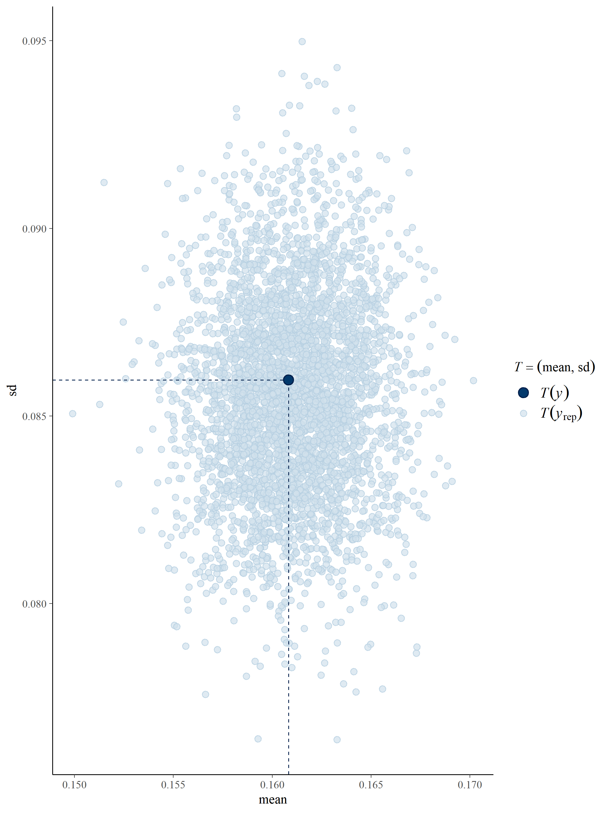

``` r
pp_check(fit_init, type = "loo_ribbon")
```

```
Using all posterior draws for ppc type 'loo_ribbon' by default.
```


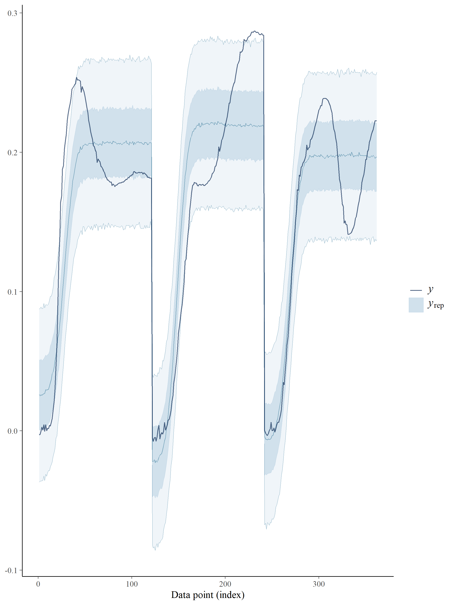

``` r
plot(gsw~th, dd_init, pch=16, main = unique(dd_init$TW))
points(fitted(fit_init)[,1]~th, dd_init, pch=16, col="red")
```


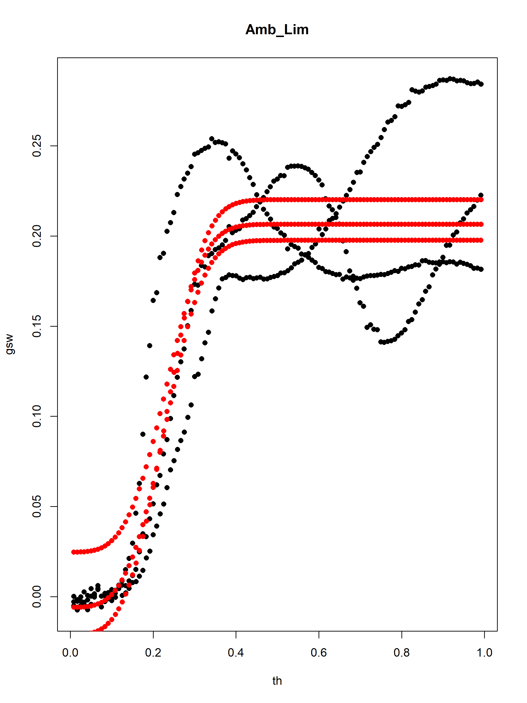

``` r
# Configure and compile the model - McAusland
fit_init_mc <- brm(
  formula = nlform_mc,
  data = dd_init,
  prior = priors_mc,
  chains = 4,
  cores = 4,
  iter = 3000,
  warmup = 2000,
  control = list(
    adapt_delta = 0.99,
    max_treedepth = 12,
    metric = "diag_e"
  )
)
```

```
Compiling Stan program...
```

```
Start sampling
```

```
Warning: There were 1 divergent transitions after warmup. See
https://mc-stan.org/misc/warnings.html#divergent-transitions-after-warmup
to find out why this is a problem and how to eliminate them.
```

```
Warning: Examine the pairs() plot to diagnose sampling problems
```

``` r
print(summary(fit_init_mc))
```

```
Warning: There were 1 divergent transitions after warmup. Increasing adapt_delta above 0.99 may help. See
http://mc-stan.org/misc/warnings.html#divergent-transitions-after-warmup
```

```
 Family: gaussian 
  Links: mu = identity 
Formula: gsw ~ g0 + (g1 - g0) * exp(-exp(((lambda - tmin)/k) + 1)) 
         g0 ~ 1 + (1 | Rep)
         g1 ~ 1 + (1 | Rep)
         k ~ 1
         lambda ~ 1
   Data: dd_init (Number of observations: 362) 
  Draws: 4 chains, each with iter = 3000; warmup = 2000; thin = 1;
         total post-warmup draws = 4000

Multilevel Hyperparameters:
~Rep (Number of levels: 3) 
                 Estimate Est.Error l-95% CI u-95% CI Rhat Bulk_ESS Tail_ESS
sd(g0_Intercept)     0.02      0.01     0.01     0.03 1.00     2538     1809
sd(g1_Intercept)     0.02      0.02     0.01     0.07 1.00     1069     1673

Regression Coefficients:
                 Estimate Est.Error l-95% CI u-95% CI Rhat Bulk_ESS Tail_ESS
g0_Intercept         0.01      0.01    -0.01     0.03 1.00     1967     2489
g1_Intercept         0.21      0.02     0.18     0.25 1.00     1498     1182
k_Intercept          3.89      0.40     3.14     4.68 1.00     2467     2542
lambda_Intercept     8.24      0.61     6.99     9.39 1.00     2438     2386

Further Distributional Parameters:
      Estimate Est.Error l-95% CI u-95% CI Rhat Bulk_ESS Tail_ESS
sigma     0.04      0.00     0.03     0.04 1.00     3829     2900

Draws were sampled using sampling(NUTS). For each parameter, Bulk_ESS
and Tail_ESS are effective sample size measures, and Rhat is the potential
scale reduction factor on split chains (at convergence, Rhat = 1).
```

``` r
plot(fit_init_mc)
```


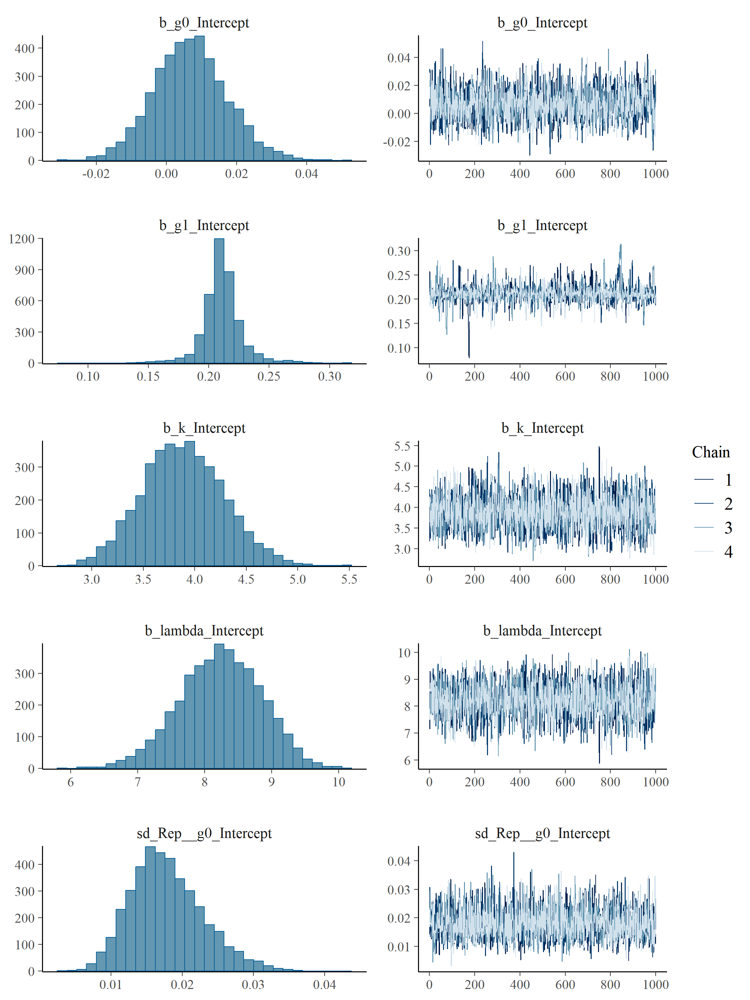

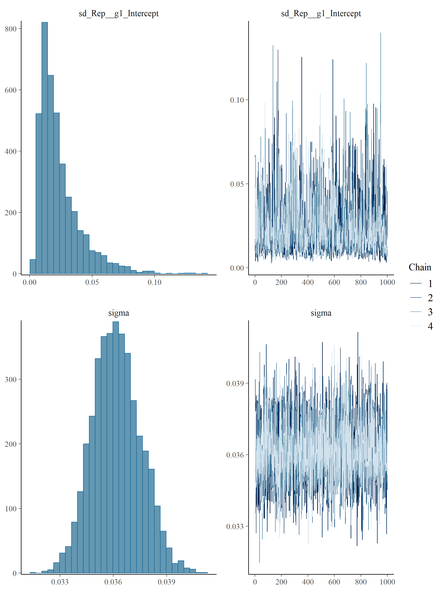

``` r
pairs(fit_init_mc)
```


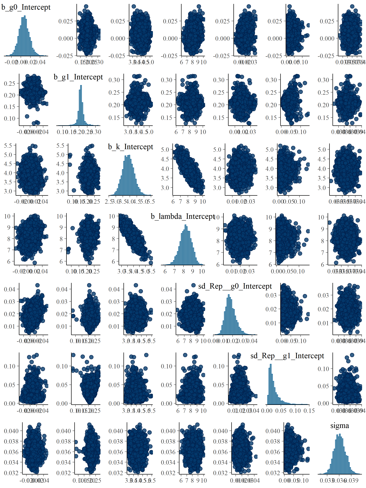

``` r
mcmc_plot(fit_init_mc, type = "trace")
```


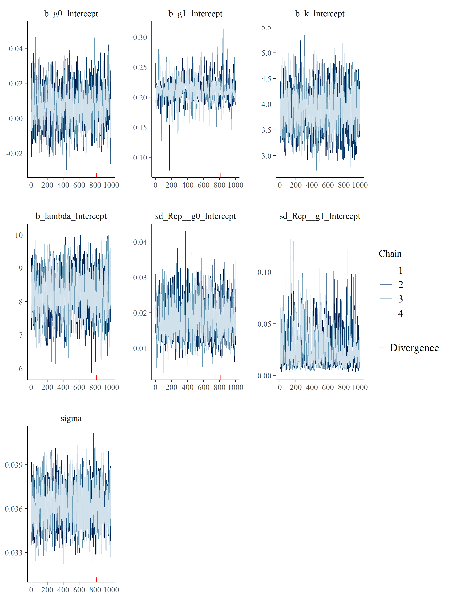

``` r
rstan::check_hmc_diagnostics(fit_init_mc$fit)
```

```

Divergences:
```

```
1 of 4000 iterations ended with a divergence (0.025%).
Try increasing 'adapt_delta' to remove the divergences.
```

```

Tree depth:
```

```
0 of 4000 iterations saturated the maximum tree depth of 12.
```

```

Energy:
```

```
E-BFMI indicated no pathological behavior.
```

``` r
loo(fit_init_mc)
```

```

Computed from 4000 by 362 log-likelihood matrix.

         Estimate   SE
elpd_loo    683.3 10.7
p_loo         7.8  0.5
looic     -1366.7 21.5
------
MCSE of elpd_loo is 0.0.
MCSE and ESS estimates assume MCMC draws (r_eff in [0.7, 1.3]).

All Pareto k estimates are good (k < 0.7).
See help('pareto-k-diagnostic') for details.
```

``` r
pp_check(fit_init_mc)  # compares density of the observed data with data generated from posterior predictive distribution
```

```
Using 10 posterior draws for ppc type 'dens_overlay' by default.
```


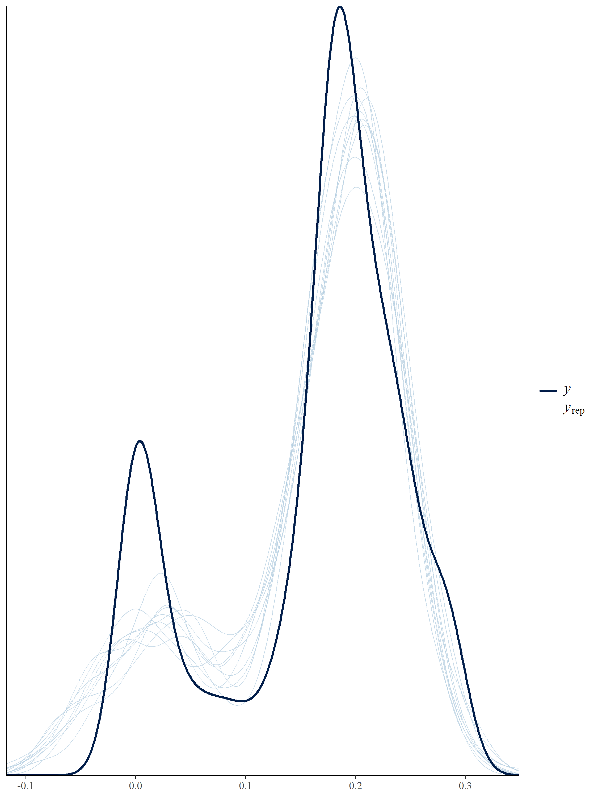

``` r
pp_check(fit_init_mc, type = "error_hist", ndraws = 12)
```

```
`stat_bin()` using `bins = 30`. Pick better value `binwidth`.
```


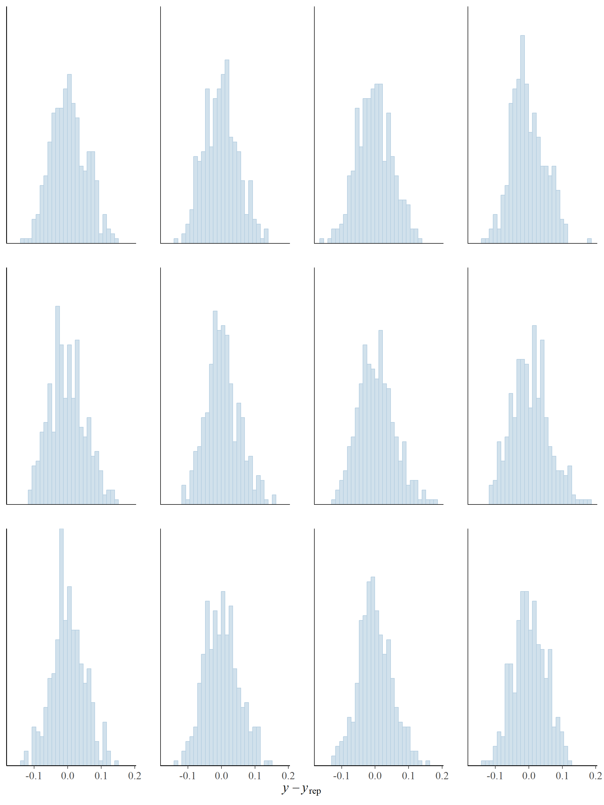

``` r
pp_check(fit_init_mc, type = "scatter_avg", ndraws = 1000)
```


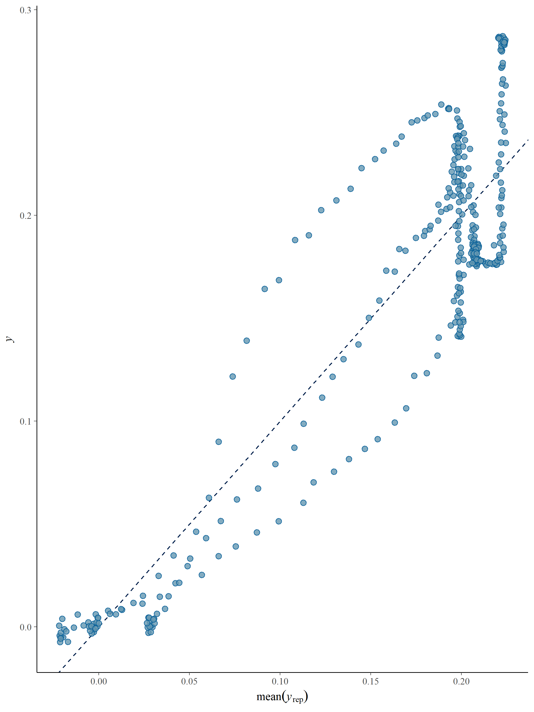

``` r
pp_check(fit_init_mc, type = "stat_2d")
```

```
Using all posterior draws for ppc type 'stat_2d' by default.
```

```
Note: in most cases the default test statistic 'mean' is too weak to detect anything of interest.
```


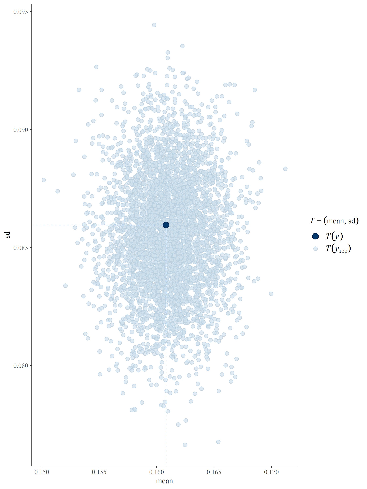

``` r
pp_check(fit_init_mc, type = "loo_ribbon")
```

```
Using all posterior draws for ppc type 'loo_ribbon' by default.
```


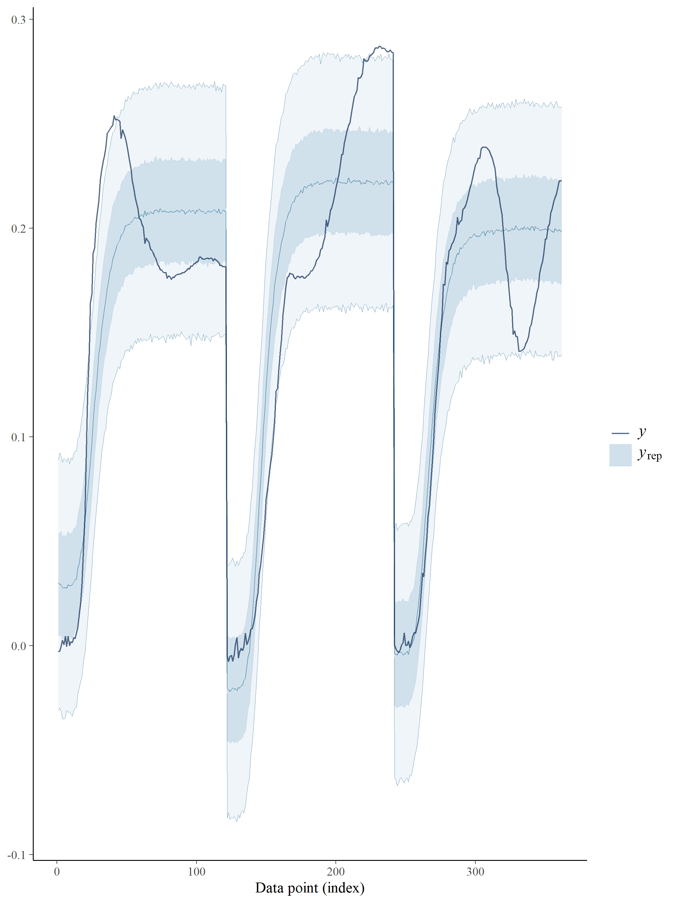

``` r
plot(gsw~tmin, dd_init, pch=16, main = unique(dd_init$TW))
points(fitted(fit_init_mc)[,1]~tmin, dd_init, pch=16, col="red")
```


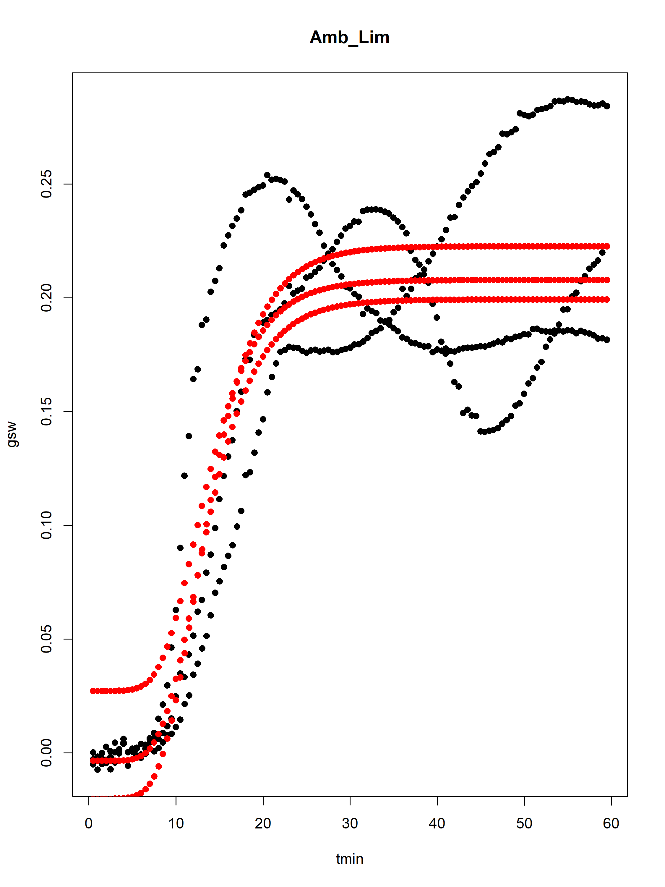

``` r
##look at the effects from the model
fixef(fit_init_mc)
```

```
                    Estimate  Est.Error        Q2.5      Q97.5
g0_Intercept     0.006836203 0.01051301 -0.01337031 0.02811469
g1_Intercept     0.211076754 0.01701580  0.17680806 0.24877661
k_Intercept      3.888241913 0.39516800  3.13894431 4.68384564
lambda_Intercept 8.236751133 0.61389777  6.99144957 9.38634737
```

``` r
ranef(fit_init_mc)
```

```
$Rep
, , g0_Intercept

     Estimate  Est.Error         Q2.5        Q97.5
1  0.02030816 0.01105709 -0.001066884  0.042655726
2 -0.02712141 0.01195855 -0.052105212 -0.005247391
3 -0.01043589 0.01133606 -0.034192327  0.010692823

, , g1_Intercept

      Estimate  Est.Error        Q2.5      Q97.5
1 -0.003270086 0.01717927 -0.04077573 0.03039047
2  0.011533995 0.01703214 -0.02598133 0.04683600
3 -0.011865452 0.01717184 -0.05011417 0.02112588
```

``` r
coef(fit_init_mc)
```

```
$Rep
, , g0_Intercept

      Estimate   Est.Error         Q2.5        Q97.5
1  0.027144364 0.008706696  0.009421977  0.044021547
2 -0.020285209 0.008422931 -0.036568865 -0.003980454
3 -0.003599688 0.007942663 -0.019364516  0.011681535

, , g1_Intercept

   Estimate   Est.Error      Q2.5     Q97.5
1 0.2078067 0.003956039 0.2001431 0.2156171
2 0.2226107 0.004454512 0.2136745 0.2312322
3 0.1992113 0.004069345 0.1915719 0.2071738

, , k_Intercept

  Estimate Est.Error     Q2.5    Q97.5
1 3.888242  0.395168 3.138944 4.683846
2 3.888242  0.395168 3.138944 4.683846
3 3.888242  0.395168 3.138944 4.683846

, , lambda_Intercept

  Estimate Est.Error    Q2.5    Q97.5
1 8.236751 0.6138978 6.99145 9.386347
2 8.236751 0.6138978 6.99145 9.386347
3 8.236751 0.6138978 6.99145 9.386347
```

#### Write a function to process each individual treatment


``` r
process <- function(d1, fit_template) {
  dd <- subset(d1, Light == "On" & th != 0 & !is.na(gsw))
  
  # t=0 at the light step 
  dd$th <- dd$th - dd$th[1]
  dd$tmin <- dd$tmin - dd$tmin[1]
  
  ##remove the first time point, as seems to be impacted by change of lighting still
  dd <- subset(dd, th != 0)
  
  fit <- update(
    fit_template,
    newdata = dd,
    recompile = NULL,
    refresh = 0
  )
  
  # Check diagnostics, Important!
  print(summary(fit))
  rstan::check_hmc_diagnostics(fit$fit)
  #plot(fit)
  #pp_check(fit)
  # plot(gsw~th, dd, pch=16, main = unique(dd$TW))
  # points(fitted(fit)[,1]~th, dd, pch=16, col="red")
  
  return(fit)
}
```

#### Implement loop


``` r
# Main loop that select each plant per species
fits <- list()

for (i in unique(li6800.dat$TW)) {
  d1 <- subset(li6800.dat, TW == i)
  
  cat("TW:", i, "\n")
  
  fits[[i]] <- process(d1, fit_init)
}
```

```
TW: Amb_Lim 
```

```
Start sampling
```

```
 Family: gaussian 
  Links: mu = identity 
Formula: gsw ~ g1 + (g0 - g1) * exp(-((th/tau)^theta)) 
         g0 ~ 1 + (1 | Rep)
         g1 ~ 1 + (1 | Rep)
         tau ~ 1
         theta ~ 1
   Data: dd (Number of observations: 362) 
  Draws: 4 chains, each with iter = 3000; warmup = 2000; thin = 1;
         total post-warmup draws = 4000

Multilevel Hyperparameters:
~Rep (Number of levels: 3) 
                 Estimate Est.Error l-95% CI u-95% CI Rhat Bulk_ESS Tail_ESS
sd(g0_Intercept)     0.02      0.01     0.01     0.03 1.00     2636     2339
sd(g1_Intercept)     0.02      0.02     0.01     0.07 1.00     1199     2179

Regression Coefficients:
                Estimate Est.Error l-95% CI u-95% CI Rhat Bulk_ESS Tail_ESS
g0_Intercept        0.00      0.01    -0.02     0.03 1.00     1864     2551
g1_Intercept        0.21      0.02     0.18     0.25 1.00     1521     1353
tau_Intercept       0.26      0.01     0.24     0.27 1.00     4180     2456
theta_Intercept     3.63      0.42     2.91     4.52 1.00     3938     2649

Further Distributional Parameters:
      Estimate Est.Error l-95% CI u-95% CI Rhat Bulk_ESS Tail_ESS
sigma     0.04      0.00     0.03     0.04 1.00     3794     2508

Draws were sampled using sampling(NUTS). For each parameter, Bulk_ESS
and Tail_ESS are effective sample size measures, and Rhat is the potential
scale reduction factor on split chains (at convergence, Rhat = 1).

Divergences:
```

```
0 of 4000 iterations ended with a divergence.
```

```

Tree depth:
```

```
0 of 4000 iterations saturated the maximum tree depth of 12.
```

```

Energy:
```

```
E-BFMI indicated no pathological behavior.
```

```
TW: Amb_Unlim 
```

```
Start sampling
```

```
 Family: gaussian 
  Links: mu = identity 
Formula: gsw ~ g1 + (g0 - g1) * exp(-((th/tau)^theta)) 
         g0 ~ 1 + (1 | Rep)
         g1 ~ 1 + (1 | Rep)
         tau ~ 1
         theta ~ 1
   Data: dd (Number of observations: 363) 
  Draws: 4 chains, each with iter = 3000; warmup = 2000; thin = 1;
         total post-warmup draws = 4000

Multilevel Hyperparameters:
~Rep (Number of levels: 3) 
                 Estimate Est.Error l-95% CI u-95% CI Rhat Bulk_ESS Tail_ESS
sd(g0_Intercept)     0.03      0.01     0.02     0.04 1.00     2468     2920
sd(g1_Intercept)     0.05      0.02     0.02     0.10 1.00     1876     1987

Regression Coefficients:
                Estimate Est.Error l-95% CI u-95% CI Rhat Bulk_ESS Tail_ESS
g0_Intercept        0.01      0.01    -0.02     0.04 1.00     2354     2424
g1_Intercept        0.34      0.03     0.28     0.39 1.00     1639     1732
tau_Intercept       0.22      0.01     0.21     0.23 1.00     4145     2657
theta_Intercept     1.70      0.19     1.37     2.11 1.00     3832     2991

Further Distributional Parameters:
      Estimate Est.Error l-95% CI u-95% CI Rhat Bulk_ESS Tail_ESS
sigma     0.03      0.00     0.03     0.03 1.00     3563     2427

Draws were sampled using sampling(NUTS). For each parameter, Bulk_ESS
and Tail_ESS are effective sample size measures, and Rhat is the potential
scale reduction factor on split chains (at convergence, Rhat = 1).

Divergences:
```

```
0 of 4000 iterations ended with a divergence.
```

```

Tree depth:
```

```
0 of 4000 iterations saturated the maximum tree depth of 12.
```

```

Energy:
```

```
E-BFMI indicated no pathological behavior.
```

```
TW: Heat_Lim 
```

```
Start sampling
```

```
 Family: gaussian 
  Links: mu = identity 
Formula: gsw ~ g1 + (g0 - g1) * exp(-((th/tau)^theta)) 
         g0 ~ 1 + (1 | Rep)
         g1 ~ 1 + (1 | Rep)
         tau ~ 1
         theta ~ 1
   Data: dd (Number of observations: 362) 
  Draws: 4 chains, each with iter = 3000; warmup = 2000; thin = 1;
         total post-warmup draws = 4000

Multilevel Hyperparameters:
~Rep (Number of levels: 3) 
                 Estimate Est.Error l-95% CI u-95% CI Rhat Bulk_ESS Tail_ESS
sd(g0_Intercept)     0.02      0.01     0.02     0.04 1.00     3570     2585
sd(g1_Intercept)     0.05      0.02     0.02     0.10 1.00     1792     2208

Regression Coefficients:
                Estimate Est.Error l-95% CI u-95% CI Rhat Bulk_ESS Tail_ESS
g0_Intercept        0.02      0.01    -0.01     0.04 1.00     2553     2481
g1_Intercept        0.33      0.03     0.26     0.38 1.00     1815     1713
tau_Intercept       0.12      0.00     0.12     0.13 1.00     3506     2672
theta_Intercept     3.28      0.34     2.68     4.01 1.00     4109     3014

Further Distributional Parameters:
      Estimate Est.Error l-95% CI u-95% CI Rhat Bulk_ESS Tail_ESS
sigma     0.04      0.00     0.04     0.04 1.00     3973     2532

Draws were sampled using sampling(NUTS). For each parameter, Bulk_ESS
and Tail_ESS are effective sample size measures, and Rhat is the potential
scale reduction factor on split chains (at convergence, Rhat = 1).

Divergences:
```

```
0 of 4000 iterations ended with a divergence.
```

```

Tree depth:
```

```
0 of 4000 iterations saturated the maximum tree depth of 12.
```

```

Energy:
```

```
E-BFMI indicated no pathological behavior.
```

```
TW: Heat_Unlim 
```

```
Start sampling
```

```
 Family: gaussian 
  Links: mu = identity 
Formula: gsw ~ g1 + (g0 - g1) * exp(-((th/tau)^theta)) 
         g0 ~ 1 + (1 | Rep)
         g1 ~ 1 + (1 | Rep)
         tau ~ 1
         theta ~ 1
   Data: dd (Number of observations: 363) 
  Draws: 4 chains, each with iter = 3000; warmup = 2000; thin = 1;
         total post-warmup draws = 4000

Multilevel Hyperparameters:
~Rep (Number of levels: 3) 
                 Estimate Est.Error l-95% CI u-95% CI Rhat Bulk_ESS Tail_ESS
sd(g0_Intercept)     0.03      0.01     0.02     0.04 1.00     3010     2618
sd(g1_Intercept)     0.05      0.02     0.02     0.10 1.00     2079     2124

Regression Coefficients:
                Estimate Est.Error l-95% CI u-95% CI Rhat Bulk_ESS Tail_ESS
g0_Intercept       -0.00      0.01    -0.03     0.03 1.00     2574     2410
g1_Intercept        0.45      0.03     0.39     0.51 1.00     1913     2069
tau_Intercept       0.30      0.01     0.28     0.32 1.00     4579     2598
theta_Intercept     0.99      0.04     0.91     1.08 1.00     4310     2815

Further Distributional Parameters:
      Estimate Est.Error l-95% CI u-95% CI Rhat Bulk_ESS Tail_ESS
sigma     0.02      0.00     0.02     0.02 1.00     5046     2941

Draws were sampled using sampling(NUTS). For each parameter, Bulk_ESS
and Tail_ESS are effective sample size measures, and Rhat is the potential
scale reduction factor on split chains (at convergence, Rhat = 1).

Divergences:
```

```
0 of 4000 iterations ended with a divergence.
```

```

Tree depth:
```

```
0 of 4000 iterations saturated the maximum tree depth of 12.
```

```

Energy:
```

```
E-BFMI indicated no pathological behavior.
```

#### Explore model output


``` r
pp_check(fits[[1]])  # compares density of the observed data with data generated from posterior predictive distribution
```

```
Using 10 posterior draws for ppc type 'dens_overlay' by default.
```


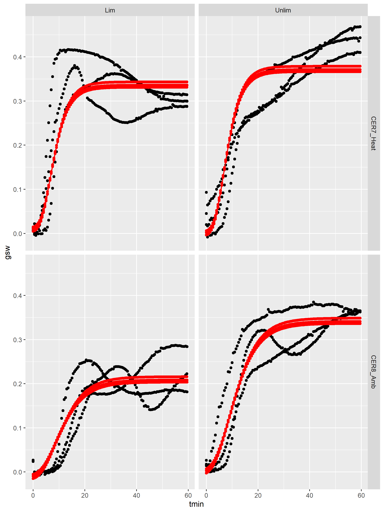

``` r
pp_check(fits[[2]])  # compares density of the observed data with data generated from posterior predictive distribution
```

```
Using 10 posterior draws for ppc type 'dens_overlay' by default.
```


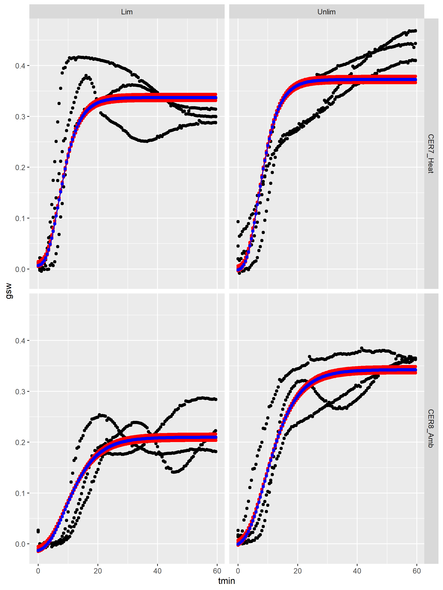

``` r
pp_check(fits[[3]])  # compares density of the observed data with data generated from posterior predictive distribution
```

```
Using 10 posterior draws for ppc type 'dens_overlay' by default.
```


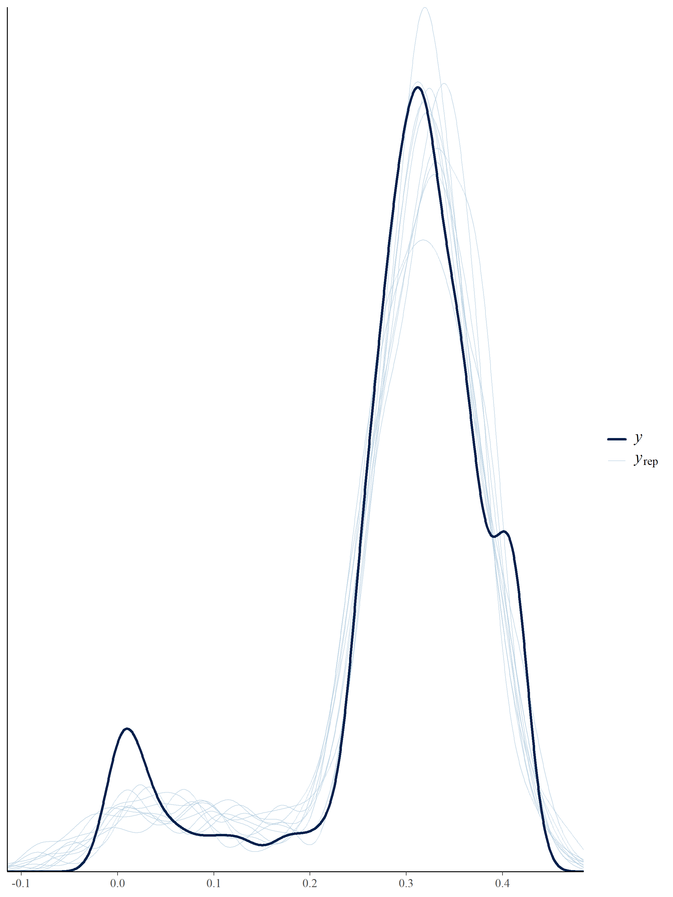

``` r
pp_check(fits[[4]])  # compares density of the observed data with data generated from posterior predictive distribution
```

```
Using 10 posterior draws for ppc type 'dens_overlay' by default.
```


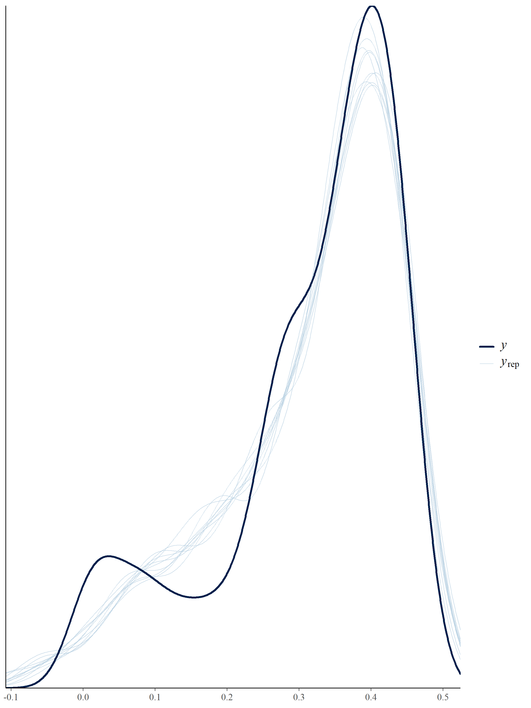

``` r
##look at the effects from the model
coef(fits[[1]])
```

```
$Rep
, , g0_Intercept

      Estimate   Est.Error         Q2.5        Q97.5
1  0.024502821 0.009013799  0.006067057  0.041633653
2 -0.021125315 0.008494397 -0.037853482 -0.004983363
3 -0.005984945 0.008040558 -0.022373946  0.009647284

, , g1_Intercept

   Estimate   Est.Error      Q2.5     Q97.5
1 0.2064310 0.003712395 0.1992700 0.2138019
2 0.2200968 0.004249011 0.2116845 0.2285878
3 0.1976739 0.003994377 0.1898704 0.2056179

, , tau_Intercept

   Estimate   Est.Error      Q2.5     Q97.5
1 0.2558891 0.006436022 0.2436945 0.2687248
2 0.2558891 0.006436022 0.2436945 0.2687248
3 0.2558891 0.006436022 0.2436945 0.2687248

, , theta_Intercept

  Estimate Est.Error     Q2.5    Q97.5
1 3.632283 0.4213409 2.912159 4.523557
2 3.632283 0.4213409 2.912159 4.523557
3 3.632283 0.4213409 2.912159 4.523557
```

``` r
coef(fits[[2]])
```

```
$Rep
, , g0_Intercept

     Estimate  Est.Error        Q2.5       Q97.5
1 -0.03854206 0.01108881 -0.06099531 -0.01745877
2 -0.03388425 0.01195681 -0.05780635 -0.01090506
3  0.07406793 0.01109371  0.05154600  0.09550369

, , g1_Intercept

   Estimate   Est.Error      Q2.5     Q97.5
1 0.3228330 0.004104375 0.3150283 0.3313423
2 0.3124040 0.004521825 0.3037314 0.3214684
3 0.3803297 0.004165461 0.3722628 0.3887530

, , tau_Intercept

   Estimate   Est.Error      Q2.5     Q97.5
1 0.2211773 0.005538106 0.2104245 0.2323007
2 0.2211773 0.005538106 0.2104245 0.2323007
3 0.2211773 0.005538106 0.2104245 0.2323007

, , theta_Intercept

  Estimate Est.Error    Q2.5    Q97.5
1 1.701452  0.187393 1.37382 2.107492
2 1.701452  0.187393 1.37382 2.107492
3 1.701452  0.187393 1.37382 2.107492
```

``` r
coef(fits[[3]])
```

```
$Rep
, , g0_Intercept

     Estimate  Est.Error        Q2.5       Q97.5
1  0.01936509 0.01295524 -0.00632108  0.04396533
2  0.05420611 0.01478493  0.02495048  0.08275187
3 -0.03686615 0.01388683 -0.06419973 -0.01016627

, , g1_Intercept

   Estimate   Est.Error      Q2.5     Q97.5
1 0.2920532 0.003976263 0.2843268 0.2999006
2 0.3662767 0.003960143 0.3586692 0.3739998
3 0.3231115 0.004069791 0.3150963 0.3308593

, , tau_Intercept

   Estimate   Est.Error      Q2.5     Q97.5
1 0.1233664 0.003278647 0.1168975 0.1297304
2 0.1233664 0.003278647 0.1168975 0.1297304
3 0.1233664 0.003278647 0.1168975 0.1297304

, , theta_Intercept

  Estimate Est.Error     Q2.5    Q97.5
1 3.276913 0.3419747 2.680566 4.014017
2 3.276913 0.3419747 2.680566 4.014017
3 3.276913 0.3419747 2.680566 4.014017
```

``` r
coef(fits[[4]])
```

```
$Rep
, , g0_Intercept

       Estimate   Est.Error         Q2.5       Q97.5
1  0.0008141108 0.009596096 -0.018347066  0.01963399
2  0.0254917066 0.008593817  0.008253476  0.04217054
3 -0.0937755327 0.010723707 -0.115248046 -0.07326511

, , g1_Intercept

   Estimate   Est.Error      Q2.5     Q97.5
1 0.4772703 0.007076875 0.4644315 0.4924562
2 0.4094189 0.006212397 0.3981729 0.4226037
3 0.4654620 0.008231635 0.4506659 0.4826864

, , tau_Intercept

  Estimate  Est.Error      Q2.5     Q97.5
1 0.300157 0.00928418 0.2829948 0.3191936
2 0.300157 0.00928418 0.2829948 0.3191936
3 0.300157 0.00928418 0.2829948 0.3191936

, , theta_Intercept

   Estimate  Est.Error      Q2.5    Q97.5
1 0.9925959 0.04184341 0.9127701 1.075361
2 0.9925959 0.04184341 0.9127701 1.075361
3 0.9925959 0.04184341 0.9127701 1.075361
```

#### Implement loop - McAusland


``` r
# Main loop that select each plant per species
fits_mc <- list()

for (i in unique(li6800.dat$TW)) {
  d1 <- subset(li6800.dat, TW == i)
  
  cat("TW:", i, "\n")
  
  fits_mc[[i]] <- process(d1, fit_init_mc)
}
```

```
TW: Amb_Lim 
```

```
Start sampling
```

```
 Family: gaussian 
  Links: mu = identity 
Formula: gsw ~ g0 + (g1 - g0) * exp(-exp(((lambda - tmin)/k) + 1)) 
         g0 ~ 1 + (1 | Rep)
         g1 ~ 1 + (1 | Rep)
         k ~ 1
         lambda ~ 1
   Data: dd (Number of observations: 362) 
  Draws: 4 chains, each with iter = 3000; warmup = 2000; thin = 1;
         total post-warmup draws = 4000

Multilevel Hyperparameters:
~Rep (Number of levels: 3) 
                 Estimate Est.Error l-95% CI u-95% CI Rhat Bulk_ESS Tail_ESS
sd(g0_Intercept)     0.02      0.01     0.01     0.03 1.00     2259     2038
sd(g1_Intercept)     0.03      0.02     0.01     0.07 1.01     1195     2027

Regression Coefficients:
                 Estimate Est.Error l-95% CI u-95% CI Rhat Bulk_ESS Tail_ESS
g0_Intercept         0.01      0.01    -0.01     0.03 1.00     2124     2465
g1_Intercept         0.21      0.02     0.17     0.25 1.01     1221     1263
k_Intercept          3.88      0.40     3.15     4.73 1.00     2691     2674
lambda_Intercept     8.26      0.63     6.97     9.46 1.00     2646     2327

Further Distributional Parameters:
      Estimate Est.Error l-95% CI u-95% CI Rhat Bulk_ESS Tail_ESS
sigma     0.04      0.00     0.03     0.04 1.00     3700     2735

Draws were sampled using sampling(NUTS). For each parameter, Bulk_ESS
and Tail_ESS are effective sample size measures, and Rhat is the potential
scale reduction factor on split chains (at convergence, Rhat = 1).

Divergences:
```

```
0 of 4000 iterations ended with a divergence.
```

```

Tree depth:
```

```
0 of 4000 iterations saturated the maximum tree depth of 12.
```

```

Energy:
```

```
E-BFMI indicated no pathological behavior.
```

```
TW: Amb_Unlim 
```

```
Start sampling
```

```
 Family: gaussian 
  Links: mu = identity 
Formula: gsw ~ g0 + (g1 - g0) * exp(-exp(((lambda - tmin)/k) + 1)) 
         g0 ~ 1 + (1 | Rep)
         g1 ~ 1 + (1 | Rep)
         k ~ 1
         lambda ~ 1
   Data: dd (Number of observations: 363) 
  Draws: 4 chains, each with iter = 3000; warmup = 2000; thin = 1;
         total post-warmup draws = 4000

Multilevel Hyperparameters:
~Rep (Number of levels: 3) 
                 Estimate Est.Error l-95% CI u-95% CI Rhat Bulk_ESS Tail_ESS
sd(g0_Intercept)     0.03      0.00     0.02     0.04 1.00     3219     2708
sd(g1_Intercept)     0.05      0.02     0.02     0.09 1.00     1971     1807

Regression Coefficients:
                 Estimate Est.Error l-95% CI u-95% CI Rhat Bulk_ESS Tail_ESS
g0_Intercept         0.02      0.01    -0.01     0.04 1.00     2463     2423
g1_Intercept         0.34      0.03     0.28     0.39 1.00     1874     2095
k_Intercept          5.58      0.37     4.87     6.34 1.00     2448     2003
lambda_Intercept     3.36      0.69     1.95     4.64 1.00     2501     1709

Further Distributional Parameters:
      Estimate Est.Error l-95% CI u-95% CI Rhat Bulk_ESS Tail_ESS
sigma     0.03      0.00     0.03     0.03 1.00     4282     2302

Draws were sampled using sampling(NUTS). For each parameter, Bulk_ESS
and Tail_ESS are effective sample size measures, and Rhat is the potential
scale reduction factor on split chains (at convergence, Rhat = 1).

Divergences:
```

```
0 of 4000 iterations ended with a divergence.
```

```

Tree depth:
```

```
0 of 4000 iterations saturated the maximum tree depth of 12.
```

```

Energy:
```

```
E-BFMI indicated no pathological behavior.
```

```
TW: Heat_Lim 
```

```
Start sampling
```

```
 Family: gaussian 
  Links: mu = identity 
Formula: gsw ~ g0 + (g1 - g0) * exp(-exp(((lambda - tmin)/k) + 1)) 
         g0 ~ 1 + (1 | Rep)
         g1 ~ 1 + (1 | Rep)
         k ~ 1
         lambda ~ 1
   Data: dd (Number of observations: 362) 
  Draws: 4 chains, each with iter = 3000; warmup = 2000; thin = 1;
         total post-warmup draws = 4000

Multilevel Hyperparameters:
~Rep (Number of levels: 3) 
                 Estimate Est.Error l-95% CI u-95% CI Rhat Bulk_ESS Tail_ESS
sd(g0_Intercept)     0.02      0.01     0.02     0.04 1.00     2731     2231
sd(g1_Intercept)     0.05      0.02     0.02     0.10 1.00     1675     2548

Regression Coefficients:
                 Estimate Est.Error l-95% CI u-95% CI Rhat Bulk_ESS Tail_ESS
g0_Intercept         0.02      0.01    -0.00     0.05 1.00     2453     2836
g1_Intercept         0.33      0.03     0.27     0.39 1.00     1385     1990
k_Intercept          1.81      0.18     1.48     2.17 1.00     2351     2280
lambda_Intercept     4.03      0.33     3.35     4.67 1.00     2412     2419

Further Distributional Parameters:
      Estimate Est.Error l-95% CI u-95% CI Rhat Bulk_ESS Tail_ESS
sigma     0.04      0.00     0.04     0.04 1.00     4058     2937

Draws were sampled using sampling(NUTS). For each parameter, Bulk_ESS
and Tail_ESS are effective sample size measures, and Rhat is the potential
scale reduction factor on split chains (at convergence, Rhat = 1).

Divergences:
```

```
0 of 4000 iterations ended with a divergence.
```

```

Tree depth:
```

```
0 of 4000 iterations saturated the maximum tree depth of 12.
```

```

Energy:
```

```
E-BFMI indicated no pathological behavior.
```

```
TW: Heat_Unlim 
```

```
Start sampling
```

```
 Family: gaussian 
  Links: mu = identity 
Formula: gsw ~ g0 + (g1 - g0) * exp(-exp(((lambda - tmin)/k) + 1)) 
         g0 ~ 1 + (1 | Rep)
         g1 ~ 1 + (1 | Rep)
         k ~ 1
         lambda ~ 1
   Data: dd (Number of observations: 363) 
  Draws: 4 chains, each with iter = 3000; warmup = 2000; thin = 1;
         total post-warmup draws = 4000

Multilevel Hyperparameters:
~Rep (Number of levels: 3) 
                 Estimate Est.Error l-95% CI u-95% CI Rhat Bulk_ESS Tail_ESS
sd(g0_Intercept)     0.03      0.00     0.02     0.04 1.00     2880     2435
sd(g1_Intercept)     0.04      0.02     0.02     0.09 1.00     1723     1923

Regression Coefficients:
                 Estimate Est.Error l-95% CI u-95% CI Rhat Bulk_ESS Tail_ESS
g0_Intercept         0.01      0.01    -0.02     0.04 1.00     2049     2427
g1_Intercept         0.41      0.03     0.36     0.46 1.00     1623     1854
k_Intercept          9.12      0.23     8.67     9.59 1.00     3623     2560
lambda_Intercept     0.19      0.18     0.01     0.64 1.00     3405     1994

Further Distributional Parameters:
      Estimate Est.Error l-95% CI u-95% CI Rhat Bulk_ESS Tail_ESS
sigma     0.03      0.00     0.03     0.03 1.00     4344     2827

Draws were sampled using sampling(NUTS). For each parameter, Bulk_ESS
and Tail_ESS are effective sample size measures, and Rhat is the potential
scale reduction factor on split chains (at convergence, Rhat = 1).

Divergences:
```

```
0 of 4000 iterations ended with a divergence.
```

```

Tree depth:
```

```
0 of 4000 iterations saturated the maximum tree depth of 12.
```

```

Energy:
```

```
E-BFMI indicated no pathological behavior.
```

#### Explore model output


``` r
pp_check(fits_mc[[1]])  # compares density of the observed data with data generated from posterior predictive distribution
```

```
Using 10 posterior draws for ppc type 'dens_overlay' by default.
```


``` r
pp_check(fits_mc[[2]])  # compares density of the observed data with data generated from posterior predictive distribution
```

```
Using 10 posterior draws for ppc type 'dens_overlay' by default.
```


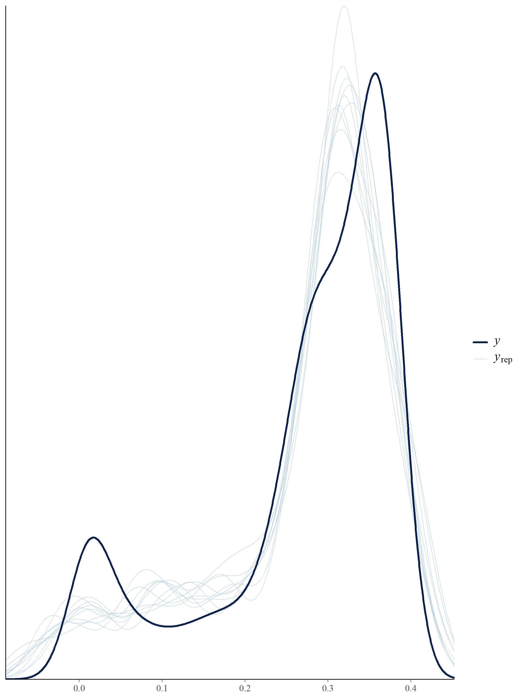

``` r
pp_check(fits_mc[[3]])  # compares density of the observed data with data generated from posterior predictive distribution
```

```
Using 10 posterior draws for ppc type 'dens_overlay' by default.
```


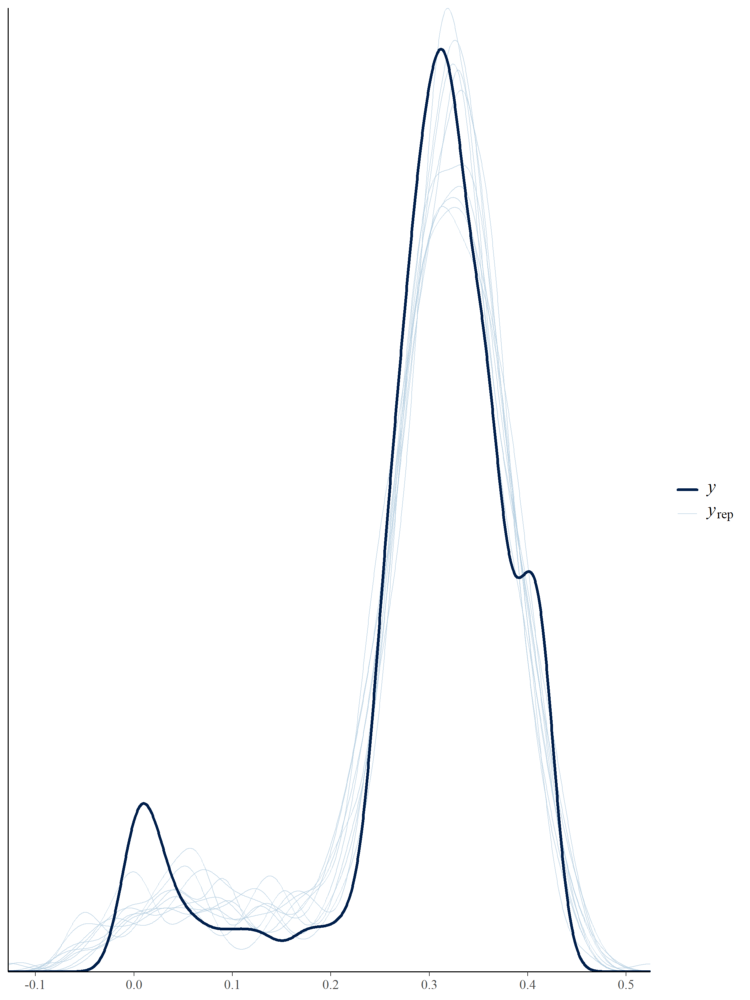

``` r
pp_check(fits_mc[[4]])  # compares density of the observed data with data generated from posterior predictive distribution
```

```
Using 10 posterior draws for ppc type 'dens_overlay' by default.
```


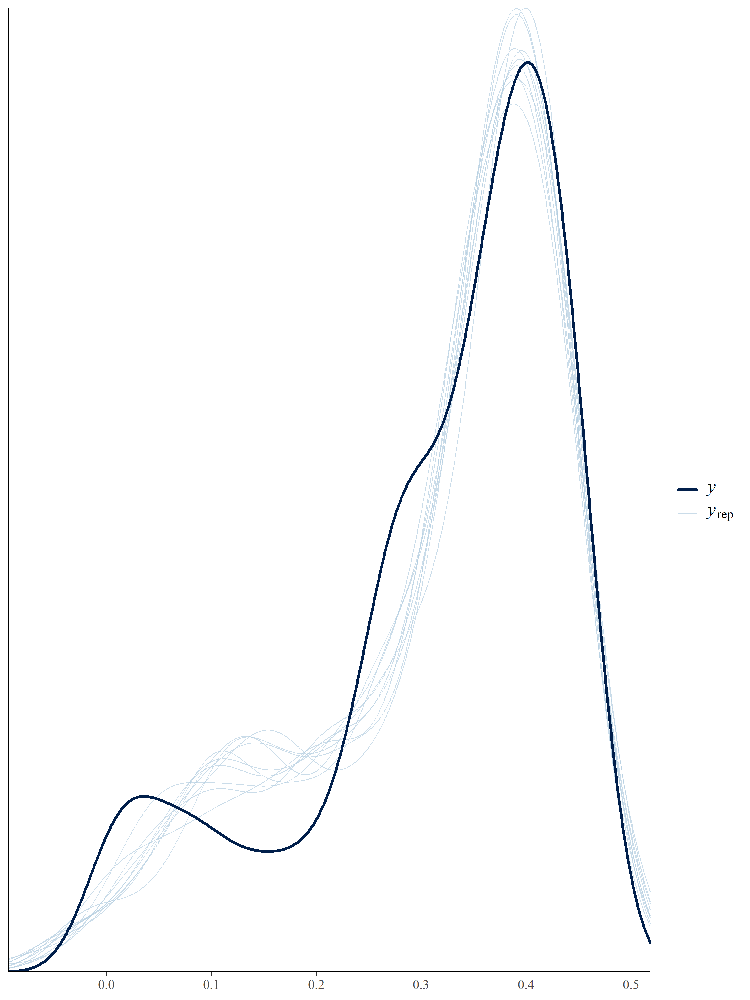

``` r
##look at the effects from the model
coef(fits_mc[[1]])
```

```
$Rep
, , g0_Intercept

      Estimate   Est.Error        Q2.5        Q97.5
1  0.027314618 0.008553733  0.01023592  0.044244942
2 -0.020151616 0.008223490 -0.03662218 -0.004028034
3 -0.003675857 0.007816665 -0.01944035  0.011325195

, , g1_Intercept

   Estimate   Est.Error      Q2.5     Q97.5
1 0.2077399 0.003971758 0.2001172 0.2154469
2 0.2227107 0.004406726 0.2139793 0.2314482
3 0.1991120 0.004062362 0.1910235 0.2069540

, , k_Intercept

  Estimate Est.Error     Q2.5    Q97.5
1 3.884985 0.4029157 3.145027 4.726589
2 3.884985 0.4029157 3.145027 4.726589
3 3.884985 0.4029157 3.145027 4.726589

, , lambda_Intercept

  Estimate Est.Error     Q2.5    Q97.5
1 8.256022 0.6309374 6.974628 9.458234
2 8.256022 0.6309374 6.974628 9.458234
3 8.256022 0.6309374 6.974628 9.458234
```

``` r
coef(fits_mc[[2]])
```

```
$Rep
, , g0_Intercept

     Estimate  Est.Error        Q2.5        Q97.5
1 -0.03035595 0.01104306 -0.05387067 -0.009760161
2 -0.02471004 0.01134631 -0.04848950 -0.004026356
3  0.08354730 0.01077702  0.06206044  0.103445575

, , g1_Intercept

   Estimate   Est.Error      Q2.5     Q97.5
1 0.3228977 0.003387980 0.3163374 0.3295275
2 0.3120659 0.003528278 0.3050696 0.3189106
3 0.3798611 0.003436852 0.3733394 0.3865280

, , k_Intercept

  Estimate Est.Error     Q2.5    Q97.5
1 5.576832 0.3725318 4.873302 6.341242
2 5.576832 0.3725318 4.873302 6.341242
3 5.576832 0.3725318 4.873302 6.341242

, , lambda_Intercept

  Estimate Est.Error     Q2.5    Q97.5
1 3.363874 0.6877959 1.951983 4.637542
2 3.363874 0.6877959 1.951983 4.637542
3 3.363874 0.6877959 1.951983 4.637542
```

``` r
coef(fits_mc[[3]])
```

```
$Rep
, , g0_Intercept

     Estimate  Est.Error         Q2.5        Q97.5
1  0.02679616 0.01253320  0.002077288  0.049913358
2  0.06198639 0.01388232  0.034088593  0.088987743
3 -0.02881356 0.01330024 -0.055031342 -0.002501652

, , g1_Intercept

   Estimate   Est.Error      Q2.5     Q97.5
1 0.2925354 0.004039332 0.2845061 0.3001643
2 0.3666100 0.003909578 0.3587781 0.3742728
3 0.3237179 0.004075018 0.3159341 0.3317789

, , k_Intercept

  Estimate Est.Error     Q2.5    Q97.5
1 1.811184 0.1777298 1.475986 2.170728
2 1.811184 0.1777298 1.475986 2.170728
3 1.811184 0.1777298 1.475986 2.170728

, , lambda_Intercept

  Estimate Est.Error     Q2.5    Q97.5
1 4.026035 0.3344144 3.345401 4.669743
2 4.026035 0.3344144 3.345401 4.669743
3 4.026035 0.3344144 3.345401 4.669743
```

``` r
coef(fits_mc[[4]])
```

```
$Rep
, , g0_Intercept

     Estimate   Est.Error         Q2.5       Q97.5
1  0.01941026 0.008342332  0.002715129  0.03572079
2  0.04361790 0.007432100  0.029021714  0.05786791
3 -0.06672669 0.008448215 -0.082942833 -0.04997429

, , g1_Intercept

   Estimate   Est.Error      Q2.5     Q97.5
1 0.4431667 0.003611208 0.4362377 0.4503318
2 0.3810056 0.003603086 0.3738822 0.3880654
3 0.4241871 0.004080364 0.4161695 0.4324764

, , k_Intercept

  Estimate Est.Error     Q2.5   Q97.5
1 9.116487 0.2328893 8.670258 9.58502
2 9.116487 0.2328893 8.670258 9.58502
3 9.116487 0.2328893 8.670258 9.58502

, , lambda_Intercept

   Estimate Est.Error        Q2.5     Q97.5
1 0.1869757 0.1771312 0.005515883 0.6351086
2 0.1869757 0.1771312 0.005515883 0.6351086
3 0.1869757 0.1771312 0.005515883 0.6351086
```

``` r
##calculate Slmax
Slmax.calc <- function(coef){
  ##pull out ceofficients, as they relate to parameters in Woning et al 2026
  gi <- coef$Rep[, "Estimate", "g0_Intercept"]
  gf <- coef$Rep[, "Estimate", "g1_Intercept"]
  lambda_c <- coef$Rep[, "Estimate", "theta_Intercept"]
  tau_c <- coef$Rep[, "Estimate", "tau_Intercept"]
  
  numerator_calc <- -1*(gi - gf) * lambda_c * exp((lambda_c - 1)/lambda_c)
  denominator_calc <- ((lambda_c - 1)/lambda_c)^(1/lambda_c) * tau_c
  
  numerator_calc/denominator_calc
}

Slmax.calc(coef(fits[[1]]))
```

```
       1        2        3 
5.824496 7.722811 6.520211 
```

``` r
Slmax.calc(coef(fits[[2]]))
```

```
       1        2        3 
7.067323 6.772275 5.989486 
```

``` r
Slmax.calc(coef(fits[[3]]))
```

```
       1        2        3 
16.21621 18.55821 21.40714 
```

``` r
Slmax.calc(coef(fits[[4]]))
```

```
  1   2   3 
NaN NaN NaN 
```

``` r
##these values seem off - go thing we're more interested in the McAusland model!

##calculate Slmax for the McAusland model
Slmax.calc.mc <- function(coef){
  ##pull out ceofficients, as they relate to parameters in McAusland 2016
  gi <- coef$Rep[, "Estimate", "g0_Intercept"]
  gf <- coef$Rep[, "Estimate", "g1_Intercept"]
  k <- coef$Rep[, "Estimate", "k_Intercept"]
  
  (gf - gi)/(k*exp(1))
}

Slmax.calc.mc(coef(fits_mc[[1]]))
```

```
         1          2          3 
0.01708494 0.02299727 0.01920252 
```

``` r
Slmax.calc.mc(coef(fits_mc[[2]]))
```

```
         1          2          3 
0.02330262 0.02221565 0.01954654 
```

``` r
Slmax.calc.mc(coef(fits_mc[[3]]))
```

```
         1          2          3 
0.05397575 0.06187376 0.07160457 
```

``` r
Slmax.calc.mc(coef(fits_mc[[4]]))
```

```
         1          2          3 
0.01709993 0.01361467 0.01980994 
```

### Save data


``` r
save.image(saveFile)
```

