---
output:
  pdf_document: default
  html_document: default
---
# Wheat stomatal kinetics (heat & drought)
## --- Ed Chaplin (USyd), *Apr--June 2025* ---
### Li-6800 STOMATAL CONDUCTANCE MODEL FITTING - LIGHT OFF TO LIGHT ON (INCREASE)

* This script will attempt to fit the methods of Woning et al (2026) and McAusland et al (2016) using the script supplied by Silvere Vialet-Chabrand
* The models fitted in the script look to be the Cumulative Distribution Weibull (CDWeibull) models described in Eqn 4.1 of Woning et al (2026)
* I've also adapted the script to incorporate the McAusland model
* Scripts supplied by Silvere can be found in the gs_fit.zip directory
* There are two scripts in this directory: fit_per_curve.r and fit_per_species.r
* Fit_per_curve looks to take each individual plant and fit a curve to it, 
while fit_per_species fits some parameters (tau and theta) at a species (treatment in our setting) level and others at a replicate level
* In an email from Silvere (shared by Chris and put in the \textit{Materials from Ed} directory), 
Silvere prefers the fit_per_species approach, as do I, as this seems to align better with conventional analysis approaches

### Changes in v2
* Using learnings from li600 data, returning to this script to fit the treatments as fixed effects in the same model, rather than fitting each response separately
* Only fitting McAusland parameterisation in this case and ditching the need to fit multiple models

### Load the libraries


``` r
library(knitr)
#knitr::spin("li6800.stomatalCondModel_i.v2.r")
library(ggplot2)
opts_chunk$set("tidy" = FALSE, "dev" = "png", "dpi" = 300, 
               "fig.width" = 7.5, "fig.height" = 10, "comment"=NA, fig.path = "figures/increase/")
library(dae)
library(dplyr)
```

```
## 
## Attaching package: 'dplyr'
```

```
## The following objects are masked from 'package:stats':
## 
##     filter, lag
```

```
## The following objects are masked from 'package:base':
## 
##     intersect, setdiff, setequal, union
```

``` r
library(growthPheno) # calcLagged
packageVersion("growthPheno")
```

```
## [1] '3.1.18'
```

``` r
library(brms) ##package used to fit bayesian regression model using Stan
```

```
## Loading required package: Rcpp
```

```
## Loading 'brms' package (version 2.23.0). Useful instructions
## can be found by typing help('brms'). A more detailed introduction
## to the package is available through vignette('brms_overview').
```

```
## 
## Attaching package: 'brms'
```

```
## The following object is masked from 'package:stats':
## 
##     ar
```

### Set up constants and files


``` r
options(width=90)
load("../data/li6800.v1.Rdata")
saveFile <- "../data/stomatalCondModel_i.v2.Rdata"
```

### Define TW to be unique for each treatment


``` r
li6800.dat$TW <- paste(li6800.dat$Temperature, li6800.dat$Watering, sep="_")
li6800.dat$TW <- factor(li6800.dat$TW)
```

### Define th and tmin, to be time in hours and minutes respectively


``` r
li6800.dat$th <- li6800.dat$xElapsed/3600
li6800.dat$tmin <- li6800.dat$xElapsed/60
```

### Add other useful variables


``` r
li6800.dat$Room <- "CER7"
li6800.dat$Room[li6800.dat$Temperature == "Amb"] <- "CER8"
li6800.dat <- within(li6800.dat, {
  Room_Temperature <- paste(Room, Temperature, sep="_")
  Room <- factor(Room)
  Room_Temperature <- factor(Room_Temperature)
  Watering <- factor(Watering)
})
```

### Explore the gs profiles of just the light on portion of the experiment


``` r
plotProfiles(li6800.dat %>% filter(Light == "On"), response = "gsw",
             individuals = "TWR", times = "tmin",
             facet.x = "Room_Temperature",
             facet.y = "Watering",
             y.title = "gsw",
             x.title = "minutes",
             title = "gsw",
             breaks.spacing.x = 5,
             alpha = 0.75)
```


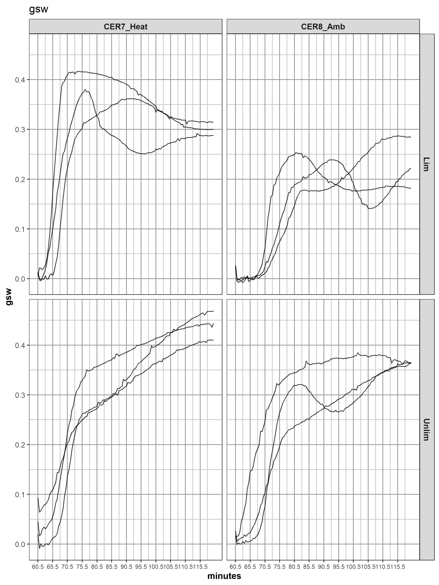

### Explore the gs profiles of just the second light off portion of the experiment


``` r
# plotProfiles(li6800.dat %>% filter(Light == "Off" & th > 2), response = "gsw",
#              individuals = "TWR", times = "th",
#              facet.x = "Temperature",
#              facet.y = "Watering",
#              y.title = "gsw",
#              x.title = "hours",
#              title = "gsw",
#              breaks.spacing.x = 5,
#              alpha = 0.75)
```

### Following *fit_per_species.R*
* Script begins by specifying a stomatal conductance model and setting priors on the parameters
* I have played a little with the priors specified in the script by Silvere, to be more representative of this dataset
* Following discussion with Ed on 22/04, perhaps we want to select a different ``training" dataset for each treatment combination - need to explore what impact this has
* I haven't implemented the above dot point, as the model is refit for each treatment - it's just the compliation of the tool that fits the model under the hood that doesn't need to be re-initialised and keeps the same structure

#### Stomatal conductance model - McAusland from McAusland et al 2016


``` r
nlform_mc <- bf(gsw ~ g0 + (g1 - g0) * exp(-exp(((lambda - tmin)/k)+1)),
             g0 ~ 1 + Room_Temperature*Watering +
               (1 | Rep),
             g1 ~ 1 + Room_Temperature*Watering +
               (1 | Rep),
             k ~ 1+ Room_Temperature*Watering,
             lambda ~ 1+ Room_Temperature*Watering,
             nl = TRUE)

priors_mc <- c(prior(normal(0, 0.01), nlpar = "g0"),
            prior(normal(0.35, 0.1), nlpar = "g1"),
            prior(normal(0, 0.05), class = "sd", nlpar = "g0"),
            prior(normal(0, 0.1), class = "sd", nlpar = "g1"),
            prior(normal(3.5, 1), nlpar = "k", lb = 0),
            prior(normal(3, 1), nlpar = "lambda", lb = 0),
            prior(student_t(3, 0, 0.01), class = "sigma"))

plot(0 + (0.35 - 0) * exp(-exp(((3 - seq(0, 60, 0.5))/3.5) + 1)) ~
       seq(0, 60, 0.5))
```


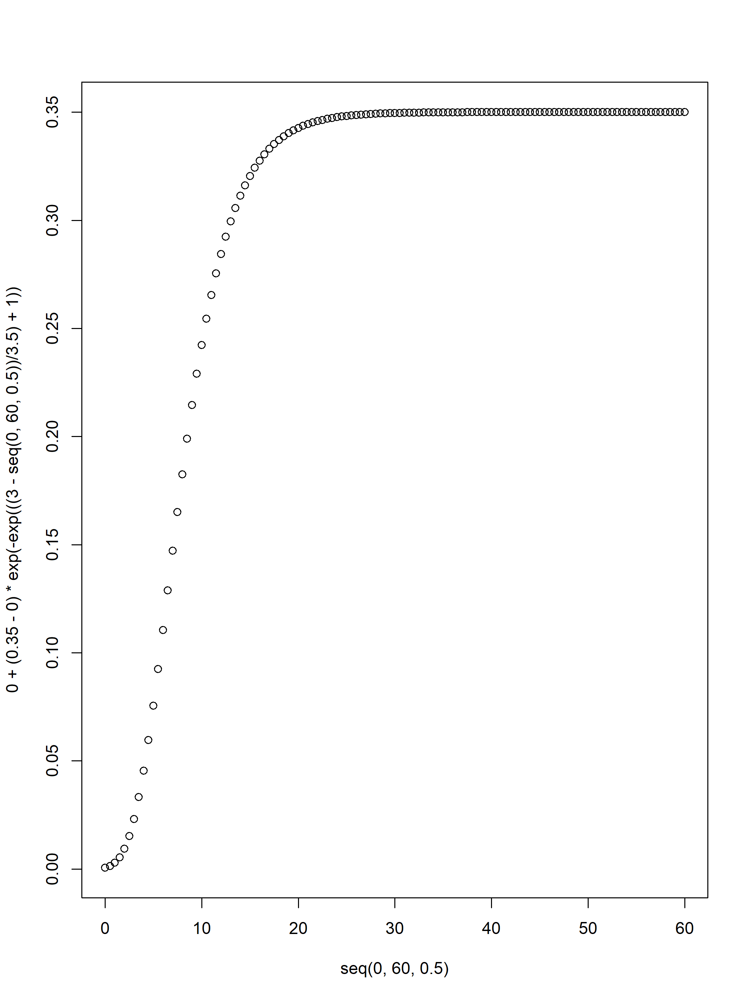

#### Put finishing touches on dataframe
Subset for light on portion and remove th == 0 if it's present, as the light was still on at that point


``` r
li6800.on.dat <- subset(li6800.dat, Light == "On" & th != 0)
##in this case, we can align the time access to all start from zero
li6800.on.dat$th <- li6800.on.dat$th - li6800.on.dat$th[1]
li6800.on.dat$tmin <- li6800.on.dat$tmin - li6800.on.dat$tmin[1]

plotProfiles(li6800.on.dat, response = "gsw",
             individuals = "TWR", times = "tmin",
             y.title = "gsw",
             x.title = "minutes",
             title = "gsw",
             breaks.spacing.x = 5,
             alpha = 0.75)
```


#### Fit the model


``` r
# Configure and compile the model - McAusland
fit_on_max <- brm(
  formula = nlform_mc,
  data = li6800.on.dat,
  prior = priors_mc,
  chains = 6,
  cores = 6,
  iter = 10000,
  warmup = 6000,
  control = list(
    adapt_delta = 0.99,
    max_treedepth = 12,
    metric = "diag_e"
  )
)
```

```
Compiling Stan program...
```

```
Start sampling
```

```
Warning: There were 24 divergent transitions after warmup. See
https://mc-stan.org/misc/warnings.html#divergent-transitions-after-warmup
to find out why this is a problem and how to eliminate them.
```

```
Warning: Examine the pairs() plot to diagnose sampling problems
```

``` r
print(summary(fit_on_max))
```

```
Warning: There were 24 divergent transitions after warmup. Increasing adapt_delta above
0.99 may help. See
http://mc-stan.org/misc/warnings.html#divergent-transitions-after-warmup
```

```
 Family: gaussian 
  Links: mu = identity 
Formula: gsw ~ g0 + (g1 - g0) * exp(-exp(((lambda - tmin)/k) + 1)) 
         g0 ~ 1 + Room_Temperature * Watering + (1 | Rep)
         g1 ~ 1 + Room_Temperature * Watering + (1 | Rep)
         k ~ 1 + Room_Temperature * Watering
         lambda ~ 1 + Room_Temperature * Watering
   Data: li6800.on.dat (Number of observations: 1462) 
  Draws: 6 chains, each with iter = 10000; warmup = 6000; thin = 1;
         total post-warmup draws = 24000

Multilevel Hyperparameters:
~Rep (Number of levels: 3) 
                 Estimate Est.Error l-95% CI u-95% CI Rhat Bulk_ESS Tail_ESS
sd(g0_Intercept)     0.01      0.01     0.00     0.04 1.00     8121    10224
sd(g1_Intercept)     0.02      0.02     0.00     0.07 1.00     5281     7527

Regression Coefficients:
                                              Estimate Est.Error l-95% CI u-95% CI Rhat
g0_Intercept                                     -0.01      0.01    -0.02     0.01 1.00
g0_Room_TemperatureCER8_Amb                      -0.01      0.01    -0.02     0.01 1.00
g0_WateringUnlim                                  0.02      0.01     0.01     0.04 1.00
g0_Room_TemperatureCER8_Amb:WateringUnlim         0.04      0.01     0.02     0.05 1.00
g1_Intercept                                      0.33      0.01     0.30     0.36 1.00
g1_Room_TemperatureCER8_Amb                      -0.13      0.00    -0.13    -0.12 1.00
g1_WateringUnlim                                  0.06      0.00     0.06     0.07 1.00
g1_Room_TemperatureCER8_Amb:WateringUnlim         0.09      0.01     0.08     0.10 1.00
k_Intercept                                       2.54      0.20     2.15     2.94 1.00
k_Room_TemperatureCER8_Amb                        1.93      0.37     1.21     2.65 1.00
k_WateringUnlim                                   3.52      0.27     3.01     4.04 1.00
k_Room_TemperatureCER8_Amb:WateringUnlim          0.05      0.05     0.00     0.18 1.00
lambda_Intercept                                  2.76      0.35     2.07     3.43 1.00
lambda_Room_TemperatureCER8_Amb                   1.42      0.58     0.31     2.57 1.00
lambda_WateringUnlim                              0.13      0.12     0.00     0.45 1.00
lambda_Room_TemperatureCER8_Amb:WateringUnlim     0.06      0.06     0.00     0.24 1.00
                                              Bulk_ESS Tail_ESS
g0_Intercept                                     16543    17316
g0_Room_TemperatureCER8_Amb                      19788    18089
g0_WateringUnlim                                 21733    17937
g0_Room_TemperatureCER8_Amb:WateringUnlim        23936    18286
g1_Intercept                                      7229     5797
g1_Room_TemperatureCER8_Amb                      19009    18490
g1_WateringUnlim                                 16366    18062
g1_Room_TemperatureCER8_Amb:WateringUnlim        17027    17195
k_Intercept                                      14780    15572
k_Room_TemperatureCER8_Amb                       14498    13521
k_WateringUnlim                                  19365    16784
k_Room_TemperatureCER8_Amb:WateringUnlim         20966    11223
lambda_Intercept                                 14513    14417
lambda_Room_TemperatureCER8_Amb                  12510     8481
lambda_WateringUnlim                             19423    10662
lambda_Room_TemperatureCER8_Amb:WateringUnlim    19324    10622

Further Distributional Parameters:
      Estimate Est.Error l-95% CI u-95% CI Rhat Bulk_ESS Tail_ESS
sigma     0.05      0.00     0.05     0.05 1.00    30547    17417

Draws were sampled using sampling(NUTS). For each parameter, Bulk_ESS
and Tail_ESS are effective sample size measures, and Rhat is the potential
scale reduction factor on split chains (at convergence, Rhat = 1).
```

``` r
plot(fit_on_max, ask = FALSE)
```


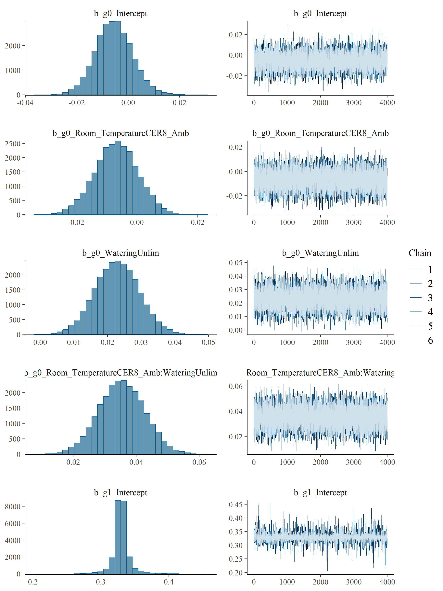

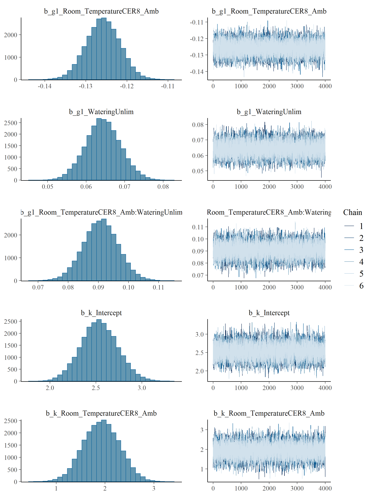

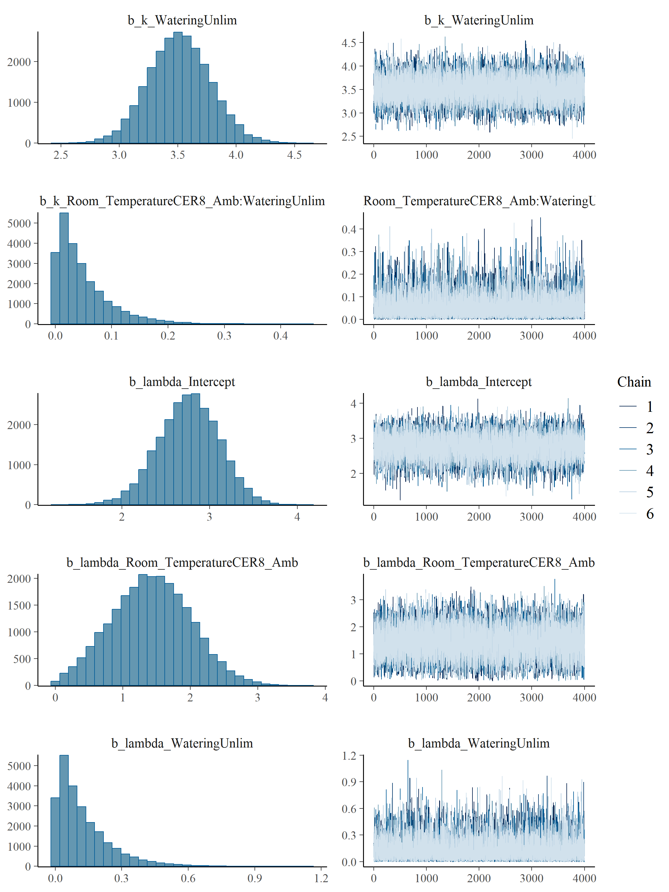

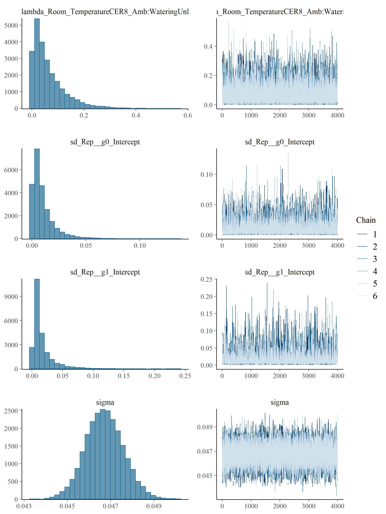

``` r
pairs(fit_on_max)
```


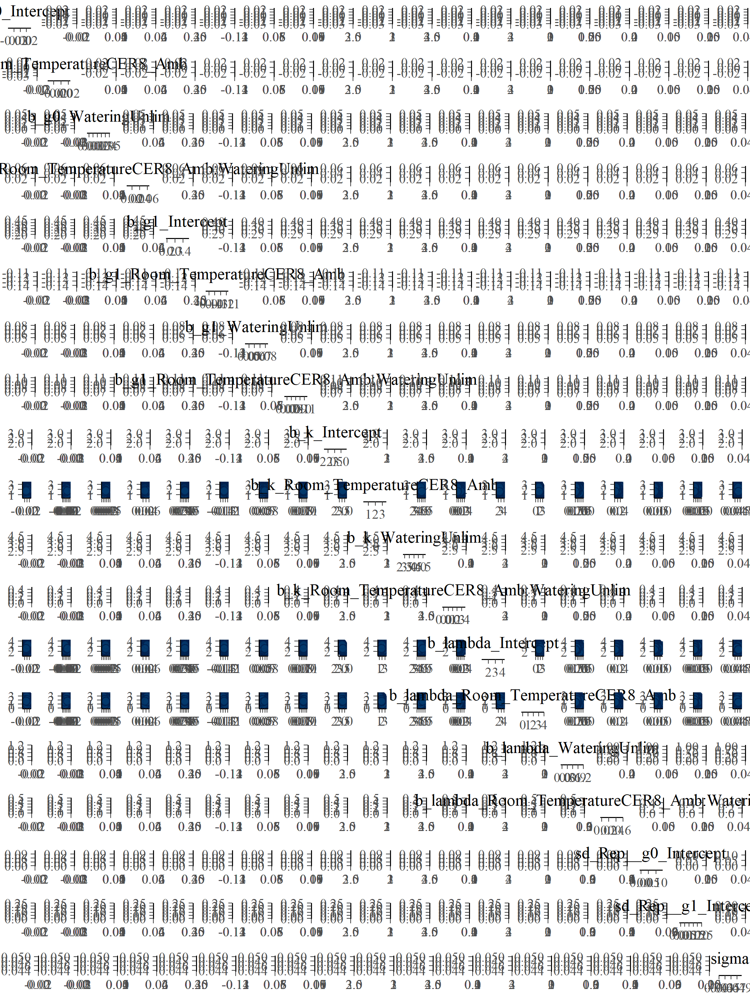

``` r
mcmc_plot(fit_on_max, type = "trace")
```


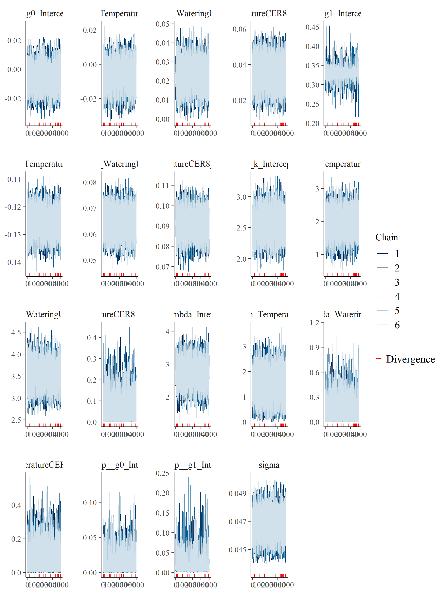

``` r
rstan::check_hmc_diagnostics(fit_on_max$fit)
```

```

Divergences:
```

```
24 of 24000 iterations ended with a divergence (0.1%).
Try increasing 'adapt_delta' to remove the divergences.
```

```

Tree depth:
```

```
0 of 24000 iterations saturated the maximum tree depth of 12.
```

```

Energy:
```

```
E-BFMI indicated no pathological behavior.
```

``` r
loo(fit_on_max)
```

```

Computed from 24000 by 1462 log-likelihood matrix.

         Estimate   SE
elpd_loo   2394.9 26.9
p_loo        17.5  1.0
looic     -4789.9 53.7
------
MCSE of elpd_loo is 0.0.
MCSE and ESS estimates assume MCMC draws (r_eff in [0.7, 1.2]).

All Pareto k estimates are good (k < 0.7).
See help('pareto-k-diagnostic') for details.
```

``` r
pp_check(fit_on_max)  # compares density of the observed data with data generated from posterior predictive distribution
```

```
Using 10 posterior draws for ppc type 'dens_overlay' by default.
```


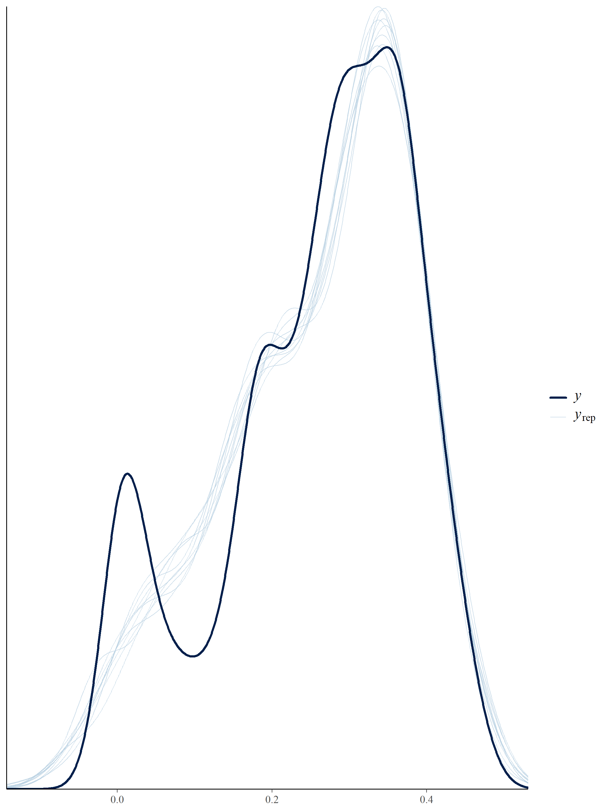

``` r
pp_check(fit_on_max, type = "error_hist", ndraws = 12)
```

```
`stat_bin()` using `bins = 30`. Pick better value `binwidth`.
```


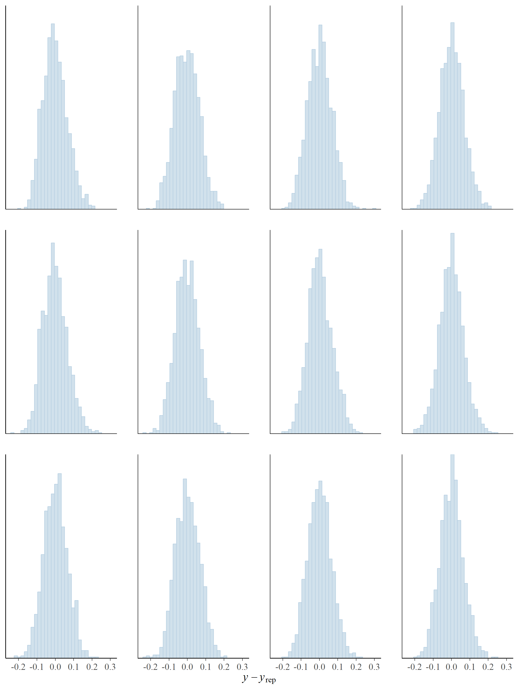

``` r
pp_check(fit_on_max, type = "scatter_avg", ndraws = 1000)
```


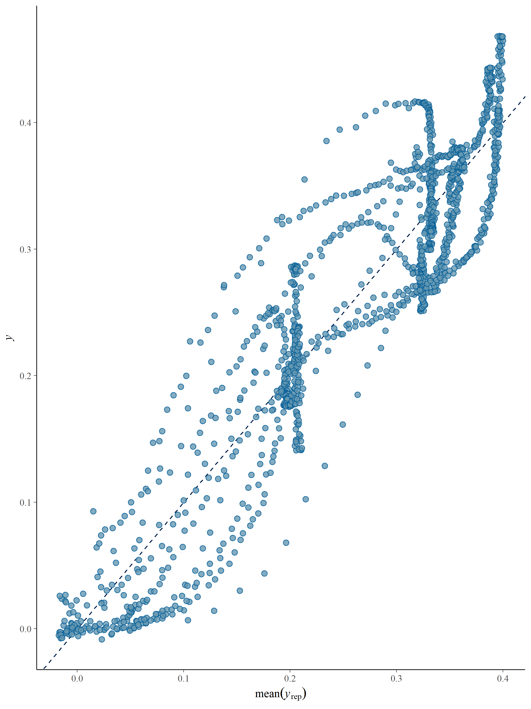

``` r
pp_check(fit_on_max, type = "stat_2d")
```

```
Using all posterior draws for ppc type 'stat_2d' by default.
```

```
Note: in most cases the default test statistic 'mean' is too weak to detect anything of interest.
```


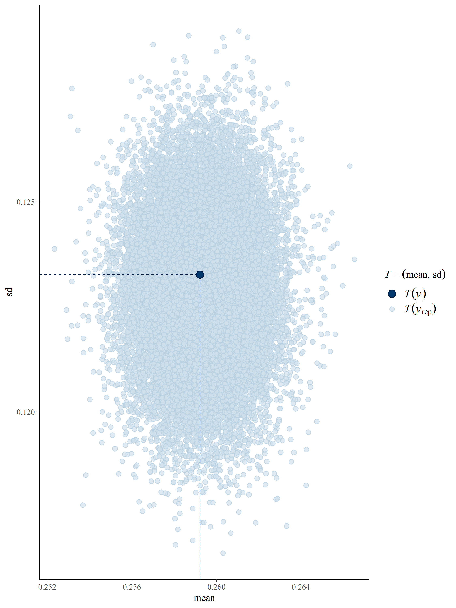

``` r
pp_check(fit_on_max, type = "loo_ribbon")
```

```
Using all posterior draws for ppc type 'loo_ribbon' by default.
```


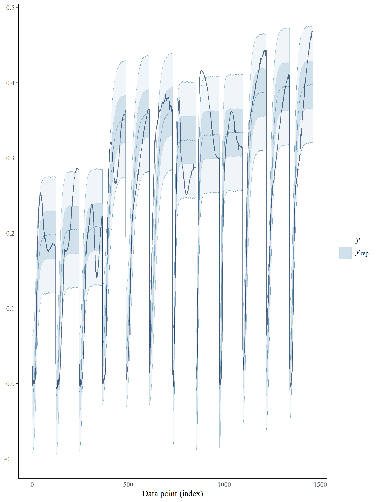

``` r
plot(gsw~tmin, li6800.on.dat, pch=16)
points(fitted(fit_on_max)[,1]~tmin, li6800.on.dat, pch=16, col="red")
```


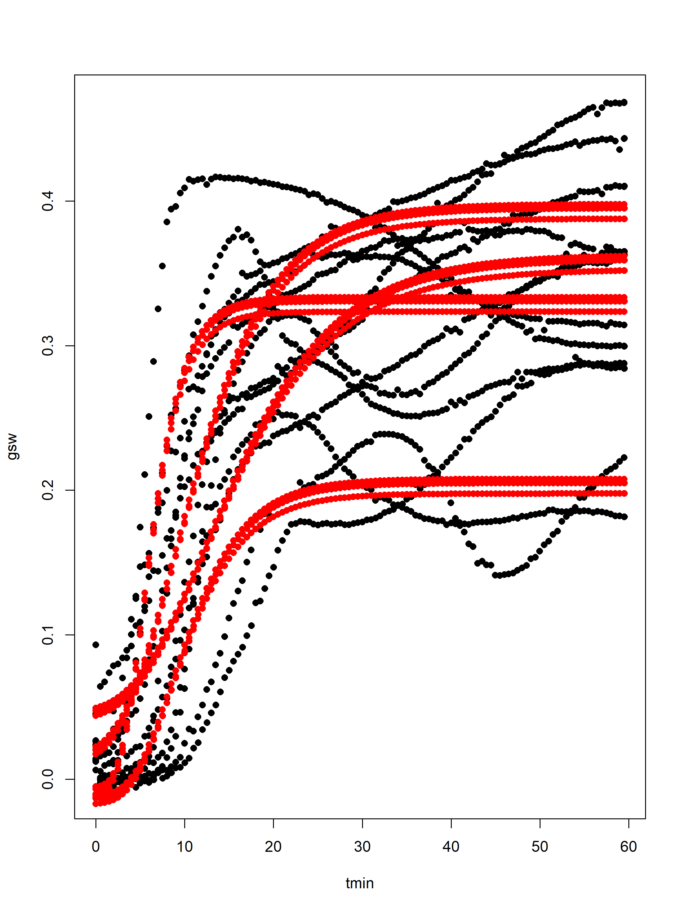

``` r
##make the above plot prettier
li6800.on.plot <- li6800.on.dat
li6800.on.plot$fitted <- fitted(fit_on_max)[,1]
li6800.on.plot$fitted.fixed <- fitted(fit_on_max, re_formula = NA)[,1]

ggplot(li6800.on.plot, aes(x= tmin, y = gsw, group = Rep)) +
  geom_point() +
  facet_grid(Room_Temperature ~ Watering) +
  geom_point(aes(y=fitted), colour = "red") +
  geom_line(aes(y=fitted), colour = "red")
```


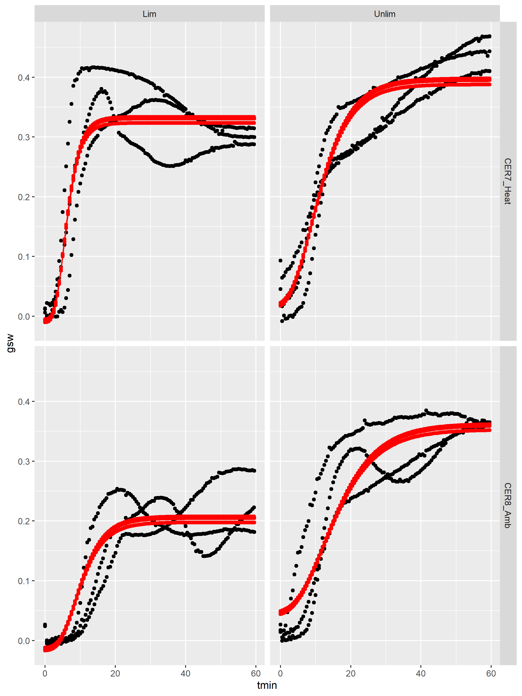

``` r
ggplot(li6800.on.plot, aes(x= tmin, y = gsw, group = Rep)) +
  geom_point() +
  facet_grid(Room_Temperature ~ Watering) +
  geom_point(aes(y=fitted), colour = "red") +
  geom_line(aes(y=fitted), colour = "red") +
  geom_point(aes(y=fitted.fixed), colour = "blue") +
  geom_line(aes(y=fitted.fixed), colour = "blue")
```


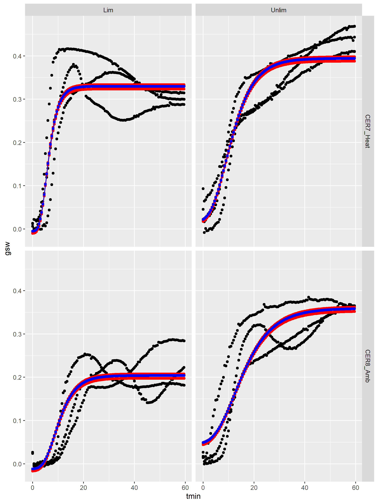

#### Testing contribution of effects in the model


``` r
# nlform_mc_reduced <- bf(gsw ~ g0 + (g1 - g0) * exp(-exp(((lambda - tmin)/k)+1)),
#                 g0 ~ 1 + Room_Temperature*Watering +
#                   (1 | Rep),
#                 g1 ~ 1 + Room_Temperature*Watering +
#                   (1 | Rep),
#                 k ~ 1 + Room_Temperature,
#                 lambda ~ 1,
#                 nl = TRUE)

# Fit the model
# fit_on_reduced <- brm(
#   formula = nlform_mc_reduced,
#   data = li6800.on.dat,
#   prior = priors_mc,
#   chains = 6,
#   cores = 6,
#   iter = 10000,
#   warmup = 6000,
#   control = list(
#     adapt_delta = 0.99,
#     max_treedepth = 12,
#     metric = "diag_e"
#   )
# )

# print(summary(fit_on_reduced))
# loo(fit_on_reduced)
# loo(fit_on_current)
# plot(gsw~tmin, li6800.on.dat, pch=16)
# points(fitted(fit_on_reduced)[,1]~tmin, li6800.on.dat, pch=16, col="red")
# coef(fit_on_reduced)
# 
# fit_on_current <- add_criterion(fit_on_current, "loo")
# fit_on_reduced <- add_criterion(fit_on_reduced, "loo")

#loo_compare(fit_on_current, fit_on_reduced)
##Lambda: Drop Room_Temperature:Watering interaction
##k: Drop Room_Temperature:Watering interaction
##g0: Retain Room_Temperature:Watering interaction
##g1: Retain Room_Temperature:Watering interaction

##lambda: Drop Watering main effect
##lambda: Drop Room_Temperature main effect
##k: Retain Room_Temperature main effect
##k: Retain Watering main effect
```

#### Fit final model


``` r
##Final model:
##g0: Room_Temperature:Watering
##g1: Room_Temperature:Watering
##lambda: 1
##k: Room_Temperature + Watering
#fit_on_current <- fit_on_reduced

nlform_mc_final <- bf(gsw ~ g0 + (g1 - g0) * exp(-exp(((lambda - tmin)/k)+1)),
                g0 ~ 1 + Room_Temperature*Watering +
                  (1 | Rep),
                g1 ~ 1 + Room_Temperature*Watering +
                  (1 | Rep),
                k ~ 1 + Room_Temperature,
                lambda ~ 1,
                nl = TRUE)

# Fit the model
fit_on_final <- brm(
  formula = nlform_mc_final,
  data = li6800.on.dat,
  prior = priors_mc,
  chains = 6,
  cores = 6,
  iter = 10000,
  warmup = 6000,
  control = list(
    adapt_delta = 0.99,
    max_treedepth = 12,
    metric = "diag_e"
  )
)
```

```
Compiling Stan program...
```

```
Start sampling
```

```
Warning: There were 21 divergent transitions after warmup. See
https://mc-stan.org/misc/warnings.html#divergent-transitions-after-warmup
to find out why this is a problem and how to eliminate them.
```

```
Warning: Examine the pairs() plot to diagnose sampling problems
```

``` r
print(summary(fit_on_final))
```

```
Warning: There were 21 divergent transitions after warmup. Increasing adapt_delta above
0.99 may help. See
http://mc-stan.org/misc/warnings.html#divergent-transitions-after-warmup
```

```
 Family: gaussian 
  Links: mu = identity 
Formula: gsw ~ g0 + (g1 - g0) * exp(-exp(((lambda - tmin)/k) + 1)) 
         g0 ~ 1 + Room_Temperature * Watering + (1 | Rep)
         g1 ~ 1 + Room_Temperature * Watering + (1 | Rep)
         k ~ 1 + Room_Temperature
         lambda ~ 1
   Data: li6800.on.dat (Number of observations: 1462) 
  Draws: 6 chains, each with iter = 10000; warmup = 6000; thin = 1;
         total post-warmup draws = 24000

Multilevel Hyperparameters:
~Rep (Number of levels: 3) 
                 Estimate Est.Error l-95% CI u-95% CI Rhat Bulk_ESS Tail_ESS
sd(g0_Intercept)     0.01      0.01     0.00     0.05 1.00     7756    10949
sd(g1_Intercept)     0.02      0.02     0.00     0.08 1.00     5627     7696

Regression Coefficients:
                                          Estimate Est.Error l-95% CI u-95% CI Rhat
g0_Intercept                                  0.01      0.01    -0.01     0.02 1.00
g0_Room_TemperatureCER8_Amb                  -0.02      0.01    -0.03    -0.01 1.00
g0_WateringUnlim                             -0.01      0.01    -0.02     0.00 1.00
g0_Room_TemperatureCER8_Amb:WateringUnlim     0.02      0.01     0.00     0.03 1.00
g1_Intercept                                  0.34      0.01     0.31     0.37 1.00
g1_Room_TemperatureCER8_Amb                  -0.13      0.00    -0.14    -0.12 1.00
g1_WateringUnlim                              0.04      0.00     0.03     0.04 1.00
g1_Room_TemperatureCER8_Amb:WateringUnlim     0.10      0.01     0.09     0.11 1.00
k_Intercept                                   3.81      0.26     3.33     4.33 1.00
k_Room_TemperatureCER8_Amb                    2.26      0.26     1.75     2.77 1.00
lambda_Intercept                              2.91      0.43     2.04     3.72 1.00
                                          Bulk_ESS Tail_ESS
g0_Intercept                                 17601    16955
g0_Room_TemperatureCER8_Amb                  19731    17878
g0_WateringUnlim                             23298    18061
g0_Room_TemperatureCER8_Amb:WateringUnlim    23462    19473
g1_Intercept                                  8331     7204
g1_Room_TemperatureCER8_Amb                  18562    18522
g1_WateringUnlim                             18714    17275
g1_Room_TemperatureCER8_Amb:WateringUnlim    16922    17677
k_Intercept                                  14938    14344
k_Room_TemperatureCER8_Amb                   20443    15960
lambda_Intercept                             14254    12070

Further Distributional Parameters:
      Estimate Est.Error l-95% CI u-95% CI Rhat Bulk_ESS Tail_ESS
sigma     0.05      0.00     0.05     0.05 1.00    27461    17232

Draws were sampled using sampling(NUTS). For each parameter, Bulk_ESS
and Tail_ESS are effective sample size measures, and Rhat is the potential
scale reduction factor on split chains (at convergence, Rhat = 1).
```

``` r
pp_check(fit_off_final)
```

```
Error:
! object 'fit_off_final' not found
```

``` r
rstan::check_hmc_diagnostics(fit_off_final$fit)
```

```
Error:
! object 'fit_off_final' not found
```

``` r
##make the above plot prettier
li6800.on.plot <- li6800.on.dat
li6800.on.plot$fitted <- fitted(fit_on_final)[,1]
li6800.on.plot$fitted.fixed <- fitted(fit_on_final, re_formula = NA)[,1]

ggplot(li6800.on.plot, aes(x= tmin, y = gsw, group = Rep)) +
  geom_point() +
  facet_grid(Room_Temperature ~ Watering) +
  geom_point(aes(y=fitted), colour = "red") +
  geom_line(aes(y=fitted), colour = "red")
```


``` r
ggplot(li6800.on.plot, aes(x= tmin, y = gsw, group = Rep)) +
  geom_point() +
  facet_grid(Room_Temperature ~ Watering) +
  geom_point(aes(y=fitted), colour = "red") +
  geom_line(aes(y=fitted), colour = "red") +
  geom_point(aes(y=fitted.fixed), colour = "blue") +
  geom_line(aes(y=fitted.fixed), colour = "blue")
```


``` r
##I will write another script to get parameters from the model
# ##calculate Slmax for the McAusland model
# Slmax.calc.mc <- function(coef){
#   ##pull out ceofficients, as they relate to parameters in McAusland 2016
#   gi <- coef$Rep[, "Estimate", "g0_Intercept"]
#   gf <- coef$Rep[, "Estimate", "g1_Intercept"]
#   k <- coef$Rep[, "Estimate", "k_Intercept"]
#   
#   (gf - gi)/(k*exp(1))
# }
# 
# Slmax.calc.mc(coef(fits_mc[[1]]))
# Slmax.calc.mc(coef(fits_mc[[2]]))
# Slmax.calc.mc(coef(fits_mc[[3]]))
# Slmax.calc.mc(coef(fits_mc[[4]]))
```

### Save data


``` r
save.image(saveFile)
```

