---
output:
  pdf_document: default
  html_document: default
---
# Wheat stomatal kinetics (heat & drought)
## --- Ed Chaplin (USyd), *Apr--June 2025* ---
### Li-6800 STOMATAL CONDUCTANCE MODEL PLOTTING PARAMETERS

* Plotting the resulting parameter estimates
* 

### Load the libraries


``` r
library(knitr)
#knitr::spin("li6800.stomatalCondParamPlotting.v1.r")
library(ggplot2)
opts_chunk$set("tidy" = FALSE, "dev" = "png", "dpi" = 300, 
               "fig.width" = 7.5, "fig.height" = 10, "comment"=NA, fig.path = "figures/")
library(dae)
library(dplyr)
library(brms) ##package used to fit bayesian regression model using Stan
library(tidyr)
library(emmeans)
library(tidybayes)
library(pracma)
library(patchwork)
```

### Set up constants and files


``` r
options(width=90)
load("../data/stomatalCondParamEstimation_i.v1.Rdata")
load("../data/stomatalCondParamEstimation_d.v1.Rdata")
load("../data/stomatalCondParamEstimation_A_i.v1.Rdata")
saveFile <- "../data/stomatalCondParamPlotting.v1.Rdata"
```

### Bring together parameters from across different analyses


``` r
head(li6800.A.i.param)
```

```
  Room_Temperature Watering g0_A_emmean g0_A_lower.HPD g0_A_upper.HPD
1        CER7_Heat      Lim   0.4612072      0.2726138      0.6603669
2         CER8_Amb      Lim   0.9241376      0.6373473      1.1833780
3        CER7_Heat    Unlim   1.1317338      0.8536236      1.4043426
4         CER8_Amb    Unlim   2.2518709      1.8687217      2.6338734
         g0_A_tabquant g1_A_emmean g1_A_lower.HPD g1_A_upper.HPD           g1_A_tabquant
1  0.461 [0.273, 0.66]    24.12132       23.18866       25.28805 24.121 [23.189, 25.288]
2 0.924 [0.637, 1.183]    21.74901       20.77568       22.93259 21.749 [20.776, 22.933]
3 1.132 [0.854, 1.404]    25.60162       24.62397       26.77939 25.602 [24.624, 26.779]
4 2.252 [1.869, 2.634]    26.38653       25.37484       27.56291 26.387 [25.375, 27.563]
  k_A_emmean k_A_lower.HPD k_A_upper.HPD         k_A_tabquant t95_emmean t95_lower.HPD
1   3.707071      3.525933      3.896441 3.707 [3.526, 3.896]   14.64504      13.91690
2   7.042995      6.740555      7.349885  7.043 [6.741, 7.35]   27.64662      26.45120
3   4.871998      4.621587      5.131084 4.872 [4.622, 5.131]   19.11516      18.10498
4   8.206315      7.835147      8.593633 8.206 [7.835, 8.594]   31.82729      30.36089
  t95_upper.HPD .width .point .interval            t95_tabquant A95_emmean A95_lower.HPD
1      15.38447   0.95 median       hdi 14.645 [13.917, 15.384]   22.91526      21.98792
2      28.85130   0.95 median       hdi 27.647 [26.451, 28.851]   20.66156      19.73690
3      20.10559   0.95 median       hdi 19.115 [18.105, 20.106]   24.32154      23.40387
4      33.30865   0.95 median       hdi 31.827 [30.361, 33.309]   25.06720      24.10796
  A95_upper.HPD            A95_tabquant Limit_emmean Limit_lower.HPD Limit_upper.HPD
1      23.98836 22.915 [21.988, 23.988]    0.1045623      0.09878291       0.1106137
2      21.78596 20.662 [19.737, 21.786]    0.2133898      0.20203594       0.2256521
3      25.45276 24.322 [23.404, 25.453]    0.1379294      0.12962045       0.1464166
4      26.18893 25.067 [24.108, 26.189]    0.2431601      0.22823042       0.2580052
           Limit_tabquant
1  10.456 [9.878, 11.061]
2 21.339 [20.204, 22.565]
3 13.793 [12.962, 14.642]
4 24.316 [22.823, 25.801]
```

``` r
head(li6800.i.param)
```

```
  Room_Temperature Watering    g0_emmean g0_lower.HPD g0_upper.HPD            g0_tabquant
1        CER7_Heat      Lim  0.005715822  -0.01067725 0.0204419120   0.006 [-0.011, 0.02]
2         CER8_Amb      Lim -0.015632347  -0.03456335 0.0004020862     -0.016 [-0.035, 0]
3        CER7_Heat    Unlim -0.002984951  -0.02342396 0.0153516116 -0.003 [-0.023, 0.015]
4         CER8_Amb    Unlim -0.004560178  -0.02633910 0.0152058786 -0.005 [-0.026, 0.015]
  g1_emmean g1_lower.HPD g1_upper.HPD          g1_tabquant k_emmean k_lower.HPD
1 0.3368347    0.3063949    0.3663453 0.337 [0.306, 0.366] 3.809266    3.328434
2 0.2094931    0.1797629    0.2394620  0.209 [0.18, 0.239] 6.063799    5.437185
3 0.3723058    0.3430099    0.4029144 0.372 [0.343, 0.403] 3.809266    3.328434
4 0.3422122    0.3103194    0.3705435  0.342 [0.31, 0.371] 6.063799    5.437185
  k_upper.HPD           k_tabquant lambda_emmean lambda_lower.HPD lambda_upper.HPD
1    4.327638 3.809 [3.328, 4.328]       2.92598         2.053094         3.730533
2    6.651428 6.064 [5.437, 6.651]       2.92598         2.053094         3.730533
3    4.327638 3.809 [3.328, 4.328]       2.92598         2.053094         3.730533
4    6.651428 6.064 [5.437, 6.651]       2.92598         2.053094         3.730533
       lambda_tabquant Slmax_emmean Slmax_lower.HPD Slmax_upper.HPD       Slmax_tabquant
1 2.926 [2.053, 3.731]    0.5335851       0.4546119       0.6180032 0.534 [0.455, 0.618]
2 2.926 [2.053, 3.731]    0.2276378       0.1904763       0.2709143  0.228 [0.19, 0.271]
3 2.926 [2.053, 3.731]    0.6045666       0.5244643       0.6958533 0.605 [0.524, 0.696]
4 2.926 [2.053, 3.731]    0.3506607       0.3047004       0.4000952   0.351 [0.305, 0.4]
```

``` r
head(li6800.d.param)
```

```
  Room_Temperature Watering g0_emmean g0_lower.HPD g0_upper.HPD          g0_tabquant
1        CER7_Heat      Lim 0.2707174    0.1963175    0.3565208 0.271 [0.196, 0.357]
2         CER8_Amb      Lim 0.2002530    0.1229866    0.2836654   0.2 [0.123, 0.284]
3        CER7_Heat    Unlim 0.4552246    0.3812559    0.5407923 0.455 [0.381, 0.541]
4         CER8_Amb    Unlim 0.2838894    0.2080176    0.3661285 0.284 [0.208, 0.366]
     g1_emmean g1_lower.HPD g1_upper.HPD           g1_tabquant k_emmean k_lower.HPD
1 0.0038352005 -0.014231691   0.02066783 0.004 [-0.014, 0.021] 3.068592    2.916036
2 0.0009570562 -0.017151334   0.01810996 0.001 [-0.017, 0.018] 3.068592    2.916036
3 0.0791044184  0.061177916   0.09662226  0.079 [0.061, 0.097] 6.569226    6.362446
4 0.0132003079 -0.004716062   0.03086419 0.013 [-0.005, 0.031] 6.569226    6.362446
  k_upper.HPD           k_tabquant lambda_emmean lambda_lower.HPD lambda_upper.HPD
1    3.222151 3.069 [2.916, 3.222]     0.1691432     3.195929e-05        0.4367896
2    3.222151 3.069 [2.916, 3.222]     0.1691432     3.195929e-05        0.4367896
3    6.776745 6.569 [6.362, 6.777]     1.1651820     6.885239e-01        1.6543842
4    6.776745 6.569 [6.362, 6.777]     1.1651820     6.885239e-01        1.6543842
       lambda_tabquant Slmax_emmean Slmax_lower.HPD Slmax_upper.HPD
1     0.169 [0, 0.437]   -0.5344196      -0.7114045      -0.3762393
2     0.169 [0, 0.437]   -0.3991272      -0.5745690      -0.2422679
3 1.165 [0.689, 1.654]   -0.3513450      -0.4339158      -0.2806673
4 1.165 [0.689, 1.654]   -0.2529170      -0.3335238      -0.1809828
           Slmax_tabquant
1 -0.534 [-0.711, -0.376]
2 -0.399 [-0.575, -0.242]
3 -0.351 [-0.434, -0.281]
4 -0.253 [-0.334, -0.181]
```

``` r
##bring together the parameters into one dataframe, but first make sure names are unique
li6800.i.param <- li6800.i.param %>% rename_with(~paste0("i_", .x),
                                         -all_of(c("Room_Temperature",
                                                   "Watering")))
li6800.d.param <- li6800.d.param %>% rename_with(~paste0("d_", .x),
                                                 -all_of(c("Room_Temperature",
                                                           "Watering")))


li6800.all.params <- left_join(li6800.A.i.param,
                               li6800.i.param) %>% left_join(li6800.d.param)
```

```
Joining with `by = join_by(Room_Temperature, Watering)`
Joining with `by = join_by(Room_Temperature, Watering)`
```

``` r
li6800.all.params
```

```
  Room_Temperature Watering g0_A_emmean g0_A_lower.HPD g0_A_upper.HPD
1        CER7_Heat      Lim   0.4612072      0.2726138      0.6603669
2         CER8_Amb      Lim   0.9241376      0.6373473      1.1833780
3        CER7_Heat    Unlim   1.1317338      0.8536236      1.4043426
4         CER8_Amb    Unlim   2.2518709      1.8687217      2.6338734
         g0_A_tabquant g1_A_emmean g1_A_lower.HPD g1_A_upper.HPD           g1_A_tabquant
1  0.461 [0.273, 0.66]    24.12132       23.18866       25.28805 24.121 [23.189, 25.288]
2 0.924 [0.637, 1.183]    21.74901       20.77568       22.93259 21.749 [20.776, 22.933]
3 1.132 [0.854, 1.404]    25.60162       24.62397       26.77939 25.602 [24.624, 26.779]
4 2.252 [1.869, 2.634]    26.38653       25.37484       27.56291 26.387 [25.375, 27.563]
  k_A_emmean k_A_lower.HPD k_A_upper.HPD         k_A_tabquant t95_emmean t95_lower.HPD
1   3.707071      3.525933      3.896441 3.707 [3.526, 3.896]   14.64504      13.91690
2   7.042995      6.740555      7.349885  7.043 [6.741, 7.35]   27.64662      26.45120
3   4.871998      4.621587      5.131084 4.872 [4.622, 5.131]   19.11516      18.10498
4   8.206315      7.835147      8.593633 8.206 [7.835, 8.594]   31.82729      30.36089
  t95_upper.HPD .width .point .interval            t95_tabquant A95_emmean A95_lower.HPD
1      15.38447   0.95 median       hdi 14.645 [13.917, 15.384]   22.91526      21.98792
2      28.85130   0.95 median       hdi 27.647 [26.451, 28.851]   20.66156      19.73690
3      20.10559   0.95 median       hdi 19.115 [18.105, 20.106]   24.32154      23.40387
4      33.30865   0.95 median       hdi 31.827 [30.361, 33.309]   25.06720      24.10796
  A95_upper.HPD            A95_tabquant Limit_emmean Limit_lower.HPD Limit_upper.HPD
1      23.98836 22.915 [21.988, 23.988]    0.1045623      0.09878291       0.1106137
2      21.78596 20.662 [19.737, 21.786]    0.2133898      0.20203594       0.2256521
3      25.45276 24.322 [23.404, 25.453]    0.1379294      0.12962045       0.1464166
4      26.18893 25.067 [24.108, 26.189]    0.2431601      0.22823042       0.2580052
           Limit_tabquant  i_g0_emmean i_g0_lower.HPD i_g0_upper.HPD
1  10.456 [9.878, 11.061]  0.005715822    -0.01067725   0.0204419120
2 21.339 [20.204, 22.565] -0.015632347    -0.03456335   0.0004020862
3 13.793 [12.962, 14.642] -0.002984951    -0.02342396   0.0153516116
4 24.316 [22.823, 25.801] -0.004560178    -0.02633910   0.0152058786
           i_g0_tabquant i_g1_emmean i_g1_lower.HPD i_g1_upper.HPD        i_g1_tabquant
1   0.006 [-0.011, 0.02]   0.3368347      0.3063949      0.3663453 0.337 [0.306, 0.366]
2     -0.016 [-0.035, 0]   0.2094931      0.1797629      0.2394620  0.209 [0.18, 0.239]
3 -0.003 [-0.023, 0.015]   0.3723058      0.3430099      0.4029144 0.372 [0.343, 0.403]
4 -0.005 [-0.026, 0.015]   0.3422122      0.3103194      0.3705435  0.342 [0.31, 0.371]
  i_k_emmean i_k_lower.HPD i_k_upper.HPD         i_k_tabquant i_lambda_emmean
1   3.809266      3.328434      4.327638 3.809 [3.328, 4.328]         2.92598
2   6.063799      5.437185      6.651428 6.064 [5.437, 6.651]         2.92598
3   3.809266      3.328434      4.327638 3.809 [3.328, 4.328]         2.92598
4   6.063799      5.437185      6.651428 6.064 [5.437, 6.651]         2.92598
  i_lambda_lower.HPD i_lambda_upper.HPD    i_lambda_tabquant i_Slmax_emmean
1           2.053094           3.730533 2.926 [2.053, 3.731]      0.5335851
2           2.053094           3.730533 2.926 [2.053, 3.731]      0.2276378
3           2.053094           3.730533 2.926 [2.053, 3.731]      0.6045666
4           2.053094           3.730533 2.926 [2.053, 3.731]      0.3506607
  i_Slmax_lower.HPD i_Slmax_upper.HPD     i_Slmax_tabquant d_g0_emmean d_g0_lower.HPD
1         0.4546119         0.6180032 0.534 [0.455, 0.618]   0.2707174      0.1963175
2         0.1904763         0.2709143  0.228 [0.19, 0.271]   0.2002530      0.1229866
3         0.5244643         0.6958533 0.605 [0.524, 0.696]   0.4552246      0.3812559
4         0.3047004         0.4000952   0.351 [0.305, 0.4]   0.2838894      0.2080176
  d_g0_upper.HPD        d_g0_tabquant  d_g1_emmean d_g1_lower.HPD d_g1_upper.HPD
1      0.3565208 0.271 [0.196, 0.357] 0.0038352005   -0.014231691     0.02066783
2      0.2836654   0.2 [0.123, 0.284] 0.0009570562   -0.017151334     0.01810996
3      0.5407923 0.455 [0.381, 0.541] 0.0791044184    0.061177916     0.09662226
4      0.3661285 0.284 [0.208, 0.366] 0.0132003079   -0.004716062     0.03086419
          d_g1_tabquant d_k_emmean d_k_lower.HPD d_k_upper.HPD         d_k_tabquant
1 0.004 [-0.014, 0.021]   3.068592      2.916036      3.222151 3.069 [2.916, 3.222]
2 0.001 [-0.017, 0.018]   3.068592      2.916036      3.222151 3.069 [2.916, 3.222]
3  0.079 [0.061, 0.097]   6.569226      6.362446      6.776745 6.569 [6.362, 6.777]
4 0.013 [-0.005, 0.031]   6.569226      6.362446      6.776745 6.569 [6.362, 6.777]
  d_lambda_emmean d_lambda_lower.HPD d_lambda_upper.HPD    d_lambda_tabquant
1       0.1691432       3.195929e-05          0.4367896     0.169 [0, 0.437]
2       0.1691432       3.195929e-05          0.4367896     0.169 [0, 0.437]
3       1.1651820       6.885239e-01          1.6543842 1.165 [0.689, 1.654]
4       1.1651820       6.885239e-01          1.6543842 1.165 [0.689, 1.654]
  d_Slmax_emmean d_Slmax_lower.HPD d_Slmax_upper.HPD        d_Slmax_tabquant
1     -0.5344196        -0.7114045        -0.3762393 -0.534 [-0.711, -0.376]
2     -0.3991272        -0.5745690        -0.2422679 -0.399 [-0.575, -0.242]
3     -0.3513450        -0.4339158        -0.2806673 -0.351 [-0.434, -0.281]
4     -0.2529170        -0.3335238        -0.1809828 -0.253 [-0.334, -0.181]
```

``` r
##recode the factors
li6800.all.params <- within(li6800.all.params, {
  Room_Temperature <- fac.recode(Room_Temperature,
                                 newlevels = c("CER7_Heat",
                                               "CER8_Ambient"))
  Watering <- fac.recode(Watering,
                         newlevels = c("Limited",
                                       "Unlimited"))
  
})
```

### Put together plots of each parameter separately to begin with and then we'll stitch them together


``` r
##increasing params
param.i <- li6800.all.params %>% select(Room_Temperature, Watering, grep("i_", 
                                                                         names(.))) %>%
  # bind_cols(li6800.all.params %>% select(grep("A_", names(.)),
  #                                             grep("t95", names(.)),
  #                                             grep("A95", names(.)),
  #                                             grep("Limit", names(.)))) %>%
  select(-c(grep("tabquant", names(.)))) %>% 
  pivot_longer(col = 3:ncol(.), values_to = "vals", names_to = "param") %>%
  separate(param, into = c("i", "param", "quantity"), sep="_") %>%
  pivot_wider(id_cols = c("Room_Temperature", "Watering", "i", "param"),
              names_from = "quantity", values_from = "vals")
param.i <- within(param.i,{
  paramLabel <- factor(param, levels = c("g0", "g1", "k", "lambda", "Slmax"),
                  labels = c(expression(italic(r)[0[i]]),
                             expression(italic(g)[smax]),
                             expression(italic(k)[i]),
                             expression(lambda[i]),
                             expression(italic(Sl)[max[i]])))
})

g0.g1.plot <- ggplot(param.i %>% filter(param %in% c("g0", "g1")), 
                     aes(x = Watering, y = emmean, 
                         group = Watering)) +
  geom_point(aes(colour = paramLabel), 
             stat = "identity",
             size = 2,
             position = position_dodge(width = 0.9)) +
  geom_errorbar(aes(ymin = lower.HPD, 
                    ymax = upper.HPD,
                    colour = paramLabel),
                width = 0.1,
                position = position_dodge(width = 0.9)) +
  facet_grid( ~ Room_Temperature) +
  theme_bw() +
  scale_x_discrete(labels = scales::label_parse()) +
  scale_colour_discrete(labels = scales::label_parse(),
                        name = "Parameter")+
  xlab("Watering treatment") + 
  ylab(expression(Parameter~estimate~(mol~m^-2~s^-1))) +
  theme(legend.position = "top",
        axis.title.x = element_blank(),
        axis.text.x  = element_blank(),
        axis.ticks.x = element_blank()) +
  ggtitle("(a)")
g0.g1.plot
```

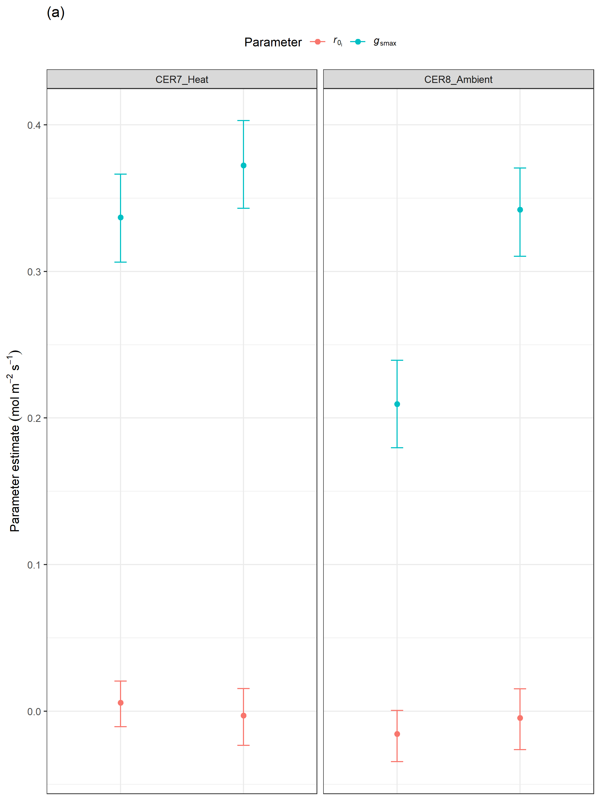

``` r
ki.plot <- ggplot(param.i %>% filter(param %in% c("k")), 
                     aes(x = Watering, y = emmean, 
                         group = Watering)) +
  geom_point(colour = "grey50", 
             stat = "identity",
             size = 2,
             position = position_dodge(width = 0.9)) +
  geom_errorbar(aes(ymin = lower.HPD, 
                    ymax = upper.HPD),
                width = 0.1,
                position = position_dodge(width = 0.9),
                colour = "grey50") +
  facet_grid( ~ Room_Temperature) +
  theme_bw() +
  scale_x_discrete(labels = scales::label_parse()) +
  scale_colour_discrete(labels = scales::label_parse(),
                        name = "Parameter")+
  xlab("Watering treatment") + 
  ylab(expression(italic(k)[i]~(min))) +
  theme(legend.position = "top",
        axis.title.x = element_blank(),
        axis.text.x  = element_blank(),
        axis.ticks.x = element_blank()) +
  ggtitle("(b)")
ki.plot
```

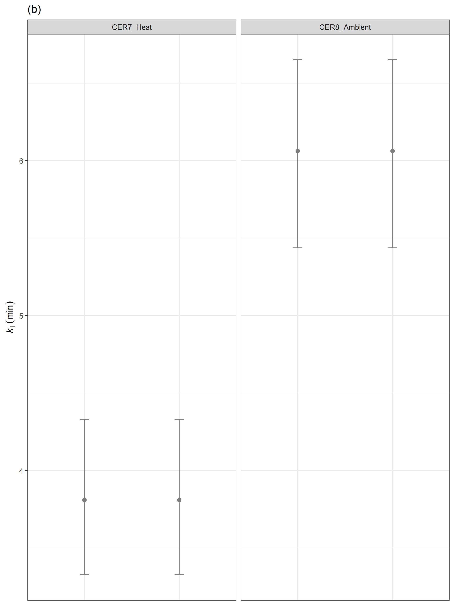

``` r
Slmax.i.plot <- ggplot(param.i %>% filter(param %in% c("Slmax")), 
                  aes(x = Watering, y = emmean, 
                      group = Watering)) +
  geom_point(colour = "grey50", 
             stat = "identity",
             size = 2,
             position = position_dodge(width = 0.9)) +
  geom_errorbar(aes(ymin = lower.HPD, 
                    ymax = upper.HPD),
                width = 0.1,
                position = position_dodge(width = 0.9),
                colour = "grey50") +
  facet_grid( ~ Room_Temperature) +
  theme_bw() +
  scale_x_discrete(labels = scales::label_parse()) +
  scale_colour_discrete(labels = scales::label_parse(),
                        name = "Parameter")+
  xlab("Watering treatment") + 
  ylab(expression(italic(Sl)[max[i]]~(mmol~m^-2~s^-2))) +
  theme(legend.position = "top") +
  ggtitle("(c)")
Slmax.i.plot
```

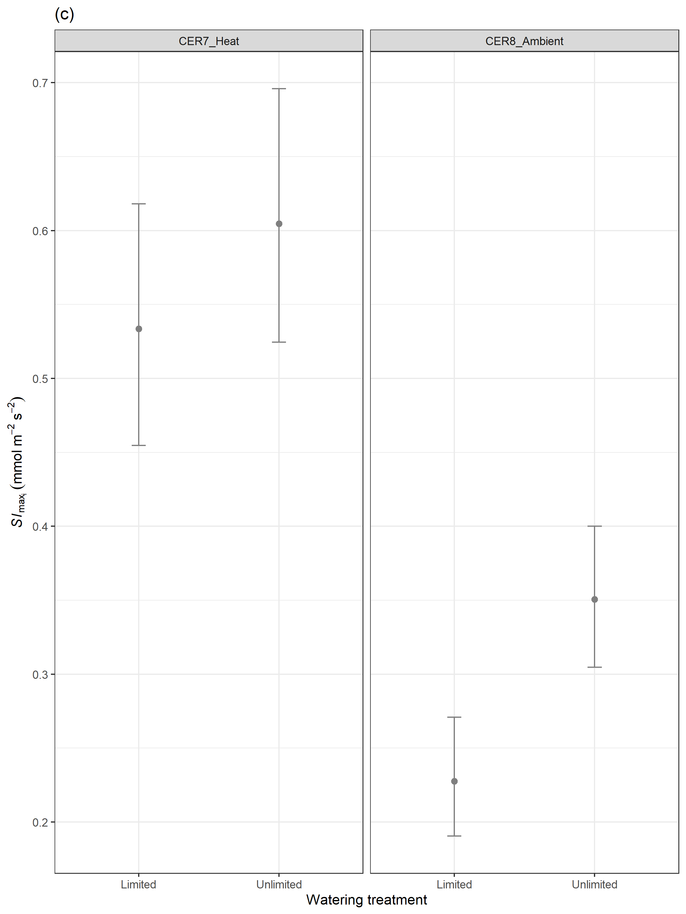

``` r
##increasing params A
param.i.A <- li6800.all.params %>% select(Room_Temperature, Watering, grep("A_", 
                                                                         names(.))) %>%
  bind_cols(li6800.all.params %>% select(grep("t95", names(.)),
                                              grep("A95", names(.)),
                                              grep("Limit", names(.)))) %>%
  select(-c(grep("tabquant", names(.)))) %>% 
  pivot_longer(col = 3:ncol(.), values_to = "vals", names_to = "param") %>%
  separate(param, into = c("param", "A", "quantity"), sep="_")
```

```
Warning: Expected 3 pieces. Missing pieces filled with `NA` in 36 rows [10, 11, 12, 13, 14, 15,
16, 17, 18, 28, 29, 30, 31, 32, 33, 34, 35, 36, 46, 47, ...].
```

``` r
param.i.A$quantity[param.i.A$param %in% c("t95", 
                                          "A95", 
                                          "Limit")] <- param.i.A$A[param.i.A$param %in% c("t95", "A95", "Limit")]
param.i.A <- param.i.A %>% select(-A) %>%
  pivot_wider(id_cols = c("Room_Temperature", "Watering", "param"),
              names_from = "quantity", values_from = "vals")
param.i.A <- within(param.i.A,{
  paramLabel <- factor(param, levels = c("g0", "A95", "g1", "k","t95", "Limit"), 
                       labels = c(expression(italic(A)[0]),
                                  expression(italic(A)[95]),
                                  expression(italic(A)[max]),
                                  expression(italic(k)[italic(A)]),
                                  expression(italic("T")[95]*italic(A)),
                                  expression(italic(g)[slimit]*italic(A))))
})

g0.g1.A.plot <- ggplot(param.i.A %>% filter(param %in% c("g0", "g1", "A95")), 
                     aes(x = Watering, y = emmean, 
                         group = Watering)) +
  geom_point(aes(colour = paramLabel), 
             stat = "identity",
             size = 2,
             position = position_dodge(width = 0.9)) +
  geom_errorbar(aes(ymin = lower.HPD, 
                    ymax = upper.HPD,
                    colour = paramLabel),
                width = 0.1,
                position = position_dodge(width = 0.9)) +
  facet_grid( ~ Room_Temperature) +
  theme_bw() +
  scale_x_discrete(labels = scales::label_parse()) +
  scale_colour_discrete(labels = scales::label_parse(),
                        name = "Parameter")+
  xlab("Watering treatment") + 
  ylab(expression(Parameter~estimate~(mu*mol~m^-2~s^-1))) +
  theme(legend.position = "top",
        axis.title.x = element_blank(),
        axis.text.x  = element_blank(),
        axis.ticks.x = element_blank()) +
  ggtitle("(d)")
g0.g1.A.plot
```

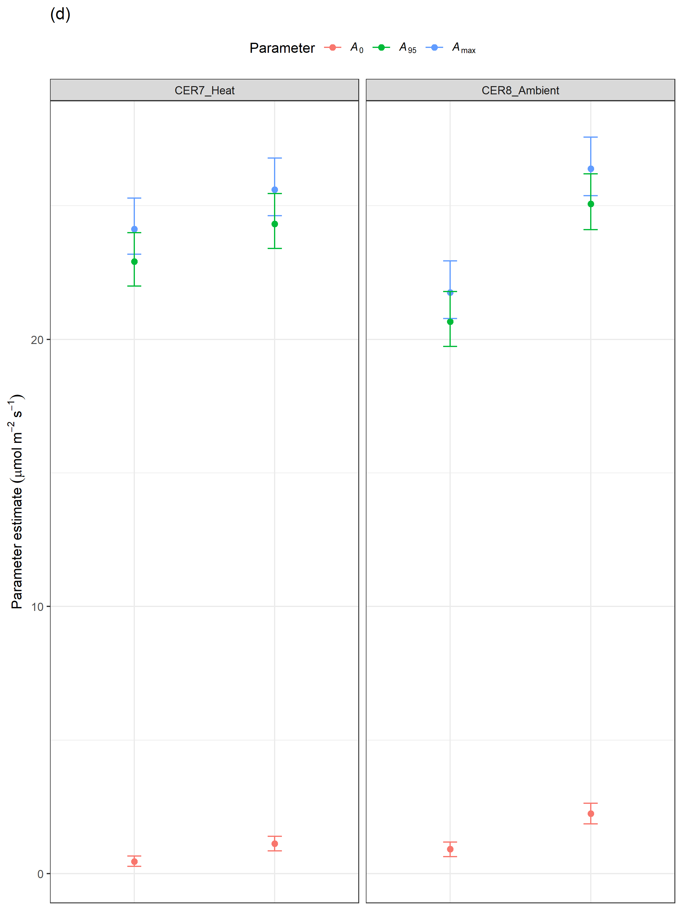

``` r
t95.A.plot <- ggplot(param.i.A %>% filter(param %in% c("t95")), 
                   aes(x = Watering, y = emmean, 
                       group = Watering)) +
  geom_point(colour = "grey50",
             stat = "identity",
             size = 2,
             position = position_dodge(width = 0.9)) +
  geom_errorbar(aes(ymin = lower.HPD, 
                    ymax = upper.HPD),
                width = 0.1,
                position = position_dodge(width = 0.9),
                colour = "grey50") +
  facet_grid( ~ Room_Temperature) +
  theme_bw() +
  scale_x_discrete(labels = scales::label_parse()) +
  scale_colour_discrete(labels = scales::label_parse(),
                        name = "Parameter")+
  xlab("Watering treatment") + 
  ylab(expression(italic("T")[95]*italic(A)~(min))) +
  theme(legend.position = "top",
        axis.title.x = element_blank(),
        axis.text.x  = element_blank(),
        axis.ticks.x = element_blank()) +
  ggtitle("(e)")
t95.A.plot
```

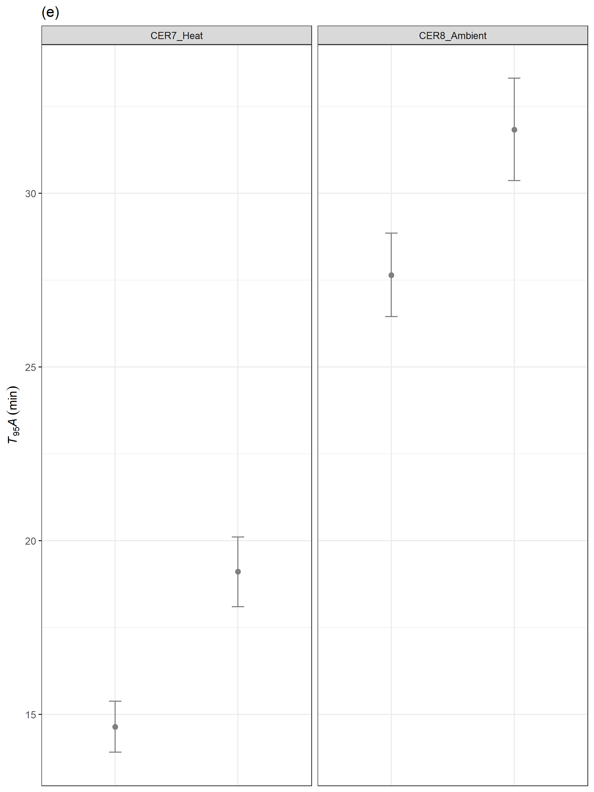

``` r
limit.A.plot <- ggplot(param.i.A %>% filter(param %in% c("Limit")), 
                     aes(x = Watering, y = emmean*100, 
                         group = Watering)) +
  geom_point(colour = "grey50",
             stat = "identity",
             size = 2,
             position = position_dodge(width = 0.9)) +
  geom_errorbar(aes(ymin = lower.HPD*100, 
                    ymax = upper.HPD*100),
                width = 0.1,
                position = position_dodge(width = 0.9),
                colour = "grey50") +
  facet_grid( ~ Room_Temperature) +
  theme_bw() +
  scale_x_discrete(labels = scales::label_parse()) +
  scale_colour_discrete(labels = scales::label_parse(),
                        name = "Parameter")+
  xlab("Watering treatment") + 
  ylab(expression(italic(g)[slimit]*italic(A)~("%"))) +
  theme(legend.position = "top") +
  ggtitle("(f)")
limit.A.plot
```

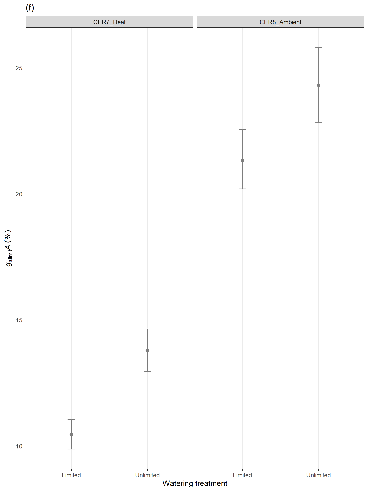

``` r
(g0.g1.plot + g0.g1.A.plot) / (ki.plot + t95.A.plot) / (Slmax.i.plot + limit.A.plot)
```

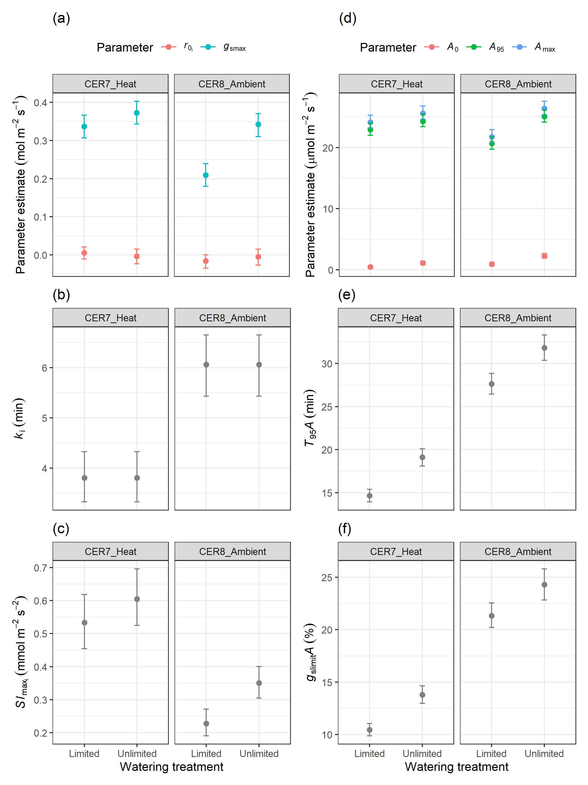

``` r
ggsave("figures/li6800_i_params.png", height = 12, width = 12)
ggsave("figures/li6800_i_params.pdf", height = 12, width = 12)
ggsave("figures/li6800_i_params.tiff", height = 12, width = 12)

##decreasing params
param.d <- li6800.all.params %>% select(Room_Temperature, Watering, grep("d_", 
                                                                         names(.))) %>%
  # bind_cols(li6800.all.params %>% select(grep("A_", names(.)),
  #                                             grep("t95", names(.)),
  #                                             grep("A95", names(.)),
  #                                             grep("Limit", names(.)))) %>%
  select(-c(grep("tabquant", names(.)))) %>% 
  pivot_longer(col = 3:ncol(.), values_to = "vals", names_to = "param") %>%
  separate(param, into = c("d", "param", "quantity"), sep="_") %>%
  pivot_wider(id_cols = c("Room_Temperature", "Watering", "d", "param"),
              names_from = "quantity", values_from = "vals")
param.d <- within(param.d,{
  paramLabel <- factor(param, levels = c("g0", "g1", "k", "lambda", "Slmax"),
                       labels = c(expression(italic(r)[0[d]]),
                                  expression(italic(g)[smin]),
                                  expression(italic(k)[d]),
                                  expression(lambda[d]),
                                  expression(italic(Sl)[max[d]])))
})

g0.g1.d.plot <- ggplot(param.d %>% filter(param %in% c("g0", "g1")), 
                     aes(x = Watering, y = emmean, 
                         group = Watering)) +
  geom_point(aes(colour = paramLabel), 
             stat = "identity",
             size = 2,
             position = position_dodge(width = 0.9)) +
  geom_errorbar(aes(ymin = lower.HPD, 
                    ymax = upper.HPD,
                    colour = paramLabel),
                width = 0.1,
                position = position_dodge(width = 0.9)) +
  facet_grid( ~ Room_Temperature) +
  theme_bw() +
  scale_x_discrete(labels = scales::label_parse()) +
  scale_colour_discrete(labels = scales::label_parse(),
                        name = "Parameter")+
  xlab("Watering treatment") + 
  ylab(expression(Parameter~estimate~(mol~m^-2~s^-1))) +
  theme(legend.position = "top",
        axis.title.x = element_blank(),
        axis.text.x  = element_blank(),
        axis.ticks.x = element_blank()) +
  ggtitle("(a)")
g0.g1.d.plot
```

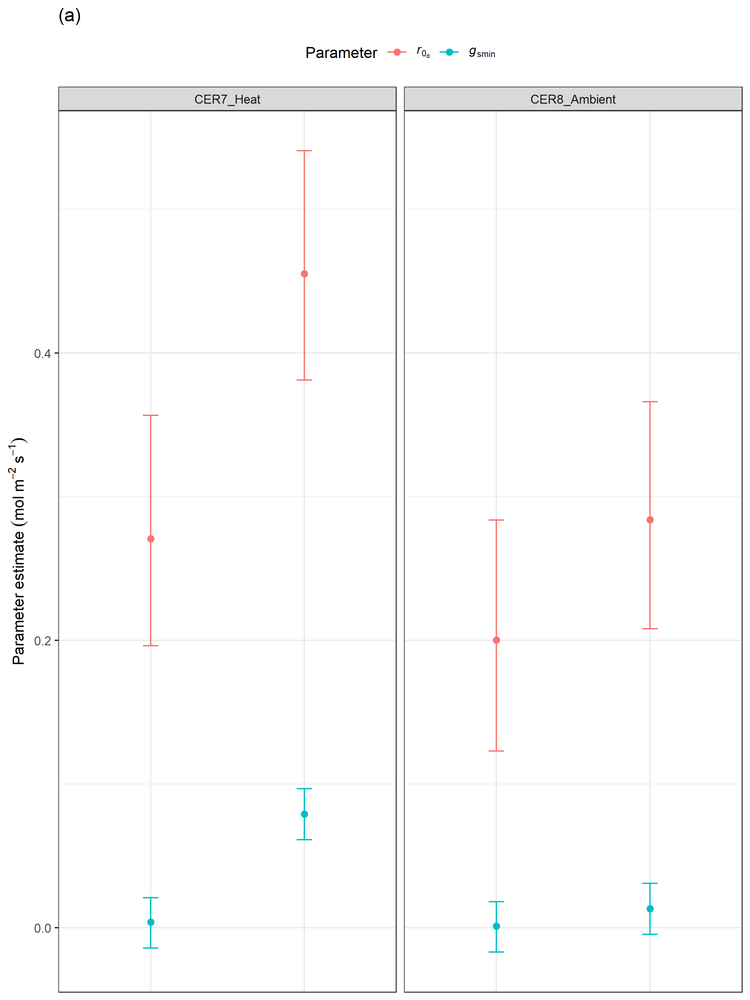

``` r
kd.plot <- ggplot(param.d %>% filter(param %in% c("k")), 
                  aes(x = Watering, y = emmean, 
                      group = Watering)) +
  geom_point(colour = "grey50", 
             stat = "identity",
             size = 2,
             position = position_dodge(width = 0.9)) +
  geom_errorbar(aes(ymin = lower.HPD, 
                    ymax = upper.HPD),
                width = 0.1,
                position = position_dodge(width = 0.9),
                colour = "grey50") +
  facet_grid( ~ Room_Temperature) +
  theme_bw() +
  scale_x_discrete(labels = scales::label_parse()) +
  scale_colour_discrete(labels = scales::label_parse(),
                        name = "Parameter")+
  xlab("Watering treatment") + 
  ylab(expression(italic(k)[d]~(min))) +
  theme(legend.position = "top",
        axis.title.x = element_blank(),
        axis.text.x  = element_blank(),
        axis.ticks.x = element_blank()) +
  ggtitle("(b)")
kd.plot
```

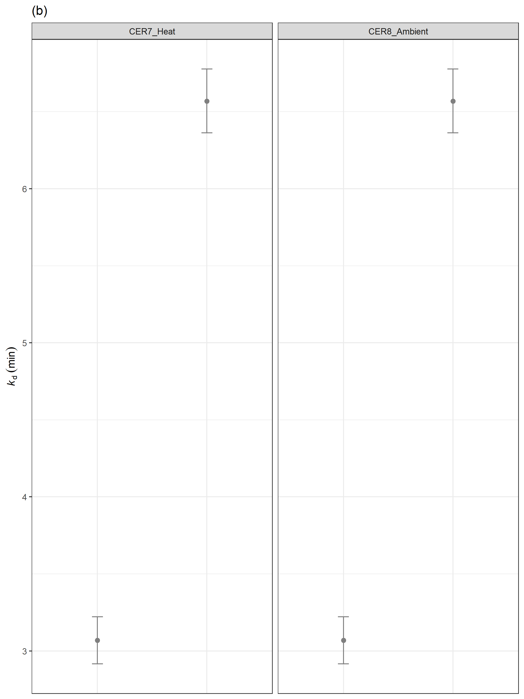

``` r
Slmax.d.plot <- ggplot(param.d %>% filter(param %in% c("Slmax")), 
                       aes(x = Watering, y = emmean, 
                           group = Watering)) +
  geom_point(colour = "grey50", 
             stat = "identity",
             size = 2,
             position = position_dodge(width = 0.9)) +
  geom_errorbar(aes(ymin = lower.HPD, 
                    ymax = upper.HPD),
                width = 0.1,
                position = position_dodge(width = 0.9),
                colour = "grey50") +
  facet_grid( ~ Room_Temperature) +
  theme_bw() +
  scale_x_discrete(labels = scales::label_parse()) +
  scale_colour_discrete(labels = scales::label_parse(),
                        name = "Parameter")+
  xlab("Watering treatment") + 
  ylab(expression(italic(Sl)[max[d]]~(mmol~m^-2~s^-2))) +
  theme(legend.position = "top") +
  ggtitle("(c)")
Slmax.d.plot
```

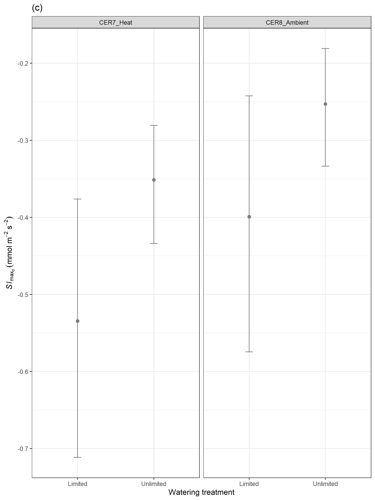

``` r
(g0.g1.d.plot) / (kd.plot) / (Slmax.d.plot)
```

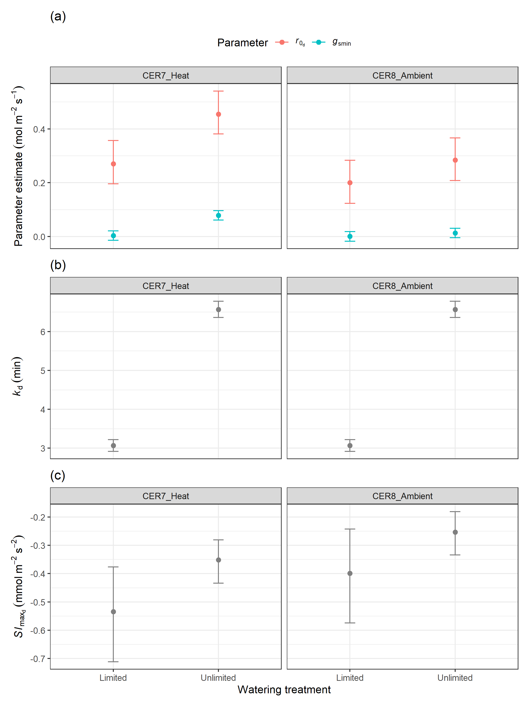

``` r
ggsave("figures/li6800_d_params.png", height = 10, width = 8)
ggsave("figures/li6800_d_params.pdf", height = 10, width = 8)
ggsave("figures/li6800_d_params.tiff", height = 10, width = 8)
```

### Put together a plot of the fits from the model for each trt combo


``` r
li6800.on.A.plot <- li6800.on.plot
li6800.on.A.plot <- within(li6800.on.A.plot, {
  Room_Temperature <- fac.recode(Room_Temperature,
                                 newlevels = c("CER7_Heat",
                                               "CER8_Ambient"))
  Watering <- fac.recode(Watering,
                         newlevels = c("Limited",
                                       "Unlimited"))
  
})

ggplot(li6800.on.A.plot, aes(tmin, A)) + 
  geom_point(alpha = 0.5, colour = "gray50") +
  geom_line(aes(y=fitted.fixed), colour = "black", linewidth = 1)+
  facet_grid(Room_Temperature ~ Watering) +
  theme_bw() +
  xlab("Time (min)")+
  ylab(expression(italic(A)~(mu*mol~m^-2~s^-1)))
```

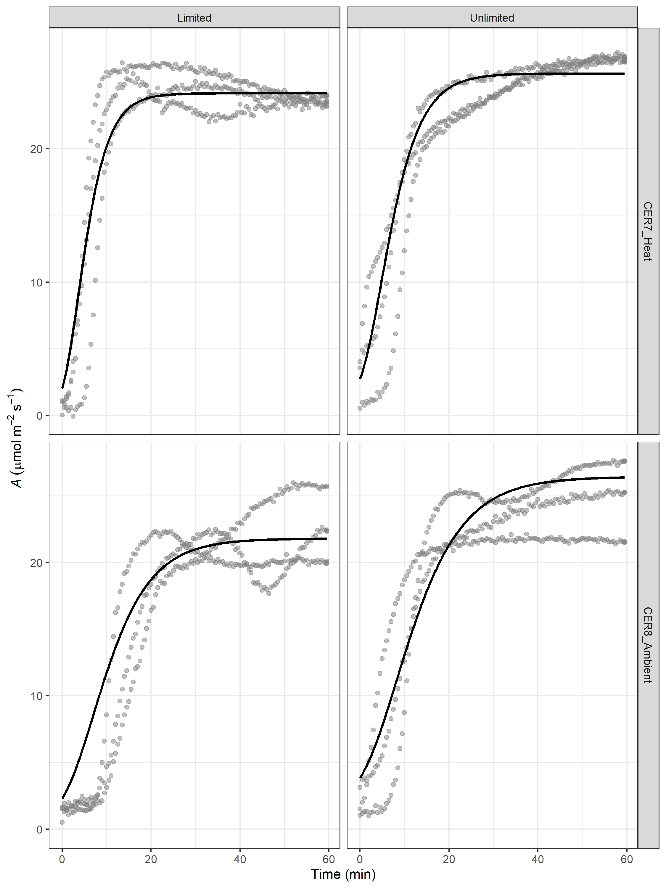

``` r
ggsave("figures/Li6800_A_FittedResponse.png", width=8, height = 8)
ggsave("figures/Li6800_A_FittedResponse.pdf", width=8, height = 8)
ggsave("figures/Li6800_A_FittedResponse.tiff", width=8, height = 8)

li6800.on.gs.plot <- li6800.on.plot
li6800.on.gs.plot <- within(li6800.on.gs.plot, {
  Room_Temperature <- fac.recode(Room_Temperature,
                                 newlevels = c("CER7_Heat",
                                               "CER8_Ambient"))
  Watering <- fac.recode(Watering,
                         newlevels = c("Limited",
                                       "Unlimited"))
  
})
li6800.on.gs.plot$fitted.fixed <- fitted(fit_on_final, re_formula = NA)[,1]

ggplot(li6800.on.gs.plot, aes(tmin, gsw)) + 
  geom_point(alpha = 0.5, colour = "gray50") +
  geom_line(aes(y=fitted.fixed), colour = "black", linewidth = 1)+
  facet_grid(Room_Temperature ~ Watering) +
  theme_bw() +
  xlab("Time (min)")+
  ylab(expression(italic(g)[s]~(mol~m^-2~s^-1)))
```

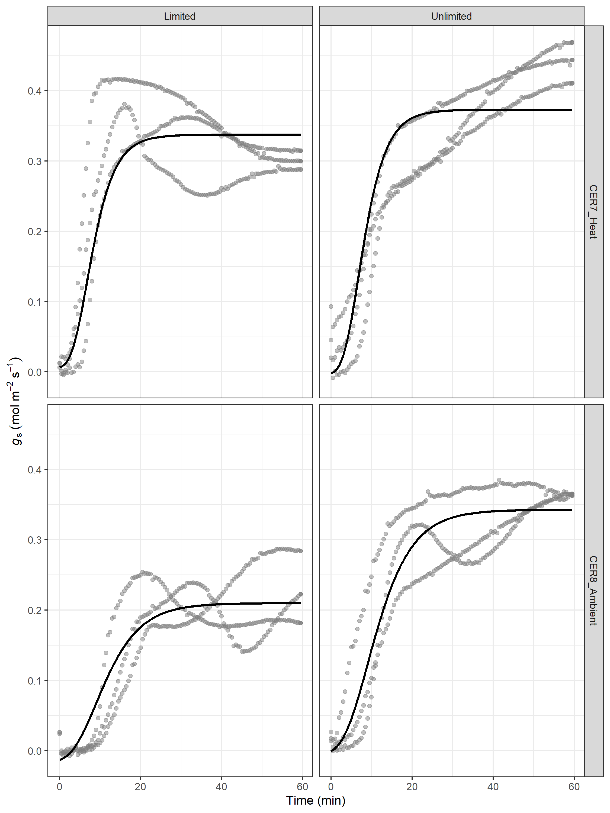

``` r
ggsave("figures/Li6800_gs_on_FittedResponse.png", width=8, height = 8)
ggsave("figures/Li6800_gs_on_FittedResponse.pdf", width=8, height = 8)
ggsave("figures/Li6800_gs_on_FittedResponse.tiff", width=8, height = 8)

li6800.off.gs.plot <- li6800.off.plot
li6800.off.gs.plot <- within(li6800.off.gs.plot, {
  Room_Temperature <- fac.recode(Room_Temperature,
                                 newlevels = c("CER7_Heat",
                                               "CER8_Ambient"))
  Watering <- fac.recode(Watering,
                         newlevels = c("Limited",
                                       "Unlimited"))
  
})
li6800.off.gs.plot$fitted.fixed <- fitted(fit_off_final, re_formula = NA)[,1]

ggplot(li6800.off.gs.plot, aes(tmin, gsw)) + 
  geom_point(alpha = 0.5, colour = "gray50") +
  geom_line(aes(y=fitted.fixed), colour = "black", linewidth = 1)+
  facet_grid(Room_Temperature ~ Watering) +
  theme_bw() +
  xlab("Time (min)")+
  ylab(expression(italic(g)[s]~(mol~m^-2~s^-1)))
```

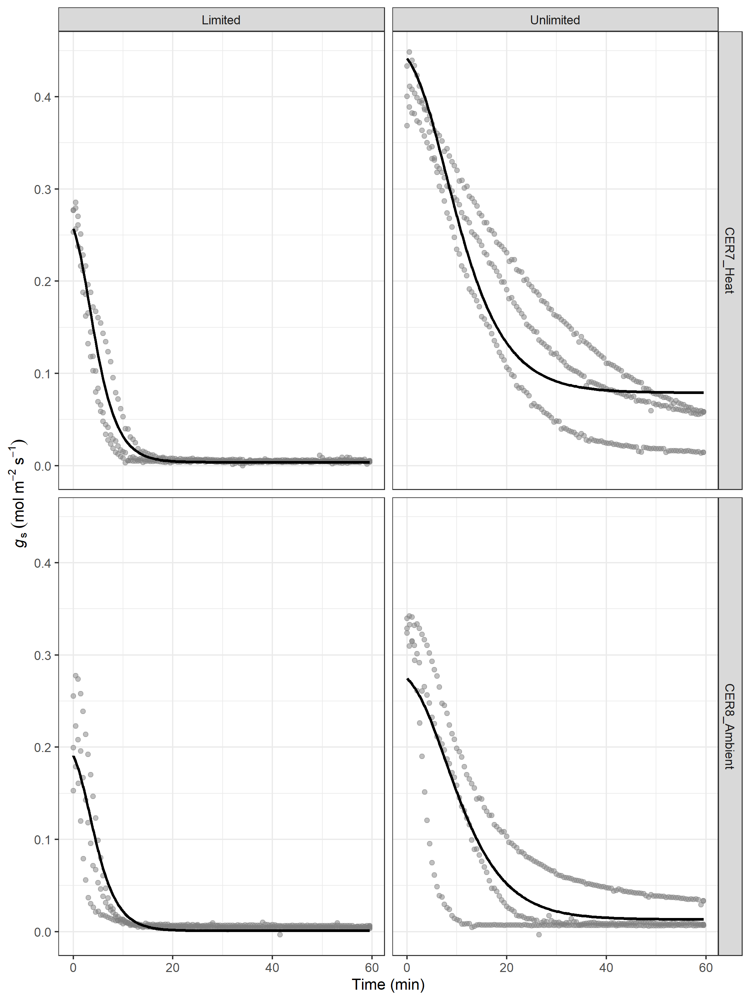

``` r
ggsave("figures/Li6800_gs_off_FittedResponse.png", width=8, height = 8)
ggsave("figures/Li6800_gs_off_FittedResponse.pdf", width=8, height = 8)
ggsave("figures/Li6800_gs_off_FittedResponse.tiff", width=8, height = 8)
```

### Put together a combined plot


``` r
li6800.gs.all.plot <- bind_rows(li6800.on.gs.plot, li6800.off.gs.plot)
li6800.gs.all.plot$Light <- factor(li6800.gs.all.plot$Light,
                                   levels = c("On", "Off"))
li6800.gs.all.plot$fitted.A <- NA
li6800.gs.all.plot$fitted.A[li6800.gs.all.plot$Light == "On"] <- li6800.on.A.plot$fitted.fixed

gs.plot <- ggplot(li6800.gs.all.plot, aes(xElapsed.min, gsw)) + 
  geom_point(alpha = 0.5, colour = "gray50", shape = 17) +
  geom_line(aes(y=fitted.fixed, group = Light, colour = Light), 
            linewidth = 1)+
  geom_vline(aes(xintercept = min(xElapsed.min[Light == "Off"])),
                 colour = "black") +
  geom_vline(data = param.i.A %>% filter(param == "t95"),
             aes(xintercept = emmean+60.5),
             linetype = "dashed") +
  scale_colour_manual(values = c("orange", "black")) +
  facet_grid(Room_Temperature ~ Watering) +
  theme_bw() +
  xlab("Time (min)")+
  ylab(expression(italic(g)[s]~(mol~m^-2~s^-1))) +
  theme(legend.position = "none",
        axis.title.x = element_blank(),
        axis.text.x  = element_blank(),
        axis.ticks.x = element_blank()) +
  ggtitle("(a)")

A.plot <- ggplot(li6800.gs.all.plot, aes(xElapsed.min, A)) + 
  geom_point(alpha = 0.5, colour = "gray50", shape = 16) +
  geom_line(aes(y=fitted.A, group = Light, colour = Light), 
            linewidth = 1)+
  geom_vline(aes(xintercept = min(xElapsed.min[Light == "Off"])),
             colour = "black") +
  geom_vline(data = param.i.A %>% filter(param == "t95"),
             aes(xintercept = emmean+60.5),
             linetype = "dashed") +
  scale_colour_manual(values = c("red", "black")) +
  facet_grid(Room_Temperature ~ Watering) +
  theme_bw() +
  xlab("Time (min)")+
  ylab(expression(italic(A)~(mu*mol~m^-2~s^-1))) +
  theme(legend.position = "none") +
  ggtitle("(b)")

gs.plot / A.plot
```

```
Warning: Removed 1451 rows containing missing values or values outside the scale range
(`geom_line()`).
```

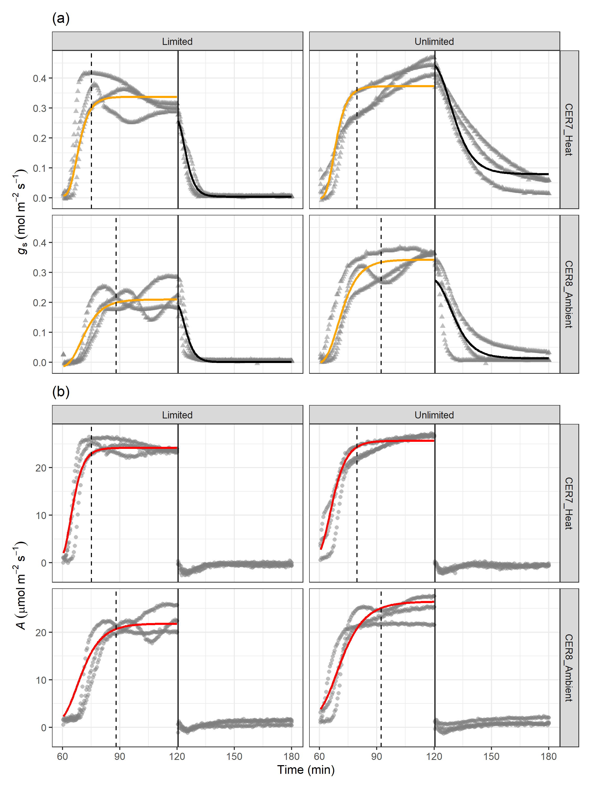

``` r
ggsave("figures/Li6800_gs.A.fitted.response.png", width=8, height = 8)
```

```
Warning: Removed 1451 rows containing missing values or values outside the scale range
(`geom_line()`).
```

``` r
ggsave("figures/Li6800_gs.A.fitted.response.pdf", width=8, height = 8)
```

```
Warning: Removed 1451 rows containing missing values or values outside the scale range
(`geom_line()`).
```

``` r
ggsave("figures/Li6800_gs.A.fitted.response.tiff", width=8, height = 8)
```

```
Warning: Removed 1451 rows containing missing values or values outside the scale range
(`geom_line()`).
```

### Put together a theoretical plot of the gs and A responses


``` r
li6800.theo.plot <- data.frame(Time = seq(from = min(li6800.gs.all.plot$xElapsed.min, na.rm = TRUE),
                                           to = max(li6800.gs.all.plot$xElapsed.min, na.rm = TRUE),
                                           length.out = 500))
li6800.theo.plot$time.adj <- li6800.theo.plot$Time - min(li6800.theo.plot$Time)

##what was the time where the light was switched off?
min(li6800.gs.all.plot$xElapsed.min[li6800.gs.all.plot$Light == "Off"], na.rm = TRUE)
```

```
[1] 120.5
```

``` r
li6800.theo.plot$Light <- "On"
li6800.theo.plot$Light[li6800.theo.plot$Time >= 120.5] <- "Off"

##add A response
li6800.theo.plot$A.resp <-  1.192237 + (24.46462 -  1.192237)*exp(-exp(((-li6800.theo.plot$time.adj/5.957095)+1)))
##what was the mean observed value of A when the light was off?
summary(li6800.gs.all.plot$A[li6800.gs.all.plot$Light == "Off"])
```

```
    Min.  1st Qu.   Median     Mean  3rd Qu.     Max. 
-2.64913 -0.62025 -0.10140  0.02182  0.71213  2.33809 
```

``` r
li6800.theo.plot$A.resp[li6800.theo.plot$Light == "Off"] <- 0.02

##add gs responses
li6800.theo.plot$gs.i.resp <-  -0.004365413 + (0.3152114 -  -0.004365413)*exp(-exp((((2.92598-li6800.theo.plot$time.adj)/4.936533)+1)))
li6800.theo.plot$gs.i.resp[li6800.theo.plot$Light == "Off"] <- NA

li6800.theo.plot$gs.d.resp <-  0.33 + (0.02427425 -  0.33)*exp(-exp((((0.6671626-li6800.theo.plot$time.adj)/4.818909)+1)))
li6800.theo.plot$gs.d.resp[li6800.theo.plot$Light == "Off"] <- li6800.theo.plot$gs.d.resp[li6800.theo.plot$Light == "On"]
```

```
Warning in li6800.theo.plot$gs.d.resp[li6800.theo.plot$Light == "Off"] <-
li6800.theo.plot$gs.d.resp[li6800.theo.plot$Light == : number of items to replace is not
a multiple of replacement length
```

``` r
li6800.theo.plot$gs.d.resp[li6800.theo.plot$Light == "On"] <- NA

##solve the above equation for t95 and then for A95
-5.957095*(log(-log((0.95*24.46462 - 1.192237)/(24.46462-1.192237)))-1) ##23.34524
```

```
[1] 23.34524
```

``` r
1.192237 + (24.46462 -  1.192237)*exp(-exp(((-23.34524/5.957095)+1))) ##23.24139
```

```
[1] 23.24139
```

``` r
##figure out what Slmax is and where it occurs
(0.3152114 - -0.004365413) / (exp(1) * 4.936533) ##0.02381545
```

```
[1] 0.02381545
```

``` r
(0.02427425 - 0.33) / (exp(1) * 4.818909) ##-0.02333935
```

```
[1] -0.02333935
```

``` r
##great, so the maximum rate of change occurs at t = lambda + k
2.92598+4.936533 ##7.862513
```

```
[1] 7.862513
```

``` r
0.6671626+4.818909 ##5.486072
```

```
[1] 5.486072
```

``` r
##what's the value of the function at this time?
-0.004365413 + (0.3152114 -  -0.004365413)*exp(-exp((((2.92598-7.862513)/4.936533)+1))) ##0.1132003
```

```
[1] 0.1132003
```

``` r
0.33 + (0.02427425 -  0.33)*exp(-exp((((0.6671626-5.486072)/4.818909)+1))) ## 0.2175298
```

```
[1] 0.2175298
```

``` r
gs.theo.plot <- ggplot(li6800.theo.plot, aes(Time, gs.i.resp)) + 
  geom_point(colour = "orange", shape = 17) +
  geom_line(colour = "orange") +
  geom_point(aes(y=gs.d.resp), colour = "black", shape = 17) +
  geom_line(aes(y=gs.d.resp), colour = "black") +
  geom_vline(aes(xintercept = min(Time[Light == "Off"])),
             colour = "black") +
  geom_vline(aes(xintercept = 23.34524+60.5), colour = "black", linetype = "dashed") +
  geom_abline(aes(intercept = 0.1132003 - 0.02381545*(7.862513+60.5), slope = 0.02381545),
              linetype = "dotdash", linewidth = 0.75, colour = "brown") +
  geom_abline(aes(intercept = 0.2175298 - -0.02333935*(5.486072+120.6176), slope =-0.02333935),
              linetype = "dotdash", linewidth = 0.75, colour = "grey75") +
  theme_bw() +
  xlab("Time (min)")+
  ylab(expression(italic(g)[s]~(mol~m^-2~s^-1))) +
  theme(legend.position = "none",
        axis.title.x = element_blank(),
        axis.text.x  = element_blank(),
        axis.ticks.x = element_blank()) +
  ggtitle("(a)")

A.theo.plot <- ggplot(li6800.theo.plot, aes(Time, A.resp)) + 
  geom_point(colour = "red", shape = 16) +
  geom_line(colour = "red") +
  geom_vline(aes(xintercept = min(Time[Light == "Off"])),
             colour = "black") +
  geom_vline(aes(xintercept = 23.34524+60.5), colour = "black", linetype = "dashed") +
  geom_hline(aes(yintercept = 23.24139), colour = "black", linetype = "dashed") +
  theme_bw() +
  xlab("Time (min)")+
  ylab(expression(italic(A)~(mu*mol~m^-2~s^-1))) +
  theme(legend.position = "none") +
  ggtitle("(b)")

gs.theo.plot / A.theo.plot
```

```
Warning: Removed 249 rows containing missing values or values outside the scale range
(`geom_point()`).
```

```
Warning: Removed 249 rows containing missing values or values outside the scale range
(`geom_line()`).
```

```
Warning: Removed 251 rows containing missing values or values outside the scale range
(`geom_point()`).
```

```
Warning: Removed 251 rows containing missing values or values outside the scale range
(`geom_line()`).
```

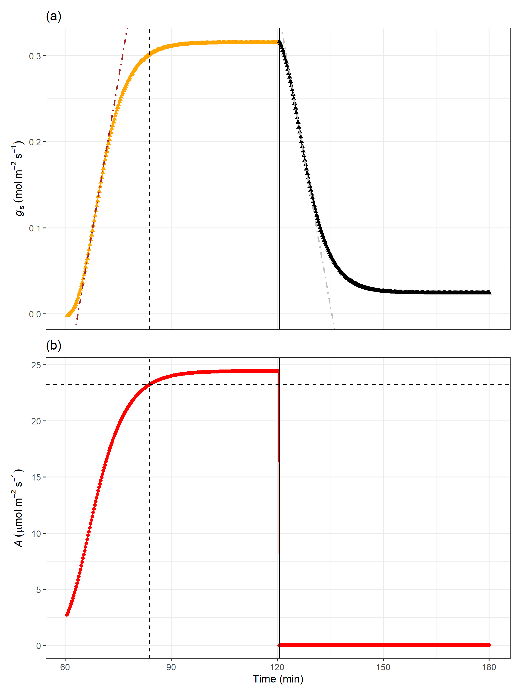

``` r
ggsave("figures/SchematicResponse.png", width=8, height = 8)
```

```
Warning: Removed 249 rows containing missing values or values outside the scale range
(`geom_point()`).
```

```
Warning: Removed 249 rows containing missing values or values outside the scale range
(`geom_line()`).
```

```
Warning: Removed 251 rows containing missing values or values outside the scale range
(`geom_point()`).
```

```
Warning: Removed 251 rows containing missing values or values outside the scale range
(`geom_line()`).
```

``` r
ggsave("figures/SchematicResponse.pdf", width=8, height = 8)
```

```
Warning: Removed 249 rows containing missing values or values outside the scale range
(`geom_point()`).
```

```
Warning: Removed 249 rows containing missing values or values outside the scale range
(`geom_line()`).
```

```
Warning: Removed 251 rows containing missing values or values outside the scale range
(`geom_point()`).
```

```
Warning: Removed 251 rows containing missing values or values outside the scale range
(`geom_line()`).
```

``` r
ggsave("figures/SchematicResponse.tiff", width=8, height = 8)
```

```
Warning: Removed 249 rows containing missing values or values outside the scale range
(`geom_point()`).
```

```
Warning: Removed 249 rows containing missing values or values outside the scale range
(`geom_line()`).
```

```
Warning: Removed 251 rows containing missing values or values outside the scale range
(`geom_point()`).
```

```
Warning: Removed 251 rows containing missing values or values outside the scale range
(`geom_line()`).
```

### Save data and export


``` r
save.image(saveFile)
```

