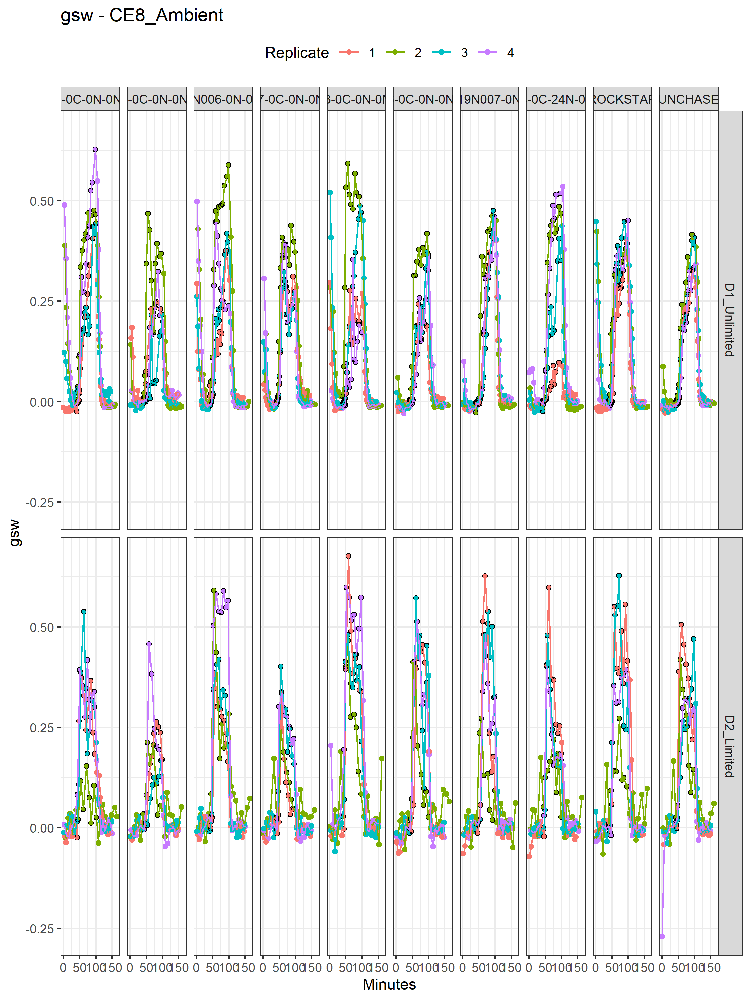
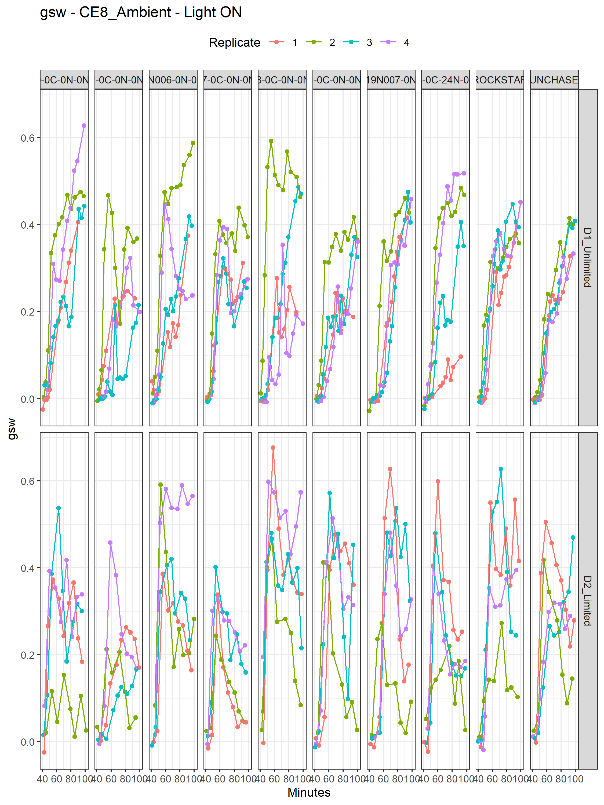
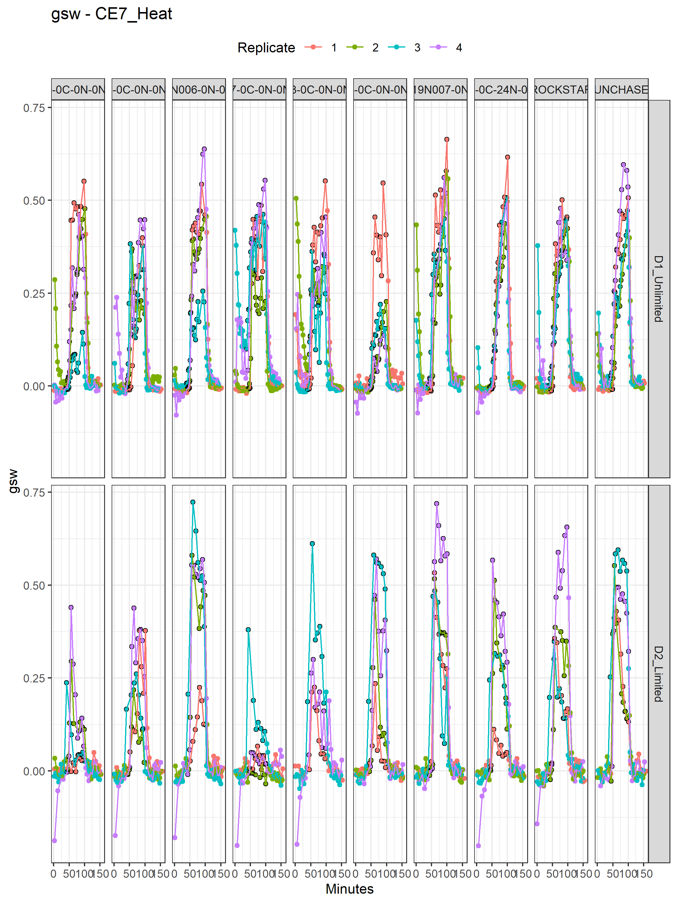
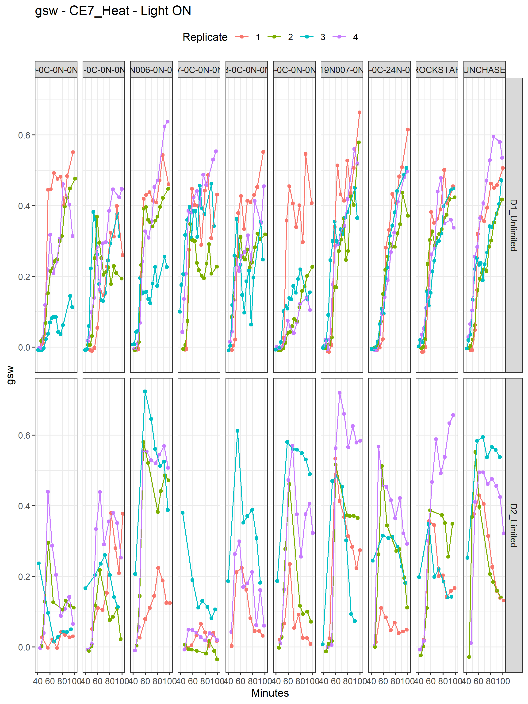

---
output:
  pdf_document: default
  html_document: default
---
# Wheat stomatal kinetics (heat & drought)
## --- Ed Chaplin (USyd), *Apr--June 2025* ---
### Porometer DATA

* Importing porometer data obtained from handheld Li-600 device
* There are individual tabs for each treatment sampled with the Li-600, accompanied by a All Data Compiled tab
* All reps were used for Li-600 measurements
* The key data parameter to assess is 'gsw' (which we can refer to as 'gs') (Column AS)
* The light level (off and on) is denoted in column AQ
* Measurements in each day were taken by two Operators (Operators confounded with Watering trts)
* Lines within Chambers and Watering trts were measured repeatedly in a systematic way by doing laps on the pots
* I've defined a time.elapsed variable to measure the overall time taken by each Operator during the sampling window
* The times that the lights were on and off for each Operator do vary slightly

### Load the libraries


``` r
library(knitr)
#knitr::spin("porometer.import.v1.r")
library(ggplot2)
opts_chunk$set("tidy" = FALSE, "dev" = "png", "dpi" = 300, 
               "fig.width" = 7.5, "fig.height" = 10, "comment"=NA, fig.path = "figures/")
library(dplyr)
```

### Set up constants and files


``` r
options(width=90)
inputFile <- "../data/Porometer Data - 20250701.xlsx"
writeFile  <- "../data/porometer.v1.Rdata"
```

### Read in the porometer data from the All Data Compiled tab


``` r
li600.dat <- suppressMessages(readxl::read_xlsx(inputFile,
                         sheet = "All Data Compiled",
                         col_names = FALSE)[,c(1:28, 35:38, 43:45)])

##tidy up
colnames(li600.dat) <- li600.dat[1,]
colnames(li600.dat)[c(1:2, 29:35)] <- c("Sample.ID", "Barcode.ID",
                               "ObsNum", "Time", "MinsFromStart","Date_Sys",
                               "Light", "Lap", "gsw")
li600.dat <- li600.dat %>% slice(-c(1:3))

##convert variables to appropriate format
li600.dat <- li600.dat %>% mutate(across(c("gsw", "Order", "Lap", "MinsFromStart", "ObsNum",
                                           "CEBPosition", "CEBBlock","CEBSubUnit", "CEBCell",
                                           "CEBPCoord", "Replicate", "Entry"),
                                         as.numeric)) %>% as.data.frame()

##Date variable is incorrect - use Data_Sys instead, but this also contains errors
##Email from Ed confirms that changes need to be made to the Date_Sys column
##From Ed: 1.	Heat_Limited_1 should be 2025-06-13 NOT 2025-06-12
##         2.	Ambient_Limited_4 should be 2025-06-16 NOT 2025-06-15 
li600.dat$Date_Sys[li600.dat$Temperature == "Heat" &
                     li600.dat$Watering == "Limited" &
                     li600.dat$Replicate == 1] <- "2025-06-13"
li600.dat$Date_Sys[li600.dat$Temperature == "Ambient" &
                     li600.dat$Watering == "Limited" &
                     li600.dat$Replicate == 4] <- "2025-06-16"

li600.dat$Date_Sys<- lubridate::ymd(li600.dat$Date_Sys)
li600.dat$Timestamp <- paste(li600.dat$Date_Sys, li600.dat$Time)
li600.dat$Timestamp <- lubridate::ymd_hms(li600.dat$Timestamp)
str(li600.dat)
```

```
'data.frame':	5003 obs. of  36 variables:
 $ Sample.ID    : chr  "1_Heat_Limited_1_T21_CER7_B_3_N_T21R01" "1_Heat_Limited_1_T21_CER7_B_3_N_T21R01" "1_Heat_Limited_1_T21_CER7_B_3_N_T21R01" "1_Heat_Limited_1_T21_CER7_B_3_N_T21R01" ...
 $ Barcode.ID   : chr  "T21R01_CER7_B_3_N_T21_1_Heat_Limited_SUNCHASER_L01" "T21R01_CER7_B_3_N_T21_1_Heat_Limited_SUNCHASER_L01" "T21R01_CER7_B_3_N_T21_1_Heat_Limited_SUNCHASER_L01" "T21R01_CER7_B_3_N_T21_1_Heat_Limited_SUNCHASER_L01" ...
 $ Pot.ID       : chr  "T21R01" "T21R01" "T21R01" "T21R01" ...
 $ CEBCell.ID   : chr  "BCER7B03" "BCER7B03" "BCER7B03" "BCER7B03" ...
 $ CEBRoom      : chr  "CER7" "CER7" "CER7" "CER7" ...
 $ CEBLane      : chr  "B" "B" "B" "B" ...
 $ CEBPosition  : num  3 3 3 3 3 3 3 3 3 3 ...
 $ CEBPCoord    : num  3.5 3.5 3.5 3.5 3.5 3.5 3.5 3.5 3.5 3.5 ...
 $ CEBSide      : chr  "N" "N" "N" "N" ...
 $ CEBLocation  : chr  "Inner" "Inner" "Inner" "Inner" ...
 $ CEBBlock     : num  1 1 1 1 1 1 1 1 1 1 ...
 $ CEBSubUnit   : num  1 1 1 1 1 1 1 1 1 1 ...
 $ CEBCell      : num  10 10 10 10 10 10 10 10 10 10 ...
 $ Treatment    : chr  "T21" "T21" "T21" "T21" ...
 $ Replicate    : num  1 1 1 1 1 1 1 1 1 1 ...
 $ Temperature  : chr  "Heat" "Heat" "Heat" "Heat" ...
 $ Watering     : chr  "Limited" "Limited" "Limited" "Limited" ...
 $ Line         : chr  "SUNCHASER" "SUNCHASER" "SUNCHASER" "SUNCHASER" ...
 $ Line.ID      : chr  "L01" "L01" "L01" "L01" ...
 $ Entry        : num  1 1 1 1 1 1 1 1 1 1 ...
 $ AWatering    : chr  "rest" "rest" "rest" "rest" ...
 $ HWatering    : chr  "Limited" "Limited" "Limited" "Limited" ...
 $ ALine        : chr  "rest" "rest" "rest" "rest" ...
 $ HLine        : chr  "SUNCHASER" "SUNCHASER" "SUNCHASER" "SUNCHASER" ...
 $ Order        : num  8 8 8 8 8 8 8 8 8 8 ...
 $ Barcode      : chr  "T21R01_CER7_B_3_N_T21_1_Heat_Limited_SUNCHASER_L01" "T21R01_CER7_B_3_N_T21_1_Heat_Limited_SUNCHASER_L01" "T21R01_CER7_B_3_N_T21_1_Heat_Limited_SUNCHASER_L01" "T21R01_CER7_B_3_N_T21_1_Heat_Limited_SUNCHASER_L01" ...
 $ Date         : chr  "20251013" "20251013" "20251013" "20251013" ...
 $ Operator     : chr  "Fiona" "Fiona" "Fiona" "Fiona" ...
 $ ObsNum       : num  10 20 30 40 49 60 70 80 90 100 ...
 $ Time         : chr  "09:26:31" "09:36:20" "09:43:22" "09:53:12" ...
 $ MinsFromStart: num  9.48 19.3 26.33 36.17 43.35 ...
 $ Date_Sys     : Date, format: "2025-06-13" "2025-06-13" ...
 $ Light        : chr  "Off" "Off" "Off" "Off" ...
 $ Lap          : num  1 2 3 4 5 6 6 7 8 9 ...
 $ gsw          : num  -0.00105 -0.0102 -0.00548 0.00394 -0.00769 ...
 $ Timestamp    : POSIXct, format: "2025-06-13 09:26:31" "2025-06-13 09:36:20" ...
```

``` r
## Correct Operator variable
li600.dat$Operator[li600.dat$Operator == "Fiona Nourish"] <- "Fiona"

##calculate time difference between each observation
li600.dat <- li600.dat[order(li600.dat$Date_Sys, li600.dat$Operator, li600.dat$Timestamp),]
li600.dat <- li600.dat %>% group_by(Date_Sys, Operator) %>% 
  mutate(time.diff = as.numeric(Timestamp - lag(Timestamp, 
                                                default = first(Timestamp)))/60,
         time.elapsed = cumsum(time.diff)) %>% as.data.frame()

head(li600.dat)
```

```
                                      Sample.ID
1   7_Ambient_Unlimited_2_T17_CER8_F_8_S_T17R02
2   4_Ambient_Unlimited_2_T14_CER8_F_9_S_T14R02
3 10_Ambient_Unlimited_2_T20_CER8_F_10_S_T20R02
4  1_Ambient_Unlimited_2_T11_CER8_F_11_S_T11R02
5  5_Ambient_Unlimited_2_T15_CER8_F_12_S_T15R02
6  2_Ambient_Unlimited_2_T12_CER8_F_13_S_T12R02
                                                                  Barcode.ID Pot.ID
1              T17R02_CER8_F_8_S_T17_2_Ambient_Unlimited_PBI19N007-0N-3N_L07 T17R02
2   T14R02_CER8_F_9_S_T14_2_Ambient_Unlimited_PBI17N013-0C-0N-0N-010N-8N_L04 T14R02
3 T20R02_CER8_F_10_S_T20_2_Ambient_Unlimited_PBI17N002-0C-0N-0N-010N-16N_L10 T20R02
4                   T11R02_CER8_F_11_S_T11_2_Ambient_Unlimited_SUNCHASER_L01 T11R02
5 T15R02_CER8_F_12_S_T15_2_Ambient_Unlimited_PBIC15034-0C-24N-010N-1N-0N_L05 T15R02
6                    T12R02_CER8_F_13_S_T12_2_Ambient_Unlimited_ROCKSTAR_L02 T12R02
  CEBCell.ID CEBRoom CEBLane CEBPosition CEBPCoord CEBSide CEBLocation CEBBlock
1   BCER8F08    CER8       F           8         8       S       Inner        2
2   BCER8F09    CER8       F           9         9       S       Inner        2
3   BCER8F10    CER8       F          10        10       S       Inner        2
4   BCER8F11    CER8       F          11        11       S       Inner        2
5   BCER8F12    CER8       F          12        12       S       Inner        2
6   BCER8F13    CER8       F          13        13       S       Inner        2
  CEBSubUnit CEBCell Treatment Replicate Temperature  Watering
1          2       4       T17         2     Ambient Unlimited
2          2       5       T14         2     Ambient Unlimited
3          2       6       T20         2     Ambient Unlimited
4          2       7       T11         2     Ambient Unlimited
5          2       8       T15         2     Ambient Unlimited
6          2       9       T12         2     Ambient Unlimited
                         Line Line.ID Entry AWatering HWatering
1             PBI19N007-0N-3N     L07     7 Unlimited      rest
2  PBI17N013-0C-0N-0N-010N-8N     L04     4 Unlimited      rest
3 PBI17N002-0C-0N-0N-010N-16N     L10    10 Unlimited      rest
4                   SUNCHASER     L01     1 Unlimited      rest
5 PBIC15034-0C-24N-010N-1N-0N     L05     5 Unlimited      rest
6                    ROCKSTAR     L02     2 Unlimited      rest
                        ALine HLine Order
1             PBI19N007-0N-3N  rest   142
2  PBI17N013-0C-0N-0N-010N-8N  rest   145
3 PBI17N002-0C-0N-0N-010N-16N  rest   148
4                   SUNCHASER  rest   151
5 PBIC15034-0C-24N-010N-1N-0N  rest   154
6                    ROCKSTAR  rest   157
                                                                     Barcode     Date
1              T17R02_CER8_F_8_S_T17_2_Ambient_Unlimited_PBI19N007-0N-3N_L07 20250612
2   T14R02_CER8_F_9_S_T14_2_Ambient_Unlimited_PBI17N013-0C-0N-0N-010N-8N_L04 20250612
3 T20R02_CER8_F_10_S_T20_2_Ambient_Unlimited_PBI17N002-0C-0N-0N-010N-16N_L10 20250612
4                   T11R02_CER8_F_11_S_T11_2_Ambient_Unlimited_SUNCHASER_L01 20250612
5 T15R02_CER8_F_12_S_T15_2_Ambient_Unlimited_PBIC15034-0C-24N-010N-1N-0N_L05 20250612
6                    T12R02_CER8_F_13_S_T12_2_Ambient_Unlimited_ROCKSTAR_L02 20250612
  Operator ObsNum     Time MinsFromStart   Date_Sys Light Lap          gsw
1       Ed      1 09:16:56      0.000000 2025-06-12   Off   1 -0.001792405
2       Ed      2 09:18:38      1.700000 2025-06-12   Off   1  0.283377944
3       Ed      3 09:19:10      2.233333 2025-06-12   Off   1  0.141922039
4       Ed      4 09:19:32      2.600000 2025-06-12   Off   1  0.086986667
5       Ed      5 09:20:03      3.116667 2025-06-12   Off   1  0.034038650
6       Ed      6 09:20:36      3.666667 2025-06-12   Off   1  0.423911155
            Timestamp time.diff time.elapsed
1 2025-06-12 09:16:56 0.0000000     0.000000
2 2025-06-12 09:18:38 1.7000000     1.700000
3 2025-06-12 09:19:10 0.5333333     2.233333
4 2025-06-12 09:19:32 0.3666667     2.600000
5 2025-06-12 09:20:03 0.5166667     3.116667
6 2025-06-12 09:20:36 0.5500000     3.666667
```

``` r
nrow(li600.dat) #5003
```

```
[1] 5003
```

### Understand the structure in the measurments
* Ed says, One complete replicate from one growth chamber (heat or ambient) was sampled per day
* Within each phase, stomatal conductance was recorded sequentially by moving from plant to plant, continuously within the phase, collecting approximately 10-15 measurements per plant per phase.
* To increase the temporal resolution of measurements, two operators with two porometers sampled plants concurrently.
* One operator measured the well watered treatment (10 plants) while the other measured the drought treatment (10 plants) within the same replicate. 


``` r
table(li600.dat$Date_Sys)
```

```

2025-06-12 2025-06-13 2025-06-16 2025-06-17 2025-06-18 2025-06-19 2025-06-20 2025-06-23 
       590        570        570        570        630        680        683        710 
```

``` r
table(li600.dat$Treatment, li600.dat$Date_Sys)
```

```
     
      2025-06-12 2025-06-13 2025-06-16 2025-06-17 2025-06-18 2025-06-19 2025-06-20
  T01         21          0         22          0         26         27          0
  T02         21          0         22          0         26         27          0
  T03         21          0         22          0         26         27          0
  T04         21          0         22          0         26         27          0
  T05         21          0         22          0         26         27          0
  T06         21          0         22          0         26         27          0
  T07         21          0         22          0         26         27          0
  T08         21          0         22          0         26         27          0
  T09         21          0         22          0         26         27          0
  T10         21          0         22          0         26         27          0
  T11         38          0         35          0         37         41          0
  T12         38          0         35          0         37         41          0
  T13         38          0         35          0         37         41          0
  T14         38          0         35          0         37         41          0
  T15         38          0         35          0         37         41          0
  T16         38          0         35          0         37         41          0
  T17         38          0         35          0         37         41          0
  T18         38          0         35          0         37         41          0
  T19         38          0         35          0         37         41          0
  T20         38          0         35          0         37         41          0
  T21          0         21          0         23          0          0         27
  T22          0         21          0         23          0          0         27
  T23          0         21          0         23          0          0         27
  T24          0         21          0         23          0          0          0
  T25          0         21          0         23          0          0         27
  T26          0         21          0         23          0          0         27
  T27          0         21          0         23          0          0         27
  T28          0         21          0         23          0          0         27
  T29          0         21          0         23          0          0         27
  T30          0         21          0         23          0          0         27
  T31          0         36          0         34          0          0         44
  T32          0         36          0         34          0          0         44
  T33          0         36          0         34          0          0         44
  T34          0         36          0         34          0          0         44
  T35          0         36          0         34          0          0         44
  T36          0         36          0         34          0          0         44
  T37          0         36          0         34          0          0         44
  T38          0         36          0         34          0          0         44
  T39          0         36          0         34          0          0         44
  T40          0         36          0         34          0          0         44
     
      2025-06-23
  T01          0
  T02          0
  T03          0
  T04          0
  T05          0
  T06          0
  T07          0
  T08          0
  T09          0
  T10          0
  T11          0
  T12          0
  T13          0
  T14          0
  T15          0
  T16          0
  T17          0
  T18          0
  T19          0
  T20          0
  T21         27
  T22         27
  T23         27
  T24         27
  T25         27
  T26         27
  T27         27
  T28         27
  T29         27
  T30         27
  T31         44
  T32         44
  T33         44
  T34         44
  T35         44
  T36         44
  T37         44
  T38         44
  T39         44
  T40         44
```

``` r
table(li600.dat$Treatment, li600.dat$Operator)
```

```
     
       Ed Fiona Matteo Pooja
  T01   0    75     21     0
  T02   0    75     21     0
  T03   0    75     21     0
  T04   0    75     21     0
  T05   0    75     21     0
  T06   0    75     21     0
  T07   0    75     21     0
  T08   0    75     21     0
  T09   0    75     21     0
  T10   0    75     21     0
  T11 151     0      0     0
  T12 151     0      0     0
  T13 151     0      0     0
  T14 151     0      0     0
  T15 151     0      0     0
  T16 151     0      0     0
  T17 151     0      0     0
  T18 151     0      0     0
  T19 151     0      0     0
  T20 151     0      0     0
  T21   0    75      0    23
  T22   0    75      0    23
  T23   0    75      0    23
  T24   0    48      0    23
  T25   0    75      0    23
  T26   0    75      0    23
  T27   0    75      0    23
  T28   0    75      0    23
  T29   0    75      0    23
  T30   0    75      0    23
  T31 158     0      0     0
  T32 158     0      0     0
  T33 158     0      0     0
  T34 158     0      0     0
  T35 158     0      0     0
  T36 158     0      0     0
  T37 158     0      0     0
  T38 158     0      0     0
  T39 158     0      0     0
  T40 158     0      0     0
```

``` r
##this demonstrates confounding between Operator and Treatment - need to keep this in mind for models
table(li600.dat$Date_Sys, li600.dat$CEBRoom)
```

```
            
             CER7 CER8
  2025-06-12    0  590
  2025-06-13  570    0
  2025-06-16    0  570
  2025-06-17  570    0
  2025-06-18    0  630
  2025-06-19    0  680
  2025-06-20  683    0
  2025-06-23  710    0
```

``` r
table(li600.dat$Date_Sys, li600.dat$Temperature)
```

```
            
             Ambient Heat
  2025-06-12     590    0
  2025-06-13       0  570
  2025-06-16     570    0
  2025-06-17       0  570
  2025-06-18     630    0
  2025-06-19     680    0
  2025-06-20       0  683
  2025-06-23       0  710
```

``` r
table(li600.dat$Date_Sys, li600.dat$Watering)
```

```
            
             Limited Unlimited
  2025-06-12     210       380
  2025-06-13     210       360
  2025-06-16     220       350
  2025-06-17     230       340
  2025-06-18     260       370
  2025-06-19     270       410
  2025-06-20     243       440
  2025-06-23     270       440
```

``` r
table(li600.dat$Date_Sys, li600.dat$Line)
```

```
            
             PBI16C009-0C-0N-0N-010N-14N PBI17N002-0C-0N-0N-010N-16N PBI17N006-0N-0N-89N
  2025-06-12                          59                          59                  59
  2025-06-13                          57                          57                  57
  2025-06-16                          57                          57                  57
  2025-06-17                          57                          57                  57
  2025-06-18                          63                          63                  63
  2025-06-19                          68                          68                  68
  2025-06-20                          71                          71                  71
  2025-06-23                          71                          71                  71
            
             PBI17N007-0C-0N-0N-010N-8N PBI17N013-0C-0N-0N-010N-8N
  2025-06-12                         59                         59
  2025-06-13                         57                         57
  2025-06-16                         57                         57
  2025-06-17                         57                         57
  2025-06-18                         63                         63
  2025-06-19                         68                         68
  2025-06-20                         71                         44
  2025-06-23                         71                         71
            
             PBI17N016-0C-0N-0N-010N-27N PBI19N007-0N-3N PBIC15034-0C-24N-010N-1N-0N
  2025-06-12                          59              59                          59
  2025-06-13                          57              57                          57
  2025-06-16                          57              57                          57
  2025-06-17                          57              57                          57
  2025-06-18                          63              63                          63
  2025-06-19                          68              68                          68
  2025-06-20                          71              71                          71
  2025-06-23                          71              71                          71
            
             ROCKSTAR SUNCHASER
  2025-06-12       59        59
  2025-06-13       57        57
  2025-06-16       57        57
  2025-06-17       57        57
  2025-06-18       63        63
  2025-06-19       68        68
  2025-06-20       71        71
  2025-06-23       71        71
```

``` r
table(li600.dat$Date_Sys, li600.dat$Replicate)
```

```
            
               1   2   3   4
  2025-06-12   0 590   0   0
  2025-06-13 570   0   0   0
  2025-06-16   0   0   0 570
  2025-06-17   0   0   0 570
  2025-06-18 630   0   0   0
  2025-06-19   0   0 680   0
  2025-06-20   0 683   0   0
  2025-06-23   0   0 710   0
```

``` r
##confounding between Dates and Room_Temperature, along with Replicate

##Define some new variables
li600.dat$Device <- 1
li600.dat$Device[li600.dat$Operator != "Ed"] <- 2

li600.dat <- within(li600.dat, {
  Room_Temperature <- paste(CEBRoom, Temperature, sep="_")
  Operator_Watering <- paste(Operator, Watering, sep="_")
  Device_Watering <- paste(paste0("D", Device), Watering, sep="_")
})
```

### Format variables


``` r
li600.dat <- within(li600.dat, {
  CEBRoom <- factor(CEBRoom)
  CEBLane <- factor(CEBLane)
  CEBPosition <- factor(CEBPosition)
  CEBSide <- factor(CEBSide)
  CEBLocation <- factor(CEBLocation)
  CEBBlock <- factor(CEBBlock)
  CEBSubUnit <- factor(CEBSubUnit)
  CEBCell <- factor(CEBCell)
  Treatment <- factor(Treatment)
  Replicate <- factor(Replicate)
  Room_Temperature <- factor(Room_Temperature)
  Operator_Watering <- factor(Operator_Watering)
  Device_Watering <- factor(Device_Watering)
  Line <- factor(Line)
})
```

## Visualise the gsw data
In this case, we'll see that some Lines will be exposed to light on/off conditions for much longer than other Lines before being measured


``` r
##building manually, as want to present points
##when did the lights go off and on?
suppressMessages(li600.dat %>% filter(Light == "On") %>%
  group_by(Date_Sys, Operator) %>%
  summarise(min = min(time.elapsed)))
```

```
# A tibble: 16 x 3
# Groups:   Date_Sys [8]
   Date_Sys   Operator   min
   <date>     <chr>    <dbl>
 1 2025-06-12 Ed        40.3
 2 2025-06-12 Matteo    40.4
 3 2025-06-13 Ed        45.6
 4 2025-06-13 Fiona     45.4
 5 2025-06-16 Ed        43.2
 6 2025-06-16 Fiona     40.7
 7 2025-06-17 Ed        40.8
 8 2025-06-17 Pooja     42.3
 9 2025-06-18 Ed        40.7
10 2025-06-18 Fiona     40.8
11 2025-06-19 Ed        41.4
12 2025-06-19 Fiona     40.0
13 2025-06-20 Ed        43.0
14 2025-06-20 Fiona     43.1
15 2025-06-23 Ed        38.5
16 2025-06-23 Fiona     38.6
```

``` r
suppressMessages(li600.dat %>% filter(Light == "Off" &
                       time.elapsed > 45.6) %>%
  group_by(Date_Sys, Operator) %>%
  summarise(min = min(time.elapsed)))
```

```
# A tibble: 16 x 3
# Groups:   Date_Sys [8]
   Date_Sys   Operator   min
   <date>     <chr>    <dbl>
 1 2025-06-12 Ed       103. 
 2 2025-06-12 Matteo   103. 
 3 2025-06-13 Ed       103. 
 4 2025-06-13 Fiona    103. 
 5 2025-06-16 Ed       103. 
 6 2025-06-16 Fiona    101. 
 7 2025-06-17 Ed       101. 
 8 2025-06-17 Pooja    103. 
 9 2025-06-18 Ed       101. 
10 2025-06-18 Fiona    101. 
11 2025-06-19 Ed       101. 
12 2025-06-19 Fiona     99.8
13 2025-06-20 Ed       103. 
14 2025-06-20 Fiona    103. 
15 2025-06-23 Ed        99.2
16 2025-06-23 Fiona     99.1
```

``` r
##Inconsistent across operators???

ggplot(li600.dat %>% filter(Date_Sys == "2025-06-12"),
       aes(x = time.elapsed, y= gsw, group = Sample.ID)) +
  geom_point(aes(colour = Line)) +
  geom_point(data = li600.dat %>% filter(Date_Sys == "2025-06-12" & Light == "On"),
             shape = 1, colour = "black") +
  geom_line(aes(colour = Line)) +
  xlab("Minutes") + ylab("gsw") +
  ggtitle("gsw - CE8_Ambient, Rep 2 - 2025-06-12") +
  facet_grid(Operator_Watering ~ Line) +
  theme_bw() +
  theme(legend.position = "top")
```


``` r
ggplot(li600.dat %>% filter(Date_Sys == "2025-06-12" & Light == "On"),
       aes(x = time.elapsed, y= gsw, group = Sample.ID)) +
  geom_point(aes(colour = Line)) +
  geom_line(aes(colour = Line)) +
  xlab("Minutes") + ylab("gsw") +
  ggtitle("gsw - Light ON - CE8_Ambient, Rep 2 - 2025-06-12") +
  facet_grid(Operator_Watering ~ Line) +
  theme_bw() +
  theme(legend.position = "top")
```


``` r
ggplot(li600.dat %>% filter(Temperature == "Ambient"),
       aes(x = time.elapsed, y= gsw, group = Sample.ID)) +
  geom_point(aes(colour = Replicate)) +
  geom_point(data = li600.dat %>% filter(Temperature == "Ambient" & Light == "On"),
             shape = 1, colour = "black") +
  geom_line(aes(colour = Replicate)) +
  xlab("Minutes") + ylab("gsw") +
  ggtitle("gsw - CE8_Ambient") +
  facet_grid(Device_Watering ~ Line) +
  theme_bw() +
  theme(legend.position = "top")
```



``` r
ggplot(li600.dat %>% filter(Temperature == "Ambient" &
                              Light == "On"),
       aes(x = time.elapsed, y= gsw, group = Sample.ID)) +
  geom_point(aes(colour = Replicate)) +
  geom_line(aes(colour = Replicate)) +
  xlab("Minutes") + ylab("gsw") +
  ggtitle("gsw - CE8_Ambient - Light ON") +
  facet_grid(Device_Watering ~ Line) +
  theme_bw() +
  theme(legend.position = "top")
```



``` r
ggplot(li600.dat %>% filter(Temperature == "Heat"),
       aes(x = time.elapsed, y= gsw, group = Sample.ID)) +
  geom_point(aes(colour = Replicate)) +
  geom_point(data = li600.dat %>% filter(Temperature == "Heat" & Light == "On"),
             shape = 1, colour = "black") +
  geom_line(aes(colour = Replicate)) +
  xlab("Minutes") + ylab("gsw") +
  ggtitle("gsw - CE7_Heat") +
  facet_grid(Device_Watering ~ Line) +
  theme_bw() +
  theme(legend.position = "top")
```



``` r
ggplot(li600.dat %>% filter(Temperature == "Heat" &
                              Light == "On"),
       aes(x = time.elapsed, y= gsw, group = Sample.ID)) +
  geom_point(aes(colour = Replicate)) +
  geom_line(aes(colour = Replicate)) +
  xlab("Minutes") + ylab("gsw") +
  ggtitle("gsw - CE7_Heat - Light ON") +
  facet_grid(Device_Watering ~ Line) +
  theme_bw() +
  theme(legend.position = "top")
```



``` r
save.image(writeFile)
```

