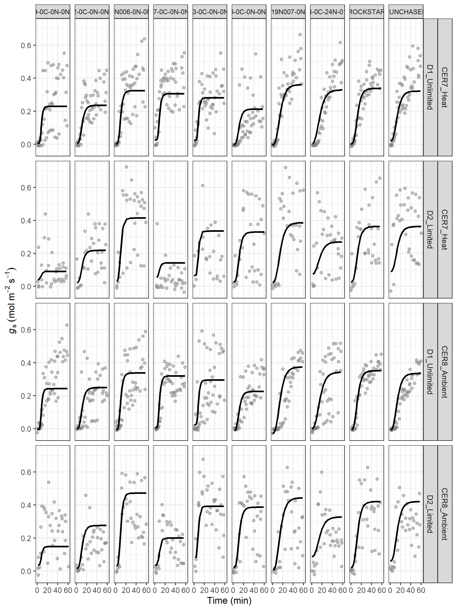
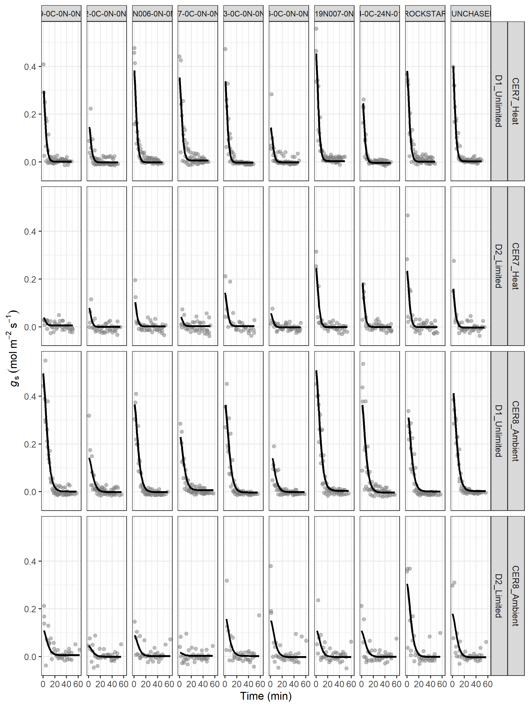
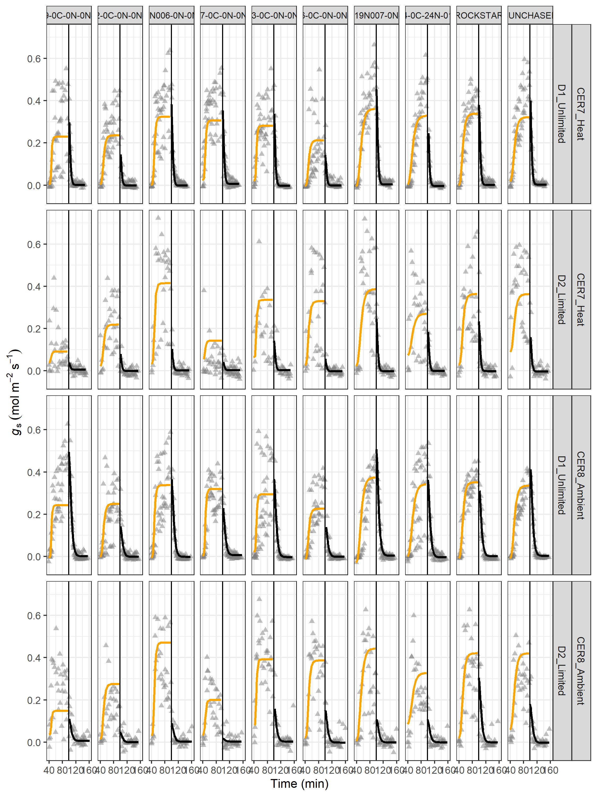
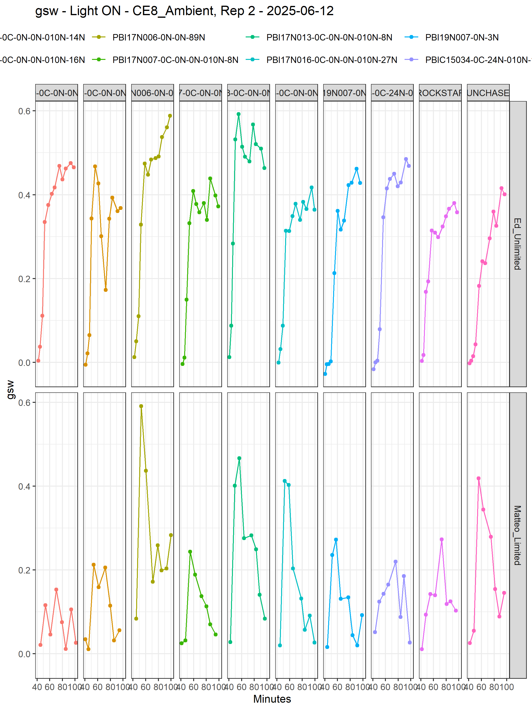

---
output:
  pdf_document: default
  html_document: default
---
# EXP 801 DS Wheat Heat Drought
## --- Ed Chaplin (USyd), *Apr--June 2025* ---
### Li-600 STOMATAL CONDUCTANCE MODEL PLOTTING PARAMETERS

* Plotting the resulting parameter estimates
* v2: updating genotype names

### Load the libraries


``` r
library(knitr)
#knitr::spin("Exp801.porometer.stomatalCondParamPlotting.v2.r")
library(ggplot2)
opts_chunk$set("tidy" = FALSE, "dev" = "png", "dpi" = 300, 
               "fig.width" = 7.5, "fig.height" = 10, "comment"=NA, fig.path = "figures/")
library(dae)
library(dplyr)
library(brms) ##package used to fit bayesian regression model using Stan
library(tidyr)
library(emmeans)
library(tidybayes)
library(pracma)
library(patchwork)
```

### Set up constants and files


``` r
options(width=90)
load("../data/stomatalCondParamEstimation_porometer_i.v1.Rdata")
load("../data/stomatalCondParamEstimation_porometer_d.v1.Rdata")
saveFile <- "../data/stomatalCondParamPlotting_porometer.v2.Rdata"
```

### Import new genotype labels


``` r
geno.labels <- read.csv("../data/NewGenotypeLabels.csv")
geno.labels <- geno.labels %>% rename(Line = Genotype)
```

### Bring together parameters from across different analyses


``` r
head(li600.i.param)
```

```
  Room_Temperature Device_Watering                        Line     g0_emmean
1        CER7_Heat    D1_Unlimited PBI16C009-0C-0N-0N-010N-14N  5.845269e-03
2     CER8_Ambient    D1_Unlimited PBI16C009-0C-0N-0N-010N-14N -4.207326e-03
3        CER7_Heat      D2_Limited PBI16C009-0C-0N-0N-010N-14N  4.117321e-02
4     CER8_Ambient      D2_Limited PBI16C009-0C-0N-0N-010N-14N  3.606240e-02
5        CER7_Heat    D1_Unlimited PBI17N002-0C-0N-0N-010N-16N  5.147822e-03
6     CER8_Ambient    D1_Unlimited PBI17N002-0C-0N-0N-010N-16N  4.373239e-05
   g0_lower.HPD g0_upper.HPD               g0_tabquant  g1_emmean g1_lower.HPD
1 -0.0234909968   0.03398052  '0.006\n[-0.023, 0.034]' 0.23069664   0.12439640
2 -0.0417348843   0.03364476 '-0.004\n[-0.042, 0.034]' 0.24178339   0.13190921
3  0.0005255663   0.07808176   '0.041\n[0.001, 0.078]' 0.09041874  -0.02305576
4 -0.0113863099   0.08239123  '0.036\n[-0.011, 0.082]' 0.14406481   0.02381930
5 -0.0339118736   0.04363406  '0.005\n[-0.034, 0.044]' 0.23736939   0.11936471
6 -0.0480977734   0.05128947      '0\n[-0.048, 0.051]' 0.24791451   0.13054914
  g1_upper.HPD             g1_tabquant k_emmean k_lower.HPD k_upper.HPD
1    0.3290268 '0.231\n[0.124, 0.329]' 2.018804    1.400275    2.670959
2    0.3531951 '0.242\n[0.132, 0.353]' 2.018804    1.400275    2.670959
3    0.2034583 '0.09\n[-0.023, 0.203]' 2.018804    1.400275    2.670959
4    0.2753736 '0.144\n[0.024, 0.275]' 2.018804    1.400275    2.670959
5    0.3497541  '0.237\n[0.119, 0.35]' 4.079593    2.771912    5.691556
6    0.3659392 '0.248\n[0.131, 0.366]' 4.079593    2.771912    5.691556
              k_tabquant lambda_emmean lambda_lower.HPD lambda_upper.HPD
1  '2.019\n[1.4, 2.671]'      5.482128         4.544177         6.325284
2  '2.019\n[1.4, 2.671]'      5.482128         4.544177         6.325284
3  '2.019\n[1.4, 2.671]'      5.482128         4.544177         6.325284
4  '2.019\n[1.4, 2.671]'      5.482128         4.544177         6.325284
5 '4.08\n[2.772, 5.692]'      5.482128         4.544177         6.325284
6 '4.08\n[2.772, 5.692]'      5.482128         4.544177         6.325284
          lambda_tabquant Slmax_emmean Slmax_lower.HPD Slmax_upper.HPD
1 '5.482\n[4.544, 6.325]'    0.6794290      0.32013555       1.1074882
2 '5.482\n[4.544, 6.325]'    0.7452611      0.35924306       1.2146830
3 '5.482\n[4.544, 6.325]'    0.1505521     -0.22606947       0.5404211
4 '5.482\n[4.544, 6.325]'    0.3284195     -0.07554399       0.7868139
5 '5.482\n[4.544, 6.325]'    0.3447834      0.13101305       0.5735646
6 '5.482\n[4.544, 6.325]'    0.3690321      0.15469209       0.6236939
            Slmax_tabquant
1   '0.679\n[0.32, 1.107]'
2  '0.745\n[0.359, 1.215]'
3  '0.151\n[-0.226, 0.54]'
4 '0.328\n[-0.076, 0.787]'
5  '0.345\n[0.131, 0.574]'
6  '0.369\n[0.155, 0.624]'
```

``` r
head(li600.d.param)
```

```
  Room_Temperature Device_Watering                        Line  g0_emmean g0_lower.HPD
1        CER7_Heat    D1_Unlimited PBI16C009-0C-0N-0N-010N-14N 0.35504387   0.22319015
2     CER8_Ambient    D1_Unlimited PBI16C009-0C-0N-0N-010N-14N 0.53057635   0.38797046
3        CER7_Heat      D2_Limited PBI16C009-0C-0N-0N-010N-14N 0.04495835  -0.10248402
4     CER8_Ambient      D2_Limited PBI16C009-0C-0N-0N-010N-14N 0.12736297  -0.02320144
5        CER7_Heat    D1_Unlimited PBI17N002-0C-0N-0N-010N-16N 0.18433032   0.03222394
6     CER8_Ambient    D1_Unlimited PBI17N002-0C-0N-0N-010N-16N 0.15995677   0.00704205
  g0_upper.HPD              g0_tabquant     g1_emmean g1_lower.HPD g1_upper.HPD
1    0.4875488  '0.355\n[0.223, 0.488]'  0.0006697599 -0.009754446  0.010568313
2    0.6692195  '0.531\n[0.388, 0.669]'  0.0006697599 -0.009754446  0.010568313
3    0.1874464 '0.045\n[-0.102, 0.187]'  0.0055893306 -0.005114681  0.016378624
4    0.2714393 '0.127\n[-0.023, 0.271]'  0.0055893306 -0.005114681  0.016378624
5    0.3429379  '0.184\n[0.032, 0.343]' -0.0017522679 -0.012852750  0.008808669
6    0.3135489   '0.16\n[0.007, 0.314]' -0.0017522679 -0.012852750  0.008808669
                g1_tabquant k_emmean k_lower.HPD k_upper.HPD              k_tabquant
1   '0.001\n[-0.01, 0.011]' 2.615539    2.538767    2.695345 '2.616\n[2.539, 2.695]'
2   '0.001\n[-0.01, 0.011]' 4.587102    4.476275    4.693512 '4.587\n[4.476, 4.694]'
3  '0.006\n[-0.005, 0.016]' 2.615539    2.538767    2.695345 '2.616\n[2.539, 2.695]'
4  '0.006\n[-0.005, 0.016]' 4.587102    4.476275    4.693512 '4.587\n[4.476, 4.694]'
5 '-0.002\n[-0.013, 0.009]' 2.615539    2.538767    2.695345 '2.616\n[2.539, 2.695]'
6 '-0.002\n[-0.013, 0.009]' 4.587102    4.476275    4.693512 '4.587\n[4.476, 4.694]'
  lambda_emmean lambda_lower.HPD lambda_upper.HPD Slmax_emmean Slmax_lower.HPD
1    0.01763447     3.016218e-08       0.07411054  -0.83072925      -1.1444408
2    0.01763447     3.016218e-08       0.07411054  -0.70820224      -0.8977364
3    0.04680341     1.824633e-03       0.13114073  -0.09193003      -0.4364561
4    0.04680341     1.824633e-03       0.13114073  -0.16319288      -0.3587307
5    0.01763447     3.016218e-08       0.07411054  -0.43647790      -0.8020240
6    0.01763447     3.016218e-08       0.07411054  -0.21600726      -0.4255437
  Slmax_upper.HPD             Slmax_tabquant
1     -0.51642760 '-0.831\n[-1.144, -0.516]'
2     -0.51697670 '-0.708\n[-0.898, -0.517]'
3      0.24704882  '-0.092\n[-0.436, 0.247]'
4      0.03570141  '-0.163\n[-0.359, 0.036]'
5     -0.07051462 '-0.436\n[-0.802, -0.071]'
6     -0.01492542 '-0.216\n[-0.426, -0.015]'
```

``` r
##bring together the parameters into one dataframe, but first make sure names are unique
li600.i.param <- li600.i.param %>% rename_with(~paste0("i_", .x),
                                         -all_of(c("Room_Temperature",
                                                   "Device_Watering",
                                                   "Line")))
li600.d.param <- li600.d.param %>% rename_with(~paste0("d_", .x),
                                                 -all_of(c("Room_Temperature",
                                                           "Device_Watering",
                                                           "Line")))

li600.all.params <- left_join(li600.i.param,
                              li600.d.param)
```

```
Joining with `by = join_by(Room_Temperature, Device_Watering, Line)`
```

``` r
li600.all.params
```

```
   Room_Temperature Device_Watering                        Line   i_g0_emmean
1         CER7_Heat    D1_Unlimited PBI16C009-0C-0N-0N-010N-14N  5.845269e-03
2      CER8_Ambient    D1_Unlimited PBI16C009-0C-0N-0N-010N-14N -4.207326e-03
3         CER7_Heat      D2_Limited PBI16C009-0C-0N-0N-010N-14N  4.117321e-02
4      CER8_Ambient      D2_Limited PBI16C009-0C-0N-0N-010N-14N  3.606240e-02
5         CER7_Heat    D1_Unlimited PBI17N002-0C-0N-0N-010N-16N  5.147822e-03
6      CER8_Ambient    D1_Unlimited PBI17N002-0C-0N-0N-010N-16N  4.373239e-05
7         CER7_Heat      D2_Limited PBI17N002-0C-0N-0N-010N-16N  2.340287e-02
8      CER8_Ambient      D2_Limited PBI17N002-0C-0N-0N-010N-16N  1.657850e-02
9         CER7_Heat    D1_Unlimited         PBI17N006-0N-0N-89N  2.022159e-03
10     CER8_Ambient    D1_Unlimited         PBI17N006-0N-0N-89N -4.254068e-03
11        CER7_Heat      D2_Limited         PBI17N006-0N-0N-89N  3.065694e-02
12     CER8_Ambient      D2_Limited         PBI17N006-0N-0N-89N  3.115375e-02
13        CER7_Heat    D1_Unlimited  PBI17N007-0C-0N-0N-010N-8N  2.572967e-02
14     CER8_Ambient    D1_Unlimited  PBI17N007-0C-0N-0N-010N-8N  5.142990e-03
15        CER7_Heat      D2_Limited  PBI17N007-0C-0N-0N-010N-8N  5.508361e-02
16     CER8_Ambient      D2_Limited  PBI17N007-0C-0N-0N-010N-8N  3.484254e-02
17        CER7_Heat    D1_Unlimited  PBI17N013-0C-0N-0N-010N-8N  2.282354e-02
18     CER8_Ambient    D1_Unlimited  PBI17N013-0C-0N-0N-010N-8N  2.350839e-02
19        CER7_Heat      D2_Limited  PBI17N013-0C-0N-0N-010N-8N  6.633263e-02
20     CER8_Ambient      D2_Limited  PBI17N013-0C-0N-0N-010N-8N  8.178226e-02
21        CER7_Heat    D1_Unlimited PBI17N016-0C-0N-0N-010N-27N -2.719761e-03
22     CER8_Ambient    D1_Unlimited PBI17N016-0C-0N-0N-010N-27N -1.338192e-02
23        CER7_Heat      D2_Limited PBI17N016-0C-0N-0N-010N-27N  2.748097e-02
   i_g0_lower.HPD i_g0_upper.HPD             i_g0_tabquant i_g1_emmean i_g1_lower.HPD
1   -2.349100e-02     0.03398052  '0.006\n[-0.023, 0.034]'  0.23069664     0.12439640
2   -4.173488e-02     0.03364476 '-0.004\n[-0.042, 0.034]'  0.24178339     0.13190921
3    5.255663e-04     0.07808176   '0.041\n[0.001, 0.078]'  0.09041874    -0.02305576
4   -1.138631e-02     0.08239123  '0.036\n[-0.011, 0.082]'  0.14406481     0.02381930
5   -3.391187e-02     0.04363406  '0.005\n[-0.034, 0.044]'  0.23736939     0.11936471
6   -4.809777e-02     0.05128947      '0\n[-0.048, 0.051]'  0.24791451     0.13054914
7   -2.878915e-02     0.07661506  '0.023\n[-0.029, 0.077]'  0.21808503     0.10433045
8   -4.676033e-02     0.07926938  '0.017\n[-0.047, 0.079]'  0.27220020     0.14510005
9   -3.524251e-02     0.03970295   '0.002\n[-0.035, 0.04]'  0.32551614     0.20526026
10  -5.374443e-02     0.04439992 '-0.004\n[-0.054, 0.044]'  0.33589459     0.21953383
11  -2.460914e-02     0.08197569  '0.031\n[-0.025, 0.082]'  0.41342218     0.29735062
12  -3.193933e-02     0.09782705  '0.031\n[-0.032, 0.098]'  0.46730967     0.34032000
13  -1.239220e-02     0.06535468  '0.026\n[-0.012, 0.065]'  0.30803139     0.18881669
14  -4.439833e-02     0.05513988  '0.005\n[-0.044, 0.055]'  0.31897288     0.20449008
15  -1.595874e-06     0.10674007       '0.055\n[0, 0.107]'  0.14159239     0.02305184
16  -2.629857e-02     0.10024382    '0.035\n[-0.026, 0.1]'  0.19606630     0.07089107
17  -1.546988e-02     0.06216641  '0.023\n[-0.015, 0.062]'  0.28234604     0.16317630
18  -2.582076e-02     0.07419390  '0.024\n[-0.026, 0.074]'  0.29368799     0.17416791
19   1.130917e-02     0.12173458   '0.066\n[0.011, 0.122]'  0.33471686     0.21179236
20   1.258632e-02     0.14678616   '0.082\n[0.013, 0.147]'  0.38762588     0.26215061
21  -4.096327e-02     0.03537650 '-0.003\n[-0.041, 0.035]'  0.21424728     0.09677978
22  -6.337786e-02     0.03613112 '-0.013\n[-0.063, 0.036]'  0.22443066     0.11021841
23  -2.389767e-02     0.08019123   '0.027\n[-0.024, 0.08]'  0.32851473     0.20981584
   i_g1_upper.HPD           i_g1_tabquant i_k_emmean i_k_lower.HPD i_k_upper.HPD
1       0.3290268 '0.231\n[0.124, 0.329]'   2.018804      1.400275      2.670959
2       0.3531951 '0.242\n[0.132, 0.353]'   2.018804      1.400275      2.670959
3       0.2034583 '0.09\n[-0.023, 0.203]'   2.018804      1.400275      2.670959
4       0.2753736 '0.144\n[0.024, 0.275]'   2.018804      1.400275      2.670959
5       0.3497541  '0.237\n[0.119, 0.35]'   4.079593      2.771912      5.691556
6       0.3659392 '0.248\n[0.131, 0.366]'   4.079593      2.771912      5.691556
7       0.3442974 '0.218\n[0.104, 0.344]'   4.079593      2.771912      5.691556
8       0.4064358 '0.272\n[0.145, 0.406]'   4.079593      2.771912      5.691556
9       0.4336722 '0.326\n[0.205, 0.434]'   3.146440      2.379462      4.008405
10      0.4570781  '0.336\n[0.22, 0.457]'   3.146440      2.379462      4.008405
11      0.5331744 '0.413\n[0.297, 0.533]'   3.146440      2.379462      4.008405
12      0.6008451  '0.467\n[0.34, 0.601]'   3.146440      2.379462      4.008405
13      0.4164781 '0.308\n[0.189, 0.416]'   2.511566      1.798587      3.342049
14      0.4388659 '0.319\n[0.204, 0.439]'   2.511566      1.798587      3.342049
15      0.2601385  '0.142\n[0.023, 0.26]'   2.511566      1.798587      3.342049
16      0.3285812 '0.196\n[0.071, 0.329]'   2.511566      1.798587      3.342049
17      0.3891799 '0.282\n[0.163, 0.389]'   2.164836      1.524443      2.858363
18      0.4090314 '0.294\n[0.174, 0.409]'   2.164836      1.524443      2.858363
19      0.4571963 '0.335\n[0.212, 0.457]'   2.164836      1.524443      2.858363
20      0.5268947 '0.388\n[0.262, 0.527]'   2.164836      1.524443      2.858363
21      0.3273444 '0.214\n[0.097, 0.327]'   4.160179      3.094038      5.282430
22      0.3451855  '0.224\n[0.11, 0.345]'   4.160179      3.094038      5.282430
23      0.4467413  '0.329\n[0.21, 0.447]'   4.160179      3.094038      5.282430
              i_k_tabquant i_lambda_emmean i_lambda_lower.HPD i_lambda_upper.HPD
1    '2.019\n[1.4, 2.671]'        5.482128           4.544177           6.325284
2    '2.019\n[1.4, 2.671]'        5.482128           4.544177           6.325284
3    '2.019\n[1.4, 2.671]'        5.482128           4.544177           6.325284
4    '2.019\n[1.4, 2.671]'        5.482128           4.544177           6.325284
5   '4.08\n[2.772, 5.692]'        5.482128           4.544177           6.325284
6   '4.08\n[2.772, 5.692]'        5.482128           4.544177           6.325284
7   '4.08\n[2.772, 5.692]'        5.482128           4.544177           6.325284
8   '4.08\n[2.772, 5.692]'        5.482128           4.544177           6.325284
9  '3.146\n[2.379, 4.008]'        5.482128           4.544177           6.325284
10 '3.146\n[2.379, 4.008]'        5.482128           4.544177           6.325284
11 '3.146\n[2.379, 4.008]'        5.482128           4.544177           6.325284
12 '3.146\n[2.379, 4.008]'        5.482128           4.544177           6.325284
13 '2.512\n[1.799, 3.342]'        5.482128           4.544177           6.325284
14 '2.512\n[1.799, 3.342]'        5.482128           4.544177           6.325284
15 '2.512\n[1.799, 3.342]'        5.482128           4.544177           6.325284
16 '2.512\n[1.799, 3.342]'        5.482128           4.544177           6.325284
17 '2.165\n[1.524, 2.858]'        5.482128           4.544177           6.325284
18 '2.165\n[1.524, 2.858]'        5.482128           4.544177           6.325284
19 '2.165\n[1.524, 2.858]'        5.482128           4.544177           6.325284
20 '2.165\n[1.524, 2.858]'        5.482128           4.544177           6.325284
21  '4.16\n[3.094, 5.282]'        5.482128           4.544177           6.325284
22  '4.16\n[3.094, 5.282]'        5.482128           4.544177           6.325284
23  '4.16\n[3.094, 5.282]'        5.482128           4.544177           6.325284
         i_lambda_tabquant i_Slmax_emmean i_Slmax_lower.HPD i_Slmax_upper.HPD
1  '5.482\n[4.544, 6.325]'      0.6794290        0.32013555         1.1074882
2  '5.482\n[4.544, 6.325]'      0.7452611        0.35924306         1.2146830
3  '5.482\n[4.544, 6.325]'      0.1505521       -0.22606947         0.5404211
4  '5.482\n[4.544, 6.325]'      0.3284195       -0.07554399         0.7868139
5  '5.482\n[4.544, 6.325]'      0.3447834        0.13101305         0.5735646
6  '5.482\n[4.544, 6.325]'      0.3690321        0.15469209         0.6236939
7  '5.482\n[4.544, 6.325]'      0.2894785        0.07440144         0.5307413
8  '5.482\n[4.544, 6.325]'      0.3827931        0.14779160         0.6709269
9  '5.482\n[4.544, 6.325]'      0.6270795        0.36332950         0.9346753
10 '5.482\n[4.544, 6.325]'      0.6617134        0.38993857         0.9923271
11 '5.482\n[4.544, 6.325]'      0.7455489        0.44921291         1.0898885
12 '5.482\n[4.544, 6.325]'      0.8518269        0.50281490         1.2366796
13 '5.482\n[4.544, 6.325]'      0.6863542        0.34133341         1.0704760
14 '5.482\n[4.544, 6.325]'      0.7635721        0.40673643         1.1958894
15 '5.482\n[4.544, 6.325]'      0.2122103       -0.10707243         0.5656989
16 '5.482\n[4.544, 6.325]'      0.3937714        0.03854535         0.8049402
17 '5.482\n[4.544, 6.325]'      0.7311242        0.34291114         1.1641792
18 '5.482\n[4.544, 6.325]'      0.7623979        0.36904616         1.2409219
19 '5.482\n[4.544, 6.325]'      0.7588531        0.34439446         1.2601294
20 '5.482\n[4.544, 6.325]'      0.8711278        0.40579368         1.4361795
21 '5.482\n[4.544, 6.325]'      0.3178259        0.13194818         0.5301781
22 '5.482\n[4.544, 6.325]'      0.3496598        0.15086865         0.5708337
23 '5.482\n[4.544, 6.325]'      0.4428561        0.22741155         0.6942774
           i_Slmax_tabquant d_g0_emmean d_g0_lower.HPD d_g0_upper.HPD
1    '0.679\n[0.32, 1.107]'  0.35504387     0.22319015      0.4875488
2   '0.745\n[0.359, 1.215]'  0.53057635     0.38797046      0.6692195
3   '0.151\n[-0.226, 0.54]'  0.04495835    -0.10248402      0.1874464
4  '0.328\n[-0.076, 0.787]'  0.12736297    -0.02320144      0.2714393
5   '0.345\n[0.131, 0.574]'  0.18433032     0.03222394      0.3429379
6   '0.369\n[0.155, 0.624]'  0.15995677     0.00704205      0.3135489
7   '0.289\n[0.074, 0.531]'  0.09554651    -0.06178594      0.2463861
8   '0.383\n[0.148, 0.671]'  0.05003035    -0.10054869      0.2073912
9   '0.627\n[0.363, 0.935]'  0.41660011     0.26465989      0.5674929
10   '0.662\n[0.39, 0.992]'  0.40830001     0.25133636      0.5570386
11   '0.746\n[0.449, 1.09]'  0.13764445    -0.01348646      0.2961097
12  '0.852\n[0.503, 1.237]'  0.10136644    -0.05659547      0.2529579
13   '0.686\n[0.341, 1.07]'  0.37970102     0.22995852      0.5329856
14  '0.764\n[0.407, 1.196]'  0.26744964     0.11826886      0.4255467
15 '0.212\n[-0.107, 0.566]'  0.06696552    -0.08816048      0.2244000
16  '0.394\n[0.039, 0.805]'  0.01848235    -0.13701937      0.1689897
17  '0.731\n[0.343, 1.164]'  0.38050194     0.22451263      0.5303086
18  '0.762\n[0.369, 1.241]'  0.40035052     0.24969237      0.5535988
19   '0.759\n[0.344, 1.26]'  0.15174256    -0.01820697      0.3296940
20  '0.871\n[0.406, 1.436]'  0.19524012     0.04007620      0.3512786
21   '0.318\n[0.132, 0.53]'  0.15945749     0.00759748      0.3085600
22   '0.35\n[0.151, 0.571]'  0.19533789     0.03723506      0.3459520
23  '0.443\n[0.227, 0.694]'  0.06356841    -0.09206963      0.2213411
              d_g0_tabquant   d_g1_emmean d_g1_lower.HPD d_g1_upper.HPD
1   '0.355\n[0.223, 0.488]'  0.0006697599   -0.009754446    0.010568313
2   '0.531\n[0.388, 0.669]'  0.0006697599   -0.009754446    0.010568313
3  '0.045\n[-0.102, 0.187]'  0.0055893306   -0.005114681    0.016378624
4  '0.127\n[-0.023, 0.271]'  0.0055893306   -0.005114681    0.016378624
5   '0.184\n[0.032, 0.343]' -0.0017522679   -0.012852750    0.008808669
6    '0.16\n[0.007, 0.314]' -0.0017522679   -0.012852750    0.008808669
7  '0.096\n[-0.062, 0.246]' -0.0007683233   -0.012441540    0.010304793
8   '0.05\n[-0.101, 0.207]' -0.0007683233   -0.012441540    0.010304793
9   '0.417\n[0.265, 0.567]' -0.0019451914   -0.012753209    0.008856550
10  '0.408\n[0.251, 0.557]' -0.0019451914   -0.012753209    0.008856550
11 '0.138\n[-0.013, 0.296]'  0.0015787944   -0.009899489    0.012649374
12 '0.101\n[-0.057, 0.253]'  0.0015787944   -0.009899489    0.012649374
13    '0.38\n[0.23, 0.533]'  0.0057784145   -0.004869020    0.016836400
14  '0.267\n[0.118, 0.426]'  0.0057784145   -0.004869020    0.016836400
15 '0.067\n[-0.088, 0.224]'  0.0025015957   -0.008836021    0.013963010
16 '0.018\n[-0.137, 0.169]'  0.0025015957   -0.008836021    0.013963010
17   '0.381\n[0.225, 0.53]' -0.0033683318   -0.013904764    0.007804901
18     '0.4\n[0.25, 0.554]' -0.0033683318   -0.013904764    0.007804901
19  '0.152\n[-0.018, 0.33]'  0.0024020497   -0.009443417    0.014101201
20   '0.195\n[0.04, 0.351]'  0.0024020497   -0.009443417    0.014101201
21  '0.159\n[0.008, 0.309]' -0.0018105312   -0.012611888    0.009151115
22  '0.195\n[0.037, 0.346]' -0.0018105312   -0.012611888    0.009151115
23 '0.064\n[-0.092, 0.221]' -0.0022612157   -0.013994911    0.008976878
               d_g1_tabquant d_k_emmean d_k_lower.HPD d_k_upper.HPD
1    '0.001\n[-0.01, 0.011]'   2.615539      2.538767      2.695345
2    '0.001\n[-0.01, 0.011]'   4.587102      4.476275      4.693512
3   '0.006\n[-0.005, 0.016]'   2.615539      2.538767      2.695345
4   '0.006\n[-0.005, 0.016]'   4.587102      4.476275      4.693512
5  '-0.002\n[-0.013, 0.009]'   2.615539      2.538767      2.695345
6  '-0.002\n[-0.013, 0.009]'   4.587102      4.476275      4.693512
7   '-0.001\n[-0.012, 0.01]'   2.615539      2.538767      2.695345
8   '-0.001\n[-0.012, 0.01]'   4.587102      4.476275      4.693512
9  '-0.002\n[-0.013, 0.009]'   2.615539      2.538767      2.695345
10 '-0.002\n[-0.013, 0.009]'   4.587102      4.476275      4.693512
11   '0.002\n[-0.01, 0.013]'   2.615539      2.538767      2.695345
12   '0.002\n[-0.01, 0.013]'   4.587102      4.476275      4.693512
13  '0.006\n[-0.005, 0.017]'   2.615539      2.538767      2.695345
14  '0.006\n[-0.005, 0.017]'   4.587102      4.476275      4.693512
15  '0.003\n[-0.009, 0.014]'   2.615539      2.538767      2.695345
16  '0.003\n[-0.009, 0.014]'   4.587102      4.476275      4.693512
17 '-0.003\n[-0.014, 0.008]'   2.615539      2.538767      2.695345
18 '-0.003\n[-0.014, 0.008]'   4.587102      4.476275      4.693512
19  '0.002\n[-0.009, 0.014]'   2.615539      2.538767      2.695345
20  '0.002\n[-0.009, 0.014]'   4.587102      4.476275      4.693512
21 '-0.002\n[-0.013, 0.009]'   2.615539      2.538767      2.695345
22 '-0.002\n[-0.013, 0.009]'   4.587102      4.476275      4.693512
23 '-0.002\n[-0.014, 0.009]'   2.615539      2.538767      2.695345
              d_k_tabquant d_lambda_emmean d_lambda_lower.HPD d_lambda_upper.HPD
1  '2.616\n[2.539, 2.695]'      0.01763447       3.016218e-08         0.07411054
2  '4.587\n[4.476, 4.694]'      0.01763447       3.016218e-08         0.07411054
3  '2.616\n[2.539, 2.695]'      0.04680341       1.824633e-03         0.13114073
4  '4.587\n[4.476, 4.694]'      0.04680341       1.824633e-03         0.13114073
5  '2.616\n[2.539, 2.695]'      0.01763447       3.016218e-08         0.07411054
6  '4.587\n[4.476, 4.694]'      0.01763447       3.016218e-08         0.07411054
7  '2.616\n[2.539, 2.695]'      0.04680341       1.824633e-03         0.13114073
8  '4.587\n[4.476, 4.694]'      0.04680341       1.824633e-03         0.13114073
9  '2.616\n[2.539, 2.695]'      0.01763447       3.016218e-08         0.07411054
10 '4.587\n[4.476, 4.694]'      0.01763447       3.016218e-08         0.07411054
11 '2.616\n[2.539, 2.695]'      0.04680341       1.824633e-03         0.13114073
12 '4.587\n[4.476, 4.694]'      0.04680341       1.824633e-03         0.13114073
13 '2.616\n[2.539, 2.695]'      0.01763447       3.016218e-08         0.07411054
14 '4.587\n[4.476, 4.694]'      0.01763447       3.016218e-08         0.07411054
15 '2.616\n[2.539, 2.695]'      0.04680341       1.824633e-03         0.13114073
16 '4.587\n[4.476, 4.694]'      0.04680341       1.824633e-03         0.13114073
17 '2.616\n[2.539, 2.695]'      0.01763447       3.016218e-08         0.07411054
18 '4.587\n[4.476, 4.694]'      0.01763447       3.016218e-08         0.07411054
19 '2.616\n[2.539, 2.695]'      0.04680341       1.824633e-03         0.13114073
20 '4.587\n[4.476, 4.694]'      0.04680341       1.824633e-03         0.13114073
21 '2.616\n[2.539, 2.695]'      0.01763447       3.016218e-08         0.07411054
22 '4.587\n[4.476, 4.694]'      0.01763447       3.016218e-08         0.07411054
23 '2.616\n[2.539, 2.695]'      0.04680341       1.824633e-03         0.13114073
   d_Slmax_emmean d_Slmax_lower.HPD d_Slmax_upper.HPD           d_Slmax_tabquant
1     -0.83072925        -1.1444408       -0.51642760 '-0.831\n[-1.144, -0.516]'
2     -0.70820224        -0.8977364       -0.51697670 '-0.708\n[-0.898, -0.517]'
3     -0.09193003        -0.4364561        0.24704882  '-0.092\n[-0.436, 0.247]'
4     -0.16319288        -0.3587307        0.03570141  '-0.163\n[-0.359, 0.036]'
5     -0.43647790        -0.8020240       -0.07051462 '-0.436\n[-0.802, -0.071]'
6     -0.21600726        -0.4255437       -0.01492542 '-0.216\n[-0.426, -0.015]'
7     -0.22631177        -0.5862761        0.14064003  '-0.226\n[-0.586, 0.141]'
8     -0.06772304        -0.2751438        0.13640023  '-0.068\n[-0.275, 0.136]'
9     -0.98050440        -1.3439437       -0.62641438 '-0.981\n[-1.344, -0.626]'
10    -0.54773826        -0.7560986       -0.34532991 '-0.548\n[-0.756, -0.345]'
11    -0.31913519        -0.6900884        0.04053865   '-0.319\n[-0.69, 0.041]'
12    -0.13301979        -0.3418246        0.07482503  '-0.133\n[-0.342, 0.075]'
13    -0.87722331        -1.2371635       -0.52064247 '-0.877\n[-1.237, -0.521]'
14    -0.34936268        -0.5616023       -0.14804415 '-0.349\n[-0.562, -0.148]'
15    -0.15137892        -0.5161741        0.22060557  '-0.151\n[-0.516, 0.221]'
16    -0.02144389        -0.2256498        0.18473373  '-0.021\n[-0.226, 0.185]'
17    -0.89822103        -1.2604829       -0.53904857  '-0.898\n[-1.26, -0.539]'
18    -0.53958771        -0.7432511       -0.33475711  '-0.54\n[-0.743, -0.335]'
19    -0.35066318        -0.7614849        0.05764602  '-0.351\n[-0.761, 0.058]'
20    -0.25828971        -0.4710955       -0.05263493 '-0.258\n[-0.471, -0.053]'
21    -0.37851041        -0.7338869       -0.02173523 '-0.379\n[-0.734, -0.022]'
22    -0.26356249        -0.4764488       -0.06094785 '-0.264\n[-0.476, -0.061]'
23    -0.15429361        -0.5314234        0.20622966  '-0.154\n[-0.531, 0.206]'
 [ reached 'max' / getOption("max.print") -- omitted 17 rows ]
```

``` r
##add new Genotype.ID
li600.all.params <- left_join(li600.all.params, geno.labels)
```

```
Joining with `by = join_by(Line)`
```

### Put together plots of each parameter separately to begin with and then we'll stitch them together


``` r
##increasing params
param.i <- li600.all.params %>% select(Room_Temperature, Device_Watering, Line, 
                                       Genotype.ID, grep("i_", names(.))) %>%
  select(-c(grep("tabquant", names(.)))) %>% 
  pivot_longer(col = 5:ncol(.), values_to = "vals", names_to = "param") %>%
  separate(param, into = c("i", "param", "quantity"), sep="_") %>%
  pivot_wider(id_cols = c("Room_Temperature", "Device_Watering", "Line", 
                          "Genotype.ID", "i", "param"),
              names_from = "quantity", values_from = "vals")
param.i <- within(param.i,{
  paramLabel <- factor(param, levels = c("g0", "g1", "k", "lambda", "Slmax"),
                  labels = c(expression(italic(r)[0[i]]),
                             expression(italic(g)[smax]),
                             expression(italic(k)[i]),
                             expression(lambda[i]),
                             expression(italic(Sl)[max[i]])))
})

g0.g1.plot <- ggplot(param.i %>% filter(param %in% c("g0", "g1")), 
                     aes(x = Genotype.ID, y = emmean, 
                         group = Genotype.ID)) +
  geom_point(aes(colour = paramLabel), 
             stat = "identity",
             size = 2,
             position = position_dodge(width = 0.9)) +
  geom_errorbar(aes(ymin = lower.HPD, 
                    ymax = upper.HPD,
                    colour = paramLabel),
                width = 0.2,
                position = position_dodge(width = 0.9)) +
  facet_grid(Device_Watering ~ Room_Temperature) +
  theme_bw() +
  #scale_x_discrete(labels = scales::label_parse()) +
  scale_colour_discrete(labels = scales::label_parse(),
                        name = "Parameter")+
  xlab("Genotype") + 
  ylab(expression(Parameter~estimate~(mol~m^-2~s^-1))) +
  theme(legend.position = "top",
        axis.title.x = element_blank(),
        axis.text.x  = element_blank(),
        axis.ticks.x = element_blank()) +
  ggtitle("(a)")
g0.g1.plot
```



``` r
ki.plot <- ggplot(param.i %>% filter(param %in% c("k")), 
                     aes(x = Genotype.ID, y = emmean, 
                         group = Genotype.ID)) +
  geom_point(colour = "grey50", 
             stat = "identity",
             size = 2,
             position = position_dodge(width = 0.9)) +
  geom_errorbar(aes(ymin = lower.HPD, 
                    ymax = upper.HPD),
                width = 0.2,
                position = position_dodge(width = 0.9),
                colour = "grey50",) +
  facet_grid(Device_Watering ~ Room_Temperature) +
  theme_bw() +
  #scale_x_discrete(labels = scales::label_parse()) +
  scale_colour_discrete(labels = scales::label_parse(),
                        name = "Parameter")+
  xlab("Genotype") + 
  ylab(expression(italic(k)[i]~(min))) +
  theme(legend.position = "top",
        axis.title.x = element_blank(),
        axis.text.x  = element_blank(),
        axis.ticks.x = element_blank()) +
  ggtitle("(b)")
ki.plot
```



``` r
Slmax.i.plot <- ggplot(param.i %>% filter(param %in% c("Slmax")), 
                  aes(x = Genotype.ID, y = emmean, 
                      group = Genotype.ID)) +
  geom_point(colour = "grey50", 
             stat = "identity",
             size = 2,
             position = position_dodge(width = 0.9)) +
  geom_errorbar(aes(ymin = lower.HPD, 
                    ymax = upper.HPD),
                width = 0.2,
                position = position_dodge(width = 0.9),
                colour = "grey50",) +
  facet_grid(Device_Watering ~ Room_Temperature) +
  theme_bw() +
  #scale_x_discrete(labels = scales::label_parse()) +
  scale_colour_discrete(labels = scales::label_parse(),
                        name = "Parameter")+
  xlab("Genotype") + 
  ylab(expression(italic(Sl)[max[i]]~(mmol~m^-2~s^-2))) +
  theme(legend.position = "top",
        axis.text.x = element_text(angle = 90, hjust=1, vjust =0.5)) +
  ggtitle("(c)")
Slmax.i.plot
```


``` r
(g0.g1.plot) / (ki.plot) / (Slmax.i.plot)
```


``` r
ggsave("figures/li600_i_params.png", height = 16, width = 12)
ggsave("figures/li600_i_params.pdf", height = 16, width = 12)
ggsave("figures/li600_i_params.tiff", height = 16, width = 12)

##decreasing params
param.d <- li600.all.params %>% select(Room_Temperature, Device_Watering, Line,
                                       Genotype.ID, grep("d_", names(.))) %>%
  select(-c(grep("tabquant", names(.)))) %>% 
  pivot_longer(col = 5:ncol(.), values_to = "vals", names_to = "param") %>%
  separate(param, into = c("d", "param", "quantity"), sep="_") %>%
  pivot_wider(id_cols = c("Room_Temperature", "Device_Watering", "Line",
                          "Genotype.ID", "d", "param"),
              names_from = "quantity", values_from = "vals")
param.d <- within(param.d,{
  paramLabel <- factor(param, levels = c("g0", "g1", "k", "lambda", "Slmax"),
                       labels = c(expression(italic(r)[0[d]]),
                                  expression(italic(g)[smin]),
                                  expression(italic(k)[d]),
                                  expression(lambda[d]),
                                  expression(italic(Sl)[max[d]])))
})

g0.g1.d.plot <- ggplot(param.d %>% filter(param %in% c("g0", "g1")), 
                     aes(x = Genotype.ID, y = emmean, 
                         group = Genotype.ID)) +
  geom_point(aes(colour = paramLabel), 
             stat = "identity",
             size = 2,
             position = position_dodge(width = 0.9)) +
  geom_errorbar(aes(ymin = lower.HPD, 
                    ymax = upper.HPD,
                    colour = paramLabel),
                width = 0.2,
                position = position_dodge(width = 0.9)) +
  facet_grid(Device_Watering ~ Room_Temperature) +
  theme_bw() +
  #scale_x_discrete(labels = scales::label_parse()) +
  scale_colour_discrete(labels = scales::label_parse(),
                        name = "Parameter")+
  xlab("Genotype") + 
  ylab(expression(Parameter~estimate~(mol~m^-2~s^-1))) +
  theme(legend.position = "top",
        axis.title.x = element_blank(),
        axis.text.x  = element_blank(),
        axis.ticks.x = element_blank()) +
  ggtitle("(a)")
g0.g1.d.plot
```


``` r
kd.plot <- ggplot(param.d %>% filter(param %in% c("k")), 
                  aes(x = Genotype.ID, y = emmean, 
                      group = Genotype.ID)) +
  geom_point(colour = "grey50", 
             stat = "identity",
             size = 2,
             position = position_dodge(width = 0.9)) +
  geom_errorbar(aes(ymin = lower.HPD, 
                    ymax = upper.HPD),
                width = 0.2,
                position = position_dodge(width = 0.9),
                colour = "grey50",) +
  facet_grid(Device_Watering ~ Room_Temperature) +
  theme_bw() +
  #scale_x_discrete(labels = scales::label_parse()) +
  scale_colour_discrete(labels = scales::label_parse(),
                        name = "Parameter")+
  xlab("Genotype") + 
  ylab(expression(italic(k)[d]~(min))) +
  theme(legend.position = "top",
        axis.title.x = element_blank(),
        axis.text.x  = element_blank(),
        axis.ticks.x = element_blank()) +
  ggtitle("(b)")
kd.plot
```


``` r
Slmax.d.plot <- ggplot(param.d %>% filter(param %in% c("Slmax")), 
                       aes(x = Genotype.ID, y = emmean, 
                           group = Genotype.ID)) +
  geom_point(colour = "grey50", 
             stat = "identity",
             size = 2,
             position = position_dodge(width = 0.9)) +
  geom_errorbar(aes(ymin = lower.HPD, 
                    ymax = upper.HPD),
                width = 0.2,
                position = position_dodge(width = 0.9),
                colour = "grey50",) +
  facet_grid(Device_Watering ~ Room_Temperature) +
  theme_bw() +
  #scale_x_discrete(labels = scales::label_parse()) +
  scale_colour_discrete(labels = scales::label_parse(),
                        name = "Parameter")+
  xlab("Genotype") + 
  ylab(expression(italic(Sl)[max[d]]~(mmol~m^-2~s^-2))) +
  theme(legend.position = "top",
        axis.text.x = element_text(angle = 90, hjust=1, vjust =0.5)) +
  ggtitle("(c)")
Slmax.d.plot
```


``` r
(g0.g1.d.plot) / (kd.plot) / (Slmax.d.plot)
```


``` r
ggsave("figures/li600_d_params.png", height = 16, width = 12)
ggsave("figures/li600_d_params.pdf", height = 16, width = 12)
ggsave("figures/li600_d_params.tiff", height = 16, width = 12)
```

### Put together a plot of the fits from the model for each trt combo


``` r
li600.on.gs.plot <- li600.on.plot
li600.on.gs.plot$fitted.fixed <- fitted(fit_on_final, re_formula = NA)[,1]

##add new Genotype labels
li600.on.gs.plot <- left_join(li600.on.gs.plot, geno.labels)
```

```
Joining with `by = join_by(Line)`
```

``` r
ggplot(li600.on.gs.plot, aes(time.adj, gsw)) + 
  geom_point(alpha = 0.5, colour = "gray50") +
  geom_line(aes(y=fitted.fixed), colour = "black", linewidth = 1)+
  facet_grid(Room_Temperature + Device_Watering ~ Genotype.ID) +
  theme_bw() +
  xlab("Time (min)")+
  ylab(expression(italic(g)[s]~(mol~m^-2~s^-1))) #+
```



``` r
  #theme(strip.text.x = element_text(size = 10))
ggsave("figures/li600_gs_on_FittedResponse.png", width=20, height = 12)
ggsave("figures/li600_gs_on_FittedResponse.pdf", width=20, height = 12)
ggsave("figures/li600_gs_on_FittedResponse.tiff", width=20, height = 12)

li600.off.gs.plot <- li600.off.plot
li600.off.gs.plot$fitted.fixed <- fitted(fit_off_final, re_formula = NA)[,1]

##add new Genotype labels
li600.off.gs.plot <- left_join(li600.off.gs.plot, geno.labels)
```

```
Joining with `by = join_by(Line)`
```

``` r
ggplot(li600.off.gs.plot, aes(time.adj, gsw)) + 
  geom_point(alpha = 0.5, colour = "gray50") +
  geom_line(aes(y=fitted.fixed), colour = "black", linewidth = 1)+
  facet_grid(Room_Temperature + Device_Watering ~ Genotype.ID) +
  theme_bw() +
  xlab("Time (min)")+
  ylab(expression(italic(g)[s]~(mol~m^-2~s^-1))) # +
```



``` r
  #theme(strip.text.x = element_text(size = 8))
ggsave("figures/li600_gs_off_FittedResponse.png", width=20, height = 12)
ggsave("figures/li600_gs_off_FittedResponse.pdf", width=20, height = 12)
ggsave("figures/li600_gs_off_FittedResponse.tiff", width=20, height = 12)
```

### Put together a combined plot


``` r
li600.gs.all.plot <- bind_rows(li600.on.gs.plot, li600.off.gs.plot)
li600.gs.all.plot$Light <- factor(li600.gs.all.plot$Light,
                                   levels = c("On", "Off"))
li600.gs.all.plot$new.time <- li600.gs.all.plot$time.adj + 
  min(li600.gs.all.plot$time.elapsed)
li600.gs.all.plot$new.time[li600.gs.all.plot$Light == "Off"] <- 
  li600.gs.all.plot$new.time[li600.gs.all.plot$Light == "Off"] +
  (min(li600.gs.all.plot$time.elapsed[li600.gs.all.plot$Light == "Off"]) -
     min(li600.gs.all.plot$time.elapsed))

ggplot(li600.gs.all.plot, aes(new.time, gsw)) + 
  geom_point(alpha = 0.5, colour = "gray50", shape = 17) +
  geom_line(aes(y=fitted.fixed, group = Light, colour = Light), 
          linewidth = 1) +
  geom_vline(aes(xintercept = min(time.elapsed[Light == "Off"]))) +
  scale_colour_manual(values = c("orange", "black")) +
  facet_grid(Room_Temperature + Device_Watering ~ Genotype.ID) +
  theme_bw() +
  xlab("Time (min)")+
  ylab(expression(italic(g)[s]~(mol~m^-2~s^-1))) +
  theme(legend.position = "none",
        strip.text.x = element_text(size = 8))
```


``` r
ggsave("figures/li600.gs.fitted.response.png", width=20, height = 12)
ggsave("figures/li600.gs.fitted.response.pdf", width=20, height = 12)
ggsave("figures/li600.gs.fitted.response.tiff", width=20, height = 12)
```

### Save data and export


``` r
save.image(saveFile)
```

